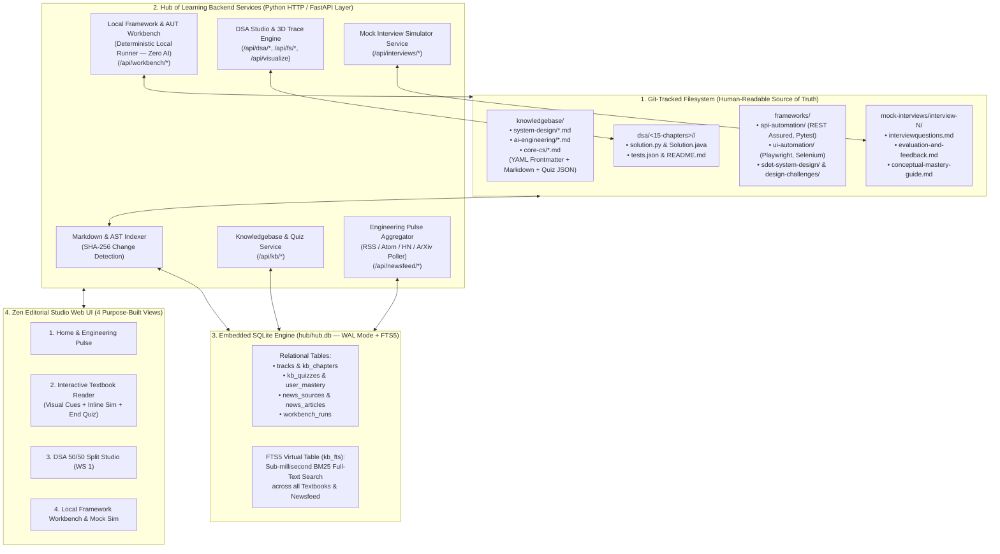

# 🏛️ The Hub of Learning — System Design & Master Architecture Plan

> **Strategic Identity Pivot**: Transforming `codingforinterviews` from a narrow interview-prep repository into **"The Hub of Learning"** — a local-first, living engineering textbook, interactive laboratory, and real-time industry pulse platform.

---

## 1. Resolving the Core Architectural Dilemma: UI First vs. Knowledgebase/Backend First?

### Verdict: **Domain Schema, Knowledgebase Structure & Backend Services First ("Content-First Architecture")**

In system design for multi-modal learning platforms (such as *Distill.pub*, *ByteByteGo*, *O'Reilly Atlas*, and *Exercism*), building UI screens before locking the **Content Schema & Execution Archetypes** leads to brittle, hardcoded pages.

Why? Because **"The Hub of Learning"** comprises **four fundamentally different learning modalities** that cannot be forced into a single LeetCode-style code box:

| Archetype | Tracks Included | Primary Learning Medium | Execution & Verification Engine | AI Dependency |
| :--- | :--- | :--- | :--- | :--- |
| **1. Dynamic Interactive Textbook (The Crown Jewel)** | • **System Design** • **AI Engineering** • **Core CS Internals** | Long-form interactive textbook chapters with mental models, visual cues, inline simulators, production blueprints, and **Live Tech Newsfeed** cross-links. | **End-of-Chapter Mastery Gate**: Interactive multi-part conceptual quizzes + runnable architecture lab (`./run.sh test <lab>`). | **Zero required at runtime** (optional AI enrichment for newsfeed summaries). |
| **2. In-Browser Algorithmic Studio** | • **DSA (15 Chapters, 128 Problems)** | Concise problem prompt + 4-Tier Socratic Hints + 3D Tactile Visualizer (`WS 1`). | In-browser Python & Java editor synced atomically to `dsa/<chapter>/<slug>/` + per-case `tests.json` runner. | **Zero required.** |
| **3. Local IDE Engineering Workbench** | • **SDET & Automation Frameworks** (`Playwright`, `REST Assured`, `Pytest`, `Selenium`, `AeroCart` AUT) | Architectural specs, multi-file repository blueprints, and concurrency invariants—coded inside your **local IDE** (VS Code / Antigravity / IntelliJ). | **100% Deterministic Local Verification**: Hub controls the local `AeroCart` AUT & executes local test runners (`pytest`, `mvn`, `./run.sh`), reporting pass/fail & 32-worker isolation metrics. | **Strictly Zero AI** (100% deterministic local verification). |
| **4. Interactive Mock Interview Simulator** | • **Mock Interviews** (`mock-interviews/interview-N/`) | Multi-part Staff/Senior architectural scenarios with diagram sketchpads & structured response editors. | 100-Point Bar-Raiser Rubric evaluation + deep-links into the **Knowledgebase Textbook** chapters for every gap. | Hybrid (Deterministic rubric checklists + optional AI Bar-Raiser review). |

---

## 2. System Architecture Blueprint (Local-First Hybrid Storage: Markdown + SQLite FTS5)

Following local-first system design principles (*"The Filesystem is the Source of Truth; SQLite is the Disposable High-Speed Index"*):

---

## 3. Deep Dive: The Dynamic Knowledgebase & Engineering Pulse Newsfeed

### 3.1 Anatomy of a "Hub of Learning" Textbook Chapter
Inspired by *Designing Data-Intensive Applications (DDIA)*, *Distill.pub*, *Bartosz Ciechanowski*, and *ByteByteGo*, every chapter in `knowledgebase/<track>/<chapter-slug>.md` is authored in clean Markdown with structured YAML frontmatter and rendered into a rich interactive textbook experience:

1. **Part I — First-Principles Mental Model & Visual Cue**:
   - Explains *why* the technology exists using a physical/tactile analogy (e.g., Restaurant Kitchen Tickets for Distributed Tenant Isolation; 26-Pan Balance Scale for Anagrams; Highway Ramp Metering for Token Bucket Rate Limiting).
2. **Part II — Internal Engine Mechanics & Interactive Walkthrough**:
   - Step-by-step protocol/kernel breakdown with embedded **Mermaid Sequence/Architecture Diagrams** AND an inline **Interactive Simulation Widget** (powered by `visualizer_engine.py`, e.g. stepping through TLS 1.3 vs 1.2 handshakes, GC Sawtooth vs RSS memory leaks, Consistent Hashing ring `vnode` failures, or RAG Triad claim entailment).
3. **Part III — Production Implementation Blueprints & War Stories**:
   - Side-by-side **Java 17** and **Python 3** production-grade patterns plus a **"What Breaks in Production (Staff Gotchas)"** callout box.
4. **Part IV — End-of-Chapter Mastery Gate (Quizzes + Hands-On Practice)**:
   - **Conceptual Verification Quiz**: 3–5 interactive scenario questions with instant per-option explanations.
   - **Executable Practice Lab**: 1-click button to run or open the paired dual-language lab (`core-cs/`, `system-design/`, `ai-engineering/`).

### 3.2 The "Engineering Pulse" Newsfeed Architecture
To keep the Knowledgebase perpetually fresh with how AI and software engineering are shifting:
- **Ingestion Layer (`hub/newsfeed_engine.py`)**:
  - Polls curated, high-signal engineering RSS/Atom/JSON feeds using conditional HTTP headers (`ETag`, `If-Modified-Since` $\to$ `304 Not Modified`) with a strict 5-second timeout and circuit-breaker backoff:
    - *AI & LLM Engineering*: Simon Willison's Weblog, Anthropic Engineering, OpenAI Research, Chip Huyen, LangChain/LlamaIndex Engineering.
    - *Distributed Systems & Cloud*: Netflix TechBlog, Uber Engineering, Cloudflare Blog, Meta Engineering, AWS Architecture Blog, Martin Fowler.
    - *Core CS, Browsers & Testing*: Chromium Blog, Playwright Release Notes, Julia Evans, Brandur Leach (Postgres/WAL).
- **Offline-First Resilience**:
  - Ships with a rich, pre-seeded snapshot of landmark engineering articles in `hub/seed_newsfeed.json` and caches all fetched articles in SQLite (`news_articles`), so the newsfeed works 100% offline or behind corporate firewalls.
- **Automatic Topic Cross-Linking**:
  - Each article is tagged against our Knowledgebase taxonomy (`#rag-evals`, `#consistent-hashing`, `#backpressure-jitter`, `#playwright-cdp`, `#os-memory`, `#wal-mvcc`) so when you read a Textbook Chapter on *Consistent Hashing*, the right margin shows real-world engineering posts on how Uber/Cloudflare/Discord shard their clusters!

---

## 4. The 4-Phase Execution Roadmap

### **Phase 1: Architecture & System Design Research (Current Gate)**
- Define the 4 Track Archetypes (`Interactive Textbook`, `In-Browser DSA Studio`, `Local IDE Framework Workbench`, `Mock Interview Simulator`).
- Define the Markdown + SQLite (`WAL` + `FTS5`) hybrid data architecture and Newsfeed ingestion pipeline.
- Review and lock this blueprint with the user before writing Phase 2 database/service code.

### **Phase 2: Backend Services & Hybrid Database Layer (`hub/storage.py` & `hub/services/`)**
1. **SQLite + FTS5 Storage Engine (`hub/storage.py`)**:
   - Create `hub/hub.db` schema (`tracks`, `kb_chapters`, `kb_fts`, `kb_quiz_attempts`, `news_sources`, `news_articles`, `workbench_runs`).
   - Build the deterministic filesystem indexer that scans `knowledgebase/`, `dsa/`, `core-cs/`, `system-design/`, `ai-engineering/`, `frameworks/`, and `mock-interviews/` on startup and syncs metadata + `FTS5` full-text search.
2. **Backend Service Endpoints (`hub/server.py`)**:
   - `GET /api/tracks` — Returns all tracks grouped by archetype with live mastery & chapter counts.
   - `GET /api/kb/chapters?track=<slug>`, `GET /api/kb/chapter?slug=<slug>`, `GET /api/kb/search?q=<query>`, `POST /api/kb/quiz` — Powers the Interactive Textbook & Knowledgebase.
   - `GET /api/newsfeed?tag=<tag>`, `POST /api/newsfeed/refresh`, `POST /api/newsfeed/bookmark` — Powers the Live Engineering Pulse Newsfeed.
   - `GET /api/workbench/frameworks`, `POST /api/workbench/run` — Powers the 100% deterministic local Framework Workbench (zero AI).
   - `GET /api/interviews`, `GET /api/interviews/session?id=<id>`, `POST /api/interviews/save` — Powers the Mock Interview Simulator.
3. **Automated Backend Test Suite**:
   - Add unit & integration tests verifying SQLite `FTS5` search, Textbook parsing, Quiz grading, Newsfeed ingestion/caching, and Local Workbench execution.

### **Phase 3: Track Catalog & Purpose-Built Zen Editorial UI Views**
1. **Upgraded Home Studio (`/`)**:
   - Features the **Today's Deep Dive** hero card, the **All Tracks Catalog** (clearly badged by archetype: `📖 Interactive Textbook`, `💻 In-Browser Studio`, `🛠️ Local IDE Workbench`, `🎙️ Mock Interview Sim`), and the **Live Engineering Pulse Newsfeed** ribbon.
2. **Interactive Textbook Reader View (`/kb/:track/:chapter`)**:
   - 3-column Zen Editorial reading room: Left Chapter/Section TOC + `FTS5` Search bar; Center Textbook Reader (Mental Model, Mermaid Diagrams, Inline Interactive Visualizer, Java/Python Production Blueprints, End-of-Chapter Quiz & Lab Gate); Right Sticky Invariants + Cross-Linked Newsfeed Articles.
3. **Local Framework Workbench View (`/workbench/frameworks`)**:
   - Shows the 5 Framework Suites (`REST Assured`, `Pytest`, `Playwright Python/Java`, `Selenium`) + 5 SDET Design Challenges + local `AeroCart` AUT status + deterministic `▶ Run Local Verification` runner.
4. **Mock Interview Simulator View (`/interviews/:id`)**:
   - Interactive 5-question architectural simulator + 100-point rubric scorecard + direct links into the Knowledgebase Textbooks.

### **Phase 4: Knowledgebase Content Authoring & Newsfeed Curation**
- Author comprehensive, multi-chapter interactive textbooks in `knowledgebase/system-design/`, `knowledgebase/ai-engineering/`, and `knowledgebase/core-cs/` (incorporating and expanding all existing labs and `conceptual-mastery-guide.md` chapters with rich visual diagrams, inline simulators, and end-of-chapter quizzes).
