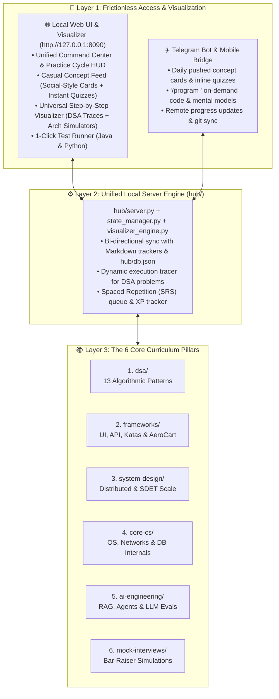

# 🏛️ Antigravity Learning Hub: Architectural Evaluation & Master Roadmap

**Last Updated:** `2026-11-05`  
**Target Objective:** Transform `codingforinterviews` from a CLI-only code repository into a frictionless, visual, multi-pillar learning platform and mobile micro-learning engine capable of taking a candidate to Staff/Lead SDET & Systems Architect mastery.

---

## 📊 1. Baseline Architecture Evaluation (605 / 1000)

| # | Evaluation Dimension | Baseline Score | Strengths | Key Gaps Addressed by This Roadmap |
| :-: | :--- | :---: | :--- | :--- |
| **1** | **Ease of Following** *(Workflow & Clarity)* | **155 / 250** | • Structured folders (`dsa/`, `frameworks/`, `mock-interviews/`). • Unified `./run.sh` and 4-stage `PRACTICE_CYCLE.md`. | • **Markdown Sprawl:** Progress is split across 4 separate `.md` files. • **High Cognitive Load:** Requires memorizing CLI commands rather than using a single visual dashboard. |
| **2** | **Accessibility** *(Casual Daily Habit)* | **95 / 250** | • Zero external cloud dependencies; runs locally in `<1s`. | • **100% Heavy IDE Mode:** Cannot be browsed casually like a social feed when tired or away from the terminal. • **High Activation Energy:** Opening IDE + terminal creates friction on busy days. |
| **3** | **Skill Improvement** *(Growth Engine)* | **195 / 250** | • Dual-language rule (Java 17 + Python 3). • AeroCart AUT (`apps/aerocart/`) + Concurrency Kata. • 100-point `/interviewer` rubric. | • **No Visual Execution Traces:** Static text explanations are slower to internalize than step-by-step interactive animations. • **No Spaced Repetition (SRS):** Solved problems are not automatically scheduled for review quizzes. |
| **4** | **Knowledge Depth** *(Curriculum Breadth)* | **160 / 250** | • Staff-level guides for Playwright CDP, Kafka/CDC, OpenTelemetry, RAG Triad, and DORA. | • **Missing Core CS Pillars:** Lacks dedicated modules for **Operating Systems** (memory leaks, daemons, file descriptors, USB/kernel hooks) and **Computer Networks** (TCP/IP, TLS, HTTP/2/3, proxies). • **System Design & AI** need dedicated root pillars. |
| — | **TOTAL BASELINE** | **605 / 1000** | **Solid CLI Foundation** | **Target After Rollout: 960+ / 1000** |

---

## 🏗️ 2. Target System Architecture (3-Layer Hub)

---

## 🚀 3. Phased Implementation Plan & Rigorous Testing Gates

Each phase must be built, verified with automated tests, and validated hands-on before advancing to the next phase.

### Phase 1: Local Server, State Engine & Interactive Web Visualizer (`hub/`) — **[ACTIVE]**
1. **`hub/state_manager.py`**:
   - Bi-directional state reader/writer syncing `dsa/MASTER_SHEET.md`, `PRACTICE_CYCLE.md`, `frameworks/MASTER_FRAMEWORKS.md`, `mock-interviews/README.md`, and `hub/db.json` (streaks, XP, completed concept cards, quiz history, SRS queue).
2. **`hub/visualizer_engine.py`**:
   - Generates deterministic, step-by-step execution traces for:
     - **DSA Problems**: `001-two-sum`, `002-valid-anagram`, `003-group-anagrams` (supports custom user inputs!).
     - **Architecture & CS Simulators**:
       1. *Playwright CDP WebSocket vs. Selenium W3C HTTP Protocol Flow*
       2. *Distributed Concurrency: Shared Seat Collision vs. Dynamic Tenant UUID Isolation*
       3. *Endpoint-to-Cloud Continuous Sync, Offline Ring Buffer & Backpressure (SASE/Netskope Architecture)*
3. **`hub/server.py` & `hub/static/index.html`**:
   - Zero-dependency threaded HTTP server on `http://127.0.0.1:8090`.
   - Interactive single-page web application with 3 views:
     - **Command Center HUD**: Progress metrics, active cycle runner, 1-click Java/Python test execution (`./run.sh test <slug>`).
     - **Casual Concept Feed**: Social-media-style bite-sized learning cards with interactive multiple-choice quizzes across DSA, OS, Networks, System Design, and AI.
     - **Step-by-Step Visualizer Studio**: Playback controls (`Play`, `Pause`, `Step Forward`, `Step Back`, `Speed`, custom inputs) rendering live arrays, hash tables, frequency buckets, and distributed packet flows.
4. **Phase 1 Verification Gate (`hub/tests/test_hub_phase1.py`)**:
   - Automated test suite verifying all REST endpoints, state synchronization, custom trace generation, quiz persistence, and live test runner execution.

---

### Phase 2: Core CS (`core-cs/`), System Design (`system-design/`), and AI Engineering (`ai-engineering/`) Expansion — **[NEXT]**
1. **Scaffold `core-cs/`**:
   - `operating-systems/`: Processes vs. Threads, Virtual Memory & Page Faults, Memory/Handle Leak Profiling (macOS Instruments / Windows PerfMon), File Descriptors, Daemons, USB/Device Kernel Hooks.
   - `computer-networks/`: OSI & TCP/IP Stack, TCP 3-Way Handshake & Congestion Control, TLS 1.3 Handshake, DNS Resolution, HTTP/1.1 vs. HTTP/2 vs. HTTP/3 (QUIC), WebSockets, Forward/Reverse Proxies & SASE Inspection.
   - `databases/`: B-Trees vs. LSM Trees, WAL (Write-Ahead Logging), ACID & Isolation Levels, Connection Pool Exhaustion.
2. **Scaffold `system-design/`**:
   - Distributed primitives (Load Balancers, Consistent Hashing, Caching, Rate Limiting) + SDET Platform Design (Sharded Grids, Flaky Quarantine Engine, Endpoint-to-Cloud Sync).
3. **Scaffold `ai-engineering/`**:
   - RAG Triad Evaluation Pipeline, Vector Embeddings, Agentic Self-Healing AST Engines, Automated Log Triage.
4. **Phase 2 Verification Gate**:
   - Integrate all new modules into the Web UI Casual Feed and Visualizer Studio with runnable labs.

---

### Phase 3: Telegram Bot & Mobile Micro-Learning Bridge (`hub/telegram_bot.py`) — **[PLANNED]**
1. **Telegram Bot Worker**:
   - Daily scheduled concept card & inline quiz push.
   - On-demand commands: `/daily`, `/quiz`, `/program <topic>`, `/progress`, `/cycle`, `/note <text>`.
   - Gemini API Persona Bridge: Connects natural language Telegram messages to the repository state and `GEMINI.md` Bar-Raiser/Mentor persona.
2. **Phase 3 Verification Gate**:
   - End-to-end webhook/polling test verifying remote state updates and Markdown sync.

