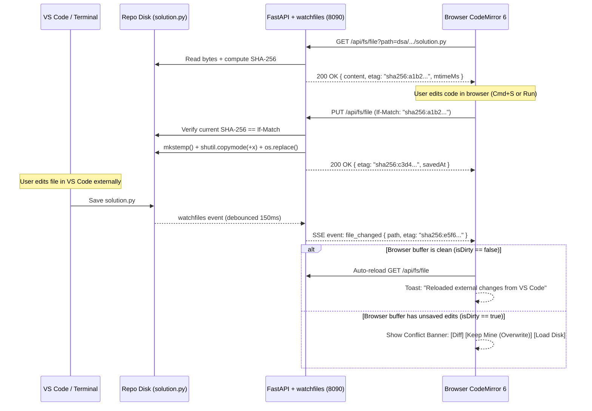
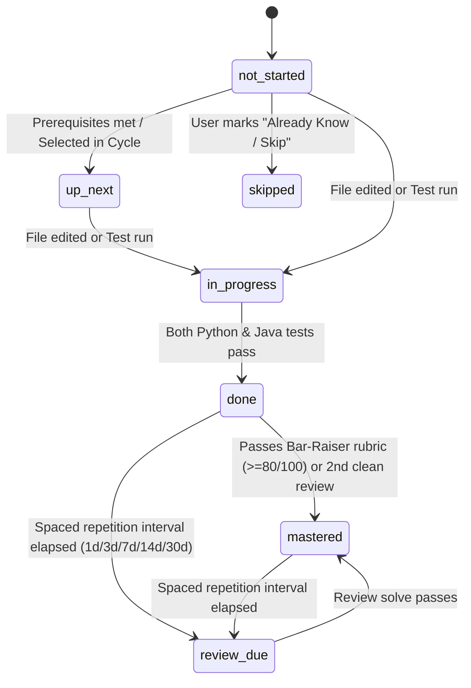

# Antigravity Learning Platform — Architecture & Design Proposal (Phase 2)

> **Status**: Phase 2 Proposal (Incorporating Approved User Decisions 1, 2, and 3)  
> **Research Inputs**: [`SYNTHESIS.md`](file:///Users/yeshwinmanjunath/development/codingforinterviews/docs/research/SYNTHESIS.md) · [`home-and-roadmaps.md`](file:///Users/yeshwinmanjunath/development/codingforinterviews/docs/research/home-and-roadmaps.md) · [`dsa-workspace.md`](file:///Users/yeshwinmanjunath/development/codingforinterviews/docs/research/dsa-workspace.md) · [`architecture.md`](file:///Users/yeshwinmanjunath/development/codingforinterviews/docs/research/architecture.md)  
> **Interactive Prototype (Phase 3)**: [`docs/prototypes/home-and-dsa-prototype.html`](file:///Users/yeshwinmanjunath/development/codingforinterviews/docs/prototypes/home-and-dsa-prototype.html) (also served at `http://127.0.0.1:8090/prototype`)

---

## 1. Executive Summary & Locked Decisions

We are transforming the local Learning Hub (`hub/`) from a single-file prototype into a **multi-track, local-first engineering mastery platform** modeled after the best mechanics of **AlgoExpert (`algoexpert.io`)**, **NeetCode**, **roadmap.sh**, **Frontend Masters**, and **VisuAlgo / Python Tutor**—connected directly to the repository's real filesystem.

### Locked Architectural Decisions
| # | Decision | Approved Direction |
|---|---|---|
| **1** | **Structured Test Cases (`tests.json`)** | Adopt a shared `tests.json` per problem for per-case pass/fail tabs, structural expected-vs-actual diffs, and one-click **"Visualize Failing Case"**. Roll out starting with the 3 completed problems (`001-two-sum`, `002-valid-anagram`, `003-group-anagrams`) and progressively for new problems, while preserving `main()` / `__main__` assertions for `./run.sh test` CLI compatibility. |
| **2** | **Drop XP Gamification** | Remove synthetic XP counters. Track progress using **7 honest engineering states** (`not_started`, `up_next`, `in_progress`, `done`, `mastered`, `skipped`, `review_due`), **spaced-repetition intervals** (`1d → 3d → 7d → 14d → 30d`), and a **forgiving weekly target** (`5/7 days` with 2 automatic streak freezes). Existing XP fields in `hub/db.json` are archived untouched under `_archived_legacy_xp`. |
| **3** | **Python 3.12 Virtual Environment (`.venv`)** | Provisioned `.venv` at the repository root using **CPython 3.12.13** (`uv venv .venv`) with `fastapi`, `uvicorn[standard]`, `watchfiles`, `httpx`, and `pytest`. `./run.sh` automatically prefers `.venv/bin/python3` and falls back to `python3` in bare environments. |
| **4** | **Localhost Security Hardening** | Removed wildcard `Access-Control-Allow-Origin: *` in [`hub/server.py`](file:///Users/yeshwinmanjunath/development/codingforinterviews/hub/server.py) and added strict `Host` + `Origin` validation (`_validate_local_request`) blocking cross-origin CSRF and DNS rebinding with `403 Forbidden` (verified in `test_13_localhost_cors_and_dns_rebinding_protection`). |

---

## 2. System Topology & Module Isolation

### 2.1 High-Level Architecture

```mermaid
flowchart TB
    subgraph Browser["Browser SPA (Vite + React 19 + TypeScript + Tailwind v4)"]
        Shell["App Shell (48px Top Bar + Cmd+K Palette + SSE Client)"]
        Home["Home Page (/)\nToday Hero · Readiness Strip · 6 Track Cards · Review Queue"]
        subgraph Tracks["Independent Lazy-Loaded Track Plugins (web/src/tracks/*)"]
            DSA["DSA Track (/tracks/dsa)\n13-Pattern DAG + Dual-Lang Table + AlgoExpert 2x2 Workspace"]
            FW["Frameworks & SDET (/tracks/frameworks)"]
            SD["System Design (/tracks/system-design)"]
            CS["Core CS (/tracks/core-cs)"]
            AI["AI Engineering (/tracks/ai-engineering)"]
            MI["Mock Interviews (/tracks/mock-interviews)"]
        end
        Shell --> Home
        Shell --> Tracks
    end

    subgraph Backend["Local FastAPI Backend (hub/app.py on 127.0.0.1:8090)"]
        API_FS["/api/fs/file (GET / PUT)\nSHA-256 ETag + If-Match + Atomic Write (+x preserved)"]
        API_SSE["/api/events (SSE)\nwatchfiles 150ms debounced watcher"]
        API_RUN["/api/run (POST)\nJava 17 + Python 3.12 Runner + tests.json Harness"]
        API_VIZ["/api/visualize (POST)\nDeterministic Step-by-Step Trace Engine"]
        API_TRK["/api/tracks & /api/progress\nBi-directional Markdown + JSON State Sync"]
    end

    subgraph Repo["Repository Filesystem (Single Source of Truth)"]
        DSA_Files["dsa/<pattern>/<slug>/\nREADME.md · solution.py · Solution.java · tests.json"]
        MD_Files["dsa/MASTER_SHEET.md · PRACTICE_CYCLE.md"]
        DB_File["hub/db.json (Progress, Review Queue, Layout Prefs)"]
    end

    DSA <-->|"GET / PUT /api/fs/file\n(If-Match: sha256)"| API_FS
    Shell <-- "SSE file_changed / progress_updated" --- API_SSE
    DSA -->|"POST /api/run"| API_RUN
    DSA -->|"POST /api/visualize"| API_VIZ
    Home <-->|"GET /api/tracks"| API_TRK

    API_FS <--> DSA_Files
    API_SSE <-- "OS File Events" --- DSA_Files
    API_RUN --> DSA_Files
    API_TRK <--> MD_Files
    API_TRK <--> DB_File
```

### 2.2 Track Independence Contract ("No Common Page UI Lock-In")

To guarantee that each track can evolve its own radically different learning interface (e.g., an AlgoExpert 4-quadrant coding IDE for **DSA**, an architecture simulator & fault-injection canvas for **System Design**, a timed rubric split-screen for **Mock Interviews**):

1. **Minimal App Shell**: The shared shell (`web/src/shell/`) owns **only**:
   - A `48px` top navigation bar (`Home`, `Tracks ▾`, `Cmd+K` search trigger, file-watcher connection dot, theme toggle).
   - Shared design tokens (colors, typography, spacing) and generic primitives (`Button`, `Badge`, `SplitPane`, `CodeBlock`).
2. **Self-Contained Track Directories**:
   ```text
   web/src/
   ├── shell/                    # TopBar (48px), CommandPalette (Cmd+K), SSE Provider
   ├── pages/
   │   └── HomePage.tsx          # Cross-track Command Center
   ├── shared/                   # Generic UI primitives, API client, FileSync hook
   └── tracks/                   # Each track is an isolated mini-application
       ├── _registry.ts          # Auto-discovers web/src/tracks/*/manifest.ts via import.meta.glob
       ├── dsa/                  # Own routes, layout, stores, components (2x2 IDE, Pattern DAG)
       │   ├── manifest.ts
       │   ├── DsaTrackPage.tsx
       │   ├── DsaWorkspacePage.tsx
       │   └── components/       # PromptPane, CodeMirrorPane, VisualizerPane, TestConsolePane
       ├── frameworks/           # Built in Slice 3
       ├── system-design/        # Built in Slice 4
       ├── core-cs/              # Built in Slice 5
       ├── ai-engineering/       # Built in Slice 6
       └── mock-interviews/      # Built in Slice 7
   ```
3. **Strict Boundary Enforcement**: Track `A` (`web/src/tracks/dsa/*`) is forbidden from importing anything from Track `B` (`web/src/tracks/system-design/*`). Every track registers via a lightweight `TrackManifest` (`id`, `title`, `accentColor`, `routes: React.lazy(...)`).

---

## 3. Bidirectional Real Filesystem Sync & Conflict Safety

When you open `003-group-anagrams` in the browser and edit `solution.py` or `Solution.java`, you are editing the **exact file on disk**:
- [`dsa/01-arrays-and-hashing/003-group-anagrams/solution.py`](file:///Users/yeshwinmanjunath/development/codingforinterviews/dsa/01-arrays-and-hashing/003-group-anagrams/solution.py)
- [`dsa/01-arrays-and-hashing/003-group-anagrams/Solution.java`](file:///Users/yeshwinmanjunath/development/codingforinterviews/dsa/01-arrays-and-hashing/003-group-anagrams/Solution.java)



### Safety Guarantees
1. **Path Jail**: `resolve_safe_repo_path()` uses `Path.resolve().is_relative_to(REPO_ROOT)` and an explicit directory/extension allowlist (`dsa/`, `core-cs/`, `system-design/`, `ai-engineering/`, `frameworks/`, `mock-interviews/`). `.git`, `.env`, and `.venv` are hard-blocked.
2. **Executable Mode Preservation**: Existing `solution.py` files carry `0755` (`+x`) permissions. Atomic writes use `tempfile.mkstemp(dir=target.parent)` + `shutil.copymode(target, tmp_path)` before `os.replace()` so `git diff` never shows spurious file mode changes.
3. **Echo Suppression**: When the browser saves via `PUT /api/fs/file`, the server records the new `sha256` in a 500ms suppression table so the resulting OS file event doesn't trigger a redundant self-reload.

---

## 4. Structured Per-Problem Testing (`tests.json`)

To power LeetCode/AlgoExpert-style per-case tabs (`Case 1 ✓`, `Case 2 ✗`), expected-vs-actual structural diffs, and **"Visualize This Failing Case"**, each problem directory supports an optional `tests.json` alongside `Solution.java` and `solution.py`:

```json
{
  "problemId": "003-group-anagrams",
  "method": "groupAnagrams",
  "comparison": "unordered_nested_list",
  "visualizerId": "dsa-group-anagrams",
  "cases": [
    {
      "id": "case-1",
      "label": "Standard Anagrams",
      "input": { "strs": ["eat", "tea", "tan", "ate", "nat", "bat"] },
      "expected": [["bat"], ["nat", "tan"], ["ate", "eat", "tea"]]
    },
    {
      "id": "case-2",
      "label": "Empty String",
      "input": { "strs": [""] },
      "expected": [[""]]
    },
    {
      "id": "case-3",
      "label": "Single Character",
      "input": { "strs": ["a"] },
      "expected": [["a"]]
    }
  ]
}
```

- **Backward Compatible**: If a problem does not yet have `tests.json`, `/api/run` automatically falls back to executing `Solution.java` `main()` and `solution.py` `__main__` assertions.
- **CLI Unchanged**: `./run.sh test 003-group-anagrams` continues to run `Solution.java` and `solution.py` directly for fast terminal and GitHub Actions CI workflows.

---

## 5. Progress & Mastery Model (No XP)

### 5.1 Unified 7-State Node Lifecycle
Every problem or lab across all 6 tracks uses a transparent, deterministic state machine:



### 5.2 Forgiving Consistency & Spaced Repetition
- **Weekly Target**: Default **5 active days / week** (configurable `3–7`), with **2 automatic streak freezes** replenished weekly so a busy workday never wipes out momentum.
- **Spaced Repetition Intervals**: Completed problems enter the review queue at `1d → 3d → 7d → 14d → 30d` based on self-rated recall difficulty (`Easy`, `Good`, `Hard`, `Struggled`) after each solve.

---

## 6. Screen-by-Screen UX Architecture (Home + DSA Track)

### Screen 1: Home Page (`/`) — Cross-Track Command Center
1. **Zone 1 — "Today's Focus" Hero Card (Top Left, 65% width)**:
   - Displays the exact active item (e.g., `DSA · Arrays & Hashing · 003 Group Anagrams`), why it's up next, last saved timestamp on disk, and a primary **"Resume in Workspace →"** CTA (`1 click` to code).
2. **Zone 2 — Readiness & Weekly Consistency Widget (Top Right, 35% width)**:
   - **MAANG Readiness Breakdown**: Transparent weighted composite across the 6 pillars (`DSA 30%`, `Frameworks 20%`, `System Design 15%`, `Core CS 15%`, `AI Eng 10%`, `Mock Interviews 10%`).
   - **Weekly Target Ring**: `4 / 5 days this week` + `2/2 Streak Freezes Ready` + `Due Reviews: 2`.
3. **Zone 3 — 6 Track Roadmap Cards (2×3 Grid)**:
   - Each card represents an independent track (`DSA`, `SDET Frameworks`, `System Design`, `Core CS`, `AI Engineering`, `Mock Interviews`) with:
     - **Completion Fraction & Dual-Language Pills** (`Py 3/128 · Java 3/128`)
     - **Mini-Roadmap Segmented Progress Strip** (colored blocks showing each module/pattern's state on hover)
     - **Current Active Milestone** + **"Open Track"** and **"Jump to Next"** actions.
4. **Zone 4 — Spaced-Repetition Review Queue & Practice Cycle Stepper**:
   - Actionable list of items in `review_due` state + current 4-stage Practice Cycle status.

### Screen 2: DSA Track Page (`/tracks/dsa`)
- **View Toggle**: Switch between:
  1. **NeetCode-Style 13-Pattern Dependency DAG**: Visual prerequisite tree (`Arrays & Hashing` $\to$ `Two Pointers` / `Stack` $\to$ `Binary Search` / `Sliding Window` / `Linked List` $\to$ `Trees` $\to$ `Tries` / `Heap` / `Backtracking` $\to$ `Graphs` / `1D DP` $\to$ `2D DP` / `Intervals` / `Greedy` / `Bit Manipulation`).
  2. **AlgoExpert-Style Grouped Pattern Table**: Filterable by pattern, difficulty, language status (`Python Only`, `Java Only`, `Both Done`, `Review Due`), with direct one-click links into the workspace.

### Screen 3: DSA Problem Workspace (`/tracks/dsa/:problemSlug`)
- **AlgoExpert 4-Quadrant Resizable Grid** (`react-resizable-panels`) with **4 Layout Presets** in the header (`1. Reading`, `2. Coding`, `3. Running`, `4. Reviewing` + `Cmd+\` Zen Mode):
  - **Top-Left (`Prompt | Hints | Editorial | Notes`)**: Problem statement, constraints, complexity targets, and progressive **4-Tier Socratic Hints** (`Mental Model` $\to$ `Pattern` $\to$ `Invariant` $\to$ `Scaffolding`) that unlock one tier at a time.
  - **Bottom-Left (`Visualizer | Video Walkthrough`)**:
    - **Interactive Visualizer**: Synced with `hub/visualizer_engine.py` traces—play/pause, step scrubber, speed (`0.5x–2x`), and direct highlight of the active invariant.
    - **Narrated Walkthrough Player**: Synchronized voiceover + step-by-step visual slide/trace player (plus static local `.mp4` support when recorded).
  - **Top-Right (`CodeMirror 6 Dual-Language Editor`)**:
    - `Python (solution.py)` | `Java (Solution.java)` tabs with live relative file path (`dsa/01-arrays-and-hashing/003-group-anagrams/solution.py`), live save status badge (`Saved · sha256:8f3a`), `Cmd+S` save, `Cmd+Enter` run, and external edit conflict banner.
  - **Bottom-Right (`Per-Case Test Console & Diff Viewer`)**:
    - `Test Cases (Case 1 ✓ | Case 2 ✓ | Case 3 ✓ | + Custom)` and `Raw Output / Bar-Raiser Rubric` tabs, expected-vs-actual structural diff, and **"Visualize This Case"** button that pipes any test case directly into the Bottom-Left visualizer.

---

## 7. Vertical Slice Implementation Roadmap (Phase 4)

Once the Phase 3 prototype design is reviewed and approved:

| Slice | Scope | Key Verification Gate |
|---|---|---|
| **Slice 0: Backend Foundation** | Add `hub/app.py` (FastAPI + `watchfiles` SSE + `/api/fs/file` atomic read/write with `If-Match` ETag + `tests.json` runner + no-XP state schema) while keeping legacy endpoints passing. | `pytest hub/tests/` (100% parity + file sync + ETag conflict + path traversal tests) |
| **Slice 1: Web Shell + Home Page** | Scaffold `web/` (Vite + React + TS + Tailwind v4), build `TopBar`, `CommandPalette`, and `HomePage` wired to live `/api/tracks` and `/api/progress`. | Unit + E2E test of Home Page data binding & navigation |
| **Slice 2: DSA Track + AlgoExpert Workspace** | Build `web/src/tracks/dsa/` (13-Pattern DAG, Problem Table, 4-Quadrant Workspace with CodeMirror 6 real file sync, `tests.json` for `001`, `002`, `003`, 4-tier hints, and Visualizer/Walkthrough pane). | Edit `solution.py` in browser $\to$ verify disk update $\to$ run Java & Python tests $\to$ visualize failing case |
| **Slice 3–7: Remaining Tracks (One by One)** | Build `Frameworks`, `System Design`, `Core CS`, `AI Engineering`, and `Mock Interviews` tracks sequentially, designing and testing each before moving to the next. | Per-track test suite + full `./run.sh ci` gate |
