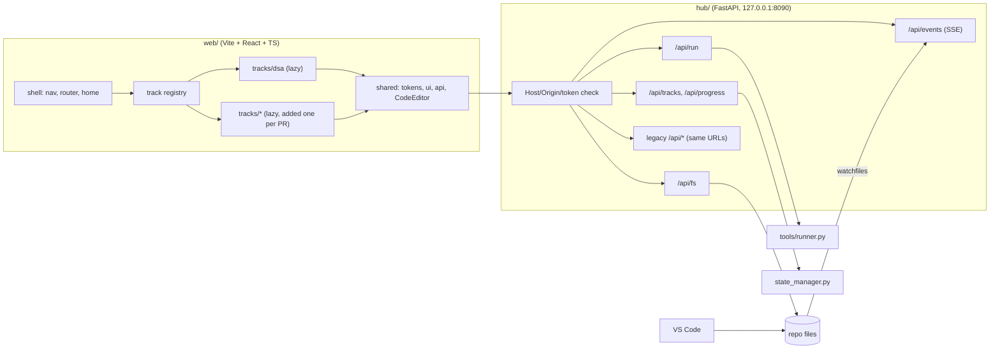

# Research Synthesis: Home + DSA (Round 1)

**Date:** 2026-11-06
**Inputs:** [home-and-roadmaps.md](home-and-roadmaps.md), [dsa-workspace.md](dsa-workspace.md), [architecture.md](architecture.md)
**Status:** Recommendation for review. Nothing here is built yet.

> [!WARNING]
> **Confidence caveat.** AlgoExpert and NeetCode are client-rendered apps that blocked direct fetching. Their exact pane positions, colours and per-category counters come from search summaries and memory, not rendered pages. Check them against the live logged-in screens (screenshots are enough) before copying a layout pixel for pixel. roadmap.sh, Duolingo, Frontend Masters, NeetCode's streak/theme code and AlgoExpert's fonts *were* verified directly.

---

## 1. The ten decisions research points to

| # | Decision | Recommendation | Main evidence |
| :-: | :--- | :--- | :--- |
| 1 | App structure | **One SPA; each track is a lazy-loaded module found automatically** (`web/src/tracks/<id>/manifest.ts`). A lint rule stops tracks from importing each other | Track independence without micro-frontend overhead; adding a track touches no other track |
| 2 | Frontend stack | **Vite + React + TypeScript**, TanStack Router + Query, **Tailwind v4 + shadcn/ui** | Best library fit (resizable panes, Excalidraw, editor wrappers); you own the component code for a premium look |
| 3 | Editor | **CodeMirror 6** (Python, Java, Vim mode, merge view) | Monaco gives no real language intelligence for Java/Python without a language server, and is several MB. Sourcegraph cut 43% of its bundle by switching |
| 4 | Backend | **FastAPI + uvicorn + watchfiles** in a Python 3.11+ venv; legacy endpoints kept at the same URLs | SSE, file watching, typed APIs and one router per track; the current stdlib server would need all of that hand-built |
| 5 | File sync | Browser saves to the real file. Content-hash ETag, `If-Match` → **412 + current content → merge view**. Atomic write that keeps file permissions. **SSE** pushes VS Code edits to the browser | Same model as VS Code for the Web and JupyterLab; nothing is ever silently overwritten |
| 6 | Home page | **Today hero (one "Continue" + reason) → readiness strip → 6 track cards with mini-roadmap strips → review queue → recent** | Duolingo (one obvious next step), Frontend Masters ("Up next" + why), AlgoExpert (product switcher), roadmap.sh (avoid one giant graph) |
| 7 | DSA track page | Pattern rail (13 folders) with **graph/list toggle**, Continue + Review strip, problem table with **Python and Java status as separate columns** | NeetCode roadmap, AlgoExpert grouped list, your dual-language rule |
| 8 | Problem workspace | AlgoExpert-style split: **left tabs** (Prompt, Hints, Scratchpad, Visualize, Solution, Video, Notes) and **right editor** (Py/Java tabs, real path, save state) above a **console** (Tests, Custom, Output, Diff). Four layout states, remembered pane sizes, focus mode | AlgoExpert + LeetCode, plus fixes for their known complaints |
| 9 | Visuals + video | **One `trace.json` per problem** (code line for Py *and* Java, state, one-sentence caption) drives the visualizer. **Videos are narrated playbacks of the same trace** (TTS + headless recording), with chapters linked to steps | VisuAlgo captions, Python Tutor line arrows; lowest effort per video for a solo creator. Manim only for ~13 pattern intros |
| 10 | Progress model | **Shared node states across all tracks:** Not started · Up next · In progress · Done · **Mastered** · Skipped (counts toward %) · Review due. **Forgiving consistency:** weekly target first, streak second, automatic freezes, no guilt copy | roadmap.sh states, Exercism completed vs mastered, Duolingo streak data and its documented downsides |

---

## 2. Home page (recommended)

```
┌──────────────────────────────────────────────────────────────────────────────┐
│ ◆ PrepHub   [Tracks ▾]        ⌘K Search…           🔥12d · 5/7 wk   ☾        │
├──────────────────────────────────────────────────────────────────────────────┤
│ ┌ CONTINUE ▸ Longest Substring Without Repeating Chars  [Sliding Window] ──┐ │
│ │ Why next: finishes Sliding Window (3/6) → unlocks Two-Pointer review      │ │
│ │ [ ▶ Resume ]     ○ 2 reviews due   ○ Cycle stage 2   ○ Min day: 1 review  │ │
│ └──────────────────────────────────────────────────────────────────────────┘ │
│  Readiness ◔ 38%     activity ▁▂▃▅▃▆▇ (12 wks)     Bar-raiser 72→81→85        │
├──────────────────────────────────────────────────────────────────────────────┤
│ ┌ DSA ─────────────┐ ┌ SDET Frameworks ─┐ ┌ System Design ───┐               │
│ │ 3/128 · Now: …   │ │ 6/8 labs         │ │ 2/2 labs         │  each card:   │
│ │ ■■▣□□□□□□□  ▲    │ │ ■■■▣□□           │ │ ■■▣□             │  % + counts,  │
│ └──────────────────┘ └──────────────────┘ └──────────────────┘  mini-roadmap │
│ ┌ Core CS ─────────┐ ┌ AI Engineering ──┐ ┌ Mock Interviews ─┐  strip, Now / │
│ │ OS · Net · DB    │ │ 2/2 labs         │ │ 1 done · 19/100  │  Next, click  │
│ └──────────────────┘ └──────────────────┘ └──────────────────┘  → track page │
├──────────────────────────────────────────────────────────────────────────────┤
│ Review queue (due)                 │ Recent milestones                       │
└──────────────────────────────────────────────────────────────────────────────┘
```

- **One primary action** above the fold. Its "why" comes from `PRACTICE_CYCLE.md` / `tools/cycle.py` plus each track's "up next".
- **No giant graph on the home page.** Graphs live on the track pages.
- **Animation only at completion** (~600 ms check + bar fill), respecting `prefers-reduced-motion`.

---

## 3. DSA track

### 3.1 Track page
```
┌──────────────┬───────────────────────────────────────────────────────────────┐
│ PATTERNS     │  ▶ CONTINUE: 3Sum (Java pending)    ⟳ REVIEW DUE: 4  [Start]  │
│ ◐ 01 Arrays  │  Overall 3/128 · Py 3 · Java 3 · Avg score —                  │
│ ◑ 02 Two Ptr │───────────────────────────────────────────────────────────────│
│ ○ 03 Sliding │  02 · TWO POINTERS     ██░░ 1/9   [Primer] [Template] [Which?] │
│ ...          │  #  Problem             Diff  Py  Java  Score Hints  Review    │
│ [Graph|List] │  1  Valid Palindrome     E    ✓   ✓    92    0     in 12d     │
└──────────────┴───────────────────────────────────────────────────────────────┘
```
"Done" = both languages pass. "Mastered" = interviewer score ≥ 80 **and** one spaced re-solve passed.

### 3.2 Problem workspace
```
┌───────────────────────────────────────────────────────────────────────────────┐
│ ← Arrays │ 003 · Group Anagrams [M] ⏱ 18:42  Py ✓ Java ● │ Run ⌘↵ │ Check ⌘⇧↵ │
├─────────────────────────────┬─────────────────────────────────────────────────┤
│ Prompt│Hints│Scratch│Visual │ [Python] [Java]   dsa/01-…/003-group-anagrams/   │
│ Solution🔒│Video🔒│Notes    │ solution.py   ✓ saved to disk                    │
│                             │  (CodeMirror 6 editor)                           │
│ [Hint 1][Hint 2][Hint 3]    ├─────────────────────────────────────────────────┤
│ [Hint 4][Reveal optimal O()]│ Tests │ Custom │ Output │ Diff                     │
└─────────────────────────────┴─────────────────────────────────────────────────┘
```

| State | Left | Editor | Console |
| :--- | :--- | :--- | :--- |
| Reading | 50% | 50% | collapsed |
| Coding | 35% | 65% | 25% (autosave ~1 s after typing stops) |
| Running | 35% | 65% | 40%, jumps to first failure + Diff |
| Reviewing | 50% (Solution / Video / Visual) | 50%, your code vs reference | collapsed |

**Learning flow:**
1. Read, then plan in the Scratchpad.
2. Code in language A, then run.
3. Use the 4-tier hints if needed (your existing `/hint` tiers). Each hint is logged.
4. Once A passes, port the solution to language B.
5. Solution, Video and Visual unlock after **both languages pass**, or after 25 min / 3 failed runs. Before that a soft gate says "Reveal anyway? (logged)".
6. Self-rate 1–4 and optionally run `/interviewer`.
7. The next review is scheduled at 1 / 3 / 7 / 14 / 30 days, shorter if you used hints or revealed the solution.

**Shortcuts that never move:**
- `⌘↵` run, `⌘⇧↵` check
- `⌘1` / `⌘2` switch Python / Java
- `⌘J` toggle the console, `⌘B` toggle the left pane, `⌘.` next hint
- `⌘K` search
- `←` / `→` and `Space` in the visualizer

---

## 4. Technical architecture



**Repo layout:**
- `web/src/{shell, shared, tracks/<id>}` for the frontend.
- `hub/{app.py, api/core, api/tracks, fs/, security.py}` for the backend. `state_manager.py`, `visualizer_engine.py`, `runner.py` and `telegram_bot.py` are reused as-is.

**Migration with no regressions:**
- The legacy `hub/server.py` and `index.html` stay untouched (all 12 suites stay green) while the new app grows alongside.
- A parity test checks that every legacy endpoint returns the same results from both servers.
- Legacy is retired only at the end, in one reviewed PR.

**CI:** still **one job**. Add Node setup, `npm ci`, lint, typecheck, unit tests and build, a pytest run for the new APIs, and a cached Chromium Playwright smoke test. The timeout goes from 5 to about 10 minutes.

---

## 5. Security issue in the current Hub

> [!CAUTION]
> `hub/server.py` sends `Access-Control-Allow-Origin: *` on every response, and `POST /api/run-test` runs code from the repo. Any website open in your browser while the Hub is running can trigger test runs or Telegram pushes. Once we add a **file write** endpoint, "write + run" from any web page becomes **remote code execution** on your laptop. Localhost is not a security boundary.
>
> **Fix:**
> 1. Remove wildcard CORS.
> 2. Allow-list the `Host` header (blocks DNS rebinding).
> 3. Check `Origin` on POST/PUT.
> 4. Require a per-launch random token header on write and run calls.
>
> Steps 1–2 are safe to apply to the legacy server today. None of the 12 suites check CORS.

---

## 6. Changes that affect existing content (need a decision)

1. **Per-case test results.** Today each problem asserts inside `main()`, which gives a single pass/fail. The workspace's case list, diff and "visualize this failing case" need **one shared `tests.json` per problem**, read by both a Python and a Java harness. This changes how every problem is authored. It can be adopted gradually: the 3 completed problems first, the rest as you solve them.
2. **XP vs mastery.** Research is clear that XP, gems and streak-only motivation drive bare-minimum behaviour for experienced learners. The recommendation is to **replace XP** with Done / Mastered / Review-due signals and a forgiving weekly target. Existing XP data would be archived, not deleted.
3. **Python 3.11 venv.** Your system Python is 3.9.6, which current FastAPI/Pydantic no longer fully support. The new backend needs a project venv (`uv venv` or Homebrew Python). CI already uses 3.11.

---

## 7. Next steps (after approval)

1. **Phase 2 proposal:** `docs/PLATFORM_ARCHITECTURE_PROPOSAL.md` with final API contracts, the `tests.json` / `trace.json` schemas and the PR slice order.
2. **Phase 3 design:** clickable HTML prototypes of **Home → DSA track → Problem workspace** (including the four layout states, the conflict banner and the soft gate), plus 2–3 visual style directions as generated mockups.
3. **Phase 4:** review and iterate, then build slice 0 (security hardening + FastAPI alongside the legacy server), slice 1 (shell + home), slice 2 (DSA workspace + file sync).

