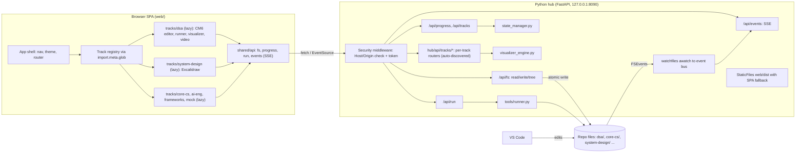

# Architecture Research: Rebuilding the local-first interview-prep platform

## 0. What's in the repo now
- `hub/server.py` (290 lines) uses only the standard library: `ThreadingMixIn` + `BaseHTTPRequestHandler` on 127.0.0.1:8090. It serves one file, `hub/static/index.html` (904 lines). **It sends `Access-Control-Allow-Origin: *` on every response, including POSTs.** It also exposes `dispatch_request()`, an in-process fake request used by the tests, and `execute_test_target()` (regex-checked slug → `python3 tools/runner.py test <slug> --lang <lang>`, 25s timeout).
- The Telegram bot starts as a daemon thread inside `run_hub_server()`.
- `hub/tests/test_hub_phase1.py` has 12 unittest suites. They are **tied to the legacy UI and server**:
  - test_05 checks that `hub/static/index.html` contains `tab-btn-feed`, `tab-btn-visualizer`, `tab-btn-dashboard`, `/api/visualize` and `/api/run-test`.
  - test_06 calls `hub_server.dispatch_request("GET","/")` and expects "Antigravity Learning Hub" in the HTML, plus 9 visualizers and 128 DSA problems.
  - CI stage 4 starts `python3 hub/server.py --port 8090` and curls `/api/health`, `/api/dashboard`, `/api/feed`, `/api/visualizers`.
- CI is a single job with `timeout-minutes: 5`, Java 17 and Python 3.11. There is no Node or `package.json` yet.
- Environment: local Python is **3.9.6** (system); CI uses 3.11. Node v24.8 is installed. Files use LF line endings. `solution.py` files are **executable** (+x), which matters for atomic writes (§C).

---

## 1. Recommended stack
| Layer | Choice |
|---|---|
| Frontend structure | **One React SPA. Each track is a lazy-loaded module, found automatically from a folder registry** (`import.meta.glob`) |
| Framework / router / data | React 19 + TypeScript + Vite; TanStack Router (or React Router data routes); TanStack Query for server state |
| Styling | Tailwind CSS v4 + shadcn/ui (Radix primitives), with CSS-variable design tokens; lucide icons |
| Code editor | **CodeMirror 6** (`@uiw/react-codemirror` or a thin wrapper of your own), `@codemirror/lang-python`, `@codemirror/lang-java`, `@replit/codemirror-vim`, `@codemirror/merge` for conflicts |
| Panes | `react-resizable-panels` (shadcn's `Resizable` wraps it) |
| Diagramming (System Design only, lazy) | Excalidraw (MIT) |
| Backend | **FastAPI + uvicorn + watchfiles**, run in a venv on Python ≥3.11 |
| Live updates | **One SSE stream per tab** (`/api/events`). WebSocket only later, if an interactive terminal is needed |
| File writes | Allow-listed paths, temp file + `os.replace`, **hash ETag with `If-Match` → 412 (or 409) plus current content**, then a merge view in the UI |

## 2. Architecture diagram


---

## A. Frontend structure

### A1. App structure
| | (a) Vite multi-page app | **(b) SPA + lazy track modules** | (c) Micro-frontends / Module Federation |
|---|---|---|---|
| Track independence | Strong: each page is its own entry | Strong if enforced: each track is its own chunk and folder, with a lint rule against cross-track imports | Strongest, deployable separately |
| Adding a track | Edit `build.rollupOptions.input` (can be globbed) and add an HTML file ([Vite MPA](https://vite.dev/guide/build#multi-page-app)) | Add `src/tracks/<x>/manifest.ts`; the registry picks it up via [`import.meta.glob`](https://vite.dev/guide/features#glob-import). No shell edits | New remote app, host config and shared-dependency negotiation |
| Shared shell / design system | Re-boots on every navigation; shared state must be rebuilt per page | One shell, instant navigation, shared query cache and theme | Shared singletons (React versions) are a known source of runtime bugs |
| Developer experience | Fine | Best: one dev server, one HMR graph | Several dev servers; opaque "shared module not available" errors |
| Bundle | Per page | Per route via code-splitting ([TanStack Router](https://tanstack.com/router/latest/docs/framework/react/guide/code-splitting), [React Router `lazy`](https://reactrouter.com/start/data/route-object#lazy)) | Extra runtime and manifests |
| Verdict | Acceptable | **Recommended** | Overkill. Micro-frontends address *organisational* scaling across many teams ([Fowler](https://martinfowler.com/articles/micro-frontends.html)); a single user gains nothing |

**How the registry works:**
- Each track exports a `TrackManifest { id, title, icon, accent, description, routes: () => import('./routes') }`.
- `shell/trackRegistry.ts` loads all `../tracks/*/manifest.ts` eagerly (they are tiny) and lazy-loads each track's `routes`.
- The home page builds its roadmap cards from the manifests plus `/api/tracks`.
- To keep tracks apart, add [eslint-plugin-boundaries](https://github.com/javierbrea/eslint-plugin-boundaries) (or `no-restricted-imports`). Rule: `tracks/*` may import `shared/*` but not `tracks/<other>`. `shared` must never import `tracks`.

### A2. Framework
| | **React** | Svelte 5 | Vue 3 | Solid |
|---|---|---|---|---|
| Libraries this project needs (editor wrapper, panes, shadcn, Excalidraw, video) | All first-class (Excalidraw and react-resizable-panels are React-native) | Fewer; Excalidraw needs a React island | Good (shadcn-vue exists) | Thin |
| Runtime size | Largest (~45–60 KB gz) | Smallest | Medium | Small |
| AI-assistant / codegen familiarity | Highest | Good | Good | Lower |
| Verdict | **Recommended**: ecosystem fit matters more than KB for a local app | Good option if the user prefers it | OK | Skip |

### A3. Styling
| | **Tailwind v4 + shadcn/ui (Radix)** | CSS Modules | Component kit (MUI/Mantine) |
|---|---|---|---|
| Premium, custom look | Excellent; you own the component source ([shadcn Vite install](https://ui.shadcn.com/docs/installation/vite), [Tailwind v4 Vite plugin](https://tailwindcss.com/docs/installation/using-vite)) | Every component is hand-built | Looks like the kit |
| Accessibility | Radix primitives ([radix-ui.com](https://www.radix-ui.com/primitives)) | Manual | Good |
| Design tokens | CSS variables in `shared/design/tokens.css` via Tailwind `@theme` | CSS variables | Theme object |
| Verdict | **Recommended**. Gives an AlgoExpert-style look with dark mode via tokens. Tracks may add CSS Modules locally for special canvases | Use locally where needed | Skip |

---

## B. Code editor

| | **CodeMirror 6** | Monaco |
|---|---|---|
| Bundle | Modular ESM, about 150–300 KB gz with basicSetup + 2 languages + vim | Multi-MB. Sourcegraph cut their JS bundle by **43%** after replacing Monaco with CM6 ([Sourcegraph blog](https://sourcegraph.com/blog/migrating-monaco-codemirror)) |
| Java/Python support | `@codemirror/lang-java` / `lang-python` (Lezer parsers: highlighting, folding, indentation) | **Monarch syntax highlighting only.** Rich language services exist only for TS/JS/JSON/CSS/HTML, so the IntelliSense advantage does not apply to Java/Python without an LSP ([monaco-editor](https://github.com/microsoft/monaco-editor)) |
| Vim | [`@replit/codemirror-vim`](https://github.com/replit/codemirror-vim), actively maintained | `monaco-vim`, less maintained |
| Theming | `EditorView.theme` / `@uiw` themes; can read CSS-variable tokens | `defineTheme` JSON |
| Vite integration | Plain imports, no workers | Needs `?worker` imports plus `MonacoEnvironment`. `@monaco-editor/react` **loads from the jsDelivr CDN by default**, so offline use needs `loader.config({ monaco })` ([monaco-react](https://github.com/suren-atoyan/monaco-react)) |
| Conflict UI | [`@codemirror/merge`](https://github.com/codemirror/merge) (side-by-side `MergeView` and `unifiedMergeView`) | `createDiffEditor` |
| Verdict | **Recommended** | Only if a "VS Code look" is a hard requirement |

Wrap the editor once in `shared/editor/CodeEditor.tsx` (language, vim toggle and theme via Compartments) so every track reuses it.

**Panes:**
| | **react-resizable-panels** | allotment |
|---|---|---|
| Notes | Keyboard-accessible, saves layout (`autoSaveId`), used by shadcn `Resizable` ([GitHub](https://github.com/bvaughn/react-resizable-panels)) | VS Code split-view engine with good snap-collapse ([GitHub](https://github.com/johnwalley/allotment)) |
| Verdict | **Recommended** (fits shadcn) | Fine alternative |

Video for DSA: a native `<video>` element, or a lazy YouTube embed (e.g., `lite-youtube-embed`). No heavy player is needed.

---

## C. File sync design

### C1. Endpoints
```
GET  /api/fs/tree?root=dsa/01-arrays-and-hashing/003-group-anagrams
     → { entries:[{path, kind, size, mtimeNs, etag}] }

GET  /api/fs/file?path=dsa/.../solution.py
     → 200 { path, content, etag, mtimeNs, size, eol:"lf"|"crlf" }   (also an ETag: "<sha256-16>" header)

PUT  /api/fs/file?path=dsa/.../solution.py
     Headers: If-Match: "<etag>"      (If-None-Match: * when creating)
     Body:    { content }
     → 200 { etag, mtimeNs }
     → 412 Precondition Failed { error:"stale", currentEtag, currentContent }   (on mismatch)
     → 403 path not allowed | 413 too large | 428 missing If-Match

GET  /api/events          (SSE; one stream per tab; supports Last-Event-ID)
     event: fs.changed   data: {path, etag, origin:"hub"|"external"}
     event: fs.deleted   data: {path}
     event: progress.changed data: {trackId}
     event: run.output / run.done  data: {runId, chunk | result}

GET  /api/tracks                 → [{id, title, total, done, nextItem}]   (home roadmap)
GET  /api/progress?track=dsa     → per-item status (from state_manager / MASTER_SHEET.md)
PATCH /api/progress/{itemId}     { status, javaDone, pyDone, score }   (wraps tools/tracker.py logic)

POST /api/run   { target:"003-group-anagrams", lang:"python"|"java"|"all" }
     → 202 { runId }   (streams via SSE)   or   200 { status, exitCode, output, durationMs }   (legacy-compatible sync mode)

Legacy, kept unchanged: /api/health, /api/dashboard, /api/feed, /api/feed/interact,
/api/visualizers, /api/visualize, /api/run-test, /api/telegram/*
```

**412 or 409?** RFC 9110 defines 412 for a failed `If-Match` ([RFC 9110 §13.1.1](https://www.rfc-editor.org/rfc/rfc9110#name-if-match), [MDN 412](https://developer.mozilla.org/en-US/docs/Web/HTTP/Reference/Status/412)). Use 409 only if the version travels in the JSON body. Either works for a private API. Recommendation: 412 with header ETags; return the current content in the body so the client can show a diff without a second request.

### C2. Path safety
Put this in one module, `hub/fs/safe_paths.py`; it is the single most important piece.
1. Accept only repo-relative POSIX paths. Reject absolute paths, `..` segments, NUL bytes and backslashes.
2. `p = (REPO_ROOT / rel).resolve()`, then require `p.is_relative_to(REPO_ROOT / root)` for a root in the **allow-list**: `dsa`, `core-cs`, `system-design`, `ai-engineering`, `frameworks`, `mock-interviews`. `resolve()` follows symlinks, so links escaping the repo fail the check ([OWASP path traversal](https://owasp.org/www-community/attacks/Path_Traversal)).
3. **Deny-list** segments and files: `.git`, `.env*`, `node_modules`, `.build`, `__pycache__`, `hub/db.json`, `.agents`.
4. Extension allow-list for writes: `.py .java .md .json .txt .excalidraw`. Size cap ~1 MB. UTF-8 only.
5. Writes may create files only inside an existing track item folder (no new top-level directories).

### C3. Atomic write (`hub/fs/atomic.py`)
1. `tempfile.mkstemp(dir=target.parent, prefix=f".{name}.")`. It must be the **same directory** so the rename is atomic.
2. Write, `flush`, `os.fsync`.
3. **`shutil.copymode(target, tmp)`**. `mkstemp` creates files 0600, and the existing `solution.py` files are +x, so skipping this silently changes permissions and shows up in git.
4. `os.replace(tmp, target)` (atomic on POSIX, [docs](https://docs.python.org/3/library/os.html#os.replace)), then fsync the directory as best-effort. Delete the temp file on failure.
5. Hold a per-path `threading.Lock` around the check (re-hash the current file, compare with If-Match) and the replace. This narrows the race with VS Code to microseconds, which is acceptable for one user.
6. Keep line endings: detect CRLF on read (CM6 normalises to `\n`) and convert back on write. The repo is LF today, so this is low risk.

### C4. ETag choice
Use a **content hash** (sha256, first 16 hex chars) as the ETag, with `(mtime_ns, size)` as a cheap pre-check cache.
- A pure mtime ETag is what VS Code uses (`etag = mtime+size`, [vscode files.ts](https://github.com/microsoft/vscode/blob/main/src/vs/platform/files/common/files.ts)). But mtime granularity, `git checkout` and formatters that rewrite identical content make a hash more robust and keep "no-op change" events quiet.
- Prior art: the Jupyter Contents API has the same GET/PUT shape with a `last_modified` check, and JupyterLab shows a "File changed on disk" prompt ([Jupyter Server REST API](https://jupyter-server.readthedocs.io/en/latest/developers/rest-api.html)).

### C5. Pushing external changes to the browser
| | **SSE** | WebSocket |
|---|---|---|
| Direction | Server → client, which is all file events and run output need | Two-way |
| Reconnect / resume | Built-in auto-reconnect and `Last-Event-ID` ([MDN](https://developer.mozilla.org/en-US/docs/Web/API/Server-sent_events/Using_server-sent_events)) | Manual |
| Through the Vite proxy | Works with the plain `/api` proxy | Needs `ws: true` |
| Gotcha | HTTP/1.1 allows ~6 connections per origin, so use **one** multiplexed stream per tab | — |
| Verdict | **Recommended** | Add later only for an xterm.js terminal / stdin |

| Watcher | **watchfiles** | watchdog | Polling (stdlib) |
|---|---|---|---|
| Notes | Rust `notify` (FSEvents on macOS); native `awatch` async iterator with built-in debounce/batching; already used by uvicorn `--reload` ([docs](https://watchfiles.helpmanual.io/)) | Thread + callback API; needs manual bridging to asyncio ([GitHub](https://github.com/gorakhargosh/watchdog)) | `os.scandir` mtime sweep every 500 ms; fine for a few hundred files, zero dependencies |
| Verdict | **Recommended**. Lower the debounce from the default ~1.6 s to ~150–300 ms. Filter to allow-listed roots and extensions. `force_polling=True` as a fallback | OK | Fallback if staying on the stdlib server |

**Avoiding echo loops and lost edits in the client:**
- The server remembers the ETags of its own writes for ~2 s and tags matching watcher events `origin:"hub"`.
- The client ignores any `fs.changed` whose ETag equals its current base ETag.
- External change while the buffer is **clean** → reload in place, keeping cursor and scroll.
- External change while the buffer is **dirty** → banner: "Changed on disk: Reload / Compare / Keep mine". *Compare* opens the `@codemirror/merge` view; *Keep mine* re-PUTs with the new ETag.
- A save that gets 412 goes through the same compare flow. **Nothing is ever silently overwritten.**
- Autosave: debounce ~1 s, plus an explicit Cmd-S. Run always saves first, so the file on disk stays the source of truth for `runner.py`.

**How other tools do it:**
- code-server / VS Code for the Web: a server process with direct disk access, OS watchers, and an mtime-ETag save-conflict dialog. This is the same model as the recommendation.
- Exercism CLI: no live sync. `download` writes files, you edit locally, `submit` uploads, and local files are the source of truth ([Exercism docs](https://exercism.org/docs/using/solving-exercises/working-locally)).
- CodeCrafters: git-push based.
- StackBlitz WebContainers: an in-memory, sandboxed virtual file system with no direct disk access ([WebContainers FS](https://webcontainers.io/guides/working-with-the-file-system)), so it is not suitable when VS Code must see the edits.
- Conclusion: a local server as the file authority + SSE + ETags is the right model.

### C6. Security — highest-priority finding
Today's `Access-Control-Allow-Origin: *` plus `/api/run-test` means any website the user visits can trigger test runs. Once a file **write** endpoint exists, write + run = **remote code execution from any web page**. Localhost is not a security boundary ([GitHub Blog: localhost dangers, CORS & DNS rebinding](https://github.blog/security/application-security/localhost-dangers-cors-and-dns-rebinding/)). Required fixes:
1. **Remove wildcard CORS.** No CORS at all is needed: same origin in prod, the Vite proxy in dev.
2. **Host header allow-list** (`127.0.0.1:<port>`, `localhost:<port>`) to block DNS rebinding. Vite does the same with [`server.allowedHosts`](https://vite.dev/config/server-options#server-allowedhosts).
3. **Origin check** on unsafe methods.
4. **Per-launch random token**: the server injects it into the served `index.html` as a `<meta>` tag, and every write/run request must send it as an `X-Hub-Token` header. A custom header forces a CORS preflight that the server rejects.
5. Bind to 127.0.0.1 only (already the case).

---

## D. Backend: keep the stdlib server or move to FastAPI?
| | Stdlib `http.server` (current) | Starlette + uvicorn | **FastAPI + uvicorn + watchfiles** |
|---|---|---|---|
| Dependencies | 0 | ~6 packages | ~12 (starlette, pydantic, pydantic-core, anyio, uvicorn, h11, click, watchfiles, …); all have wheels |
| SSE | Possible by hand (thread per connection, manual chunk writes); fragile | `StreamingResponse` / [sse-starlette](https://github.com/sysid/sse-starlette) | Native `fastapi.sse.EventSourceResponse` in recent versions ([FastAPI SSE docs](https://fastapi.tiangolo.com/tutorial/server-sent-events/); **check the minimum version**; sse-starlette is the fallback) |
| Typed APIs | None | Manual | Pydantic models → OpenAPI → generated TS types via [openapi-typescript](https://openapi-ts.dev/), which keeps frontend and backend in sync |
| Per-track routers | Hand-written if/elif dispatch (the current 290-line handler) | `Mount`/`Router` | `APIRouter` per track, auto-included |
| Static + SPA fallback | Manual | [`StaticFiles(html=True)`](https://www.starlette.io/staticfiles/) | Same. Newer FastAPI reportedly adds an `app.frontend()` helper (unverified; `StaticFiles` + catch-all works on every version) |
| Tests | `dispatch_request` hack | `TestClient` | `TestClient` (needs `httpx`) |
| Verdict | Viable minimal option: SSE by hand + polling watcher | Lean option | **Recommended**: the dependency cost is small next to SSE, watching, typed contracts and router-per-track |

Practical notes:
- Add `hub/requirements.txt` (pin versions) and use a **Python 3.11+ venv** locally (`uv venv` or brew). System Python 3.9.6 is at or past end of support for current FastAPI and Pydantic.
- Keep blocking work (runner subprocess, `state_manager` Markdown parsing) in `def` endpoints, which run in FastAPI's threadpool, or use `asyncio.create_subprocess_exec` for streaming run output.
- Add a per-problem lock around Java compilation so two concurrent runs of the same problem don't collide in `.build/`.
- Lock `db.json` read-modify-write (`state_manager.save_db`) behind a `threading.Lock`.
- Start the Telegram polling thread from the FastAPI `lifespan` hook.

**Dev vs prod:**
- **Dev:** run two processes (`uvicorn hub.app:app --port 8090 --reload` and `npm --prefix web run dev` on :5173). `vite.config.ts` sets `server: { proxy: { '/api': { target: 'http://127.0.0.1:8090' } } }` ([Vite proxy](https://vite.dev/config/server-options#server-proxy)). SSE works through the proxy. A `make dev` / `./run.sh hub dev` wrapper can start both.
- **Prod (daily use):** `npm --prefix web run build` → `web/dist/`, then `python -m hub` serves `/api/*` routes first and mounts `web/dist` at `/` with an `index.html` fallback for client routes. One port, one process, works offline.
- If `web/dist` is missing, fall back to serving the legacy `hub/static/index.html` and print "run npm build".

---

## E. Proposed repo layout
```text
web/                                  # Vite + React + TS
├── package.json  vite.config.ts  tsconfig.json  eslint.config.js
├── playwright.config.ts              # webServer: python -m hub --port 8091 (serves dist)
├── index.html                        # <title>Antigravity Learning Hub</title>
├── e2e/                              # smoke.spec.ts, dsa.spec.ts (tag @track:dsa)
└── src/
    ├── main.tsx
    ├── shell/                        # AppShell, TopNav/Sidebar, router.tsx, trackRegistry.ts
    │   └── home/                     # HomePage: roadmap cards + progress rings
    ├── shared/                       # THE thin shared layer (only this is shared)
    │   ├── design/tokens.css         # CSS vars → Tailwind @theme; light/dark
    │   ├── ui/                       # shadcn components (button, card, tabs, resizable, dialog…)
    │   ├── api/                      # client.ts (token header), fs.ts, progress.ts, run.ts,
    │   │                             # events.ts (single EventSource + subscribe), types.gen.ts
    │   └── editor/                   # CodeEditor.tsx (CM6), useFileDocument.ts (load/save/etag/
    │                                 # dirty/conflict), ConflictDialog.tsx (@codemirror/merge)
    └── tracks/
        ├── dsa/            manifest.ts routes.tsx pages/ components/{Workspace,TestPanel,
        │                   Visualizer,VideoPane} __tests__/
        ├── frameworks/     manifest.ts …
        ├── system-design/  manifest.ts … (Excalidraw lazy; scenes saved as .excalidraw via fs API)
        ├── core-cs/        …
        ├── ai-engineering/ …
        └── mock-interviews/ … (edits interviewquestions.md via fs API)
hub/
├── server.py  static/index.html      # LEGACY — untouched until Phase 4
├── app.py                            # create_app(): middleware, routers, static mount, lifespan
├── __main__.py                       # python -m hub [--port] [--dev]
├── requirements.txt                  # fastapi, uvicorn, watchfiles, httpx (tests)
├── api/
│   ├── core/  fs.py events.py progress.py run.py legacy.py (same URLs as server.py)
│   └── tracks/ __init__.py (pkgutil auto-discovery of `router`), dsa.py, system_design.py, …
├── fs/  safe_paths.py atomic.py watcher.py etag.py
├── security.py                       # Host/Origin/token middleware
├── state_manager.py visualizer_engine.py telegram_bot.py   # reused as-is (service layer)
└── tests/ test_hub_phase1.py (unchanged), test_fs_api.py, test_security.py,
           test_events.py, test_legacy_parity.py, test_track_<x>.py
tools/runner.py                       # reused; optionally add `--json` output
```

Reuse of existing modules:
- `state_manager.get_dashboard_payload()` and `get_feed_payload()` feed `/api/tracks`, `/api/progress` and the home page.
- `visualizer_engine.generate_trace()` sits behind `hub/api/tracks/dsa.py` (and the legacy `/api/visualize`).
- `execute_test_target()` moves to `hub/api/core/run.py` and is re-exported from `hub/server.py`, so test_05 still passes.

**Adding a track** means two new folders: `web/src/tracks/<x>/` and `hub/api/tracks/<x>.py`. Both are auto-discovered, and no other track is touched. Run that track's tests on their own with `vitest run src/tracks/<x>`, `playwright test --grep @track:<x>`, `pytest hub/tests/test_track_<x>.py`.

**CI: still one cheap job.** Raise the timeout from 5 to ~10 min and add:
```yaml
- uses: actions/setup-node@v4
  with: { node-version: 22, cache: npm, cache-dependency-path: web/package-lock.json }
- run: pip install -r hub/requirements.txt
- run: npm --prefix web ci && npm --prefix web run lint && npm --prefix web run typecheck && npm --prefix web test -- --run && npm --prefix web run build
- run: python3 hub/tests/test_hub_phase1.py          # unchanged 12 suites
- run: python3 -m pytest hub/tests -k "not phase1" -q  # new API/security/fs tests
- run: npx --prefix web playwright install --with-deps chromium && npm --prefix web run e2e -- --grep @smoke
```
Cache `~/.cache/ms-playwright` keyed on the Playwright version, and use the Playwright `webServer` option to boot `python -m hub` ([Playwright webServer](https://playwright.dev/docs/test-webserver), [CI guide](https://playwright.dev/docs/ci)). Keep the existing curl smoke steps until Phase 4.

---

## F. Migration path (no regressions in the 12 suites)
| Phase | Work | Effect on CI |
|---|---|---|
| 0. Harden | Remove `ACAO: *` from legacy `server.py`; add a Host check | All 12 suites stay green (none check CORS headers) |
| 1. New backend alongside | Add `hub/app.py` with `api/core/legacy.py` serving the **same URLs** by calling the same functions. Add `test_legacy_parity.py` comparing `hub.server.dispatch_request(...)` with `TestClient` output for each legacy endpoint. Add fs, events, run and security modules with tests | `server.py` and `index.html` untouched, so suites 1–12 and the curl smoke steps are unaffected |
| 2. Shell + DSA track | `web/` scaffold, home page on `/api/dashboard`, DSA workspace (editor + file sync + runner + visualizer). FastAPI serves the SPA at `/` and the legacy page at `/legacy` | Add Node build, Vitest and the Playwright smoke test |
| 3. Remaining tracks, one per PR | system-design, core-cs, ai-engineering, frameworks, mock-interviews | Only per-track tests are added |
| 4. Retire legacy | `python -m hub` becomes the default. Point the CI curl smoke test at it. **Deliberately update test_05/test_06**: assert the SPA build output contains the shell markers, keep the `execute_test_target` and injection checks, and keep "Antigravity Learning Hub" in the SPA `<title>`. `hub/server.py` becomes a shim (`run_hub_server` → uvicorn; keep `execute_test_target` and `dispatch_request` delegating to `TestClient` so imports still work) | The only intentional test edit, done in one reviewed PR |

---

## Risks and mitigations
1. **Write + run from any web page (RCE)** if CORS/Host/token protections are skipped → §C6 is mandatory before any write endpoint ships.
2. **Silent overwrites / echo loops** between VS Code and the browser → hash ETags, `If-Match` required (428 without it), self-write suppression, never auto-reload a dirty buffer.
3. **File permissions lost on atomic save** (`mkstemp` makes 0600; the repo's +x on `solution.py` disappears) → `copymode`, plus a unit test for it.
4. **Python 3.9 locally vs 3.11 in CI**; current FastAPI may not support 3.9 → standardise on a 3.11+ venv. The docs say `fastapi.sse` and `app.frontend()` are recent additions; check minimum versions or use sse-starlette / `StaticFiles` instead.
5. **Watcher noise** (git checkout, formatters, `.build/`, `__pycache__`) → path/extension filters, debounce, and hash ETags drop no-op changes.
6. **CI time** (Playwright browser install ~45–90 s) → Chromium only, cached, smoke tag, 10-min timeout.
7. **Bundle bloat** from Excalidraw (~350 KB gz) or video → lazy inside the track only. The shell stays small. Optional `rollup-plugin-visualizer` budget check.
8. **Stale `web/dist`** in prod mode → server logs a warning if `dist` is older than `src`; `./run.sh hub` can build when needed.
9. **Track coupling creeping in** → eslint-boundaries rule plus code review. `shared/` holds only the agreed thin layer (shell, tokens, fs/progress/run/events API, editor wrapper).
10. **Concurrent runs / db.json writes** → per-problem compile lock and a db lock.
11. **Over-engineering** → no Module Federation, no monorepo tooling (Nx/Turbo), no database. Markdown/JSON files stay the source of truth.
