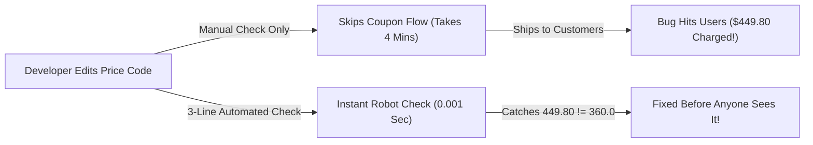

# Why Software Breaks & Your First 3-Line Automated Test

```json continuity
{
  "previously": "Welcome to Day 1! Zero prior QA, automation, or testing background needed.",
  "painPoint": "A tiny typo in our AeroCart flight app charges passengers $449.80 instead of $360—and manually clicking through Chrome after every code edit takes way too long.",
  "unlock": "Write your very first 3-line automated check using Arrange-Act-Assert, spot what makes a test 'flaky', and unlock the Staff reliability formula (p^N)."
}
```

```json walkthrough
[
  {
    "time": "0:00",
    "badge": "Slide 1 / 4 · The $90 Airline Typo",
    "caption": "Welcome to AeroCart—our flight-booking app! A traveler applies a 20% coupon (`0.20`) on a $450 NYC -> London flight. They should pay $360, right? Instead, a tired developer subtracted 0.20 from 450 and charged $449.80!",
    "code": "def calculate_ticket_price(base_price, discount):\n    # OOPS! $450 - 0.20 = $449.80 instead of $360!\n    return base_price - discount"
  },
  {
    "time": "0:22",
    "badge": "Slide 2 / 4 · Why Manual Clicking Hurts",
    "caption": "You could open Chrome, pick Flight AI-202, choose Seat 1A, and type a coupon by hand. That takes 3 minutes! When your app grows to 50 features, checking everything by hand takes 2.5 hours every single afternoon.",
    "code": "# Manual Friday Checklist:\n# [ ] Search JFK -> LHR (3 mins)\n# [ ] Try 20% coupon (3 mins)\n# [ ] Try baggage fee... (exhausting!)"
  },
  {
    "time": "0:48",
    "badge": "Slide 3 / 4 · Your First 3-Line Robot Check",
    "caption": "Instead of clicking by hand, we write 3 lines of plain code: 1) Pick an example (Arrange), 2) Call the function (Act), 3) Demand the exact right answer with `assert` (Assert). It runs in 0.001 seconds!",
    "code": "price = 450                                    # 1. Arrange\nresult = calculate_ticket_price(price, 0.20)   # 2. Act\nassert result == 360.0                         # 3. Assert!\n# Boom! Fails immediately: 449.8 != 360.0"
  },
  {
    "time": "1:12",
    "badge": "Slide 4 / 4 · Watch Out for 'Flaky' Alarms!",
    "caption": "Once you have 100 robot checks, a new villain appears: a test that randomly blinks Red even when nothing is broken! Let's step through the 4 bite-sized lessons below to master it.",
    "code": "# Deterministic test: Same code = Same Pass/Fail 100% of the time\n# Flaky test: Passes Saturday, fails Monday with ZERO code edits!"
  }
]
```

```json pretraining
[
  {
    "term": "Software Bug (Defect)",
    "formula": "Actual != Expected",
    "meaning": "Any moment your code produces a different result ($449.80) than what a user or business rule expected ($360.00)."
  },
  {
    "term": "Arrange · Act · Assert (AAA)",
    "formula": "Setup -> Run -> Check",
    "meaning": "The simple 3-step recipe inside every automated test: set up inputs, run the code, and check the answer."
  },
  {
    "term": "Flaky vs. Deterministic Test",
    "formula": "Same Input => Same Verdict",
    "meaning": "A deterministic test always gives the same result; a flaky test randomly passes or fails without any code change (like a faulty smoke detector)."
  },
  {
    "term": "Suite Reliability Decay",
    "formula": "P_suite = p^N",
    "meaning": "When N tests each pass with chance p (say 0.99), the chance ALL 100 pass together drops to 0.99^100 = 36.6%!"
  }
]
```

```json poe
{
  "question": "Imagine your team has 100 automated tests, and each test is 99% reliable (it only has a tiny 1% random hiccup). When all 100 tests run together on a healthy code change, how often will the whole build turn GREEN?",
  "options": [
    "About 99% of the time — because the average test is 99% reliable",
    "About 90% of the time — maybe 1 in 10 builds will fail",
    "Only 36.6% of the time! Nearly two-thirds of builds will fail with a false alarm",
    "0% of the time — every build will fail"
  ],
  "answerIndex": 2,
  "explanation": "For the whole build to pass Green, Test 1 AND Test 2 AND ... Test 100 must ALL pass on the same run: 0.99 * 0.99 * ... (100 times) = 0.99^100 = 36.6%! That means 63.4% of builds turn Red when nothing is even broken."
}
```

## 🌱 Step 1: Plain-English Story — The $90 Airline Coupon Mistake

Forget every scary buzzword you have ever heard about "Quality Engineering" or "SDET." Let's start with a real story.

Imagine it is your very first week building **AeroCart**, an online airline booking website (which actually lives right inside this project at `apps/aerocart/`!). Your team launches a summer promo: **`20% OFF` any flight from New York to London (`$450`)**.

A developer writes a tiny helper function to calculate the final ticket price, glances at the webpage, sees no crash, and goes home happy. Ten minutes later, customer support explodes: **every traveler using the `20%` coupon was charged `$449.80` instead of `$360.00`!**

Why? Because in code, `20%` is stored as `0.20`, and the developer accidentally wrote `base_price - discount` (`450 - 0.20 = 449.80`) instead of `base_price * (1 - discount)`.



**What is Software Testing, really?**
- **Manual Testing** means a human opens a browser, clicks buttons, types in `$450` and `20%`, and checks with their own eyes whether `$360.00` appears. That works fine when your app has 1 button—but when your app has 200 features, nobody has 6 hours to click every button after every small edit!
- **Automated Testing** simply means writing a tiny second piece of code whose *only job* is to feed `$450` and `0.20` into your function and yell loudly if the answer isn't `360.00`.

Let's write that exact 3-line check right now in **Step 2**!

## 🔨 Step 2: First Lines of Code — Your 3-Line Automated Check

Good news: you do **not** need Pytest, JUnit, Playwright, Selenium, or any external library to write an automated test. Every test you will ever write in your career—from a beginner script to a Staff system at Google—follows one universal 3-beat rhythm called **Arrange → Act → Assert (`AAA`)**:

1. **Arrange**: Set up your starting numbers or ingredients (`$450` ticket, `20%` discount).
2. **Act**: Call the function or button you want to test.
3. **Assert**: Check that the actual output matches what you expected!

Switch between **Python 3** and **Java 17** below to see how clean those 3 lines look:

```python
# --- AeroCart's FIXED ticket calculator ---
def calculate_ticket_price(base_price: float, discount_rate: float) -> float:
    return round(base_price * (1.0 - discount_rate), 2)


# --- YOUR VERY FIRST AUTOMATED TEST (3 LINES!) ---
ticket = 450.0                                     # 1. ARRANGE: Pick a clear example
actual_price = calculate_ticket_price(ticket, 0.20) # 2. ACT: Run the code under test
assert actual_price == 360.0                       # 3. ASSERT: Demand $360.00!

print("✓ Test passed! AeroCart charged the exact right price:", actual_price)
```

### Java 17 Equivalent

```java
public class FirstAeroCartTest {
    static double calculateTicketPrice(double basePrice, double discountRate) {
        return Math.round(basePrice * (1.0 - discountRate) * 100.0) / 100.0;
    }

    public static void main(String[] args) {
        double ticket = 450.0;                                    // 1. ARRANGE
        double actualPrice = calculateTicketPrice(ticket, 0.20);  // 2. ACT
        if (actualPrice != 360.0) {                               // 3. ASSERT
            throw new AssertionError("Expected 360.0, but got " + actualPrice);
        }
        System.out.println("✓ Test passed! Exact price: " + actualPrice);
    }
}
```

Pause and celebrate that for a second:
- It runs in **less than 1 millisecond**.
- You can run it **10,000 times a day** for free.
- If a teammate accidentally breaks `calculate_ticket_price` six months from now, `AssertionError` stops them *before* their code ever reaches real passengers!

> [!TIP]
> **Why Catching Bugs Early Matters So Much**: Fixing a typo while you still have the file open on your laptop takes **2 minutes**. Fixing that exact same typo *after* it ships to production means refunding thousands of credit cards, waking engineers up at 2 AM, and writing incident reports (**100× more painful**!). Engineers call testing early **"Shifting Left"** because on a timeline (`Code → Test → Launch`), you moved testing to the left!

## ⚡ Step 3: Where It Breaks in Real Life — The "Flaky Test" Villain

Okay, our first 3-line check was easy! So why do big engineering teams still struggle with testing?

Watch what happens when a teammate adds a *"Weekend Saver (`10% OFF` on Saturdays & Sundays)"* feature to AeroCart—and writes it by checking the computer's **real wall clock** inside the function:

```python
from datetime import datetime

# ❌ FRAGILE: Secretly reads whatever day your laptop clock says right now!
def weekend_flight_price(base_price: float) -> float:
    today_weekday = datetime.now().weekday()  # 5 = Saturday, 6 = Sunday
    if today_weekday in (5, 6):
        return base_price * 0.90
    return base_price

# Your teammate writes this test on Saturday afternoon — it PASSES!
# On Monday morning at 9:00 AM, nobody touched a line of code... and it FAILS!
```

When a test **passes sometimes and fails other times without anyone changing the code**, engineers call it a **Flaky Test**.

A flaky test is the worst thing in quality engineering—it's like a kitchen smoke alarm that shrieks randomly whenever somebody makes toast. After a week of false alarms, developers stop trusting the tests completely and click *"Re-run"* or *"Merge Anyway"*—letting real bugs slip straight to customers!

**How do pros make tests 100% reliable ("Deterministic")?**
Never let your code secretly grab outside surprises (the real wall clock, random numbers, or a shared database row). Pass the day in as an explicit input so **Saturday is always Saturday when you test Saturday**:

```json contrast
{
  "title": "Hidden Outside Surprises vs. Controlled Inputs",
  "naiveTitle": "Reading the Real Clock / Retry Band-Aid",
  "naiveMetric": "Passes Saturday · Fails Monday",
  "naivePoints": [
    "Function secretly calls `datetime.now()` or `random.random()` behind the scenes",
    "Team slaps `--reruns 3` onto CI to hide random failures instead of fixing the root cause",
    "Developers lose trust in red builds and start ignoring real failures"
  ],
  "staffTitle": "Deterministic Inputs (Zero Surprises)",
  "staffMetric": "100% Identical Result Every Run",
  "staffPoints": [
    "Pass `current_day` (or a fake `Clock`) directly into the function so tests control time",
    "Same code + same inputs = exact same Pass/Fail verdict on Tuesday, Saturday, or New Year's Eve",
    "Retry budgets are reserved strictly for network blips—never for broken logic assertions"
  ]
}
```

Try the **Quick Intuition Check** and step through the **Interactive Simulator** right below to see how fast even a "tiny 1% flake rate" snowballs across 100+ tests!

## 🚀 Step 4: Staff Engineer Deep-Dive — The `p^N` Law & Smart Retry Guardrails

Now that you have the plain-English intuition for *why* flaky tests hurt trust, you are ready for the #1 mathematical insight Staff SDETs use when designing company-wide CI pipelines!

### Why "99% Reliable" Tests Create a 63% Broken Pipeline
Suppose a manager says: *"Good news! Each of our $N = 100$ browser tests passes $p = 99\%$ of the time (only a $1\%$ random hiccup per test)."*

Why does the team still complain that builds fail constantly? By basic **flakiness combinatorics**, for the **entire test suite** to turn Green, Test 1 **AND** Test 2 **AND** ... Test 100 must **all** pass on the same run:

$$
P_{\text{all green}} = p \times p \times \dots \times p = p^N = (1 - f)^N
$$

Plug in the numbers and watch how fast reliability collapses:

| Suite Size ($N$) | Single-Test Reliability ($p$) | Chance Whole Pipeline Passes ($p^N$) | False-Alarm Red Builds! |
| :---: | :---: | :---: | :---: |
| **1 test** | `99.0%` ($1\%$ flake) | **`99.0%`** | `1.0%` (Barely noticeable) |
| **50 tests** | `99.0%` ($1\%$ flake) | **`60.5%`** | `39.5%` (2 in 5 builds fail falsely!) |
| **100 tests** | `99.0%` ($1\%$ flake) | **`36.6%`** | **`63.4%`** (Nearly two-thirds broken!) |
| **500 tests** | `99.8%` ($0.2\%$ flake) | **`36.8%`** | **`63.2%`** (Still broken at scale!) |

### Production Blueprint: Fault-Classified Smart Runner (`Python 3` & `Java 17`)
In real pipelines, how do we handle a genuine 1-second Wi-Fi hiccup (`TimeoutError`) *without* hiding real product bugs (`AssertionError`)? We classify the exception! An `AssertionError` (`$449.80 != $360.00`) fails **immediately with zero retries**, whereas a transient network blip retries once and logs a **`FLAKY_PASS_ON_RETRY`** warning so the team can fix the root cause:

```python
from dataclasses import dataclass
from typing import Callable


@dataclass(frozen=True)
class RunOutcome:
    test_name: str
    status: str  # "PASS" | "FLAKY_PASS_ON_RETRY" | "FAIL"
    attempts: int


def run_with_fault_classification(test_name: str, test_fn: Callable[[], None], max_infra_retries: int = 2) -> RunOutcome:
    attempts = 0
    while True:
        attempts += 1
        try:
            test_fn()
            status = "PASS" if attempts == 1 else "FLAKY_PASS_ON_RETRY"
            return RunOutcome(test_name=test_name, status=status, attempts=attempts)
        except AssertionError:
            # Real product bug (e.g., $449.80 != $360.00) -> NEVER waste time retrying!
            return RunOutcome(test_name=test_name, status="FAIL", attempts=attempts)
        except (TimeoutError, ConnectionError):
            # Transient network hiccup -> retry up to budget, and flag as flaky if it passes
            if attempts > max_infra_retries:
                return RunOutcome(test_name=test_name, status="FAIL", attempts=attempts)
```

### Java 17 Equivalent

```java
public class SmartFaultClassifiedRunner {
    public record RunOutcome(String testName, String status, int attempts) {}

    public static RunOutcome runTest(String testName, Runnable testFn, int maxInfraRetries) {
        int attempts = 0;
        while (true) {
            attempts++;
            try {
                testFn.run();
                String status = (attempts == 1) ? "PASS" : "FLAKY_PASS_ON_RETRY";
                return new RunOutcome(testName, status, attempts);
            } catch (AssertionError productBug) {
                // Real assertion failure -> fail fast immediately (0 retries!)
                return new RunOutcome(testName, "FAIL", attempts);
            } catch (RuntimeException transientFault) {
                if (attempts > maxInfraRetries) {
                    return new RunOutcome(testName, "FAIL", attempts);
                }
            }
        }
    }
}
```

> [!WARNING]
> **Staff Interview Gotcha — Never Treat `PASS_ON_RETRY` as a Clean Green!**
> If a test fails Attempt #1 and passes Attempt #2, silently marking it `PASS` hides race conditions until customers hit them in production. Always record `FLAKY_PASS_ON_RETRY` as a distinct metric—and if any test triggers it on `> 0.5%` of runs, move it to a quarantine queue so an owner fixes the underlying clock or data leak!

**Up Next in Chapter 02**: Now that we can write a clean, deterministic 3-line check for AeroCart's ticket price, how do we choose *which* numbers to test when AeroCart adds baggage weight tiers, promo codes, and cabin classes (`4,096` combinations)? Let's find out!

```json quiz
[
  {
    "id": "sdet-01-q1",
    "question": "In the 3-step Arrange-Act-Assert (AAA) pattern you learned in Step 2, what happens during the 'Assert' step?",
    "options": [
      "We start the database and create sample variables like ticket = 450.0",
      "We compare the actual result returned by our code against the expected answer ($360.0) and fail immediately if they do not match",
      "We deploy the application to real airline passengers",
      "We pause the script for 5 seconds so the CPU can cool down"
    ],
    "answerIndex": 1,
    "explanation": "Arrange sets up the test inputs, Act executes the function under test, and Assert verifies that the actual output matches the expected answer."
  },
  {
    "id": "sdet-01-q2",
    "question": "A test for AeroCart's 'Weekend Discount' passes on Saturday afternoon but fails on Monday morning even though nobody changed a single line of code. What is this called, and what is the clean fix?",
    "options": [
      "A syntax error; rewrite the function in Java instead of Python",
      "A flaky test caused by reading the real wall clock (`datetime.now()`); fix it by passing the current day/time in as a controlled input",
      "A hardware bug; buy faster CI servers",
      "Normal behavior; just disable tests on Mondays"
    ],
    "answerIndex": 1,
    "explanation": "Reading uncontrolled outside state like the live system clock makes a test non-deterministic (flaky). Passing time as an explicit input makes every run 100% repeatable."
  },
  {
    "id": "sdet-01-q3",
    "question": "Why should a smart test runner NEVER retry an `AssertionError` (like `$449.80 != $360.00`), while allowing 1–2 tracked retries for a `ConnectionError`?",
    "options": [
      "Because `AssertionError` cannot be caught in Python or Java",
      "Because a deterministic `AssertionError` proves our business math is wrong (retrying just wastes time or masks race bugs), whereas a `ConnectionError` is an infrastructure blip that should be flagged as `FLAKY_PASS_ON_RETRY`",
      "Because `ConnectionError` means the test passed",
      "Retrying `AssertionError` deletes the database"
    ],
    "answerIndex": 1,
    "explanation": "Distinguishing deterministic assertion failures (0 retries, fail fast) from transient infrastructure faults prevents hiding product bugs while keeping CI resilient."
  }
]
```
