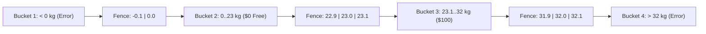

# Picking Smart Test Inputs Without Guessing (Boundaries & Combos)

```json continuity
{
  "previously": "In Ch 01, we wrote our first 3-line Arrange-Act-Assert check catching AeroCart's $90 coupon bug—and kept it 100% deterministic.",
  "painPoint": "Now AeroCart adds luggage weight fees (free up to 23kg, $100 up to 32kg, banned above 32kg) PLUS 6 checkout dropdowns (4,096 combinations!). We can't test every number from 1 to 1,000!",
  "unlock": "Use Equivalence Buckets, the 3-Point Fence-Post Trick (22.9, 23.0, 23.1), and Pairwise combos to catch sneaky off-by-one bugs with tiny, surgical test lists."
}
```

```json walkthrough
[
  {
    "time": "0:00",
    "badge": "Slide 1 / 4 · Too Many Numbers to Test!",
    "caption": "AeroCart's new luggage rule says: 0 to 23kg is FREE ($0), above 23kg up to 32kg costs $100, and above 32kg is REJECTED. A beginner tests 5kg, 10kg, 12kg, and 15kg—and still misses a huge bug!",
    "code": "# Beginner tests 4 happy weights:\nassert bag_fee(5) == 0\nassert bag_fee(10) == 0\nassert bag_fee(15) == 0  # <-- Testing the same bucket 3 times!"
  },
  {
    "time": "0:24",
    "badge": "Slide 2 / 4 · Bugs Hide on the Fence Posts!",
    "caption": "What if the developer accidentally wrote `if weight < 23` instead of `weight <= 23`? A passenger with an exact 23kg suitcase gets unfairly charged $100! Testing 5kg and 10kg never catches it—testing 22.9, 23.0, and 23.1 catches it instantly!",
    "code": "def bag_fee(kg):\n    if kg < 23: return 0     # BUG! 23.0kg falls through to $100!\n    if kg <= 32: return 100"
  },
  {
    "time": "0:50",
    "badge": "Slide 3 / 4 · The 6-Dropdown Explosion",
    "caption": "Next, AeroCart's checkout page has 6 dropdowns (Cabin, Bag, Card, Currency, Meal, Seat) with 4 choices each: 4^6 = 4,096 combinations! Most real bugs happen when just TWO choices clash (like Amex + Japanese Yen).",
    "code": "# Exhaustive: 4 * 4 * 4 * 4 * 4 * 4 = 4,096 slow tests\n# Pairwise (every pair of 2 choices tested): ~16 fast tests!"
  },
  {
    "time": "1:14",
    "badge": "Slide 4 / 4 · Loop Over a Clean Table",
    "caption": "Instead of copy-pasting `assert` 20 times, we put our smart fence-post inputs in a neat table and loop through them in 6 lines of code!",
    "code": "for weight, expected_fee in [(0, 0), (23, 0), (23.1, 100), (32, 100)]:\n    assert bag_fee(weight) == expected_fee"
  }
]
```

```json pretraining
[
  {
    "term": "Equivalence Partition (Bucket)",
    "formula": "5kg == 10kg == 18kg -> Same Rule",
    "meaning": "A range of inputs your code treats identically—picking ONE representative from the middle of each bucket is enough."
  },
  {
    "term": "3-Point Boundary Value Analysis",
    "formula": "[Edge - 1, Edge, Edge + 1]",
    "meaning": "Testing just below, right on, and just above every rule cutoff (22.9, 23.0, 23.1) where `<` vs `<=` typos hide."
  },
  {
    "term": "Data-Driven / Parameterized Test",
    "formula": "1 Test Function + Table of Cases",
    "meaning": "Feeding a list of `(input, expected)` pairs into a single clean loop instead of copy-pasting the same test 15 times."
  },
  {
    "term": "Pairwise Combinatorial Testing",
    "formula": "4^6 (4,096) -> ~16 Smart Rows",
    "meaning": "Generating a compact table where every possible pair of two dropdown options appears together at least once."
  }
]
```

```json poe
{
  "question": "AeroCart's rule says: 'Checked bags up to and including 23 kg fly FREE ($0); bags heavier than 23 kg up to 32 kg cost $100.' A developer accidentally types `if kg < 23:` instead of `if kg <= 23:`. Which tiny set of test inputs is GUARANTEED to catch that exact typo?",
  "options": [
    "Testing 5 kg, 12 kg, and 28 kg (one light bag, one medium bag, one heavy bag)",
    "Testing 100 random numbers between 1 and 20",
    "Testing the fence-post boundaries: 22.9 kg ($0), 23.0 kg ($0), and 23.1 kg ($100)",
    "Only testing negative numbers like -5 kg"
  ],
  "answerIndex": 2,
  "explanation": "With `if kg < 23:`, both 5 kg and 22.9 kg still return $0, and 23.1 kg returns $100—ONLY 23.0 kg exposes the `<` vs `<=` mistake by wrongly returning $100 instead of $0!"
}
```

## 🌱 Step 1: Plain-English Story — Why Testing `5kg`, `10kg`, and `15kg` Is Wasted Work

In **Chapter 01**, we saved AeroCart from a `$90` ticket-price bug using a 3-line `Arrange-Act-Assert` check. Feeling confident, our product manager hands us the next feature: **AeroCart Checked Baggage Fees**!

Here is the plain-English rule printed on AeroCart's website:
- **Invalid (`< 0 kg`)**: Reject with an error (suitcases can't weigh negative kilograms!).
- **Standard Bag (`0 kg` up to `23.0 kg`)**: **$0** (Free!).
- **Heavy Bag (`23.1 kg` up to `32.0 kg`)**: **$100** fee.
- **Oversized Cargo (`> 32.0 kg`)**: Reject (too heavy for passenger planes!).

Now ask yourself: *Which weights should we put into our automated tests?*

If we test `5 kg`, `10 kg`, `14 kg`, and `18 kg`, we feel productive because we wrote 4 tests—**but all 4 sit inside the exact same `if` branch!** If `10 kg` works, `14 kg` is almost guaranteed to work too. Engineers call each range of numbers that shares the same rule an **Equivalence Bucket (Partition)**.



**Where do 90% of real bugs actually hide?**
Right on the **fences** between buckets! Developers constantly type `<` when they meant `<=` (called an **off-by-one bug**). If someone writes `if kg < 23: return 0`, then a passenger whose suitcase weighs **exactly `23.0 kg`** gets unfairly charged `$100`!

That gives us our superpower rule—**The 3-Point Fence-Post Trick (Boundary Value Analysis)**:
> At every cutoff (`0`, `23.0`, `32.0`), always test **just below (`22.9`)**, **right on (`23.0`)**, and **just above (`23.1`)**!

## 🔨 Step 2: First Lines of Code — Testing Every Fence Post in One Clean Loop

Should we copy-paste `assert calculate_bag_fee(...) == ...` ten times in a row? No way! Instead, we list our smart fence-post cases in a simple table and run a 4-line loop over them.

Engineers call this a **Table-Driven (or Parameterized) Test**—and once you write one, you'll never go back:

```python
def calculate_bag_fee(kg: float) -> int:
    if kg < 0 or kg > 32.0:
        raise ValueError("Invalid bag weight")
    if kg <= 23.0:
        return 0
    return 100


# --- SMART FENCE-POST TABLE (Catches every < vs <= bug!) ---
boundary_cases = [
    (0.0, 0),      # Exact lower edge of Free bucket
    (22.9, 0),     # Just below 23kg fence -> Free
    (23.0, 0),     # RIGHT ON 23kg fence   -> Still Free!
    (23.1, 100),   # Just above 23kg fence -> $100 Heavy fee
    (32.0, 100),   # Exact upper edge of Heavy bucket
]

for weight, expected_fee in boundary_cases:
    actual = calculate_bag_fee(weight)
    assert actual == expected_fee, f"At {weight}kg: expected ${expected_fee}, got ${actual}"

print(f"✓ Verified all {len(boundary_cases)} boundary fence posts in 0.1ms!")
```

### Java 17 Equivalent

```java
import java.util.Map;
import java.util.LinkedHashMap;

public class BaggageBoundaryTest {
    static int calculateBagFee(double kg) {
        if (kg < 0 || kg > 32.0) throw new IllegalArgumentException("Invalid bag weight");
        if (kg <= 23.0) return 0;
        return 100;
    }

    public static void main(String[] args) {
        double[][] cases = {
            {0.0, 0}, {22.9, 0}, {23.0, 0}, {23.1, 100}, {32.0, 100}
        };
        for (double[] row : cases) {
            int actual = calculateBagFee(row[0]);
            if (actual != (int) row[1]) {
                throw new AssertionError("At " + row[0] + "kg: got $" + actual);
            }
        }
        System.out.println("✓ Verified all 5 boundary fence posts!");
    }
}
```

Look how clean that is: **5 surgical inputs** test more real risk than **500 random numbers** between `1` and `20`! (And to test the rejected `-0.1 kg` and `32.1 kg` error edges, we simply wrap a `try / except ValueError` check confirming an error *was* raised!)

## ⚡ Step 3: Where It Breaks in Real Life — The 4,096-Dropdown Explosion!

Fence-post testing nailed our single `weight` input. Now watch the next real-world problem we hit on AeroCart's checkout page!

AeroCart's checkout screen has **6 independent options**, each with **4 choices**:
1. **Cabin**: Economy, Premium, Business, First (`4`)
2. **Bag Tier**: Carry-On, 23kg, 32kg, Sports Gear (`4`)
3. **Payment Card**: Visa, Mastercard, Amex, Apple Pay (`4`)
4. **Currency**: USD, GBP, EUR, JPY (`4`)
5. **Loyalty Tier**: Guest, Silver, Gold, Platinum (`4`)
6. **Device**: Desktop Chrome, Mobile Safari, Android, iPad (`4`)

If your boss asks you to *"test every combination"*, how many tests is that?
$$4 \times 4 \times 4 \times 4 \times 4 \times 4 = 4^6 = \mathbf{4,096\text{ tests!}}$$
At 10 seconds per browser test, that's **11.3 hours** just for one screen!

**Here is the real-world breakthrough (backed by NIST studies across thousands of real production bugs):**
Almost **85% to 95%** of multi-option bugs are triggered by just **1 option alone** OR **2 options clashing together** (for example: **`Amex` + `Japanese Yen (JPY)`** crashing because Yen has zero decimal places!). Almost *never* does a bug require all 6 dropdowns to line up like a lottery ticket.

```json contrast
{
  "title": "Brute-Force Cartesian Grid vs. Smart Pairwise Coverage",
  "naiveTitle": "All 4^6 Brute-Force Combinations",
  "naiveMetric": "4,096 Tests · 11.3 Hours CI",
  "naivePoints": [
    "Multiplies every dropdown against every other dropdown blindly",
    "Impossible to run on every pull request—so the team stops running it and guesses 5 happy-path cases instead",
    "Adding just 2 more 4-choice dropdowns explodes the suite to 65,536 tests!"
  ],
  "staffTitle": "Pairwise (2-Way) Covering Table + Critical Triples",
  "staffMetric": "~20 Tests · 92%+ Bug Detection in 3 Secs",
  "staffPoints": [
    "packs combinations cleverly so EVERY possible pair of 2 options (like `Amex + JPY` or `First Class + Sports Gear`) is tested at least once",
    "Shrinks 4,096 cases down to ~20 surgical rows—a 99.5% reduction in execution cost!",
    "Explicitly pins business-critical 3-way rules (like `First + Platinum + Free Sports Gear`) on top"
  ]
}
```

Test your intuition in the **Simulator** below to watch `4,096` combinations compress down to ~20 high-signal Pairwise tests!

## 🚀 Step 4: Staff Engineer Deep-Dive — Greedy Pairwise Generator & Metamorphic Checks

At the Staff level, you don't even build Pairwise tables by hand—you write (or plug in) a deterministic **Greedy All-Pairs Generator** that guarantees 100% 2-way pair coverage automatically whenever product managers add a new currency or card type!

### Production Blueprint: Deterministic Pairwise Generator (`Python 3` & `Java 17`)

```python
from itertools import combinations, product
from typing import Dict, List, Set, Tuple


def generate_pairwise_cases(factors: Dict[str, List[str]]) -> List[Dict[str, str]]:
    """Greedily pick test rows that cover the maximum number of unseen 2-option pairs."""
    keys = list(factors.keys())
    all_candidates = [dict(zip(keys, vals)) for vals in product(*(factors[k] for k in keys))]

    # Collect every 2-way pair (colA=valA, colB=valB) that MUST appear at least once
    uncovered_pairs: Set[Tuple[str, str, str, str]] = set()
    for k1, k2 in combinations(keys, 2):
        for v1 in factors[k1]:
            for v2 in factors[k2]:
                uncovered_pairs.add((k1, v1, k2, v2))

    selected_rows: List[Dict[str, str]] = []
    while uncovered_pairs:
        best_row = max(
            all_candidates,
            key=lambda row: sum(
                1 for (k1, v1, k2, v2) in uncovered_pairs if row[k1] == v1 and row[k2] == v2
            ),
        )
        selected_rows.append(best_row)
        for k1, k2 in combinations(keys, 2):
            uncovered_pairs.discard((k1, best_row[k1], k2, best_row[k2]))

    return selected_rows
```

### Java 17 Equivalent

```java
import java.util.*;

public class PairwiseGenerator {
    public record PairKey(int colA, String valA, int colB, String valB) {}

    public static List<List<String>> buildPairwise(List<List<String>> domains) {
        int cols = domains.size();
        Set<PairKey> uncovered = new LinkedHashSet<>();
        for (int i = 0; i < cols; i++) {
            for (int j = i + 1; j < cols; j++) {
                for (String va : domains.get(i)) {
                    for (String vb : domains.get(j)) {
                        uncovered.add(new PairKey(i, va, j, vb));
                    }
                }
            }
        }
        List<List<String>> candidates = cartesian(domains);
        List<List<String>> suite = new ArrayList<>();
        while (!uncovered.isEmpty()) {
            List<String> best = candidates.get(0);
            int bestHits = -1;
            for (List<String> row : candidates) {
                int hits = countHits(row, uncovered);
                if (hits > bestHits) { bestHits = hits; best = row; }
            }
            suite.add(best);
            for (int i = 0; i < cols; i++) {
                for (int j = i + 1; j < cols; j++) {
                    uncovered.remove(new PairKey(i, best.get(i), j, best.get(j)));
                }
            }
        }
        return suite;
    }

    private static int countHits(List<String> row, Set<PairKey> uncovered) {
        int hits = 0;
        for (int i = 0; i < row.size(); i++) {
            for (int j = i + 1; j < row.size(); j++) {
                if (uncovered.contains(new PairKey(i, row.get(i), j, row.get(j)))) hits++;
            }
        }
        return hits;
    }

    private static List<List<String>> cartesian(List<List<String>> domains) {
        List<List<String>> res = List.of(List.of());
        for (List<String> dom : domains) {
            List<List<String>> next = new ArrayList<>();
            for (List<String> prefix : res) {
                for (String val : dom) {
                    List<String> copy = new ArrayList<>(prefix);
                    copy.add(val);
                    next.add(copy);
                }
            }
            res = next;
        }
        return res;
    }
}
```

> [!WARNING]
> **Staff Interview Gotcha — Never Blindly Pairwise Invalid Inputs Into Valid Rows!**
> Suppose one of your dropdown choices is `Weight = -5 kg` (an invalid negative input that raises an error immediately). If your Pairwise table pairs `-5 kg` with `Amex + JPY`, your checkout code aborts on Step 1 (`Invalid weight!`) and **never even reaches the payment code for `Amex + JPY`**—leaving `Amex + JPY` secretly untested! **Always separate Invalid Negative Boundary tests from Valid Pairwise combinations!**

**Up Next in Chapter 03**: Wait—should we run those 20 Pairwise tests and 5 Baggage Boundary tests directly against our Python/Java function (`0.1ms`), against our HTTP API (`4ms`), or by opening Chrome and clicking buttons (`2,000ms`)? Let's solve that exact question next!

```json quiz
[
  {
    "id": "sdet-02-q1",
    "question": "Why does testing `22.9 kg`, `23.0 kg`, and `23.1 kg` catch far more bugs than testing `5 kg`, `10 kg`, and `15 kg` for AeroCart's 23 kg free-baggage rule?",
    "options": [
      "Because heavier suitcases make Python run faster",
      "Because 5, 10, and 15 kg all sit inside the same Equivalence Bucket, whereas 22.9, 23.0, and 23.1 sit right on the decision boundary where `<` vs `<=` off-by-one typos happen",
      "Because integers cannot be tested in automated suites",
      "Because airlines never allow bags lighter than 22 kg"
    ],
    "answerIndex": 1,
    "explanation": "Inputs inside the same Equivalence Partition follow the exact same code branch; testing the 3 boundary points around the cutoff exposes relational operator bugs (`<` vs `<=`)."
  },
  {
    "id": "sdet-02-q2",
    "question": "AeroCart's checkout form has 6 dropdowns with 4 valid choices each (`4^6 = 4,096` total combinations). What does a Pairwise (2-way) test table guarantee in ~20 rows?",
    "options": [
      "It tests only the first choice in each dropdown",
      "It guarantees that every possible pair of two dropdown choices (like `Amex` + `JPY`) appears together in at least one test row",
      "It deletes 4 of the 6 dropdowns from the product",
      "It runs all 4,096 tests in parallel across 4,096 laptops"
    ],
    "answerIndex": 1,
    "explanation": "Pairwise testing packs combinations so every 2-factor interaction is covered in ~20 rows, catching the ~85-95% of defects caused by single-factor or two-factor clashes."
  },
  {
    "id": "sdet-02-q3",
    "question": "Why is mixing an invalid error input (like `Bag Weight = -5 kg`) into your valid Pairwise table a classic testing mistake ('Input Masking')?",
    "options": [
      "Because negative numbers crash SQLite",
      "Because `-5 kg` triggers an early validation error and aborts checkout before downstream pairs in that same row (like `Amex + JPY`) ever execute!",
      "Because Pairwise tables only work on strings",
      "Because invalid inputs should never be tested"
    ],
    "answerIndex": 1,
    "explanation": "An early validation error masks every downstream parameter in that test row, silently leaving valid payment/currency pairs untested. Keep negative/invalid boundary tests separate from valid pairwise matrices."
  }
]
```
