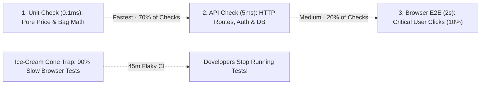

# Unit vs. API vs. Browser Tests: Where Should Each Check Live?

```json continuity
{
  "previously": "In Ch 02, we designed 25 surgical fence-post & Pairwise test cases for AeroCart's ticket coupons and baggage fees.",
  "painPoint": "Excited by automation, a teammate writes all 200 AeroCart rules as full Chrome browser tests—now every run takes 45 minutes, charges test credit cards, and breaks whenever a CSS button color changes!",
  "unlock": "Master the 3 testing layers (Unit, API, Browser UI), avoid the 'Ice-Cream Cone' trap, and write a 12-line In-Memory Fake so payment tests run offline in 0.2ms."
}
```

```json walkthrough
[
  {
    "time": "0:00",
    "badge": "Slide 1 / 4 · Why Not Test Everything in Chrome?",
    "caption": "Opening a real browser, loading HTML/CSS, clicking dropdowns, and waiting for pages takes ~3 to 10 seconds per test. Multiply that by 300 edge cases and you wait an hour just to check math rules!",
    "code": "# 300 Browser UI tests  x 8.0s   = 40 minutes (Fragile!)\n# 300 HTTP API tests    x 0.01s  =  3 seconds\n# 300 Pure Unit tests   x 0.0001s = 0.03 seconds!"
  },
  {
    "time": "0:25",
    "badge": "Slide 2 / 4 · The Jet Engine Bench Analogy",
    "caption": "Boeing doesn't fly a 787 across the Atlantic 500 times just to check if one cabin reading lightbulb turns on! You test parts fast on a bench (Unit), wire systems together in the hangar (API), and fly a few golden journeys end-to-end (UI).",
    "code": "       /\\        <- Few (5-10%) End-to-End Browser Journeys\n      /  \\       <- Medium (20-30%) Service / API Checks\n     /____\\      <- Many (60-70%) Fast Pure Logic Unit Checks"
  },
  {
    "time": "0:52",
    "badge": "Slide 3 / 4 · What About External APIs Like Stripe?",
    "caption": "What if booking a flight calls Stripe's real servers over the internet? Instead of hitting real Visa cards (slow & flaky), we plug in a tiny 12-line 'Fake' Stripe class in memory!",
    "code": "class FakeStripe:\n    def charge(self, email, cents):\n        self.charges.append((email, cents))\n        return {'paid': True}"
  },
  {
    "time": "1:15",
    "badge": "Slide 4 / 4 · Right Check in the Right Layer!",
    "caption": "Put math & edge cases in Unit tests, JSON contracts & auth in API tests, and critical human journeys (Search -> Seat -> Pay) in Browser UI tests!",
    "code": "# Math edge cases (22.9kg, 23.0kg) -> Unit Layer (0.1ms)\n# HTTP 201 / 401 / 409 contracts    -> API Layer  (4ms)\n# Can a user click Confirm Booking? -> UI Layer   (1.5s)"
  }
]
```

```json pretraining
[
  {
    "term": "The 3 Test Layers (Unit · API · UI)",
    "formula": "Function (0.1ms) < API (5ms) < Browser (2s)",
    "meaning": "Unit tests call a single function in memory; API tests send JSON to your backend server; UI tests drive a real browser like a human."
  },
  {
    "term": "The Test Pyramid vs. Ice-Cream Cone",
    "formula": "70% Unit · 20% API · 10% E2E UI",
    "meaning": "Healthy suites keep most edge-case checks fast at the bottom (Pyramid), rather than piling hundreds of slow, flaky checks in the browser (Ice-Cream Cone)."
  },
  {
    "term": "Architectural Seam",
    "formula": "def checkout(order, payment_gateway):",
    "meaning": "A clean 'plug socket' where you can swap out a slow external dependency (real Stripe) for a fast test stand-in during tests."
  },
  {
    "term": "In-Memory Fake vs. Brittle Mock",
    "formula": "Working Mini-Double vs. Hardcoded Pretend",
    "meaning": "A Fake has real lightweight working behavior (like an in-memory dictionary), whereas over-using Mocks just repeats how the code was written."
  }
]
```

```json poe
{
  "question": "Your team needs to test 40 different coupon & baggage math rules (expired promo, 22.9kg, 23.0kg, 23.1kg, JPY rounding) PLUS verify that clicking 'Confirm Booking' in Chrome actually submits an order. What is the smartest split?",
  "options": [
    "Write all 41 checks as full Chrome browser E2E tests so everything is 'realistic'",
    "Write 0 browser tests—only test math functions and hope the HTML button isn't broken",
    "Test the 40 math & boundary rules as instant Unit/API checks (<50ms total), and write 1–2 clean Browser E2E journeys verifying the UI wires everything together!",
    "Test all 40 rules manually every Friday"
  ],
  "answerIndex": 2,
  "explanation": "Browser UI tests prove the UI is wired to the backend (1–2 journeys is plenty!), while Unit & API tests verify the 40 combinatorial rules 1,000x faster and with zero CSS flakiness."
}
```

## 🌱 Step 1: Plain-English Story — Why Boeing Doesn't Fly to London to Test a Lightbulb

In **Chapters 01 and 02**, we wrote clean `Arrange-Act-Assert` checks and picked 25 smart boundary & Pairwise cases for AeroCart.

Then an eager teammate says: *"Hey! Real customers use Chrome—so let's run every single coupon, currency, and baggage test by launching Chrome, typing into boxes, and clicking buttons!"*

Two weeks later, your team is miserable:
- Running 300 Chrome tests takes **45 minutes**.
- Whenever a designer renames a button from `"Buy Now"` to `"Book Flight"`, **all 300 baggage math tests break**—even though baggage math didn't change at all!

Think about how airplane engineers build a jet:
1. **Bench Check (`Unit Test` — `0.1 milliseconds`)**: Before bolting a reading lamp or fuel valve onto the wing, you test that single piece right on a workbench. Fast, cheap, pinpoint clear!
2. **Hangar System Check (`API / Integration Test` — `5 milliseconds`)**: Next, you connect the cockpit computer to the engine controller (without taking off) and verify the signals match.
3. **Full Test Flight (`End-to-End Browser UI Test` — `2–5 seconds`)**: Finally, a pilot flies **a few critical journeys** to prove the whole plane works together!



When you put 70% of checks at the bottom, 20% in the middle, and 10% at the top, it forms a sturdy **Test Pyramid**. When beginners do the opposite—putting 90% of tests in slow browsers—engineers call it the **Ice-Cream Cone Anti-Pattern** (heavy on top, melts under heat!).

## 🔨 Step 2: First Lines of Code — Swapping Slow Stripe for a 12-Line "Fake"

*"Hold on,"* beginners always ask right here: *"How CAN I test AeroCart's `checkout()` function quickly on my laptop if `checkout()` calls Stripe over the internet to charge a credit card?"*

Easy! Instead of hardcoding `real_stripe.charge(...)` deep inside `checkout()`, we pass `payment_gateway` in as a parameter (engineers call that plug-socket an **Architectural Seam**).

In real life, AeroCart passes `RealStripeGateway()`. In our fast test, we pass a **12-line `FakePaymentGateway`** that stores charges in a simple Python list / Java `ArrayList`—zero internet, zero real money, runs in `0.1ms`!

```python
# --- 1. A tiny 8-line "Fake" Stripe that works 100% in memory! ---
class FakePaymentGateway:
    def __init__(self):
        self.charges = []  # Remembers every charge we made!

    def charge(self, email: str, amount: float) -> bool:
        if amount <= 0:
            return False
        self.charges.append((email, amount))
        return True


# --- 2. AeroCart's checkout accepts ANY gateway with a .charge() method ---
def book_flight(email: str, base_price: float, discount: float, gateway) -> str:
    final_amount = round(base_price * (1.0 - discount), 2)
    if gateway.charge(email, final_amount):
        return "CONFIRMED"
    return "PAYMENT_DECLINED"


# --- 3. Instant 0.1ms Test (Zero internet, zero Visa card needed!) ---
fake_stripe = FakePaymentGateway()
status = book_flight("maya@aerocart.io", 450.0, 0.20, gateway=fake_stripe)

assert status == "CONFIRMED"
assert fake_stripe.charges == [("maya@aerocart.io", 360.0)]
print("✓ Checkout + Payment verified offline in 0.1ms!")
```

### Java 17 Equivalent

```java
import java.util.*;

public class CheckoutSeamDemo {
    interface PaymentGateway {
        boolean charge(String email, double amount);
    }

    static class FakePaymentGateway implements PaymentGateway {
        final List<String> charges = new ArrayList<>();
        @Override
        public boolean charge(String email, double amount) {
            if (amount <= 0) return false;
            charges.add(email + ":" + amount);
            return true;
        }
    }

    static String bookFlight(String email, double price, double discount, PaymentGateway gateway) {
        double finalAmount = Math.round(price * (1.0 - discount) * 100.0) / 100.0;
        return gateway.charge(email, finalAmount) ? "CONFIRMED" : "PAYMENT_DECLINED";
    }

    public static void main(String[] args) {
        FakePaymentGateway fakeStripe = new FakePaymentGateway();
        String status = bookFlight("maya@aerocart.io", 450.0, 0.20, fakeStripe);
        assert "CONFIRMED".equals(status);
        assert fakeStripe.charges.equals(List.of("maya@aerocart.io:360.0"));
        System.out.println("✓ Checkout + Payment verified offline in 0.1ms!");
    }
}
```

## ⚡ Step 3: Where It Breaks in Real Life — When Mocks Lie to You!

There is one famous trap when faking outside services: **what if your Fake or Mock drifts away from how the real service behaves?**

Imagine a developer writes a lazy one-line **Mock** (`mock_stripe.charge.return_value = True`). Six months later, real Stripe updates its API so charging cents requires an `integer` (`36000` cents) instead of a `float` (`360.0` dollars).
- All 500 of your mocked unit tests shout **`100% GREEN!`** (because `mock_stripe` blindly returned `True` no matter what garbage you passed it!).
- Production crashes the second a real customer clicks Buy!

```json contrast
{
  "title": "Blind Over-Mocking vs. Contract-Verified Fakes",
  "naiveTitle": "Mocking Everything Blindly",
  "naiveMetric": "100% Green Tests · Broken Production!",
  "naivePoints": [
    "Replaces every class and database call with `MagicMock(return_value=True)`",
    "Tests break whenever you rename a private helper method, yet stay Green when real SQL or Stripe schemas change!",
    "Gives false confidence because nothing checks whether the Mock still matches reality"
  ],
  "staffTitle": "Pyramid + Contract-Verified Fakes",
  "staffMetric": "<3m CI · Real Integration Confidence",
  "staffPoints": [
    "Use real fast local databases (SQLite / ephemeral containers) for your own code's SQL queries",
    "Use stateful In-Memory Fakes for third-party APIs (Stripe, Twilio), and run ONE shared contract test against both `FakeStripe` and `StripeSandbox` nightly!",
    "Keep 5–10 golden Browser E2E journeys verifying real UI-to-API wiring"
  ]
}
```

Step through the **Pyramid ROI Simulator** below to watch CI runtime drop from `48 minutes` to `3.5 minutes` while reliability climbs past `99.8%`!

## 🚀 Step 4: Staff Engineer Deep-Dive — Pyramid vs. Trophy vs. Honeycomb & Verified Fakes

When you reach Senior and Staff interviews, someone will inevitably ask: *"Is the classic Test Pyramid always the right shape?"*

Here is the crystal-clear modern answer: **the ideal shape depends on where your app's complexity lives**:

| Architecture Style | Best Test Shape | Where Most Tests Live & Why |
| :--- | :--- | :--- |
| **Rich Domain Math / Compilers / Pricing Engines** | **Classic Test Pyramid** *(Mike Cohn)* | **65–70% Unit**: Complex branching rules (`calculate_bag_fee`, tax engines) run 10,000× faster in memory. |
| **Modern React / Next.js Web Apps** | **Testing Trophy** *(Kent C. Dodds)* | **Component / Integration Middle**: Rendering a component with mocked HTTP (`MSW` / `page.route`) tests real user DOM interactions without full backend overhead. |
| **Thin CRUD Microservices** *(Glue over Postgres + Kafka)* | **Testing Honeycomb** *(Spotify)* | **70% Service / API Integration**: If a service is 10 lines of Python gluing HTTP to SQL, unit-testing mocked SQL is useless—hit the real service API + ephemeral DB! |

### Production Blueprint: Shared Contract Test Keeping `FakeGateway` Honest (`Python 3` & `Java 17`)
How do Staff engineers guarantee `FakePaymentGateway` never lies? They write a **Shared Contract Check** that runs against `FakePaymentGateway` on every PR (in `0.2ms`) and against the real provider sandbox in nightly CI:

```python
from typing import Protocol


class PaymentGatewayContract(Protocol):
    def charge_cents(self, idempotency_key: str, amount_cents: int) -> dict: ...


class VerifiedFakeStripe:
    def __init__(self) -> None:
        self._ledger: dict[str, dict] = {}

    def charge_cents(self, idempotency_key: str, amount_cents: int) -> dict:
        if not isinstance(amount_cents, int) or amount_cents <= 0:
            raise TypeError("Stripe requires a positive integer amount_cents!")
        # Enforce real Stripe idempotency: charging the same key twice NEVER double-bills!
        if idempotency_key not in self._ledger:
            self._ledger[idempotency_key] = {"status": "succeeded", "amount_cents": amount_cents}
        return self._ledger[idempotency_key]


def verify_gateway_contract(gateway: PaymentGatewayContract) -> None:
    """Run this exact function against BOTH VerifiedFakeStripe (every PR) and RealStripeSandbox (nightly)!"""
    first = gateway.charge_cents("idem-order-101", 36000)
    duplicate = gateway.charge_cents("idem-order-101", 36000)
    assert first == {"status": "succeeded", "amount_cents": 36000}
    assert duplicate == first  # Idempotent!
```

### Java 17 Equivalent

```java
import java.util.*;

public class VerifiedFakeContract {
    public record ChargeReceipt(String status, int amountCents) {}

    public interface PaymentGateway {
        ChargeReceipt chargeCents(String idempotencyKey, int amountCents);
    }

    public static class VerifiedFakeStripe implements PaymentGateway {
        private final Map<String, ChargeReceipt> ledger = new HashMap<>();

        @Override
        public ChargeReceipt chargeCents(String idempotencyKey, int amountCents) {
            if (amountCents <= 0) {
                throw new IllegalArgumentException("amountCents must be > 0");
            }
            return ledger.computeIfAbsent(idempotencyKey, k -> new ChargeReceipt("succeeded", amountCents));
        }
    }

    public static void assertGatewayHonorsContract(PaymentGateway gw) {
        ChargeReceipt r1 = gw.chargeCents("idem-order-101", 36000);
        ChargeReceipt r2 = gw.chargeCents("idem-order-101", 36000);
        assert "succeeded".equals(r1.status()) && r1.amountCents() == 36000;
        assert r1.equals(r2) : "Gateway violated idempotency contract!";
    }
}
```

> [!WARNING]
> **Staff Interview Gotcha — Never Mock What You Don't Own Without a Contract Test!**
> Mocking an internal helper or third-party SDK directly with `unittest.mock.patch` couples your test to private method names while hiding breaking API changes. Wrap external vendors behind **your own narrow interface** (`PaymentGateway`) and verify your `Fake` against the vendor's schema/sandbox!

**Module 1 Complete — Up Next in Module 2 (Chapter 04)**: Now we know *what* to test and *which layer* to put it in! Next, what happens when 10 developers on your team run API & database tests at the exact same time and wipe out each other's test flights? Let's build **Hermetic Environments**!

```json quiz
[
  {
    "id": "sdet-03-q1",
    "question": "What goes wrong when a team falls into the 'Ice-Cream Cone' anti-pattern (putting 90% of their edge-case checks inside full browser E2E tests)?",
    "options": [
      "Unit tests become slower than browser tests",
      "CI takes 30–60+ minutes, minor UI styling tweaks break hundreds of unrelated business-math tests, and compound browser/network flakiness destroys team trust",
      "Browsers refuse to run more than 50 tests",
      "The backend API stops accepting JSON"
    ],
    "answerIndex": 1,
    "explanation": "Full browser tests traverse the entire UI, network, and DB stack—making them 1,000x slower and far more sensitive to unrelated UI changes than targeted Unit and API checks."
  },
  {
    "id": "sdet-03-q2",
    "question": "In Step 2, how did we test `book_flight()` in 0.1ms without charging a real credit card on Stripe's live servers?",
    "options": [
      "We deleted the payment step from AeroCart in production",
      "We passed a lightweight In-Memory `FakePaymentGateway` into `book_flight()` through an architectural seam (parameter/interface)",
      "We used a real company corporate Visa card and refunded it manually",
      "We added `time.sleep(10)`"
    ],
    "answerIndex": 1,
    "explanation": "Passing `gateway` as an interface/parameter creates a clean seam: production injects `RealStripeGateway`, while fast tests inject `FakePaymentGateway` in memory."
  },
  {
    "id": "sdet-03-q3",
    "question": "How do Staff engineers prevent an in-memory `FakeStripe` class from drifting out of sync when the real Stripe API changes its rules?",
    "options": [
      "Rewrite `FakeStripe` from scratch every morning",
      "Run the exact same shared Contract Test suite (`verify_gateway_contract`) against `FakeStripe` on every PR and against the real Stripe Sandbox/OpenAPI spec on a schedule",
      "Replace `FakeStripe` with `MagicMock(return_value=True)`",
      "Only test payments in production"
    ],
    "answerIndex": 1,
    "explanation": "A shared contract suite guarantees that your fast in-memory Fake enforces the exact same input types, errors, and idempotency invariants as the real vendor API."
  }
]
```
