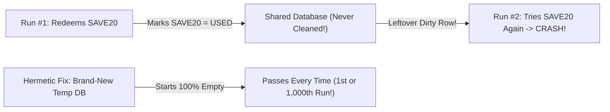

# Why 'Works on My Machine' Happens & Self-Cleaning Test Databases

```json continuity
{
  "previously": "In Ch 03, we organized our AeroCart checks into a fast Test Pyramid (70% Unit, 20% API, 10% Browser UI) and used a 12-line Fake for Stripe.",
  "painPoint": "Our API test for single-use coupon `SAVE20` passes the very first time we run it—and then crashes on every run after that (and on our teammate's laptop!) because the first test left `'SAVE20': USED` behind in a shared database!",
  "unlock": "Build a self-cleaning ('Hermetic') temporary database for every test run, and unlock Staff-level 15ms Template Database Snapshot cloning."
}
```

```json walkthrough
[
  {
    "time": "0:00",
    "badge": "Slide 1 / 4 · Why Did Run #2 Fail?!",
    "caption": "You write a test that redeems one-time promo code `SAVE20` in AeroCart's database. At 10:00 AM it turns GREEN! At 10:01 AM you run the exact same test again without touching a single line of code—and it explodes: `Error: SAVE20 already used!`",
    "code": "# Run #1 (10:00 AM): Redeems SAVE20 -> DB saves 'USED' -> PASS!\n# Run #2 (10:01 AM): DB still says 'USED' from Run #1 -> FAIL!",
    "nodes": ["Run #1 Writes DB", "Dirty Row Left Behind", "Run #2 Crashes"]
  },
  {
    "time": "0:25",
    "badge": "Slide 2 / 4 · The Shared Kitchen Mess",
    "caption": "A shared QA database is like a restaurant kitchen where nobody washes the frying pan between orders. If Chef #1 burns garlic in the pan, Chef #2's pancake tastes like burnt garlic!",
    "code": "# Shared Staging DB (qa-db.aerocart.internal):\n# Dev A deletes flight AI-202 while Dev B is booking AI-202!",
    "nodes": ["Shared Staging DB", "Dev A Mutates Row", "Dev B False Failure"]
  },
  {
    "time": "0:50",
    "badge": "Slide 3 / 4 · Self-Cleaning ('Hermetic') DB",
    "caption": "Instead of sharing one messy database, what if every test creates its own fresh, private SQLite database in memory (or a temporary file), runs the check, and throws it away when done?",
    "code": "with sqlite3.connect(':memory:') as db:\n    setup_tables(db)\n    assert redeem_coupon(db, 'SAVE20') == 'APPLIED'\n# Poof! Clean slate every single run!",
    "nodes": ["Create Temp DB", "Run Isolated Test", "Auto-Destroy DB"]
  },
  {
    "time": "1:15",
    "badge": "Slide 4 / 4 · Fast 15ms Template Clones",
    "caption": "When your real Postgres database has 180 table migrations that take 5 seconds to boot, Staff engineers migrate ONCE into a golden template and photocopy it in 15 milliseconds!",
    "code": "-- Migrate once into qa_template (4.5s)\n-- Clone per worker in 15ms:\nCREATE DATABASE qa_worker_01 TEMPLATE qa_template;",
    "nodes": ["Migrate Template Once", "15ms Block Clone", "Zero Boot Tax"]
  }
]
```

```json pretraining
[
  {
    "term": "State Leak (Dirty Database)",
    "formula": "Test 1 Leftovers -> Breaks Test 2",
    "meaning": "When a test inserts or changes data (like marking coupon SAVE20 as 'used') and forgets to clean up, causing the next test run to fail."
  },
  {
    "term": "Hermetic Test Environment",
    "formula": "100% Self-Contained + Self-Cleaning",
    "meaning": "Hermetic means 'airtight': a test starts with its own clean local database and zero dependency on outside servers or other teammates' laptops."
  },
  {
    "term": "Ephemeral Port (:0)",
    "formula": "bind('127.0.0.1', 0) -> Free OS Port",
    "meaning": "Asking your computer's operating system to pick any unused port number automatically so two test runs never fight over port 8080 or 5432."
  },
  {
    "term": "Template DB Snapshot Clone",
    "formula": "CREATE DATABASE w1 TEMPLATE golden_db",
    "meaning": "Building all database tables once into a master 'template' database, then instantly photocopying it in ~15ms for each test worker."
  }
]
```

```json poe
{
  "question": "You replace a messy shared database with Docker containers (Testcontainers). However, your test runner boots a brand-new Postgres container and runs 180 SQL table creation scripts before EVERY single test file (80 files × 6 seconds each = 8 extra minutes!). How do Staff engineers make this fast?",
  "options": [
    "Go back to sharing one giant staging database and ask teammates on Slack before running tests",
    "Delete 170 of the SQL tables so migrations finish faster",
    "Boot ONE container per test run, run the 180 SQL migrations ONCE into a `qa_template` database, and clone fresh per-worker copies in ~15ms using `CREATE DATABASE test_w1 TEMPLATE qa_template`",
    "Skip database tests completely"
  ],
  "answerIndex": 2,
  "explanation": "Restarting Docker and re-running 180 SQL migrations 80 times wastes 8 minutes of cold-boot overhead. Migrating once into a golden template and cloning it at the filesystem block level gives you a brand-new database in ~15 milliseconds!"
}
```

## 🌱 Step 1: Plain-English Story — The Shared Kitchen Frying Pan

In **Chapter 03**, we separated our AeroCart tests into Unit, API, and Browser layers. Now it is time to test our **real database queries**—specifically, AeroCart's new **Single-Use Promo Code (`SAVE20`)** rule: *a passenger can redeem `SAVE20` once, and if anyone tries to use `SAVE20` a second time, AeroCart must block it!*

You connect your test to the team's shared `qa-staging` database and click **Run**:
- **10:00 AM (Run #1)**: Your test redeems `SAVE20`. The database marks `SAVE20` as `USED`. **Test PASSES!**
- **10:01 AM (Run #2)**: You run the exact same test a second time to show your manager—and it **CRASHES** with `AssertionError: Coupon SAVE20 has already been used!`
- Worse, at **10:02 AM**, your teammate Priya in London runs *her* checkout test on her laptop—and her test fails too because your test used up the `SAVE20` coupon in the shared database!



Think of a shared test database like a **shared restaurant kitchen where nobody washes the frying pan between meals**:
- If Chef #1 fries fish in the pan and walks away, Chef #2's chocolate crepe is ruined!
- When a test leaves leftover rows in a database that break future tests, engineers call it **State Leakage** (or a **Dirty Environment**).
- The cure is what engineers call a **Hermetic Environment** (*hermetic* is just a fancy word for **"airtight and self-cleaning"**): every test run gets its own fresh, private database and throws it in the trash the second the test finishes!

## 🔨 Step 2: First Lines of Code — A Self-Cleaning SQLite Database in 15 Lines

Let's fix AeroCart's `SAVE20` coupon test right now! Instead of connecting to a shared database server that remembers yesterday's leftover rows, we can create a **brand-new temporary SQLite database** inside a helper function.

Every time `make_clean_db()` is called, it builds a fresh `coupons` table with a clean `'SAVE20'` coupon—so you can run your test **1 time or 10,000 times in a row** and it passes 100% of the time:

```python
import sqlite3

def make_clean_db() -> sqlite3.Connection:
    # ":memory:" creates a brand-new, private database in RAM that vanishes when closed!
    db = sqlite3.connect(":memory:")
    db.execute("CREATE TABLE coupons (code TEXT PRIMARY KEY, used INTEGER)")
    db.execute("INSERT INTO coupons VALUES ('SAVE20', 0)")
    return db

def redeem_coupon(db: sqlite3.Connection, code: str) -> str:
    row = db.execute("SELECT used FROM coupons WHERE code = ?", (code,)).fetchone()
    if not row or row[0] == 1:
        return "ALREADY_USED"
    db.execute("UPDATE coupons SET used = 1 WHERE code = ?", (code,))
    return "APPLIED"

# Even if we run this check 3 times in a row, each run gets a 100% clean slate!
for run_number in (1, 2, 3):
    with make_clean_db() as fresh_db:
        assert redeem_coupon(fresh_db, "SAVE20") == "APPLIED"
        assert redeem_coupon(fresh_db, "SAVE20") == "ALREADY_USED"
print("✓ All 3 runs passed with zero leftover dirty rows!")
```

### Java 17 Equivalent

```java
import java.sql.*;

public class HermeticCouponTest {
    static Connection makeCleanDb() throws SQLException {
        // Fresh in-memory database created from scratch for each test!
        Connection db = DriverManager.getConnection("jdbc:sqlite::memory:");
        try (Statement s = db.createStatement()) {
            s.execute("CREATE TABLE coupons (code TEXT PRIMARY KEY, used INT)");
            s.execute("INSERT INTO coupons VALUES ('SAVE20', 0)");
        }
        return db;
    }

    public static void main(String[] args) throws Exception {
        for (int run = 1; run <= 3; run++) {
            try (Connection freshDb = makeCleanDb(); Statement s = freshDb.createStatement()) {
                int updated = s.executeUpdate("UPDATE coupons SET used = 1 WHERE code = 'SAVE20' AND used = 0");
                if (updated != 1) throw new AssertionError("Run " + run + " failed!");
            } // try-with-resources automatically closes & destroys freshDb here!
        }
        System.out.println("✓ All 3 runs passed with zero leftover dirty rows!");
    }
}
```

Look at that `with make_clean_db() as fresh_db:` (and Java's `try (Connection freshDb = ...)`):
- Even if an assertion crashes in the middle of the test, the `with` / `try` block **guarantees** the temporary database is closed and wiped clean!

## ⚡ Step 3: Where It Breaks in Real Life — The 8-Minute Container Boot Tax

Creating a 1-table database from scratch in Step 2 took `0.5 milliseconds`.

**So where does that break when AeroCart grows into a big company?**
In a real production app, your database doesn't just have 1 `coupons` table—it has **180 SQL migration files** (`001_create_users.sql` through `180_add_baggage_indexes.sql`) running inside a real PostgreSQL Docker container (`Testcontainers`).
- Booting a fresh Postgres Docker container and running all 180 SQL files takes **~5 seconds**.
- If you do that from scratch before every single test across 100 tests, you just added **$100 \times 5\text{ seconds} = 500\text{ seconds}$ (over 8 minutes!)** of pure waiting!
- And if two developers run tests on the same build server using hardcoded port `5432`, the second test crashes immediately with `Address already in use (EADDRINUSE)`!

**How do Staff engineers get a 100% clean database in `15 milliseconds` instead of `5 seconds`?**
They boot **one** container on a random free OS port (`:0`), run the 180 migrations **once** into a read-only master database called `qa_template`, and then **photocopy (`clone`)** that template file for each test in milliseconds!

```json contrast
{
  "title": "Shared Staging vs. Naive Container Reboot vs. Template Snapshot Clones",
  "naiveTitle": "Shared QA DB or Rebooting Docker Every Test",
  "naiveMetric": "Dirty-Row Collisions or +8.5m Boot Wait",
  "naivePoints": [
    "Shared staging DB fails randomly whenever two engineers run tests at the same time",
    "Hardcoded ports (`localhost:5432`) crash with `Address already in use` on shared CI machines",
    "Booting a fresh Docker container + 180 SQL migrations before every test wastes 8+ minutes",
    "Pressing Ctrl+C leaves zombie Docker containers eating up gigabytes of laptop RAM"
  ],
  "staffTitle": "Singleton Ephemeral Container + Template Clones",
  "staffMetric": "3.5s Once · 2–15ms Per Clean Database Clone!",
  "staffPoints": [
    "Binds dynamic OS port `:0` so multiple test suites never collide on the same port",
    "Runs all 180 SQL migrations ONCE into `qa_template`, then clones clean copies in <15ms",
    "Uses real commits for HTTP API/browser tests instead of deceptive uncommitted transactions",
    "Attaches a Reaper watchdog (like Testcontainers Ryuk) to auto-delete containers even after SIGKILL"
  ]
}
```

Use the **Interactive Isolation Simulator** below to compare a messy Shared Staging DB against fast Hermetic Template Clones!

## 🚀 Step 4: Staff Engineer Deep-Dive — Birthday Collisions, Template Clones & The `@Transactional` Trap

Now that you understand *why* tests need self-cleaning databases and *why* migrating 180 tables from scratch is slow, let's unlock the Staff-level math and production blueprints!

### 1. Why Shared Staging Environments Collapse Above 15 Engineers
Suppose $M$ engineers share one `qa-staging` environment, and each engineer runs a 10-minute integration suite across $W = 48$ ten-minute windows in an 8-hour workday. By the **Birthday Paradox collision bound**, the probability that at least two test runs overlap and corrupt each other's database rows is:

$$
P_{\text{collision}}(M, W) \approx 1 - \exp\left(-\frac{M(M - 1)}{2W}\right)
$$

Even with just $M = 12$ engineers and $W = 48$ windows, $P_{\text{collision}} \approx 1 - e^{-132/96} = \mathbf{74.7\%}$! Shared mutable staging is mathematically guaranteed to fail almost four times out of five.

### 2. Choosing the Right Database Reset Strategy

| Reset Strategy | Setup Cost | Works with Real HTTP / Browser Tests? | Catches `COMMIT`-Time DB Triggers? | Best Use Case |
| :--- | :---: | :---: | :---: | :--- |
| **Shared Staging DB** | `0 ms` | Yes (with constant collisions!) | Yes | Post-deploy smoke checks only |
| **In-Process Transaction Rollback (`BEGIN...ROLLBACK`)** | `< 1 ms` | **No!** (Web server uses a separate DB connection) | **No!** (`DEFERRED` constraints skipped) | Fast in-process repository unit tests |
| **Golden Template Clone (`TEMPLATE` / File Copy)** | **`2 – 15 ms`** | **Yes!** (Each worker gets its own DB URL) | **Yes!** (Real `COMMIT` executed) | Parallel API & E2E worker shards |
| **Fresh Container Boot Per Test** | `4,000+ ms` | Yes | Yes | Destructive DB crash / disk-full chaos tests |

### Production Blueprint: Golden Template Database Cloner (`Python 3` & `Java 17`)
Here is the exact pattern used in high-speed CI pipelines: build and migrate `qa_template.db` **once**, checkpoint its Write-Ahead Log (`WAL`), and copy the pre-built file in **~1.5 milliseconds** per worker alongside an OS-assigned ephemeral port (`:0`):

```python
import shutil
import socket
import sqlite3
import tempfile
from pathlib import Path


class HermeticTemplateDbPool:
    """Migrates schema ONCE into a golden snapshot, then clones isolated worker DBs in ~1.5ms."""

    def __init__(self, schema_sql_list: list[str]) -> None:
        self._root = Path(tempfile.mkdtemp(prefix="aerocart_hermetic_"))
        self._template_path = self._root / "qa_template.db"
        self._build_golden_template(schema_sql_list)

    def _build_golden_template(self, schema_sql_list: list[str]) -> None:
        conn = sqlite3.connect(str(self._template_path))
        try:
            conn.execute("PRAGMA journal_mode=WAL;")
            conn.execute("PRAGMA foreign_keys=ON;")
            for sql in schema_sql_list:
                conn.executescript(sql)
            # Flush WAL into main DB file so file-copy clones are 100% self-contained
            conn.execute("PRAGMA wal_checkpoint(TRUNCATE);")
            conn.commit()
        finally:
            conn.close()

    @staticmethod
    def allocate_ephemeral_port() -> int:
        # Binding port 0 asks the OS kernel for a guaranteed-free port [49152..65535]
        with socket.socket(socket.AF_INET, socket.SOCK_STREAM) as sock:
            sock.bind(("127.0.0.1", 0))
            return int(sock.getsockname()[1])

    def clone_for_worker(self, worker_id: int) -> sqlite3.Connection:
        worker_db_path = self._root / f"qa_worker_{worker_id:02d}.db"
        shutil.copy2(self._template_path, worker_db_path)  # ~1.5ms OS file copy!
        conn = sqlite3.connect(str(worker_db_path), check_same_thread=False)
        conn.execute("PRAGMA foreign_keys=ON;")
        return conn

    def teardown_all(self) -> None:
        shutil.rmtree(self._root, ignore_errors=True)
```

### Java 17 Equivalent

```java
import java.sql.*;
import java.util.concurrent.atomic.AtomicBoolean;

public final class PostgresTemplateEnvironmentPool {
    private static final String TEMPLATE_DB = "qa_golden_template";
    private static final AtomicBoolean INITIALIZED = new AtomicBoolean(false);
    private final String baseHostPortUrl; // e.g., "jdbc:postgresql://127.0.0.1:55192/"
    private final String user;
    private final String pass;

    public PostgresTemplateEnvironmentPool(String baseHostPortUrl, String user, String pass) {
        this.baseHostPortUrl = baseHostPortUrl.endsWith("/") ? baseHostPortUrl : baseHostPortUrl + "/";
        this.user = user;
        this.pass = pass;
    }

    public void initializeTemplateOnce(Runnable runFlywayMigrationsOnTemplate) throws SQLException {
        if (INITIALIZED.compareAndSet(false, true)) {
            try (Connection admin = DriverManager.getConnection(baseHostPortUrl + "postgres", user, pass);
                 Statement stmt = admin.createStatement()) {
                stmt.execute("DROP DATABASE IF EXISTS " + TEMPLATE_DB + " WITH (FORCE)");
                stmt.execute("CREATE DATABASE " + TEMPLATE_DB);
            }
            runFlywayMigrationsOnTemplate.run(); // Runs 180 migrations ONCE!
            try (Connection admin = DriverManager.getConnection(baseHostPortUrl + "postgres", user, pass);
                 Statement stmt = admin.createStatement()) {
                stmt.execute("ALTER DATABASE " + TEMPLATE_DB + " WITH is_template = TRUE");
            }
        }
    }

    public String cloneIsolatedWorkerDb(int workerId) throws SQLException {
        String workerDb = String.format("qa_worker_%02d", workerId);
        try (Connection admin = DriverManager.getConnection(baseHostPortUrl + "postgres", user, pass);
             Statement stmt = admin.createStatement()) {
            stmt.execute("DROP DATABASE IF EXISTS " + workerDb + " WITH (FORCE)");
            // Block-level filesystem photocopy inside Postgres (~15ms, zero migration re-run!)
            stmt.execute("CREATE DATABASE " + workerDb + " TEMPLATE " + TEMPLATE_DB);
        }
        return baseHostPortUrl + workerDb;
    }
}
```

> [!WARNING]
> **Staff Interview Gotcha — Why `@Transactional` Test Rollbacks Break Browser & HTTP API Tests!**
> Many frameworks offer an `@Transactional` annotation that starts a database transaction before your test and calls `ROLLBACK` at the end instead of `COMMIT`. Beware of two huge blind spots:
> 1. **Invisible Rows (`404 Not Found`)**: When a Playwright browser or HTTP client calls your web server, the web server uses a *different* database connection. Because your test transaction hasn't committed yet, the web server cannot see the test user you just inserted (`READ COMMITTED` isolation) and returns `404`!
> 2. **Skipped Commit Triggers**: `DEFERRABLE INITIALLY DEFERRED` foreign-key checks only run when `COMMIT` is called—if your tests always `ROLLBACK`, broken foreign keys pass 100% Green in CI and crash in production!

**Up Next in Chapter 05**: Now that our test run has a clean database, what happens when we try to run **32 tests at the exact same time (`parallel workers`)** against one running AeroCart server—and Worker 1 buys the last seat on Flight `AI-202` right out from under Worker 2? Let's solve **Parallel Tenant Isolation**!

```json quiz
[
  {
    "id": "sdet-04-q1",
    "question": "Why did our AeroCart `SAVE20` coupon test pass at 10:00 AM and fail at 10:01 AM in Step 1 even though nobody changed a line of code?",
    "options": [
      "SQLite databases expire after 60 seconds",
      "State Leakage: Run #1 marked `SAVE20` as `USED` in a shared database and never cleaned it up, so Run #2 started with dirty leftover data",
      "The coupon code was spelled wrong on Run #2",
      "Python's `assert` keyword only works once per day"
    ],
    "answerIndex": 1,
    "explanation": "When tests mutate a shared database without isolating or cleaning up their state, leftover rows from Run #1 cause false failures on Run #2."
  },
  {
    "id": "sdet-04-q2",
    "question": "A Playwright browser test inserts a user inside an uncommitted `@Transactional` rollback block, then opens `/profile` in Chrome. Why does the AeroCart web server return `404 User Not Found`?",
    "options": [
      "Chrome blocks localhost URLs by default",
      "Because the test transaction has not committed yet! Under default `READ COMMITTED` database isolation, the web server's separate database connection cannot see uncommitted rows from the test thread",
      "Playwright deletes database rows before loading a page",
      "SQL databases cannot store email addresses"
    ],
    "answerIndex": 1,
    "explanation": "Out-of-process HTTP and browser tests run across separate database connections. Uncommitted rows inside a test runner's transaction are invisible to the web server until committed."
  },
  {
    "id": "sdet-04-q3",
    "question": "Why does PostgreSQL's `CREATE DATABASE qa_worker_01 TEMPLATE qa_golden_template` take ~15 milliseconds instead of 5 seconds?",
    "options": [
      "It skips creating tables and leaves the database empty",
      "All 180 SQL migrations were already executed once on `qa_golden_template` (with active connections closed), so Postgres simply copies the pre-built database files on disk without re-parsing or re-running any SQL migrations",
      "It stores the database inside the browser's cookies",
      "It disables primary keys"
    ],
    "answerIndex": 1,
    "explanation": "Template cloning performs a fast filesystem-level copy of an already-migrated database snapshot, amortizing expensive schema migrations across all test workers."
  }
]
```
