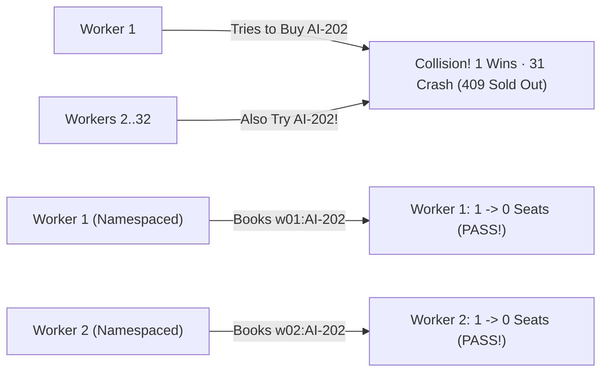

# Running 32 Tests at Once Without Stepping on Each Other's Toes

```json continuity
{
  "previously": "In Ch 04, we built a self-cleaning ('hermetic') database so leftover rows from yesterday never break today's test run.",
  "painPoint": "To make our 32-minute test suite finish in 1 minute, we run 32 test workers at the exact same time (`-n 32`) against AeroCart—and 31 out of 32 tests crash with `409 Conflict: Sold Out!` because every worker tries to book the last seat on the exact same flight (`AI-202`)!",
  "unlock": "Give every parallel test worker its own private name-tag (`X-Test-Tenant-ID` / namespaced flight ID) and master thread-safe `ContextVar` / `ThreadLocal` isolation."
}
```

```json walkthrough
[
  {
    "time": "0:00",
    "badge": "Slide 1 / 4 · Why Run Tests in Parallel?",
    "caption": "Running 320 tests one-by-one takes 32 minutes. If your laptop has 8 or 16 CPU cores, why wait in a single-file line? We turn on 32 parallel workers (`pytest -n 32`) so 32 tests run at the exact same time!",
    "code": "# Sequential (1 Worker):  320 tests = 32 minutes\n# Parallel  (32 Workers): 320 tests =  1 minute! (Wait... why did 31 fail?!)",
    "nodes": ["1 Worker (32m Slow)", "Turn On 32 Workers", "31 Tests Crash!"]
  },
  {
    "time": "0:25",
    "badge": "Slide 2 / 4 · The Last-Seat Stampede!",
    "caption": "Why did 31 tests fail? Because every test started by setting Flight `AI-202` to `1 seat left` and buying it! When 32 workers do that at the same millisecond, Worker 1 gets the seat and Workers 2..32 crash with `409 Sold Out`!",
    "code": "# Worker 1: Sets AI-202 seats=1 -> Buys 1 -> 201 Created!\n# Worker 2: Tries to buy AI-202 -> 0 left -> 409 CONFLICT (CRASH!)",
    "nodes": ["Shared Flight AI-202", "Worker 1 Buys Seat", "Workers 2..32 Crash 409"]
  },
  {
    "time": "0:50",
    "badge": "Slide 3 / 4 · Private Name-Tags (Namespaces)",
    "caption": "Instead of all 32 workers fighting over Flight `AI-202`, what if Worker 1 tests `w01:AI-202`, Worker 2 tests `w02:AI-202`, and each sends its own `X-Test-Tenant-ID` header? Zero collisions!",
    "code": "flight_id = f\"tenant_worker_{worker_id}:AI-202\"\n# Worker 1 books 'tenant_worker_01:AI-202' (1 seat -> 0)\n# Worker 2 books 'tenant_worker_02:AI-202' (1 seat -> 0) -> Both PASS!",
    "nodes": ["Worker 1 -> w01:AI-202", "Worker 2 -> w02:AI-202", "32/32 Green!"]
  },
  {
    "time": "1:15",
    "badge": "Slide 4 / 4 · Thread-Safe Contexts & Idempotency",
    "caption": "In Step 4, we'll also lock down client-side variable leaks using Python `ContextVar` and Java `ThreadLocal`, plus `Idempotency-Key` headers so network retries never double-book a seat!",
    "code": "headers = {\n    'X-Test-Tenant-ID': f't_w{worker_id}_{uuid4().hex[:6]}',\n    'Idempotency-Key': f'book-{worker_id}-step1'\n}",
    "nodes": ["ContextVar / ThreadLocal", "X-Test-Tenant-ID", "Idempotency-Key"]
  }
]
```

```json pretraining
[
  {
    "term": "Parallel Test Workers",
    "formula": "32 Workers = 32 Tests Running at Once",
    "meaning": "Instead of running tests one after another in a single line, launching multiple workers to run dozens of tests simultaneously."
  },
  {
    "term": "Race Condition (Shared-Row Collision)",
    "formula": "Worker 1 + Worker 2 -> Fight Over Flight AI-202",
    "meaning": "When two parallel tests read or change the exact same database row at the same millisecond and trip each other up."
  },
  {
    "term": "Tenant Namespace (Private Sandbox)",
    "formula": "ID = 'tenant_w01:AI-202'",
    "meaning": "Prefixing every test's data and HTTP headers with a unique worker/test ID so 32 tests can share one server without ever touching each other's rows."
  },
  {
    "term": "ContextVar / ThreadLocal",
    "formula": "One Private Locker Per Worker Thread",
    "meaning": "Special memory slots in Python and Java where Worker 1's login token is kept completely invisible to Worker 2."
  }
]
```

```json poe
{
  "question": "Your team speeds up AeroCart's API test suite by turning on 32 parallel workers (`-n 32`) against a single running AeroCart server. Every test sets Flight `AI-202` to `seats = 1` and books 1 ticket. When run one-by-one (`-n 1`), all 32 pass. With `-n 32`, 31 out of 32 randomly fail with `409 Sold Out`! What is the cleanest fix?",
  "options": [
    "Turn off parallel testing forever and go back to waiting 32 minutes",
    "Buy 32 separate laptops so each worker has its own physical computer",
    "Give every test execution its own unique `X-Test-Tenant-ID` namespace (so Worker 1 books `t_w01:AI-202` and Worker 2 books `t_w02:AI-202`), keeping all 32 workers 100% isolated on one shared server",
    "Set `seats = 999999` and delete the assertion that checks if the flight sold out"
  ],
  "answerIndex": 2,
  "explanation": "Giving each parallel test its own tenant namespace (`t_w01`, `t_w02`, ...) lets all 32 workers test 'buying the very last seat' at the exact same millisecond on one server without colliding!"
}
```

## 🌱 Step 1: Plain-English Story — The 32-Worker Stampede for Seat `1A`

In **Chapter 04**, we gave our test run a fresh, clean database so yesterday's leftover data couldn't break today's tests.

There is just one problem: our AeroCart test suite has grown to **320 API & browser tests**, and running them one after another in a single file line takes **32 minutes**!

You have a fast multi-core laptop, so you think: *"Why run 1 test at a time when I can run **32 tests at the exact same time** (`32 parallel workers`) and finish in **60 seconds**?!"*

You flip the parallel switch (`pytest -n 32` or JUnit parallel mode)... and **31 out of 32 tests immediately turn bright RED with `HTTP 409 Conflict: Flight AI-202 Sold Out`!**

What happened?!
- All 32 workers connected to the **same running AeroCart server**.
- Every test started by saying: *"Set Flight `AI-202` to have `1` seat left, then buy `1` seat and check that `0` seats remain."*
- When 32 workers did that at the **exact same millisecond**, Worker 1 grabbed the seat on `AI-202`, and Workers 2 through 32 crashed into an empty plane!



**How do we let 32 workers share one AeroCart server without ever stepping on each other's toes?**
Give every worker its own **Private Name-Tag (Tenant Namespace)**!
- Instead of fighting over one global flight called `"AI-202"`, **Worker 1** creates and books `"tenant_w01:AI-202"`.
- **Worker 2** creates and books `"tenant_w02:AI-202"`.
- **Worker 32** creates and books `"tenant_w32:AI-202"`.

Now all 32 workers can test *"buying the very last seat on a plane"* at the exact same microsecond—and **32 out of 32 pass Green**!

## 🔨 Step 2: First Lines of Code — Namespacing 32 Parallel Workers

Let's see this in action with 15 lines of code! Below, we simulate AeroCart's seat-inventory dictionary and run **32 workers in parallel**.

Because each worker prefixes its flight code with `f"tenant_w{worker_id}:AI-202"`, every single worker gets its own private flight with `1` seat, buys that last seat, and finishes with `0` seats left—zero collisions!

```python
from concurrent.futures import ThreadPoolExecutor

# AeroCart's shared seat inventory table: { "tenant_id:flight_no": seats_remaining }
SHARED_INVENTORY: dict[str, int] = {}

def book_last_seat_for_worker(worker_id: int) -> str:
    # 1. ARRANGE: Create a unique tenant namespace so this worker never collides!
    scoped_flight = f"tenant_w{worker_id:02d}:AI-202"
    SHARED_INVENTORY[scoped_flight] = 1  # Exactly 1 seat left in THIS worker's universe

    # 2. ACT: Buy the last seat
    SHARED_INVENTORY[scoped_flight] -= 1

    # 3. ASSERT: Verify 0 seats remain for our tenant's flight!
    assert SHARED_INVENTORY[scoped_flight] == 0
    return "201_CREATED"

# Run all 32 workers at the exact same time!
with ThreadPoolExecutor(max_workers=32) as pool:
    results = list(pool.map(book_last_seat_for_worker, range(32)))

assert results.count("201_CREATED") == 32
print("✓ 32 / 32 parallel workers passed simultaneously with zero collisions!")
```

### Java 17 Equivalent

```java
import java.util.Map;
import java.util.concurrent.*;
import java.util.stream.IntStream;

public class ParallelTenantDemo {
    static final Map<String, Integer> SHARED_INVENTORY = new ConcurrentHashMap<>();

    static String bookLastSeatForWorker(int workerId) {
        // 1. ARRANGE: Unique tenant prefix per parallel worker!
        String scopedFlight = String.format("tenant_w%02d:AI-202", workerId);
        SHARED_INVENTORY.put(scopedFlight, 1);

        // 2. ACT & 3. ASSERT: Buy the last seat in this worker's private namespace
        int remaining = SHARED_INVENTORY.compute(scopedFlight, (k, seats) -> seats - 1);
        if (remaining != 0) throw new AssertionError("Race collision on " + scopedFlight);
        return "201_CREATED";
    }

    public static void main(String[] args) {
        long greenCount = IntStream.range(0, 32).parallel()
            .mapToObj(ParallelTenantDemo::bookLastSeatForWorker)
            .filter("201_CREATED"::equals)
            .count();
        System.out.println("✓ " + greenCount + " / 32 parallel workers passed simultaneously!");
    }
}
```

## ⚡ Step 3: Where It Breaks in Real Life — Shared Global Variables in Your Test Code!

Isolating the **database rows** on the server fixed half the problem.

**Where is the second hidden trap when teams turn on parallel tests?**
Inside the **test code itself**! Beginners often store the currently logged-in user's token in a **single global variable** (`CURRENT_AUTH_TOKEN = "..."`) at the top of their test file:
1. At `00.001s`, **Worker 1 (Admin Test)** sets `CURRENT_AUTH_TOKEN = "ADMIN_TOKEN"`.
2. At `00.002s` (one millisecond later!), **Worker 2 (Guest Test)** overwrites that exact same global variable with `CURRENT_AUTH_TOKEN = "GUEST_TOKEN"`.
3. At `00.003s`, **Worker 1** tries to call `/admin/refund`—and crashes with `403 Forbidden` because Worker 2 stole its login token in memory!

And what if a test checks `assert total_orders_in_database() == 1`? When 32 workers create orders at the same time, `total_orders_in_database()` returns `19` instead of `1`!

```json contrast
{
  "title": "Global Variables & Hardcoded IDs vs. Tenant-Scoped Parallel Isolation",
  "naiveTitle": "Global Variables & Shared 'AI-202' Fixture",
  "naiveMetric": "1 / 32 Pass · 31 / 32 Race Crashes",
  "naivePoints": [
    "Stores `auth_token` in a global or `static` variable that parallel threads overwrite mid-test",
    "All 32 workers fight over the same hardcoded `'AI-202'` flight and `'admin@aerocart.io'` user",
    "Checks `SELECT COUNT(*) FROM orders == 1`, which breaks the instant another worker inserts an order",
    "Forces the team to disable parallelism (`@Serial`), going back to a 32-minute wait"
  ],
  "staffTitle": "Context-Isolated Client + X-Test-Tenant-ID",
  "staffMetric": "32 / 32 Pass · 28x Parallel Speedup",
  "staffPoints": [
    "Stores per-worker tokens inside thread-safe `ContextVar` (Python) or `ThreadLocal` with auto-cleanup (Java)",
    "Generates a unique `X-Test-Tenant-ID` (`t_w14_9f2a`) per test so DB rows and Redis rate-limits never collide",
    "Asserts only on rows matching `WHERE tenant_id = current_tenant()` or the exact returned `order_id`",
    "Attaches an `Idempotency-Key` header so network retries never double-charge a passenger"
  ]
}
```

Test this yourself in the **32-Worker Concurrency Simulator** below!

## 🚀 Step 4: Staff Engineer Deep-Dive — `ContextVar` vs. `ThreadLocal`, Rate-Limit Buckets & Idempotency

When you design parallel test frameworks at Staff level, three subtle engineering details separate a rock-solid 32-worker runner from a haunted one:

### 1. Concurrency Hazards & Staff Remedies Across the Stack

| Parallel Hazard | Symptom in CI Logs | Root Cause | Staff Architectural Fix |
| :--- | :--- | :--- | :--- |
| **Client Token Bleed** | Random `401` / `403` on valid Admin tests | Shared `static` variable or singleton `requests.Session` | Store context in Python `contextvars.ContextVar` or Java `ThreadLocal` (with mandatory `remove()` cleanup!) |
| **Database Row Lock / `409`** | `409 Conflict` when stock should be `1` | All workers mutate hardcoded `'SKU-01'` | Composite key `(tenant_id, sku_id)` populated via `X-Test-Tenant-ID` header |
| **Rate-Limiter `429` Storm** | `429 Too Many Requests` at Worker #20 | Rate limiter keys buckets by client IP (`127.0.0.1`) | Key non-prod rate-limit buckets by `(X-Test-Tenant-ID, IP)` so Worker 1 never throttles Worker 2 |
| **Retry Double-Debit** | Stock drops by `2` instead of `1` under load | HTTP client retries a timed-out `POST /orders` | Send deterministic `Idempotency-Key: <tenant_id>:<step>` on every mutating `POST`/`PATCH` |

### 2. The Idempotency Invariant Under Parallel Load
When 32 workers saturate local sockets, an occasional TCP timeout may trigger an automatic HTTP retry. To ensure retrying `POST /orders` never books **two** seats, every mutating request carries an `Idempotency-Key` $K$, guaranteeing that $M$ retries produce the exact same single state transition:

$$
\underbrace{f_{\text{POST}}(K, \text{payload}) \circ \dots \circ f_{\text{POST}}(K, \text{payload})}_{M \text{ transport attempts}} \equiv f_{\text{POST}}(K, \text{payload})
$$

### Production Blueprint: Thread & Async-Safe Tenant Harness (`Python 3` & `Java 17`)
Notice how Python's `contextvars.ContextVar` (unlike old `threading.local()`) keeps tenant tokens isolated across **both** OS threads AND `asyncio` coroutines, and how both Python (`finally: reset`) and Java (`AutoCloseable.close() -> remove()`) clean up pooled threads automatically:

```python
import contextvars
import uuid
from concurrent.futures import ThreadPoolExecutor
from contextlib import contextmanager
from dataclasses import dataclass
from typing import Callable, Iterator


@dataclass(frozen=True)
class TenantTestContext:
    tenant_id: str
    worker_id: int
    bearer_token: str

    def namespaced_sku(self, base_sku: str) -> str:
        return f"{self.tenant_id}:{base_sku}"

    def headers(self, step_name: str) -> dict[str, str]:
        return {
            "Authorization": f"Bearer {self.bearer_token}",
            "X-Test-Tenant-ID": self.tenant_id,
            "Idempotency-Key": f"{self.tenant_id}:{step_name}",
        }


# ContextVar is isolated across BOTH OS threads AND asyncio tasks!
_ACTIVE_TENANT: contextvars.ContextVar[TenantTestContext] = contextvars.ContextVar("active_tenant")


@contextmanager
def isolated_tenant_scope(worker_id: int) -> Iterator[TenantTestContext]:
    uid = uuid.uuid4().hex[:8]
    ctx = TenantTestContext(
        tenant_id=f"t_w{worker_id:02d}_{uid}",
        worker_id=worker_id,
        bearer_token=f"tok_{worker_id:02d}_{uid}",
    )
    token = _ACTIVE_TENANT.set(ctx)
    try:
        yield ctx
    finally:
        # CRITICAL: Reset prevents leaked state when thread pools reuse this thread!
        _ACTIVE_TENANT.reset(token)


def execute_parallel_32_workers(test_fn: Callable[[TenantTestContext], bool], workers: int = 32) -> list[bool]:
    def _run_one(slot: int) -> bool:
        with isolated_tenant_scope(slot) as ctx:
            return test_fn(ctx)

    with ThreadPoolExecutor(max_workers=workers) as pool:
        return list(pool.map(_run_one, range(workers)))
```

### Java 17 Equivalent

```java
import java.util.*;
import java.util.concurrent.*;
import java.util.stream.IntStream;

public final class ParallelTenantIsolationEngine {
    public record TenantContext(String tenantId, int workerSlot, String authToken) {
        public String scopedSku(String baseSku) {
            return tenantId + ":" + baseSku;
        }
        public Map<String, String> buildRequestHeaders(String stepName) {
            return Map.of(
                "Authorization", "Bearer " + authToken,
                "X-Test-Tenant-ID", tenantId,
                "Idempotency-Key", tenantId + ":" + stepName
            );
        }
    }

    private static final ThreadLocal<TenantContext> CONTEXT_HOLDER = new ThreadLocal<>();

    public static final class TenantScope implements AutoCloseable {
        private TenantScope(TenantContext ctx) { CONTEXT_HOLDER.set(ctx); }

        public static TenantScope open(int workerSlot) {
            String nonce = UUID.randomUUID().toString().substring(0, 8);
            return new TenantScope(new TenantContext(
                String.format("t_w%02d_%s", workerSlot, nonce), workerSlot, "jwt_" + workerSlot + "_" + nonce
            ));
        }

        public TenantContext context() { return Objects.requireNonNull(CONTEXT_HOLDER.get()); }

        @Override
        public void close() {
            // CRITICAL: Prevents JUnit ForkJoinPool thread reuse from leaking Tenant A into Test B!
            CONTEXT_HOLDER.remove();
        }
    }

    public static List<Boolean> run32WayVerification(Callable<Boolean> scenario) throws Exception {
        ExecutorService pool = Executors.newFixedThreadPool(32);
        try {
            var tasks = IntStream.range(0, 32).<Callable<Boolean>>mapToObj(slot -> () -> {
                try (TenantScope ignored = TenantScope.open(slot)) {
                    return scenario.call();
                }
            }).toList();
            return pool.invokeAll(tasks).stream().map(f -> {
                try { return f.get(); } catch (Exception e) { throw new RuntimeException(e); }
            }).toList();
        } finally {
            pool.shutdownNow();
        }
    }
}
```

> [!WARNING]
> **Staff Interview Gotcha — Forgetting `ThreadLocal.remove()` Leaks State Across Pooled Threads!**
> In Java's JUnit 5 parallel runner (`ForkJoinPool`), worker threads are **recycled** from one test to the next. If Test A calls `THREAD_LOCAL.set(adminCtx)` in `@BeforeEach` and forgets to call `THREAD_LOCAL.remove()` in `@AfterEach`, the recycled thread still holds `adminCtx` when Test B runs! Even worse, if your test spawns an async child thread (`CompletableFuture.supplyAsync`), standard `ThreadLocal` is `null` on the child thread. Always clean up in `finally` / `AutoCloseable`, and prefer passing `TenantContext` explicitly!

**Up Next in Chapter 06**: Our 32 workers can now search and reserve flights in parallel! But what happens when a passenger clicks **"Pay $360"**, and AeroCart immediately replies `status: "PENDING"` while a background payment worker processes the ticket `300ms` later? Let's master **Asynchronous & Event-Driven Testing** without ever writing `time.sleep(5)`!

```json quiz
[
  {
    "id": "sdet-05-q1",
    "question": "Why did 31 out of 32 parallel workers fail with `409 Sold Out` in Step 1 when we turned on `-n 32`, even though all 32 passed when run one-by-one?",
    "options": [
      "Python and Java cannot run more than 1 thread at a time",
      "All 32 workers shared the exact same flight ID (`AI-202`) with 1 seat; Worker 1 bought the seat first, leaving 0 seats for Workers 2 through 32",
      "The network cable unplugged during parallel mode",
      "HTTP 409 means the test passed"
    ],
    "answerIndex": 1,
    "explanation": "Mutating a single shared entity ID ('AI-202') across 32 concurrent workers creates a race condition where the first worker depletes inventory for the remaining 31 workers."
  },
  {
    "id": "sdet-05-q2",
    "question": "Why is Python's `contextvars.ContextVar` safer than `threading.local()` for storing per-test tenant IDs and auth tokens?",
    "options": [
      "`threading.local()` only works on Windows",
      "`ContextVar` isolates state across BOTH OS threads AND concurrent `asyncio` tasks sharing a single event-loop thread, whereas `threading.local()` bleeds across async tasks on the same thread",
      "`ContextVar` makes SQL queries 10x faster",
      "`threading.local()` deletes the database"
    ],
    "answerIndex": 1,
    "explanation": "Concurrent asyncio tasks (like async Playwright or httpx checks) run on the same OS thread; `ContextVar` switches context cleanly at every `await` boundary."
  },
  {
    "id": "sdet-05-q3",
    "question": "Why did all 32 parallel workers suddenly start failing with `HTTP 429 Too Many Requests` even after we gave each worker its own database rows, and how do you fix it?",
    "options": [
      "The database ran out of disk space",
      "All 32 workers send requests from the same `127.0.0.1` IP address, exhausting an IP-based rate-limit bucket in <1 second; fix by keying rate-limit buckets on `X-Test-Tenant-ID` in test mode",
      "HTTP 429 is a syntax error in Java",
      "Add `time.sleep(60)` before every request"
    ],
    "answerIndex": 1,
    "explanation": "Shared infrastructure buckets like IP-based rate limiters must also be partitioned by `X-Test-Tenant-ID` (or authenticated tenant principal) so parallel workers do not throttle each other."
  }
]
```
