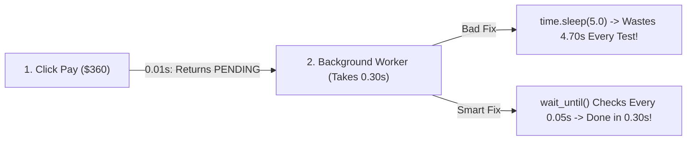

# Why time.sleep(5) Is Evil & Testing Background Jobs Without Waiting

```json continuity
{
  "previously": "In Ch 05, we ran 32 parallel flight-booking workers safely using isolated `X-Test-Tenant-ID` namespaces.",
  "painPoint": "When a passenger clicks 'Pay $360', AeroCart immediately replies `status: 'PENDING'` while a background worker charges the card 300ms later. Checking `assert status == 'CONFIRMED'` right away fails immediately—and scattering `time.sleep(5)` across 400 tests wastes 33 minutes of dead air!",
  "unlock": "Build a smart `wait_until()` condition poller that finishes the instant the ticket is ready, and unlock Staff-level Transactional Outbox, Kafka idempotency, and Saga rollback verification."
}
```

```json walkthrough
[
  {
    "time": "0:00",
    "badge": "Slide 1 / 4 · Why Did It Say 'PENDING'?!",
    "caption": "When you buy a plane ticket on a real website, the web server doesn't freeze for 2 seconds waiting for Visa and the airline printer. It immediately replies `status = 'PENDING'` and hands the work to a background queue!",
    "code": "order = submit_payment('$360')\nassert order.status == 'CONFIRMED'\n# ❌ AssertionError: 'PENDING' != 'CONFIRMED' (Checked 0.3s too early!)",
    "nodes": ["Click Pay $360", "Instant 'PENDING' Reply", "Too-Early Assert Fails!"]
  },
  {
    "time": "0:25",
    "badge": "Slide 2 / 4 · Why time.sleep(5) Is a Trap",
    "caption": "Beginners fix this by adding `time.sleep(5)`. If the ticket actually finishes in 0.2s, you waste 4.8s doing nothing! Multiply 5s across 400 tests = 33 minutes wasted. Worse, if the server takes 5.1s on a busy day, the test STILL fails!",
    "code": "time.sleep(5.0)  # Wastes 4.8s when fast... and STILL fails if server takes 5.1s!",
    "nodes": ["time.sleep(5.0)", "Wastes 33 Mins in CI", "Still Flakes at 5.1s!"]
  },
  {
    "time": "0:50",
    "badge": "Slide 3 / 4 · Smart Polling (wait_until)",
    "caption": "Instead of closing your eyes for 5 seconds, check every 50 milliseconds (`0.05s`) until `status == 'CONFIRMED'` (up to a 5s max timeout). When the ticket finishes at `0.3s`, your test moves on immediately at `0.3s`!",
    "code": "wait_until(lambda: get_status(id) == 'CONFIRMED', timeout=5.0)\n# Finishes in 0.30s on fast days, and safely waits up to 5.0s on busy days!",
    "nodes": ["Check Every 50ms", "Done in 0.3s!", "Up to 5s Safety Cap"]
  },
  {
    "time": "1:15",
    "badge": "Slide 4 / 4 · Outbox & Saga Rollbacks",
    "caption": "In Step 4, we'll see what happens inside that background queue: how Transactional Outbox prevents lost orders, and how a Saga automatically gives the seat back if a credit card declines!",
    "code": "# Step 1: Reserve Seat 1A -> Step 2: Card Declined!\n# Saga Compensation: Automatically release Seat 1A back to available!",
    "nodes": ["Transactional Outbox", "Kafka At-Least-Once", "Saga Auto-Refund"]
  }
]
```

```json pretraining
[
  {
    "term": "Asynchronous (Background) Work",
    "formula": "Request -> 'PENDING' now -> 'CONFIRMED' 300ms later",
    "meaning": "Instead of making the user stare at a frozen screen, the server accepts the order immediately and finishes payment/ticketing in the background."
  },
  {
    "term": "Condition Polling (wait_until / Awaitility)",
    "formula": "Check every 50ms until Ready (or Timeout)",
    "meaning": "Repeatedly checking if a background job is done in tiny steps so fast jobs finish in milliseconds without fixed sleeps."
  },
  {
    "term": "Transactional Outbox",
    "formula": "Save Order + Save Event in ONE Database Step",
    "meaning": "Saving the order and the 'send email/ticket' task together in the database so a sudden server crash never loses the task."
  },
  {
    "term": "Saga Compensation (Undo Step)",
    "formula": "Seat Reserved -> Card Declined => Release Seat!",
    "meaning": "An automatic 'undo' step that puts reserved flight seats back on the shelf if a later step (like credit card payment) fails."
  }
]
```

```json poe
{
  "question": "An AeroCart order endpoint saves a new flight order to the SQL database (`db.commit(order)`) and on the very next line sends a message to the background worker (`kafka.send('OrderCreated')`). How do you prove in a test that this 2-step code has a dangerous bug, and what fixes it?",
  "options": [
    "Add `time.sleep(1)` after `kafka.send()`",
    "Simulate a network blip or crash right between `db.commit()` and `kafka.send()`: the order stays stuck as `PENDING` in SQL forever because the background worker never hears about it! Fix it with a single-transaction SQL Outbox table",
    "Delete the SQL database and store everything in browser cookies",
    "Ignore exceptions thrown by `kafka.send()`"
  ],
  "answerIndex": 1,
  "explanation": "Writing to two separate systems (SQL + Kafka) one after another is called a 'Dual Write'. If the server crashes after line 1, the event is lost forever! Saving both inside one SQL transaction ('Transactional Outbox') guarantees they succeed or fail together."
}
```

## 🌱 Step 1: Plain-English Story — The Coffee Shop Buzzer vs. Blindfolded Waiting

In **Chapter 05**, we ran 32 flight searches in parallel. Now let's test what happens when a passenger clicks **"Pay $360"** on AeroCart!

In a tiny toy app, clicking "Pay" does everything at once while the user waits. But in a real airline app, charging a bank card, generating a PDF boarding pass, and emailing a receipt takes **`300 milliseconds`**. To keep the website snappy, AeroCart uses **Asynchronous (Background) Processing**:
1. The instant you click Pay, AeroCart's web server replies: **`status: "PENDING"`** (*"Got your order! Working on it..."*).
2. In the background, a payment worker charges the card and flips the status to **`"CONFIRMED"`** `300ms` later.

Now look at what happens when a beginner writes a test for this:
- **Mistake #1 (Checking Immediately)**: You call `pay()`, and on the very next line (`1 millisecond` later) you check `assert get_status() == "CONFIRMED"`. It **crashes every time** because the background worker is still working (`status` is still `"PENDING"`)!
- **Mistake #2 (`time.sleep(5)`)**: To fix it, the beginner adds `time.sleep(5)` before the `assert`.



Why do experienced engineers hate `time.sleep(5)`?
Imagine ordering an espresso at a coffee shop that takes **30 seconds** to brew:
- `time.sleep(5)` is like putting on a blindfold and standing completely frozen for **5 full minutes** even though your coffee was sitting hot on the counter after 30 seconds! Across 400 tests, `time.sleep(5)` wastes **33 minutes** of your life on every build—and on a slow day when the coffee takes `5.1` seconds, your test **still fails**!
- **Condition Polling (`wait_until`)** is like glancing at the counter every half-second: the moment your cup appears at `0.3s`, you grab it and walk out!

## 🔨 Step 2: First Lines of Code — A 12-Line `wait_until` Poller

Let's replace `time.sleep(5)` with a clean, reusable `wait_until()` helper in **Python 3** and **Java 17**!

Watch how `wait_until()` checks `check_fn()` in tiny `0.05s` steps using `time.monotonic()` (a stopwatch that never jumps backward) and returns the **exact instant** the ticket flips from `"PENDING"` to `"CONFIRMED"`:

```python
import time

def wait_until(check_fn, timeout_sec: float = 5.0, poll_sec: float = 0.05) -> None:
    deadline = time.monotonic() + timeout_sec
    while time.monotonic() < deadline:
        if check_fn():  # As soon as the condition is True, return immediately!
            return
        time.sleep(poll_sec)
    raise TimeoutError(f"Condition did not become True within {timeout_sec}s!")

# Simulate AeroCart's background worker confirming an order after 0.15 seconds:
start_time = time.monotonic()
def is_order_confirmed() -> bool:
    return (time.monotonic() - start_time) >= 0.15

# Finishes in ~0.15s instead of wasting 5.0s!
wait_until(is_order_confirmed, timeout_sec=5.0)
print("✓ Background order confirmed in ~0.15s with zero wasted sleep!")
```

### Java 17 Equivalent

```java
import java.util.function.BooleanSupplier;

public class SmartPollerDemo {
    static void waitUntil(BooleanSupplier checkFn, long timeoutMs, long pollMs) throws Exception {
        long deadlineNanos = System.nanoTime() + (timeoutMs * 1_000_000L);
        while (System.nanoTime() < deadlineNanos) {
            if (checkFn.getAsBoolean()) {
                return; // Done immediately!
            }
            Thread.sleep(pollMs);
        }
        throw new AssertionError("Condition did not become true within " + timeoutMs + "ms!");
    }

    public static void main(String[] args) throws Exception {
        long startNanos = System.nanoTime();
        waitUntil(() -> (System.nanoTime() - startNanos) >= 150_000_000L, 5000, 50);
        System.out.println("✓ Background order confirmed in ~150ms with zero wasted sleep!");
    }
}
```

## ⚡ Step 3: Where It Breaks in Real Life — Waiting 10 Seconds for a Dead Order & Double Charges!

Our `wait_until()` poller in Step 2 is already 10× better than `time.sleep(5)`.

**Where does a basic poller still run into trouble in a real production system like AeroCart?**
1. **The "Dead Order" Wait Trap**: Suppose your test waits up to `10 seconds` for `status == "CONFIRMED"`. At `0.04 seconds` (40 milliseconds!), the passenger's credit card is declined and the order status permanently flips to `"PAYMENT_FAILED"`. A basic `wait_until` loop ignores `"PAYMENT_FAILED"` and keeps stubbornly polling for the remaining **9.96 seconds** waiting for `"CONFIRMED"`! If 50 tests break on a bad commit, your build hangs for **8+ minutes** instead of failing in 2 seconds!
2. **Duplicate Messages (Double-Charging a Passenger!)**: Background message queues (like Kafka or RabbitMQ) promise **At-Least-Once Delivery**—meaning if a network hiccup happens, the queue might deliver the same `"Charge $360"` message **twice**. If your test only ever sends 1 message, you will never catch that AeroCart charged the passenger `$720`!

```json contrast
{
  "title": "Blind Sleep / Basic Polling vs. Fail-Fast Poller & Event Chaos Testing",
  "naiveTitle": "Hardcoded sleep(5000) & Happy-Path Only",
  "naiveMetric": "33m Wasted Wait · Misses Double-Charges",
  "naivePoints": [
    "Uses `time.sleep(5)` everywhere, wasting 33 minutes across 400 tests while still flaking on slow CI machines",
    "Keeps polling for 10 full seconds even when an order already failed permanently with `PAYMENT_FAILED` at 40ms",
    "Only tests sending each background event once—never checks if a duplicate event double-charges the customer"
  ],
  "staffTitle": "Fail-Fast Monotonic Poller + Outbox & Saga Checks",
  "staffMetric": "90ms Median · Proves Zero Double-Charge",
  "staffPoints": [
    "Polls with exponential backoff (`25ms -> 200ms`) using `time.monotonic()` / `System.nanoTime()`",
    "Aborts immediately (`Fail-Fast Terminal Check`) the millisecond an order hits `PAYMENT_FAILED` or `CANCELLED`",
    "Replays the same `event_id` 3 times in tests to prove the consumer deduplicates it (`Idempotent Consumer`)",
    "Verifies that if payment fails at Step 2, the Saga automatically releases the reserved flight seat at Step 1"
  ]
}
```

Step through the **Kafka Outbox & Saga Simulator** below to watch how events flow from the database to background workers!

## 🚀 Step 4: Staff Engineer Deep-Dive — The Math of `sleep()`, Transactional Outbox & Saga Conservation

Let's connect the dots between your `wait_until()` poller and the exact distributed-systems architecture Staff SDETs verify in interviews.

### 1. Why `sleep(5000)` Loses Both Speed AND Reliability
Suppose background processing latency $L$ has a median $P_{50} = 80\text{ ms}$, $P_{99} = 950\text{ ms}$, and occasional garbage-collection pauses of $P_{99.9} = 5,400\text{ ms}$. Across $N = 400$ async tests, a hardcoded $T_{\text{sleep}} = 5,000\text{ ms}$ burns:

$$
T_{\text{wasted}} = N \times \left(T_{\text{sleep}} - P_{50}\right) = 400 \times (5.0\text{s} - 0.08\text{s}) = \mathbf{1,968\text{ seconds}\;(32.8\text{ minutes!})}
$$

And because $P(L > 5,000\text{ ms}) = 0.001$, the probability that all 400 tests pass without a timeout flake is only $0.999^{400} = \mathbf{67.0\%}$! Bounded polling with a $10\text{s}$ cap finishes in $\approx 88\text{ ms}$ per test at $P_{50}$ while handling $5.4\text{s}$ spikes with **zero flakes**.

### 2. The 4 Distributed Event Scenarios Every Staff Suite Verifies

| Distributed Pattern | What Could Go Wrong in Production? | How Our Automated Test Proves It Works |
| :--- | :--- | :--- |
| **1. Transactional Outbox** | App commits `orders` row to SQL, then crashes 1ms before publishing to Kafka (`Dual-Write Bug`). | Assert `orders` row and `outbox_events` row are inserted inside the **exact same SQL transaction** (`COMMIT` or `ROLLBACK` together). |
| **2. Idempotent Consumer** | Kafka redelivers `event_id = "evt_99"` twice after a network blip, deducting 2 seats instead of 1. | Call `consumer.handle(evt_99)` **3 times in a row**; assert seat inventory decreases by **exactly 1**. |
| **3. Fail-Fast Terminal Poll** | Order transitions to `PAYMENT_DECLINED` at `35ms`, but test polls until `10,000ms` timeout. | Pass `is_terminal_failure` predicate into `poll_until_converged()` so permanent failures abort on tick #1. |
| **4. Saga Compensation** | Step 1 reserves Seat `1A`, Step 2 card payment declines, and Seat `1A` stays locked forever! | Trigger payment decline at Step 2; assert `SagaCompensateRelease` fires and `available_seats` returns to its starting count. |

### Production Blueprint: Fail-Fast Monotonic Poller & Idempotent Saga Consumer (`Python 3` & `Java 17`)

```python
import time
from dataclasses import dataclass, field
from typing import Callable, TypeVar

T = TypeVar("T")


class TerminalSagaAbortError(AssertionError):
    """Raised immediately when an async workflow enters an unrecoverable failure state."""


def poll_until_converged(
    probe: Callable[[], T],
    is_done: Callable[[T], bool],
    is_terminal_failure: Callable[[T], bool] = lambda _: False,
    timeout_sec: float = 8.0,
) -> T:
    deadline = time.monotonic() + timeout_sec
    interval = 0.025  # Start fast at 25ms, cap at 200ms
    last_val: T | None = None
    polls = 0

    while True:
        polls += 1
        last_val = probe()
        if is_done(last_val):
            return last_val
        if is_terminal_failure(last_val):
            # Fail in 25ms instead of wasting 8 seconds waiting on a dead order!
            raise TerminalSagaAbortError(f"Aborted on poll #{polls}: terminal failure state {last_val!r}")

        remaining = deadline - time.monotonic()
        if remaining <= 0:
            raise TimeoutError(f"Timed out after {timeout_sec}s ({polls} polls). Last state={last_val!r}")
        time.sleep(min(interval, remaining))
        interval = min(0.200, interval * 1.6)


@dataclass
class IdempotentFlightSagaConsumer:
    seats_by_flight: dict[str, int]
    processed_event_ids: set[str] = field(default_factory=set)

    def handle_event(self, event_id: str, event_type: str, flight_id: str, qty: int) -> str:
        # 1. Deduplicate At-Least-Once Kafka redeliveries!
        if event_id in self.processed_event_ids:
            return "DEDUPLICATED_NOOP"
        # 2. Apply reserve or Saga compensation (undo)
        if event_type == "RESERVE_SEAT":
            self.seats_by_flight[flight_id] -= qty
        elif event_type == "SAGA_COMPENSATE_RELEASE":
            self.seats_by_flight[flight_id] += qty
        self.processed_event_ids.add(event_id)
        return "APPLIED"
```

### Java 17 Equivalent

```java
import java.time.Duration;
import java.util.function.Predicate;
import java.util.function.Supplier;

public final class BoundedConvergencePoller {
    public static <T> T awaitUntil(
            String alias,
            Duration timeout,
            Supplier<T> stateProbe,
            Predicate<T> isDone,
            Predicate<T> isTerminalFailure) {

        final long deadlineNanos = System.nanoTime() + timeout.toNanos();
        long sleepMillis = 25L;
        int attempts = 0;

        while (true) {
            attempts++;
            T current = stateProbe.get();
            if (isDone.test(current)) {
                return current;
            }
            if (isTerminalFailure.test(current)) {
                throw new AssertionError(alias + " fast-aborted on poll #" + attempts + ": " + current);
            }
            long remainingNanos = deadlineNanos - System.nanoTime();
            if (remainingNanos <= 0L) {
                throw new AssertionError(alias + " timed out! Last observed state: " + current);
            }
            try {
                Thread.sleep(Math.min(sleepMillis, Math.max(1L, remainingNanos / 1_000_000L)));
            } catch (InterruptedException ie) {
                Thread.currentThread().interrupt();
                throw new AssertionError("Interrupted while polling " + alias, ie);
            }
            sleepMillis = Math.min(200L, (long) (sleepMillis * 1.6));
        }
    }
}
```

> [!WARNING]
> **Staff Interview Gotcha — Never Use `time.time()` / `System.currentTimeMillis()` for Polling Deadlines, and How to Test "Nothing Happened"!**
> 1. **Wall-Clock Jumps**: `time.time()` and `System.currentTimeMillis()` read the wall clock, which can jump backward or forward mid-test when a cloud server syncs with an NTP time server—expiring your 5-second timeout in 1 millisecond! Always use `time.monotonic()` (Python) or `System.nanoTime()` (Java).
> 2. **Testing Negative Events ("Assert No Event Was Sent")**: How do you prove a bad order did *not* send an email event without sleeping 5 seconds hoping nothing arrives? **Send a trailing Canary message** (`O_bad` followed immediately by valid `O_canary` on the same FIFO queue partition). The millisecond `O_canary` arrives (`~60ms`), you know for a 100% fact that `O_bad` was already processed ahead of it and emitted nothing!

**Module 2 Complete — Up Next in Module 3 (Chapter 07)**: Our individual tests are now clean, parallel-safe, and async-smart! But as AeroCart grows to **1,000+ tests**, running the whole suite on 1 CI machine takes **40 minutes**—and splitting files alphabetically across 4 machines leaves Machine #4 stuck for **28 minutes**! Let's fix it with **CI Sharding & Bin Packing**!

```json quiz
[
  {
    "id": "sdet-06-q1",
    "question": "Why is `wait_until(check_fn, timeout=5.0)` dramatically better than `time.sleep(5.0)` when testing an asynchronous background payment?",
    "options": [
      "`time.sleep(5.0)` is illegal syntax in Python 3",
      "`time.sleep(5.0)` always wastes the full 5 seconds even when the job finishes in 0.2s (and fails if a busy server takes 5.1s), whereas `wait_until` checks every ~25–50ms and continues the exact millisecond the job finishes",
      "`wait_until` skips running the assertion",
      "`time.sleep(5.0)` deletes the database"
    ],
    "answerIndex": 1,
    "explanation": "Condition polling finishes at actual completion speed (e.g., 200ms) on normal runs while still providing a generous safety ceiling (e.g., 5–10s) during temporary CPU spikes."
  },
  {
    "id": "sdet-06-q2",
    "question": "Why did we add an `is_terminal_failure` check inside `poll_until_converged()` in our production poller?",
    "options": [
      "To make the code longer",
      "If an order permanently fails (`status == 'PAYMENT_DECLINED'`) at 40ms while the test is waiting for `'CONFIRMED'`, a naive poller wastes the remaining 9.96 seconds waiting for a dead order; checking for terminal failure aborts immediately in 40ms",
      "Because Kafka messages self-destruct after 50ms",
      "To restart the database"
    ],
    "answerIndex": 1,
    "explanation": "Short-circuiting on terminal error states prevents broken builds from hanging until the maximum timeout on every failed test."
  },
  {
    "id": "sdet-06-q3",
    "question": "How can you test that an invalid order `O_bad` did NOT publish a Kafka event on Partition 0 in ~60ms instead of calling `time.sleep(5)` hoping nothing shows up?",
    "options": [
      "Call `time.sleep(0.001)` and hope for the best",
      "Publish `O_bad` followed immediately by a valid marker event `O_canary` on the SAME partition; because a Kafka partition is strictly FIFO (first-in, first-out), the instant `O_canary` arrives at the consumer, you know `O_bad` was already processed and emitted nothing",
      "Unplug the network cable",
      "It is impossible to test that an event was not sent"
    ],
    "answerIndex": 1,
    "explanation": "Using a trailing Canary/Sentinel message on a FIFO-ordered queue turns a slow 'wait for silence' check into a fast, deterministic positive check."
  }
]
```
