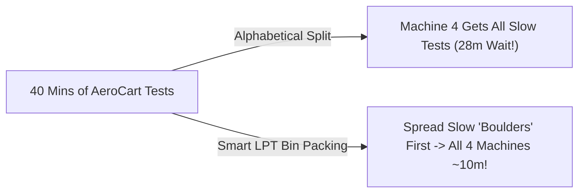

# The Grocery Checkout Line Problem: Balancing Tests Across 4 CI Machines

```json continuity
{
  "previously": "In Ch 06, we replaced slow `time.sleep(5)` calls with a smart `wait_until()` poller for AeroCart's background payment jobs.",
  "painPoint": "Six months later, AeroCart has 1,000 tests totaling 40 minutes of work. We rent 4 CI machines ('Shards') and split our test files alphabetically—yet Machine #4 gets stuck with all the heavy `checkout_e2e` tests and still takes 28 minutes while Machines 1–3 sit idle!",
  "unlock": "Use the Grocery Store Checkout Line trick—Longest-Processing-Time (`LPT`) min-heap bin packing—to balance all 4 machines to ~10 minutes flat, and learn Speculative Merge Queues."
}
```

```json walkthrough
[
  {
    "time": "0:00",
    "badge": "Slide 1 / 4 · Why Did 4 Machines Still Take 28 Mins?",
    "caption": "You have 40 minutes of AeroCart tests and 4 cloud machines (`Shards`). You expect `40 / 4 = 10 minutes`, right? Instead, splitting files alphabetically puts all the slow browser checkout tests on Machine #4, so the build STILL takes 28 minutes!",
    "code": "# Machine 1 (auth_*):     4 mins (Idle for 24 mins!)\n# Machine 2 (baggage_*):  4 mins (Idle for 24 mins!)\n# Machine 3 (coupons_*):  4 mins (Idle for 24 mins!)\n# Machine 4 (z_e2e_*):   28 mins! <-- Gates the whole PR!",
    "nodes": ["40m Total Work", "Alphabetical Split", "Machine 4 Takes 28m!"]
  },
  {
    "time": "0:25",
    "badge": "Slide 2 / 4 · The Grocery Store Checkout Analogy",
    "caption": "Imagine 4 grocery cashiers and 8 shoppers: 4 shoppers have huge 6-minute carts, and 4 have tiny 1-minute baskets. If all 4 huge carts get in Cashier #4's line, Cashier #4 takes 24 minutes while Cashiers 1–3 finish in 1 minute!",
    "code": "# Bad Lineup:  Cashier 4 gets [6m, 6m, 6m, 6m] = 24 mins!\n# Smart Lineup: Each Cashier gets [6m + 1m]    =  7 mins flat!",
    "nodes": ["4 Big Carts (Boulders)", "4 Small Baskets (Pebbles)", "Spread Big Carts First!"]
  },
  {
    "time": "0:50",
    "badge": "Slide 3 / 4 · Boulders First, Pebbles Last (LPT)",
    "caption": "The secret is super simple: 1) Sort your tests from SLOWEST to FASTEST (`Longest Processing Time` first). 2) Hand each test to whichever machine currently has the shortest total line!",
    "code": "# 1. Sort slowest -> fastest: [8m, 7m, 6m, 5m, 2m, 1m...]\n# 2. Always assign next test to the least-loaded machine!\n# Result: All 4 machines finish in ~10.0 minutes!",
    "nodes": ["Sort Slowest First", "Pick Shortest Line", "All Shards ~10m!"]
  },
  {
    "time": "1:15",
    "badge": "Slide 4 / 4 · Amdahl's Law & Merge Queues",
    "caption": "In Step 4, we'll also see why downloading dependencies inside every shard limits your speedup (Amdahl's Law) and how a Merge Queue prevents two Green PRs from breaking main!",
    "code": "# PR #1 (Green) + PR #2 (Green) -> Merged together = RED!\n# Fix: Speculative Merge Queue tests (main + PR #1 + PR #2) together!",
    "nodes": ["Amdahl's Law", "Min-Heap Bin Packer", "Speculative Merge Queue"]
  }
]
```

```json pretraining
[
  {
    "term": "CI Sharding (Splitting the Work)",
    "formula": "40 Mins of Tests / 4 Machines = ~10 Mins",
    "meaning": "Renting multiple cloud computers ('shards') in CI and dividing your test list among them so the whole suite finishes faster."
  },
  {
    "term": "The Straggler Shard",
    "formula": "Total Wait = Slowest Machine's Time",
    "meaning": "Because a Pull Request can't turn Green until ALL machines finish, one overloaded machine ('straggler') slows down the entire team."
  },
  {
    "term": "Longest-Processing-Time (LPT) Packing",
    "formula": "Sort Slowest First -> Assign to Lightest Machine",
    "meaning": "Placing the biggest, slowest tests ('boulders') onto machines first, then filling the tiny gaps at the end with fast unit tests ('pebbles')."
  },
  {
    "term": "Speculative Merge Queue",
    "formula": "Test (main + PR 1 + PR 2) Before Merging",
    "meaning": "Testing how two Pull Requests behave when combined together before they land on the main branch."
  }
]
```

```json poe
{
  "question": "Your team has 80 minutes of tests split alphabetically across 10 CI machines (`--shard=1/10`..`10/10`). Nine machines finish in 5.5 minutes, while Machine #3 (which got all the `checkout_*.spec.ts` files) runs for 15 minutes. How long does a developer wait for a Green PR, and what fixes it?",
  "options": [
    "Developers only wait 8 minutes because that is the average of the 10 machines",
    "Developers wait the full 15 minutes (the slowest 'straggler' machine gates the whole build!); sorting tests slowest-first (LPT) and assigning each to the least-loaded machine balances all 10 machines to ~8 minutes flat with zero extra cloud cost!",
    "Alphabetical sharding is already as fast as mathematically possible",
    "Delete `checkout_*.spec.ts` so Machine #3 finishes faster"
  ],
  "answerIndex": 1,
  "explanation": "A parallel CI build is only as fast as its slowest machine! Sorting tests by historical duration (Longest-Processing-Time first) into a min-heap spreads the slow checkout tests evenly across all 10 machines."
}
```

## 🌱 Step 1: Plain-English Story — Four Grocery Cashiers and the 28-Minute Bottleneck

Welcome to **Module 3**! In Modules 1 and 2, we made AeroCart's tests fast, clean, and parallel-safe.

Fast-forward six months: AeroCart now has **1,000 automated tests** that take **40 minutes** to run on 1 cloud machine in CI. Waiting 40 minutes on every Pull Request is painful, so your manager says: *"Let's rent **4 CI machines (`Shards`)**! `40 minutes ÷ 4 machines = 10 minutes`!"*

A teammate splits the test files alphabetically across the 4 machines:
- **Machine 1 (`a..f`)**: gets fast `auth` and `baggage` unit tests → finishes in **4 minutes**!
- **Machine 2 (`g..m`)**: gets fast `loyalty` tests → finishes in **4 minutes**!
- **Machine 3 (`n..s`)**: gets fast `pricing` tests → finishes in **4 minutes**!
- **Machine 4 (`t..z`)**: gets all the heavy `ticket_checkout_e2e` browser tests → grinds for **28 minutes**!

Because GitHub cannot mark your Pull Request **Green** until **all 4 machines finish**, everyone still waits **28 minutes** while Machines 1, 2, and 3 sit completely idle!



Think of **4 checkout cashiers at a grocery store**:
- If 4 shoppers with overflowing **7-minute shopping carts ("Boulders")** all stand in Cashier #4's line while shoppers with **1-minute hand baskets ("Pebbles")** use Cashiers 1–3, Cashier #4 takes **28 minutes**!
- What does a smart store manager do? **Send the big carts to empty cashiers FIRST**, and let the tiny 1-item baskets fill in the small gaps at the end!
- In computer science, this exact common-sense rule is called **Longest-Processing-Time (`LPT`) Bin Packing**: sort your tests from **slowest to fastest**, and always hand the next test to whichever machine currently has the **shortest total line**!

## 🔨 Step 2: First Lines of Code — A 15-Line LPT Test Balancer

Let's write that Grocery Store Manager in **15 lines of Python 3 and Java 17**!

Suppose we have 6 AeroCart test files with durations `[8, 7, 6, 5, 2, 2]` minutes (total = `30 minutes`) and `2` CI machines. Watch how sorting **slowest-first** and using a **Min-Heap** (which always hands us the machine with the smallest current load) balances both machines to **exactly `15 minutes` each**:

```python
import heapq

def balance_tests_across_machines(tests: list[tuple[str, int]], num_machines: int) -> list[list[str]]:
    # 1. Sort tests from SLOWEST to FASTEST ("Boulders first, pebbles last!")
    sorted_tests = sorted(tests, key=lambda item: item[1], reverse=True)

    # 2. Track each machine as (current_total_minutes, machine_id, test_list)
    machines = [(0, i, []) for i in range(num_machines)]
    heapq.heapify(machines)

    for test_name, minutes in sorted_tests:
        total_mins, machine_id, assigned = heapq.heappop(machines)  # Grab lightest machine
        assigned.append(test_name)
        heapq.heappush(machines, (total_mins + minutes, machine_id, assigned))

    return [(m_id, total, assigned) for total, m_id, assigned in sorted(machines)]

aerocart_tests = [("e2e_checkout", 8), ("e2e_refund", 7), ("api_flights", 6),
                  ("api_bags", 5), ("unit_coupon", 2), ("unit_tax", 2)]
for m_id, total_mins, files in balance_tests_across_machines(aerocart_tests, num_machines=2):
    print(f"Machine {m_id}: {total_mins} mins -> {files}")
# Both Machine 0 and Machine 1 finish in exactly 15 minutes!
```

### Java 17 Equivalent

```java
import java.util.*;

public class LptBalancerDemo {
    record TestFile(String name, int minutes) {}
    record Machine(int id, int totalMinutes, List<String> files) {}

    public static void main(String[] args) {
        List<TestFile> tests = new ArrayList<>(List.of(
            new TestFile("e2e_checkout", 8), new TestFile("e2e_refund", 7),
            new TestFile("api_flights", 6),  new TestFile("api_bags", 5),
            new TestFile("unit_coupon", 2),  new TestFile("unit_tax", 2)
        ));
        // 1. Sort slowest first ("Boulders first!")
        tests.sort(Comparator.comparingInt(TestFile::minutes).reversed());

        // 2. Min-heap always gives us the machine with the shortest current queue
        PriorityQueue<Machine> pool = new PriorityQueue<>(Comparator.comparingInt(Machine::totalMinutes));
        pool.add(new Machine(0, 0, new ArrayList<>()));
        pool.add(new Machine(1, 0, new ArrayList<>()));

        for (TestFile t : tests) {
            Machine lightest = pool.poll();
            lightest.files().add(t.name());
            pool.add(new Machine(lightest.id(), lightest.totalMinutes() + t.minutes(), lightest.files()));
        }
        pool.forEach(m -> System.out.println("Machine " + m.id() + ": " + m.totalMinutes() + "m -> " + m.files()));
    }
}
```

## ⚡ Step 3: Where It Breaks in Real Life — Uncached Setup & "Green + Green = Red!"

Balancing tests across machines cut our test time from `28 minutes` down to `10 minutes`!

**Where do fast CI pipelines still break as your engineering team grows to 50+ developers?**
1. **Repeating Slow Setup Inside Every Machine**: If every one of your 10 CI machines spends **5 minutes** downloading Python/Java packages and building Docker images from scratch before running its first test, then even with **1,000 machines**, your build can never finish in under 5 minutes! (Build once, share the snapshot!)
2. **The "Green + Green = Red" Merge Trap**:
   - At `9:00 AM`, **Developer A** opens `PR #1`, which renames `calculate_discount(price)` to `calculate_discount(price, cabin_class)`. All tests on `PR #1` turn **GREEN**!
   - At `9:01 AM`, **Developer B** opens `PR #2`, which adds a new button that calls the old `calculate_discount(price)`. Because `PR #1` hasn't merged yet, all tests on `PR #2` ALSO turn **GREEN**!
   - At `9:10 AM`, both PRs click **Merge**—and the `develop` branch immediately explodes **RED** because `PR #2` calls a function that `PR #1` just renamed!

```json contrast
{
  "title": "Alphabetical Shards & Direct Merges vs. LPT Bin Packing & Speculative Merge Queue",
  "naiveTitle": "Alphabetical Split + Rebuild Every Shard",
  "naiveMetric": "28m Straggler Wait · Broken Main Branch",
  "naivePoints": [
    "Splits test files alphabetically (`--shard=i/K`), clumping all slow `e2e_*` tests onto one straggler machine",
    "Re-downloads dependencies and recompiles code from scratch inside every single shard",
    "Assigns `0ms` estimate to brand-new test files, accidentally piling new slow browser tests onto one shard",
    "Lets developers merge any Green PR directly into `develop`, causing 'Green + Green = Red' collisions"
  ],
  "staffTitle": "Build-Once DAG + P90 LPT Heap + Merge Queue",
  "staffMetric": "6.4m PR Wait · <1.03x Imbalance · 100% Green Trunk",
  "staffPoints": [
    "Builds & caches container/dependency artifact ONCE, then fans it out to K balanced test shards",
    "Uses rolling 7-day P90 durations in an LPT min-heap (with a safe P75 default for brand-new unseen tests)",
    "Accounts for class-level `@BeforeAll` setup costs so heavy fixtures aren't duplicated across 10 shards",
    "Runs a Speculative Merge Queue that tests `(develop + PR #1 + PR #2)` together before merging!"
  ]
}
```

Try the **Interactive CI Bin-Packing Simulator** below to watch how sorting boulders first flattens straggler shards!

## 🚀 Step 4: Staff Engineer Deep-Dive — Amdahl's Law, Graham's Bound & Production LPT Planner

Now that you have the Grocery Checkout intuition, here is the formal math and production code Staff SDETs use to architect company-wide CI pipelines.

### 1. Amdahl's Law for CI Pipeline DAGs & Graham's LPT Theorem
Across $K$ parallel shards, total wall-clock PR turnaround time $T_{\text{total}}(K)$ is bounded by the **serial build prefix** plus the **slowest straggler shard**:

$$
T_{\text{total}}(K) = T_{\text{serial\_build}} + T_{\text{shard\_boot}} + \max_{1 \le i \le K} \left( \sum_{j \in \text{Shard}_i} d_j \right)
$$

By **Ronald Graham's LPT Theorem (1969)**, sorting jobs longest-first into a $K$-way min-heap runs in $O(N \log N + N \log K)$ time and guarantees a worst-case makespan ratio within:

$$
\frac{\text{Makespan}_{\text{LPT}}}{\text{Makespan}_{\text{OPT}}} \le \frac{4}{3} - \frac{1}{3K}
$$

In practice, when $N \ge 200$ tests and $K \le 16$ shards, LPT using rolling 7-day **$P_{90}$ durations** achieves an **Imbalance Ratio $< 1.02\times$** (within 2% of theoretical perfection!).

| Sharding Strategy | Time Complexity | 10-Shard Makespan (`80m` Total Work) | Straggler Overhead | Handles Clustered `e2e/` Folders? |
| :--- | :---: | :---: | :---: | :---: |
| **Alphabetical / File Slice** | $O(N \log N)$ | `14.8 min` | `+85%` wasted wait | **No** (`checkout/*` clumped together) |
| **Round-Robin (`i % K`)** | $O(N)$ | `11.4 min` | `+42%` wasted wait | Partial (sensitive to outliers) |
| **Historical $P_{90}$ LPT + Prior** | $O(N \log N + N \log K)$ | **`8.1 min`** | **`< 2%` optimal** | **Yes** (mathematically bounded) |

### Production Blueprint: Deterministic $P_{90}$ LPT Shard Planner (`Python 3` & `Java 17`)
Notice how our production planner assigns a safe fallback (`default_unseen_ms = 2500.0`, the repo's 75th percentile) to brand-new tests that have no history yet—so a newly added PR with 10 browser tests never defaults to `0ms` and lands on a single shard!

```python
import heapq
from dataclasses import dataclass, field
from typing import Iterable


@dataclass(frozen=True)
class TestTimingRecord:
    test_id: str
    p90_ms: float | None = None  # None = brand-new test added in this PR!


@dataclass
class ShardPlan:
    shard_index: int
    total_estimated_ms: float = 0.0
    tests: list[str] = field(default_factory=list)


def plan_lpt_shards(
    discovered_tests: Iterable[TestTimingRecord],
    num_shards: int,
    default_unseen_ms: float = 2_500.0,
) -> dict[str, object]:
    if num_shards <= 0:
        raise ValueError("num_shards must be >= 1")

    weighted = [
        (rec.p90_ms if (rec.p90_ms is not None and rec.p90_ms > 0) else default_unseen_ms, rec.test_id)
        for rec in discovered_tests
    ]
    # Sort descending by P90 duration ("Boulders first"), breaking ties alphabetically by test_id
    weighted.sort(key=lambda item: (-item[0], item[1]))

    shards = [ShardPlan(shard_index=i) for i in range(num_shards)]
    heap: list[tuple[float, int]] = [(0.0, i) for i in range(num_shards)]
    heapq.heapify(heap)

    for est_ms, test_id in weighted:
        load_ms, s_idx = heapq.heappop(heap)
        shards[s_idx].tests.append(test_id)
        new_load = round(load_ms + est_ms, 3)
        shards[s_idx].total_estimated_ms = new_load
        heapq.heappush(heap, (new_load, s_idx))

    makespan_ms = max((s.total_estimated_ms for s in shards), default=0.0)
    ideal_avg_ms = sum(s.total_estimated_ms for s in shards) / num_shards
    return {
        "shards": shards,
        "makespan_ms": makespan_ms,
        "imbalance_ratio": round(makespan_ms / ideal_avg_ms, 4) if ideal_avg_ms > 0 else 1.0,
    }
```

### Java 17 Equivalent

```java
import java.util.*;

public final class LptShardBinPacker {
    public record TestSpec(String testId, long estimatedP90Millis) {}

    public static final class ShardBucket {
        private final int shardIndex;
        private long totalMillis;
        private final List<String> assignedTests = new ArrayList<>();

        public ShardBucket(int shardIndex) { this.shardIndex = shardIndex; }
        public int shardIndex() { return shardIndex; }
        public long totalMillis() { return totalMillis; }
        public List<String> assignedTests() { return List.copyOf(assignedTests); }

        void assign(TestSpec spec) {
            this.assignedTests.add(spec.testId());
            this.totalMillis += spec.estimatedP90Millis();
        }
    }

    public static List<ShardBucket> packIntoShards(
            List<String> discoveredTestIds,
            Map<String, Long> historicalP90Millis,
            int shardCount,
            long fallbackUnseenP75Millis) {

        List<TestSpec> sorted = discoveredTestIds.stream()
            .map(id -> new TestSpec(id, historicalP90Millis.getOrDefault(id, fallbackUnseenP75Millis)))
            .sorted(Comparator.comparingLong(TestSpec::estimatedP90Millis).reversed()
                .thenComparing(TestSpec::testId))
            .toList();

        PriorityQueue<ShardBucket> minHeap = new PriorityQueue<>(
            Comparator.comparingLong(ShardBucket::totalMillis).thenComparingInt(ShardBucket::shardIndex)
        );
        List<ShardBucket> buckets = new ArrayList<>(shardCount);
        for (int i = 0; i < shardCount; i++) {
            ShardBucket b = new ShardBucket(i);
            buckets.add(b);
            minHeap.offer(b);
        }
        for (TestSpec spec : sorted) {
            ShardBucket lightest = minHeap.poll();
            lightest.assign(spec);
            minHeap.offer(lightest);
        }
        return buckets;
    }
}
```

> [!WARNING]
> **Staff Interview Gotcha — Don't Scatter a Heavy `@BeforeAll` Fixture Across 10 Shards!**
> Suppose `CheckoutBrowserSuite` has 10 test methods (`5 seconds` each) and a heavy `@BeforeAll` setup that takes **`45 seconds`** to seed test data. If you split `CheckoutBrowserSuite` at the individual method level across all 10 shards, **every single shard now pays that 45-second `@BeforeAll` setup tax** ($10 \times 45\text{s} = 450\text{s}$ of duplicated setup)! Always bin-pack at the **fixture-group level** (`setup_cost + sum(method_costs)`), or only split a class when its methods take much longer than its setup!

**Up Next in Chapter 08**: We balanced all 1,000 AeroCart tests across 4 machines so they finish in 10 minutes. Wait a second—if a developer only edits **1 line inside `coupon.py`**, why are we running Baggage, Seat-Map, and Loyalty tests on their Pull Request at all?! Let's build **Test Impact Analysis (`TIA`)**!

```json quiz
[
  {
    "id": "sdet-07-q1",
    "question": "In Graham's LPT (Longest-Processing-Time) bin-packing algorithm, why must we sort tests from SLOWEST to FASTEST ('boulders first') before assigning them to the lightest machine?",
    "options": [
      "Computers sort descending numbers faster than ascending numbers",
      "If giant 8-minute 'boulder' tests are handed out LAST, an 8-minute test gets dropped onto an already-full machine at the very end, creating a huge straggler; placing boulders FIRST lets tiny 1-second 'pebble' tests smooth out the gaps at the end",
      "Fast unit tests must always run after browser tests",
      "Min-heaps only accept descending numbers"
    ],
    "answerIndex": 1,
    "explanation": "Assigning the longest jobs first ('boulders') and filling residual gaps with tiny jobs ('pebbles') guarantees every machine finishes at nearly the exact same time."
  },
  {
    "id": "sdet-07-q2",
    "question": "Each CI shard spends 5 minutes installing dependencies from scratch, followed by 10 minutes of sharded tests on K = 10 machines (total = 15 minutes). If you double the machines to K = 20 without caching that 5-minute dependency install, what is the fastest possible build time?",
    "options": [
      "7.5 minutes (exact 2x speedup)",
      "10.0 minutes — by Amdahl's Law, the 5-minute setup repeated inside every shard cannot be shrunk by adding more machines (5m setup + 10m / 2 = 10m)",
      "2.5 minutes",
      "15.0 minutes"
    ],
    "answerIndex": 1,
    "explanation": "By Amdahl's Law, serial setup repeated on every runner sets a hard floor on pipeline latency. Building once and caching dependencies saves more time than doubling cloud machines!"
  },
  {
    "id": "sdet-07-q3",
    "question": "PR #1 renames `apply_coupon(code)` to `apply_coupon(code, currency)`. PR #2 adds a new call to `apply_coupon(code)`. Both PRs branch off `develop` at 9:00 AM, both pass 100% Green in isolation, and both merge at 9:15 AM—breaking `develop`! What prevents this?",
    "options": [
      "Sorting tests alphabetically",
      "A Speculative Merge Queue (Merge Train) that tests the combined result (`develop + PR #1 + PR #2`) before allowing PR #2 to merge into `develop`",
      "Adding `time.sleep(10)` to the coupon test",
      "Increasing code coverage from 80% to 90%"
    ],
    "answerIndex": 1,
    "explanation": "A Speculative Merge Queue validates each PR on top of the exact commits queued ahead of it, catching semantic merge conflicts before they ever hit the main branch."
  }
]
```
