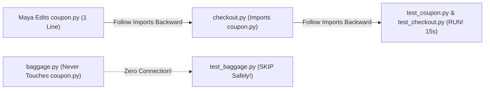

# Only Run What Changed: Building a Smart Dependency Map (Test Impact Analysis)

```json continuity
{
  "previously": "In Ch 07, we used Longest-Processing-Time (`LPT`) bin packing to balance AeroCart's 1,000 tests evenly across 4 CI machines.",
  "painPoint": "Even with balanced shards, running all 1,000 tests on every tiny Pull Request costs thousands of dollars in cloud bills. Wait—if a developer only edits 1 line inside `coupon.py`, why are we running 800 Baggage, Seat-Map, and Pilot-Roster tests that don't even touch coupons?!",
  "unlock": "Build a Reverse Dependency Map (`Test Impact Analysis` / `AST` import graph) that runs ONLY the tests affected by a code change—plus a mandatory 'Escape Hatch' when core config files change!"
}
```

```json walkthrough
[
  {
    "time": "0:00",
    "badge": "Slide 1 / 4 · Why Test Baggage When You Edited Coupons?",
    "caption": "Imagine renovating the bathroom sink in your house, and the city inspector forces you to re-inspect the garage door, the attic roof, and the lawnmower! If a developer only changed `coupon.py`, running `test_baggage.py` is 100% wasted work.",
    "code": "# git diff: Changed ONLY src/coupon.py (1 line)\n# Why run all 1,000 tests (40 mins CPU) when only 12 tests touch coupons (15 secs)?!",
    "nodes": ["1-Line Edit in coupon.py", "Skip Unrelated Bag Tests", "Run Only 12 Coupon Tests!"]
  },
  {
    "time": "0:25",
    "badge": "Slide 2 / 4 · Following 'Who Imports Whom' Backward",
    "caption": "How does our test runner know which tests can be affected by `coupon.py`? By reading the `import` lines at the top of each file (`AST` parsing) and following the arrows BACKWARD from `coupon.py` to every test that uses it!",
    "code": "# checkout.py imports coupon.py\n# test_checkout.py imports checkout.py\n# Reverse Path: coupon.py -> checkout.py -> test_checkout.py (RUN IT!)",
    "nodes": ["coupon.py", "checkout.py (Imports Coupon)", "test_checkout.py (Run!)"]
  },
  {
    "time": "0:50",
    "badge": "Slide 3 / 4 · Watch Out for the 'Config File' Trap!",
    "caption": "Wait: what if a developer doesn't edit any `.py` or `.java` file, and instead upgrades Python or database libraries inside `pyproject.toml`, `pom.xml`, or `Dockerfile`? Zero files `import Dockerfile`—so a naive dependency map would run 0 tests!",
    "code": "if changed_file in ('pyproject.toml', 'pom.xml', 'Dockerfile', 'conftest.py'):\n    return RUN_ALL_1000_TESTS  # Pull the Safety Escape Hatch!",
    "nodes": ["Edited pyproject.toml / pom.xml", "Pull Escape Hatch!", "Run 100% Full Suite"]
  },
  {
    "time": "1:15",
    "badge": "Slide 4 / 4 · Hybrid AST + Runtime Coverage",
    "caption": "In Step 4, we'll combine Static AST Import Graphs with Dynamic Per-Test Coverage Maps so even hidden Spring `@Autowired` / FastAPI plugins are caught 100% of the time!",
    "code": "selected = bfs_reverse_imports(diff) | dynamic_coverage_map[diff] | tier0_smoke_tests",
    "nodes": ["Static AST Graph", "Dynamic Coverage Map", "82% Compute Saved!"]
  }
]
```

```json pretraining
[
  {
    "term": "Test Impact Analysis (TIA)",
    "formula": "git diff -> Run ONLY Affected Tests",
    "meaning": "Looking at which files changed in a Pull Request and automatically selecting only the tests that could possibly be affected by those changes."
  },
  {
    "term": "Reverse Dependency Graph",
    "formula": "coupon.py -> checkout.py -> test_checkout.py",
    "meaning": "A map showing 'who uses whom': if File B imports File A, and Test C imports File B, then changing File A requires running Test C."
  },
  {
    "term": "AST (Abstract Syntax Tree) Parser",
    "formula": "Read 'import' lines safely without running code",
    "meaning": "A built-in tool (`ast.parse` in Python) that reads a source file's structure and `import` statements in milliseconds."
  },
  {
    "term": "Blast-Radius Escape Hatch",
    "formula": "Config / Lockfile Changed => Run 100% of Tests!",
    "meaning": "A safety rule: if someone changes a global file like `pom.xml`, `pyproject.toml`, or `Dockerfile`, don't try to be clever—run the entire test suite!"
  }
]
```

```json poe
{
  "question": "Your team builds a smart Test Impact Analysis (TIA) tool that reads Python `import` statements (`ast.parse`) to pick which tests to run. One afternoon, a developer edits ZERO `.py` files—they only edit `pyproject.toml` (upgrading a core library from v1 to v2). What happens if your TIA tool only looks at `import` statements without a Global Escape Hatch?",
  "options": [
    "Python automatically adds `import pyproject.toml` to every test file",
    "The TIA tool sees 0 changed `.py` files, runs 0 tests, marks the Pull Request 100% GREEN in 1 second, and merges a breaking library upgrade straight into production!",
    "Git blocks commits that don't include `.py` files",
    "The CI server refuses to boot"
  ],
  "answerIndex": 1,
  "explanation": "Global config files (`pyproject.toml`, `pom.xml`, `Dockerfile`, `conftest.py`, SQL migrations) are never imported via Python/Java `import` statements! Every production TIA engine MUST have a 'Blast-Radius Escape Hatch' that runs 100% of tests whenever a global file changes."
}
```

## 🌱 Step 1: Plain-English Story — Why Inspect the Lawnmower When You Fixed the Bathroom Sink?

In **Chapter 07**, we balanced AeroCart's 1,000 tests across 4 CI machines so a full test run takes 10 minutes (`40 CPU-minutes` of cloud server bill per run).

Now imagine 50 developers at AeroCart push **200 Pull Requests every day**:
- Developer Maya fixes a tiny rounding typo inside **`coupon.py`** (`1 line changed`).
- Immediately, CI boots 4 cloud machines and runs **all 1,000 tests**—including 300 **Baggage Weight** tests, 250 **Seat-Map 3D** tests, and 200 **Pilot Schedule** tests that have **nothing to do with coupons**!

That is like hiring a plumber to fix your **upstairs bathroom sink**, and the city inspector forces you to test your **garage door, kitchen toaster, and backyard lawnmower** before you're allowed to turn the water back on!



**How can a computer know—with 100% certainty—which tests depend on `coupon.py`?**
Every Python or Java file declares what it uses right at the top (`import coupon` or `from checkout import book_flight`):
1. `checkout.py` imports `coupon.py`.
2. `test_checkout.py` imports `checkout.py`.
3. `baggage.py` and `test_baggage.py` never import `coupon.py` or `checkout.py`!

If we build a **Reverse Dependency Map** (*"Who imports `coupon.py`, and who imports the files that import `coupon.py`?"*), we can follow the chain of arrows from `coupon.py` straight to `test_coupon.py` and `test_checkout.py`—and finish Maya's Pull Request in **15 seconds instead of 10 minutes**!

Engineers call this superpower **Test Impact Analysis (`TIA`)**.

## 🔨 Step 2: First Lines of Code — Following the Reverse Dependency Map

Let's write a working **18-line Test Impact Selector** in **Python 3** and **Java 17**!

Given a dictionary showing **"which files import each file"** (`REVERSE_MAP`) and a list of files edited in a Pull Request (`changed_files`), we use a simple queue (Breadth-First Search) to follow the chain of callers until we find every affected `test_*` file:

```python
from collections import deque

# Who imports whom? (File -> List of files that import it)
REVERSE_MAP = {
    "coupon.py":   ["checkout.py", "test_coupon.py"],
    "checkout.py": ["test_checkout.py"],
    "baggage.py":  ["test_baggage.py"],
}

def find_impacted_tests(changed_files: list[str]) -> list[str]:
    visited = set(changed_files)
    queue = deque(changed_files)
    while queue:
        current = queue.popleft()
        for dependent_file in REVERSE_MAP.get(current, []):
            if dependent_file not in visited:
                visited.add(dependent_file)
                queue.append(dependent_file)
    # Keep only the test files we reached!
    return sorted(f for f in visited if f.startswith("test_"))

# Maya edits ONLY coupon.py -> Notice how test_checkout.py is caught 2 hops away,
# while test_baggage.py is safely skipped!
print("Tests to run:", find_impacted_tests(["coupon.py"]))
# Output: ['test_checkout.py', 'test_coupon.py']
```

### Java 17 Equivalent

```java
import java.util.*;

public class SimpleTiaSelector {
    static final Map<String, List<String>> REVERSE_MAP = Map.of(
        "Coupon.java",   List.of("Checkout.java", "CouponTest.java"),
        "Checkout.java", List.of("CheckoutTest.java"),
        "Baggage.java",  List.of("BaggageTest.java")
    );

    static List<String> findImpactedTests(List<String> changedFiles) {
        Set<String> visited = new HashSet<>(changedFiles);
        Queue<String> queue = new ArrayDeque<>(changedFiles);
        while (!queue.isEmpty()) {
            String current = queue.poll();
            for (String caller : REVERSE_MAP.getOrDefault(current, List.of())) {
                if (visited.add(caller)) queue.offer(caller);
            }
        }
        return visited.stream().filter(f -> f.endsWith("Test.java")).sorted().toList();
    }

    public static void main(String[] args) {
        System.out.println("Tests to run: " + findImpactedTests(List.of("Coupon.java")));
        // Output: [CheckoutTest.java, CouponTest.java]
    }
}
```

Look how cool that is: even though Maya didn't directly touch `checkout.py`, our 10-line loop noticed that **`coupon.py` $\to$ `checkout.py` $\to$ `test_checkout.py`** and automatically ran `test_checkout.py` while skipping `test_baggage.py`!

## ⚡ Step 3: Where It Breaks in Real Life — Config Files & Dependency Injection Blind Spots

Following `import` lines works like magic—until two real-world surprises show up:

1. **Surprise #1: The Global Config File (`pyproject.toml` / `pom.xml` / `Dockerfile`)**:
   - What if a developer upgrades your database driver inside `pyproject.toml` or edits shared test fixtures in `conftest.py`?
   - **Zero Python files write `import pyproject.toml`!** If your TIA script only follows `import` statements, it will say *"0 tests affected!"*, run **nothing**, and let a broken database upgrade merge straight to production!
   - **The Fix (The Escape Hatch)**: Whenever a Pull Request touches a global file (`pyproject.toml`, `pom.xml`, `Dockerfile`, `conftest.py`, `.sql` migrations), **pull the Escape Hatch and run 100% of all tests!**
2. **Surprise #2: Dynamic Wiring / Dependency Injection (`@Autowired` / Plugins)**:
   - Sometimes `OrderController` calls `StripePaymentPlugin` through a framework interface or config string without directly writing `import stripe_payment_plugin`.
   - **The Fix (Hybrid Coverage Map)**: Combine static `import` graphs with **Per-Test Runtime Coverage** recorded from nightly runs (which remembers every actual line of code each test touched when it ran!).

```json contrast
{
  "title": "Naive Folder Regex / Unprotected AST vs. Staff Hybrid TIA with Escape Hatch",
  "naiveTitle": "Folder Name Guessing or Import-Only TIA",
  "naiveMetric": "8% Escaped Bugs · 0 Tests on Config Edits!",
  "naivePoints": [
    "Guesses tests by folder name (`src/coupons/*` -> `tests/coupons/*`), missing `test_checkout.py` in another folder!",
    "Runs 0 tests when `pyproject.toml`, `pom.xml`, `Dockerfile`, or `conftest.py` changes because nothing imports them",
    "Misses Spring `@Autowired` or FastAPI dependency-injected classes that don't have direct `import` statements"
  ],
  "staffTitle": "Hybrid AST + Coverage Union + Escape Hatch",
  "staffMetric": "82% PR Compute Saved · <0.05% Escape Rate",
  "staffPoints": [
    "Parses exact transitive `import` chains (`AST` reverse graph) AND unions them with per-test runtime coverage maps",
    "Triggers an automatic 100% Full-Suite Fallback ('Escape Hatch') whenever config, lockfiles, or fixtures change",
    "Always runs a fast 15-test 'Tier-0 Smoke Suite' on every PR plus 100% Full Suite inside the Merge Queue!"
  ]
}
```

Explore the **Test Impact Analysis & AST Graph Simulator** below to see how editing a leaf file (`coupon.py`) vs. a core config file (`pyproject.toml`) changes the selected test blast radius!

## 🚀 Step 4: Staff Engineer Deep-Dive — Transitive Closure Math, AST Parser & Hybrid TIA Blueprint

Let's formalize the graph theory and build a production-grade **AST Reverse-Import + Dynamic Coverage + Escape Hatch** engine in Python 3 and Java 17.

### 1. Graph Formulation & Recall Metrics
Let $G = (V, E)$ be the dependency graph where $(u, v) \in E$ means file $u$ imports or executes file $v$, and let $G_{\text{rev}} = (V, E^{-1})$ be the reversed graph. Given a pull-request change set $\Delta$, the impacted test set $T_{\text{selected}}(\Delta)$ is:

$$
T_{\text{selected}}(\Delta) = \begin{cases} T_{\text{all}} & \text{if } \Delta \cap V_{\text{global\_escape}} \neq \emptyset \\[6pt] \Big(\text{BFS}(G_{\text{rev}}, \Delta) \cup \bigcup_{f \in \Delta} \text{CovMap}[f]\Big) \cap T_{\text{all}} \;\cup\; T_{\text{smoke}} & \text{otherwise} \end{cases}
$$

To prove to engineering leadership that TIA is both **cheap** and **safe**, Staff SDETs track two metrics:
- **Compression Ratio**: $1 - \frac{|T_{\text{selected}}|}{|T_{\text{all}}|}$ (typically **$75\% - 88\%$ compute saved** on PRs).
- **TIA False-Negative Escape Rate ($FN_{\text{TIA}}$)**: The percentage of Merge-Queue/Trunk full-suite test failures whose culprit PR skipped that failing test during PR TIA (**must stay $< 0.1\%$**).

| Selection Signal | Catches 3-Hop Transitive Imports? | Catches `@Autowired` / DI / Reflection? | Safe When `pom.xml` or `.sql` Changes? | PR Selection Overhead |
| :--- | :---: | :---: | :---: | :---: |
| **Folder Path Regex** | No | No | No | `0 ms` |
| **Static AST `G_rev` BFS** | **Yes (100% exact)** | No (IoC inverts arrows!) | No | `< 150 ms` |
| **Dynamic Per-Test Coverage** | Yes (executed lines) | **Yes!** | Partial | Collected async on trunk |
| **Staff Hybrid TIA + Escape Hatch** | **Yes** | **Yes** | **Yes (100% Fallback)** | **`< 250 ms`** |

### Production Blueprint: AST Reverse-Import Graph + Coverage Union + Escape Hatch (`Python 3` & `Java 17`)
Notice how `build_python_reverse_import_graph()` uses Python's built-in `ast.parse()` to inspect `import` and `from ... import` statements **statically without executing or importing user code**:

```python
import ast
from collections import deque
from fnmatch import fnmatch
from pathlib import Path
from typing import Iterable

GLOBAL_ESCAPE_PATTERNS: tuple[str, ...] = (
    "pyproject.toml",
    "requirements*.txt",
    "*lock*",
    "Dockerfile*",
    ".github/workflows/*",
    "*/conftest.py",
    "conftest.py",
    "migrations/*.sql",
)


def build_python_reverse_import_graph(repo_root: Path, py_files: Iterable[Path]) -> dict[str, set[str]]:
    """Parses Python ASTs without executing code and builds G_rev: target_file -> {importer_files}."""
    files = list(py_files)
    mod_to_rel = {f.relative_to(repo_root).as_posix().removesuffix(".py").replace("/", "."): f.relative_to(repo_root).as_posix() for f in files}
    reverse_graph: dict[str, set[str]] = {f.relative_to(repo_root).as_posix(): set() for f in files}

    for f in files:
        importer_rel = f.relative_to(repo_root).as_posix()
        tree = ast.parse(f.read_text(encoding="utf-8"), filename=importer_rel)
        for node in ast.walk(tree):
            imported_dots: list[str] = []
            if isinstance(node, ast.Import):
                imported_dots.extend(alias.name for alias in node.names)
            elif isinstance(node, ast.ImportFrom) and node.module:
                imported_dots.append(node.module)
                imported_dots.extend(f"{node.module}.{alias.name}" for alias in node.names)
            for dotted in imported_dots:
                if dotted in mod_to_rel:
                    reverse_graph.setdefault(mod_to_rel[dotted], set()).add(importer_rel)
    return reverse_graph


def select_impacted_tests(
    changed_files: Iterable[str],
    all_tests: set[str],
    reverse_ast_graph: dict[str, set[str]],
    dynamic_coverage_map: dict[str, set[str]],
    tier0_smoke_tests: set[str],
) -> dict[str, object]:
    changed = list(changed_files)
    # 1. Global Blast-Radius Escape Hatch
    for path in changed:
        if any(fnmatch(path, pat) for pat in GLOBAL_ESCAPE_PATTERNS):
            return {
                "mode": "FULL_SUITE_FALLBACK",
                "reason": f"Global blast-radius file modified: {path}",
                "selected_tests": sorted(all_tests),
            }

    # 2. Transitive BFS over static AST reverse-import graph
    visited: set[str] = set(changed)
    queue: deque[str] = deque(changed)
    while queue:
        curr = queue.popleft()
        for caller in reverse_ast_graph.get(curr, ()):
            if caller not in visited:
                visited.add(caller)
                queue.append(caller)

    # 3. Union static AST callers + dynamic per-test coverage + Tier-0 smoke tests
    selected: set[str] = (visited & all_tests) | set(tier0_smoke_tests)
    for path in changed:
        selected |= (dynamic_coverage_map.get(path, set()) & all_tests)

    return {"mode": "SELECTIVE_TIA", "selected_tests": sorted(selected)}
```

### Java 17 Equivalent

```java
import java.util.*;

public final class TestImpactSelector {
    private static final List<String> GLOBAL_BLAST_SUFFIXES = List.of(
        "pom.xml", "build.gradle", "Dockerfile", "application.yml", ".sql"
    );

    public record SelectionPlan(boolean fullSuiteFallback, String reason, List<String> testsToRun) {}

    public static SelectionPlan computeSelection(
            Set<String> changedPaths,
            Set<String> allKnownTests,
            Map<String, Set<String>> reverseDependencyGraph,
            Map<String, Set<String>> dynamicCoverageIndex,
            Set<String> tierZeroSmokeTests) {

        // 1. Fail-safe Escape Hatch on global build/config/schema changes
        for (String path : changedPaths) {
            for (String suffix : GLOBAL_BLAST_SUFFIXES) {
                if (path.endsWith(suffix) || path.contains(".github/workflows/")) {
                    return new SelectionPlan(
                        true, "Global config modified: " + path,
                        allKnownTests.stream().sorted().toList()
                    );
                }
            }
        }

        // 2. Transitive BFS over reverse dependency graph G_rev
        Set<String> visited = new HashSet<>(changedPaths);
        Queue<String> bfs = new ArrayDeque<>(changedPaths);
        while (!bfs.isEmpty()) {
            String current = bfs.poll();
            for (String dependent : reverseDependencyGraph.getOrDefault(current, Set.of())) {
                if (visited.add(dependent)) {
                    bfs.offer(dependent);
                }
            }
        }

        // 3. Union static AST dependents + dynamic coverage map + Tier-0 smoke
        Set<String> selected = new TreeSet<>(tierZeroSmokeTests);
        for (String candidate : visited) {
            if (allKnownTests.contains(candidate)) selected.add(candidate);
        }
        for (String changed : changedPaths) {
            for (String dynTest : dynamicCoverageIndex.getOrDefault(changed, Set.of())) {
                if (allKnownTests.contains(dynTest)) selected.add(dynTest);
            }
        }
        return new SelectionPlan(false, "Selective TIA subset", List.copyOf(selected));
    }
}
```

> [!WARNING]
> **Staff Interview Gotcha — Whole-Suite Coverage vs. Per-Test Context Coverage (`--cov-context=test`)!**
> If someone asks you how to build the `dynamic_coverage_map` in an interview, never say *"Just run standard `pytest --cov` or default JaCoCo!"* Standard coverage merges all 1,000 tests into a single total report—which tells you *whether* line 42 of `coupon.py` was executed, but has **no idea which specific test** executed it! You must enable **per-test coverage contexts** (`pytest --cov --cov-context=test` in Python, or a JUnit `TestExecutionListener` that rotates JaCoCo session IDs per test method in Java) so you know the exact mapping `coupon.py -> {test_coupon.py, test_checkout.py}`!

**Up Next in Chapter 09**: Our CI pipeline now selects only impacted tests (Ch 08) and packs them evenly across shards (Ch 07). What happens when 1 out of 1,000 tests develops a subtle `2%` network flake? How do we detect, quarantine, and auto-file tickets for flaky tests using statistical math (`Rogan-Gladen` estimation) before developers lose trust? Let's find out in **Chapter 09**!

```json quiz
[
  {
    "id": "sdet-08-q1",
    "question": "Developer Maya edits `coupon.py`. `checkout.py` imports `coupon.py`, and `test_checkout.py` imports `checkout.py`. Why does a folder-name rule (`src/coupons/* -> tests/coupons/*`) fail here, while a Reverse Dependency Graph (`BFS`) succeeds?",
    "options": [
      "Folder-name rules cannot read `.py` files",
      "Folder-name matching only runs `tests/coupons/*` and misses `test_checkout.py` in `tests/checkout/`; following reverse import edges 2 hops (`coupon.py -> checkout.py -> test_checkout.py`) catches transitive callers automatically",
      "BFS runs every test in the repository",
      "`checkout.py` is deleted during CI"
    ],
    "answerIndex": 1,
    "explanation": "Bugs frequently cross folder boundaries when module B imports module A. Traversing the reverse import graph with BFS finds every direct and indirect caller."
  },
  {
    "id": "sdet-08-q2",
    "question": "In a Spring Boot or FastAPI app, `OrderController` uses Dependency Injection (`@Autowired PaymentGateway`) instead of directly importing `StripePaymentGatewayImpl`. Why does a pure static `import` graph miss `OrderControllerTest` when `StripePaymentGatewayImpl` changes, and how does Hybrid TIA catch it?",
    "options": [
      "Java interfaces cannot be compiled in CI",
      "With Dependency Injection, `StripePaymentGatewayImpl` imports the `PaymentGateway` interface (not the other way around!), so static reverse-import arrows stop at the implementation; unioning with a Dynamic Per-Test Coverage Map records that `OrderControllerTest` actually executed `StripePaymentGatewayImpl` at runtime!",
      "Spring Boot disables `git diff`",
      "Static AST graphs only work on Tuesdays"
    ],
    "answerIndex": 1,
    "explanation": "Inversion of Control (IoC) intentionally decouples callers from concrete implementations in static imports. Combining static AST edges with dynamic per-test runtime coverage closes the DI/reflection blind spot."
  },
  {
    "id": "sdet-08-q3",
    "question": "Why is it mandatory to run `--cov-context=test` (per-test coverage recording) instead of a single merged coverage report when building a Dynamic TIA map?",
    "options": [
      "Single merged coverage reports are too small",
      "A single merged report only tells you that `coupon.py` was executed somewhere during the 1,000-test run, whereas per-test context records the exact subset of test IDs that touched `coupon.py`",
      "`--cov-context=test` skips running assertions",
      "Merged coverage deletes `.py` files"
    ],
    "answerIndex": 1,
    "explanation": "To select only the affected tests when `coupon.py` changes, the coverage database must map each source file to the specific `test_id`s that executed it."
  }
]
```
