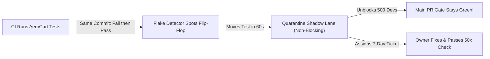

# The Automated Quarantine Box: Sidelining Flaky Tests Without Losing Coverage

```json continuity
{
  "previously": "In Chapter 08, we packed our test suite across parallel CI workers and used Test Impact Analysis (TIA) to shrink AeroCart's build time down to 3 minutes.",
  "painPoint": "Now 500 AeroCart engineers push code every day—so a single newly introduced flaky test blocks 50 innocent pull requests in a single hour! Yet if we just delete or ignore failing tests, real checkout bugs slip straight to passengers.",
  "unlock": "Build an Automated Quarantine Box that sidelines proven flaky tests into a non-blocking shadow lane within 60 seconds, assigns a 7-day owner ticket, and uses statistical confidence (Beta-Binomial / Wilson bounds) to prove a test is healthy before letting it back in."
}
```

```json walkthrough
[
  {
    "time": "0:00",
    "badge": "Slide 1 / 4 · One Chirping Smoke Alarm Blocks 50 Devs",
    "caption": "AeroCart's CI now finishes in 3 minutes! But at 10:00 AM, a subtle animation race makes `SeatMapModalTest` fail 10% of the time. Within one hour, 50 innocent developers see Red builds on code they didn't even touch!",
    "code": "# 10:05 AM: Alice's PR (Tax fix) -> RED (SeatMapModalTest failed!)\n# 10:12 AM: Bob's PR (Baggage icon) -> RED (SeatMapModalTest failed!)\n# 50 engineers are stuck in Slack asking: 'Can someone re-run my build?'",
    "nodes": ["Flaky Test Introduced", "50 PRs Blocked in 1 Hour", "Team Velocity Halts"]
  },
  {
    "time": "0:28",
    "badge": "Slide 2 / 4 · How Do We Prove It's a Flake?",
    "caption": "How does a robot know `SeatMapModalTest` is flaky rather than legitimately broken? Because on the EXACT same code commit, Attempt #1 failed and Attempt #2 passed (`PASS_ON_RETRY`)! If the code didn't change, the test is non-deterministic.",
    "code": "# Same Commit SHA (9f4a2c):\n# Attempt 1 -> FAIL (Timeout waiting for seat tooltip)\n# Attempt 2 -> PASS (200 OK)\n# Verdict: Proven PASS_ON_RETRY flake!",
    "nodes": ["Attempt 1: FAIL", "Attempt 2: PASS (Same Commit)", "Confirmed Flake Signal"]
  },
  {
    "time": "0:56",
    "badge": "Slide 3 / 4 · The Non-Blocking Quarantine Lane",
    "caption": "Instead of deleting the test or letting it block 500 developers, our Quarantine Bot moves `SeatMapModalTest` into a non-blocking Shadow Lane. PRs stay Green, while the test keeps running in the background so we collect stack traces!",
    "code": "if test_id in quarantine_list:\n    run_in_shadow_lane(test_id)  # Logs errors, never blocks PR merge!\n    file_owner_ticket(test_id, sla_days=7)",
    "nodes": ["Quarantine Registry", "Blocking PR Lane (Unblocked)", "Shadow Lane + 7-Day Ticket"]
  },
  {
    "time": "1:24",
    "badge": "Slide 4 / 4 · Earning Its Way Back (50x Burn-In)",
    "caption": "To stop the Quarantine Box from becoming a forgotten graveyard, the owning team has 7 days to fix the test and pass a 50-run stress check (`50/50 PASS`) before it returns to the main gate.",
    "code": "# De-Quarantine Gate:\n# Run fixed SeatMapModalTest 50 times in parallel under heavy CPU load\n# 50 / 50 PASS -> Promoted back to Blocking PR Gate!",
    "nodes": ["Owner Fixes Race", "50/50 Stress Burn-In", "Promoted Back to Main Gate"]
  }
]
```

```json pretraining
[
  {
    "term": "Pass-On-Retry (Flip-Flop)",
    "formula": "Attempt 1: FAIL -> Attempt 2: PASS",
    "meaning": "When a test fails and then immediately passes on the exact same code commit, proving the test itself (not the developer's code) is unstable."
  },
  {
    "term": "Quarantine Shadow Lane",
    "formula": "Run Test + Log Errors (Do Not Block PRs)",
    "meaning": "A separate side-track in CI where known flaky tests keep running so engineers can see error logs, without stopping teammates from merging healthy code."
  },
  {
    "term": "Flake Graveyard",
    "formula": "Quarantine Without Deadline = Deleted Coverage",
    "meaning": "What happens when teams mute or skip flaky tests with `@skip` and forget about them forever—silently leaving critical app features untested."
  },
  {
    "term": "Sample-Size Confidence (Wilson Bound)",
    "formula": "1 Flake in 2 Runs != 50 Flakes in 100 Runs",
    "meaning": "A smart statistical score that waits for enough test runs before declaring a test chronically flaky, preventing false alarms on brand-new tests."
  }
]
```

```json poe
{
  "question": "Suppose AeroCart's new `Test_A` ran only 2 times today and had 1 random network hiccup (50% raw flake rate). Meanwhile, `Test_B` ran 200 times today and flaked 8 times (4% raw flake rate). What happens if your quarantine bot blindly quarantines any test with a raw flake rate above 2%, and never sets a deadline to fix quarantined tests?",
  "options": [
    "Both tests will automatically fix themselves overnight",
    "1) Brand-new tests like Test_A get falsely quarantined after a single unlucky blip (tiny sample size), and 2) Without a hard 7-day fix deadline, hundreds of quarantined tests rot in a forgotten 'Flake Graveyard' where real bugs ship unnoticed!",
    "Test_B is healthier than a test with 0 failures",
    "Quarantining requires deleting the database"
  ],
  "answerIndex": 1,
  "explanation": "Raw percentages ignore how many times a test has run (1/2 looks worse than 8/200!), and quarantining without an owner deadline silently deletes your safety net."
}
```

## 🌱 Step 1: Plain-English Story — The Chirping Smoke Detector

In Chapter 08, we celebrated getting AeroCart's CI pipeline down to **3 minutes**. Now **500 engineers** push code to AeroCart every single day.

Then Monday morning hits.

A developer updates the pop-up seat selector on AeroCart's checkout page. That afternoon, `test_seat_map_popup` starts failing **1 out of every 10 times** because of a tiny animation timing hiccup.
- At 10:05 AM, Alice tries to merge a baggage-fee fix. Her build turns **RED** because `test_seat_map_popup` blinked!
- At 10:12 AM, Bob tries to merge a loyalty-points fix. His build turns **RED** for the exact same reason!
- By 11:00 AM, **50 innocent engineers are blocked** from shipping their work because of one noisy test they didn't even write.

What should we do with `test_seat_map_popup` right now?
1. **Bad Choice #1 (Leave it in the main gate)**: 500 engineers waste hours clicking *"Re-run build"* all week.
2. **Bad Choice #2 (Comment it out with `@skip`)**: Once you comment out a test in code, nobody ever looks at it again. Six months later, 150 tests are commented out and real bugs ship to passengers!

Instead, we build an **Automated Quarantine Box**:



Think of the Quarantine Box like a hospital isolation room:
- The moment a test proves it is flaky (it failed Attempt #1 and passed Attempt #2 on the *exact same code*), our bot moves it out of the **Main Blocking Gate** into a **Shadow Quarantine Lane** within 60 seconds.
- In the Shadow Lane, the test **still runs on every build** so we keep collecting fresh error logs, but if it fails, it **does not block teammates' pull requests**.
- At the exact same moment, the bot files a ticket for the team that owns that file with a strict **7-day deadline** to fix it and prove it can pass **50 times in a row**!

## 🔨 Step 2: First Lines of Code — Your First Quarantine Filter

How does a test runner know whether a test belongs in the **Blocking Gate** or the **Quarantine Box**?

Let's write a clean 15-line quarantine checker in **Python 3** and **Java 17**. Notice how we look for two simple clues in a test's recent history: did it flip-flop (`FAIL` then `PASS`) at least twice, and if a failing test is already in quarantine, we record a warning instead of crashing the developer's build!

```python
def classify_and_gate_test(test_name: str, recent_runs: list[str], failed_now: bool) -> str:
    # Clue: How many times did this test flip-flop (PASS_ON_RETRY) recently?
    flips = sum(1 for verdict in recent_runs if verdict == "PASS_ON_RETRY")
    is_quarantined = flips >= 2

    if not failed_now:
        return "PASS"
    if is_quarantined:
        return f"SHADOW_WARN: {test_name} failed in Quarantine (PR NOT blocked)"
    return f"BLOCK_PR: {test_name} failed deterministically!"


history = ["PASS", "PASS_ON_RETRY", "PASS", "PASS_ON_RETRY"]
print(classify_and_gate_test("test_seat_map_popup", history, failed_now=True))
```

### Java 17 Equivalent

```java
import java.util.List;

public class SimpleQuarantineGate {
    public static String classifyAndGate(String testName, List<String> recentRuns, boolean failedNow) {
        long flips = recentRuns.stream().filter(v -> v.equals("PASS_ON_RETRY")).count();
        boolean isQuarantined = flips >= 2;

        if (!failedNow) return "PASS";
        if (isQuarantined) {
            return "SHADOW_WARN: " + testName + " failed in Quarantine (PR NOT blocked)";
        }
        return "BLOCK_PR: " + testName + " failed deterministically!";
    }

    public static void main(String[] args) {
        var history = List.of("PASS", "PASS_ON_RETRY", "PASS", "PASS_ON_RETRY");
        System.out.println(classifyAndGate("test_seat_map_popup", history, true));
    }
}
```

Look at what those few lines just solved:
- If `test_seat_map_popup` is a known flake (`flips >= 2`), Alice's tax-fix PR prints `SHADOW_WARN` and **merges cleanly**.
- If Alice breaks a *healthy* test (`flips == 0`), it prints `BLOCK_PR` and **stops the bug immediately**!

## ⚡ Step 3: Where It Breaks in Real Life — Small-Sample False Alarms & The "Flake Graveyard"

Our simple `flips >= 2` counter is a great start, but as AeroCart grows to 5,000 tests, two real-world traps appear:

1. **Trap 1 — The Brand-New Test Problem (Sample Size Noise)**:
   Suppose a developer writes a brand-new test today. It runs **2 times** total, and one of those runs hits a brief cloud network blip (`1 flake / 2 runs = 50% flake rate`). Meanwhile, an older checkout test runs **500 times** today and flakes **10 times** (`10 flakes / 500 runs = 2% flake rate`).
   If our bot just checks raw percentages (`flake_rate >= 3%`), it quarantines the brand-new test after 1 blip while letting the chronic 10-flake monster keep blocking PRs! We need a math score that asks: *"Do we have enough runs to be 95% confident this test is truly flaky?"*
2. **Trap 2 — The "Flake Graveyard" (Quarantine Without a Clock)**:
   If the bot moves `test_seat_map_popup` into Quarantine on Monday and nobody is required to fix it, teams breathe a sigh of relief and ignore it forever. Within six months, **300 critical tests are sitting in Quarantine** and nobody notices when the real Seat Map breaks in production!

```json contrast
{
  "title": "Naive @Skip & Raw Percentages vs. Statistical Quarantine + 7-Day SLA",
  "naiveTitle": "Permanent @Skip & Raw % Thresholds",
  "naiveMetric": "180 Forgotten Skipped Tests · Zero Ownership",
  "naivePoints": [
    "Developers slap `@pytest.mark.skip('flaky')` onto failing tests in git; 6 months later, 30% of checkout has zero test coverage",
    "Raw flake percentage (`k / n`) treats 1 flake in 2 runs (50%) worse than 15 flakes in 200 runs (7.5%)",
    "Developers claim a flake is 'fixed' after running it once on their laptop, and it immediately flakes again in CI"
  ],
  "staffTitle": "Confidence-Scored Shadow Lane + 7-Day SLA + 50x Burn-In",
  "staffMetric": "<60s Auto-Unblock · 50/50 Stress Re-Entry",
  "staffPoints": [
    "Quarantines dynamically via a central list in <60 seconds without needing a git commit, keeping tests running in a Shadow Lane",
    "Uses sample-size-aware statistical confidence (Wilson / Beta-Binomial lower bound) so 1-off blips never trigger false quarantines",
    "Assigns a mandatory 7-day CODEOWNERS ticket and requires a 50-in-a-row parallel stress run (`50/50 PASS`) to leave quarantine"
  ]
}
```

Test your intuition with the **Quick Intuition Check** and explore the **Interactive Simulator** below before we dive into the Staff math in Step 4!

## 🚀 Step 4: Staff Engineer Deep-Dive — Wilson Binomial Bounds & The 50x Burn-In Gate

How do sites like Reddit, Yelp, and Netflix rank ratings or flaky tests when one item has `2` votes and another has `200` votes? They use **Edwin Wilson's Binomial Confidence Lower Bound** (or a **Beta-Binomial posterior**)!

### 1. The Wilson Score 95% Lower Bound ($W_{-}$)
Suppose a test has $k$ flake flip-flops (`PASS_ON_RETRY` or `FAIL -> PASS` on unchanged code) out of $n$ total runs, giving a raw empirical flake rate $\hat{p} = k / n$.

Instead of trusting the raw fraction $\hat{p}$, we ask: *"Given $n$ runs, what is the **95% confidence lower bound** ($z = 1.96$) on the true flake rate?"*

$$
W_{-}(k, n) = \frac{\hat{p} + \frac{z^2}{2n} - z \sqrt{\frac{\hat{p}(1 - \hat{p})}{n} + \frac{z^2}{4n^2}}}{1 + \frac{z^2}{n}}, \quad \hat{p} = \frac{k}{n}
$$

Watch how cleanly $W_{-}(k, n)$ separates small-sample noise from chronic flakiness when our quarantine threshold is **$W_{-} \ge 1.0\%$ (`0.01`)**:
- **New Test (`k = 1` flake in `n = 5` runs)**: Raw rate $\hat{p} = 20.0\%$, but sample size is tiny $\implies W_{-}(1, 5) = \mathbf{0.0088}$ (`0.88% < 1.0%` $\to$ **Watchlist only; wait for more data**).
- **Chronic Flake (`k = 8` flakes in `n = 200` runs)**: Raw rate $\hat{p} = 4.0\%$ across 200 runs $\implies W_{-}(8, 200) = \mathbf{0.0205}$ (`2.05% >= 1.0%` $\to$ **Auto-Quarantine with 95% statistical confidence!**).

*(Equivalently, in a Bayesian **Beta-Binomial** tracker starting with prior $\text{Beta}(\alpha_0=1, \beta_0=99)$, observing $k$ flakes in $n$ runs updates the posterior to $\text{Beta}(1+k, 99+n-k)$—pulling tiny samples safely toward $1\%$ until real evidence accumulates!)*

### 2. Why Re-Entry Requires a 50x Stress Burn-In
Suppose an engineer fixes a race condition in `test_seat_map_popup` and runs it **3 times** on their laptop. If the test still has a $5\%$ flake rate ($p = 0.95$), the chance it passes 3 runs in a row by pure luck is $0.95^3 = \mathbf{85.7\%}$!
By requiring **50 consecutive first-attempt passes (`50/50`)** under parallel CPU load before exiting quarantine, the chance a $5\%$-flaky test sneaks back in drops to $0.95^{50} = \mathbf{7.69\%}$.

| Lifecycle Stage | Statistical Trigger Gate | CI Pipeline Impact | SLA & Escalation Policy |
| :--- | :--- | :--- | :--- |
| **1. Healthy Blocking** | $W_{-}(k, n) < 0.002$, $0$ recent flips | **Blocks PRs & Merge Queue** | Owning Squad (`CODEOWNERS`) |
| **2. Suspect Watchlist** | $k = 1$ flip or $W_{-}(k, n) < 0.01$ | Blocks PRs; enables verbose trace recording | Automated Telemetry Bot |
| **3. Active Quarantine** | $k \ge 2$ flips and $W_{-}(k, n) \ge 0.01$ | **Demoted to Non-Blocking Shadow Lane** | Auto-Ticket filed (**7-Day Fix SLA**) |
| **4. Burn-In Verification** | Owner opens fix PR | Runs `50x` parallel stress loop; must hit `50/50 PASS` | Automated Burn-In Gate |
| **5. SLA Breach (`> 14d`)** | Unfixed in Quarantine past 14 days | Blocks non-emergency feature PRs for that squad | Escalates to Engineering Lead |

### Production Blueprint: Statistical Quarantine & Burn-In Engine (`Python 3` & `Java 17`)

```python
from __future__ import annotations

import math
from dataclasses import dataclass
from typing import Sequence


@dataclass(frozen=True)
class FlakeHealthEvaluation:
    test_id: str
    total_runs: int
    flake_events: int
    empirical_rate: float
    wilson_lower_bound_95: float
    recommended_state: str  # "HEALTHY" | "WATCHLIST" | "QUARANTINE"


def wilson_lower_bound(events: int, total: int, z: float = 1.959964) -> float:
    """Computes the 95% Wilson score lower confidence bound on binomial flake rate."""
    if total <= 0 or events <= 0:
        return 0.0
    p_hat = min(1.0, events / total)
    z2 = z * z
    denom = 1.0 + z2 / total
    center = p_hat + z2 / (2.0 * total)
    spread = z * math.sqrt((p_hat * (1.0 - p_hat) + z2 / (4.0 * total)) / total)
    return max(0.0, (center - spread) / denom)


def evaluate_test_quarantine(
    test_id: str,
    verdict_history: Sequence[str],  # "PASSED" | "PASS_ON_RETRY" | "FAILED"
    quarantine_lower_bound_threshold: float = 0.01,
) -> FlakeHealthEvaluation:
    n = len(verdict_history)
    if n == 0:
        return FlakeHealthEvaluation(test_id, 0, 0, 0.0, 0.0, "HEALTHY")

    retry_flakes = sum(1 for v in verdict_history if v == "PASS_ON_RETRY")
    flip_flakes = sum(
        1 for i in range(1, n)
        if verdict_history[i - 1] == "FAILED" and verdict_history[i] == "PASSED"
    )
    k = min(n, retry_flakes + flip_flakes)
    w_low = wilson_lower_bound(k, n)

    if k >= 2 and w_low >= quarantine_lower_bound_threshold:
        state = "QUARANTINE"
    elif k >= 1:
        state = "WATCHLIST"
    else:
        state = "HEALTHY"

    return FlakeHealthEvaluation(
        test_id=test_id,
        total_runs=n,
        flake_events=k,
        empirical_rate=round(k / n, 5),
        wilson_lower_bound_95=round(w_low, 5),
        recommended_state=state,
    )


def passes_dequarantine_burn_in(burn_in_verdicts: Sequence[str], min_runs: int = 50) -> bool:
    """Requires >= 50 consecutive first-attempt PASSED verdicts (zero PASS_ON_RETRY allowed)."""
    return len(burn_in_verdicts) >= min_runs and all(v == "PASSED" for v in burn_in_verdicts)
```

### Java 17 Equivalent

```java
package com.hub.sdet.governance;

import java.time.Duration;
import java.time.Instant;
import java.util.List;

public final class FlakeQuarantineGovernanceEngine {

    public enum GovernanceState { HEALTHY, WATCHLIST, QUARANTINED, SLA_BREACHED }

    public record QuarantineDecision(
        String testId,
        int sampleSize,
        int flakeSignals,
        double wilsonLowerBound95,
        GovernanceState state,
        boolean blocksPullRequests
    ) {}

    public static double computeWilsonLowerBound95(int events, int total) {
        if (total <= 0 || events <= 0) return 0.0;
        final double z = 1.959964;
        final double z2 = z * z;
        final double pHat = Math.min(1.0, (double) events / total);
        final double denom = 1.0 + (z2 / total);
        final double center = pHat + (z2 / (2.0 * total));
        final double margin = z * Math.sqrt((pHat * (1.0 - pHat) + z2 / (4.0 * total)) / total);
        return Math.max(0.0, (center - margin) / denom);
    }

    public static QuarantineDecision classify(
            String testId,
            List<String> rollingVerdicts,
            Instant quarantinedSinceOrNull,
            Instant now) {

        int n = rollingVerdicts.size();
        int signals = 0;
        for (int i = 0; i < n; i++) {
            String cur = rollingVerdicts.get(i);
            if ("PASS_ON_RETRY".equals(cur)) {
                signals++;
            } else if (i > 0 && "FAILED".equals(rollingVerdicts.get(i - 1)) && "PASSED".equals(cur)) {
                signals++;
            }
        }
        signals = Math.min(n, signals);
        double wLower = computeWilsonLowerBound95(signals, n);

        if (quarantinedSinceOrNull != null) {
            long days = Duration.between(quarantinedSinceOrNull, now).toDays();
            GovernanceState st = (days >= 14) ? GovernanceState.SLA_BREACHED : GovernanceState.QUARANTINED;
            return new QuarantineDecision(testId, n, signals, wLower, st, false);
        }
        if (signals >= 2 && wLower >= 0.01) {
            return new QuarantineDecision(testId, n, signals, wLower, GovernanceState.QUARANTINED, false);
        }
        if (signals >= 1) {
            return new QuarantineDecision(testId, n, signals, wLower, GovernanceState.WATCHLIST, true);
        }
        return new QuarantineDecision(testId, n, signals, wLower, GovernanceState.HEALTHY, true);
    }
}
```

> [!WARNING]
> **Staff Interview Gotcha — Never Auto-Quarantine Tier-0 Money or Security Invariants Silently!**
> What if `test_prevent_double_credit_card_charge` starts failing 15% of the time because a developer actually introduced a real concurrency bug in `PaymentService`?! If your bot blindly quarantines *every* intermittent failure without looking at criticality, you just muted the fire alarm while a real double-charge bug ships to passengers! Staff platforms tag ~15 critical money/auth checks as **`TIER_0_NEVER_QUARANTINE`**—if those flip-flop, they page the on-call engineer immediately instead of moving to the shadow lane.

**Up Next in Chapter 10**: Now that our Quarantine Shadow Lane catches flaky and failing tests, how do we fix them fast? When an AeroCart checkout test fails with `500 Internal Server Error`, which of our 6 backend microservices actually crashed? Next up, we'll attach a single "FedEx tracking number" (`traceparent`) to our test requests so we can jump straight to the exact failing line in 5 seconds!

```json quiz
[
  {
    "id": "sdet-09-q1",
    "question": "Why does a Staff-grade quarantine bot use the Wilson Score 95% Lower Bound (or Beta-Binomial confidence) instead of raw flake percentage (k / n)?",
    "options": [
      "Because computers cannot divide two integers",
      "Because raw percentages treat 1 flake in 2 runs (50%) as worse than 10 flakes in 200 runs (5%), falsely quarantining brand-new tests after a single blip; confidence bounds wait for statistically meaningful evidence across enough runs",
      "Because raw percentages cannot exceed 10%",
      "Because Wilson scores ignore PASS_ON_RETRY verdicts"
    ],
    "answerIndex": 1,
    "explanation": "At k=1, n=2, the raw rate is 50% but sample uncertainty is huge (Wilson lower bound is only ~2.5%); confidence bounds prevent hair-trigger false quarantines on small sample sizes."
  },
  {
    "id": "sdet-09-q2",
    "question": "Why must quarantined tests keep running in a non-blocking Shadow Lane with a 7-day owner SLA instead of being commented out with `@skip` or `@Disabled`?",
    "options": [
      "To keep cloud servers warm in winter",
      "Because `@skip` stops the test from running at all—generating zero logs or stack traces to debug the issue—and without a 7-day SLA, skipped tests accumulate into a forgotten 'Flake Graveyard' where critical features go untested",
      "Because Python and Java do not support skipping tests",
      "Because the Shadow Lane blocks every pull request"
    ],
    "answerIndex": 1,
    "explanation": "Running quarantined tests in a non-blocking shadow lane preserves continuous diagnostic telemetry while protecting developer velocity, and the 7-day SLA guarantees the test gets fixed rather than forgotten."
  },
  {
    "id": "sdet-09-q3",
    "question": "A developer says they fixed a race condition in `SeatMapModalTest` because it passed 3 times on their laptop. Why does the De-Quarantine Gate require 50 consecutive parallel passes (`50/50`) in CI before re-enabling it as a blocker?",
    "options": [
      "Because Git requires 50 commits per pull request",
      "Because a test that is still 5% flaky will pass 3 runs in a row 85.7% of the time (0.95^3) by pure luck! Running 50 times under realistic CI load drops the chance of an unfixed 5% flake sneaking through down to 7.7% (0.95^50)",
      "Because laptops cannot run browser tests",
      "Because burn-in gates only check code formatting"
    ],
    "answerIndex": 1,
    "explanation": "Passing 3 local runs proves almost nothing statistically (0.95^3 = 85.7%). A 50x stress burn-in under real CI contention verifies that the race condition is truly eliminated."
  }
]
```
