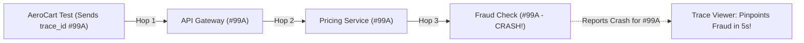

# The FedEx Tracking Number for Tests: 5-Second Bug Triage with OpenTelemetry

```json continuity
{
  "previously": "In Chapter 09, we built an Automated Quarantine Box that catches flaky or failing tests and assigns a ticket to the owning squad without blocking 500 developers.",
  "painPoint": "Now a developer opens that failure ticket: `test_checkout_flight` failed with `500 Internal Server Error`. Behind AeroCart's checkout button sit 6 separate backend microservices (Auth, Flights, Pricing, Fraud, Payment, Loyalty)—and digging through 100,000 mixed-up log lines takes 45 minutes!",
  "unlock": "Attach a universal FedEx package tracking number (`traceparent` / OpenTelemetry `trace_id`) to every test request so any failed test prints a 1-click link straight to the exact microservice and SQL query that crashed in 5 seconds."
}
```

```json walkthrough
[
  {
    "time": "0:00",
    "badge": "Slide 1 / 4 · The '500 Internal Server Error' Mystery",
    "caption": "Your AeroCart checkout test clicks 'Pay $360' and gets back `500 Internal Server Error`. That's it! Did Auth fail? Did Pricing divide by zero? Did Payment time out? Looking at the browser screen gives you zero clues.",
    "code": "# Browser Test Failure:\n# AssertionError: Expected 200 OK, got 500 Internal Server Error\n# Which of the 6 backend services crashed?! We have no idea!",
    "nodes": ["Test Clicks 'Pay'", "Gateway Returns 500", "6 Suspect Services Behind Curtain"]
  },
  {
    "time": "0:28",
    "badge": "Slide 2 / 4 · Why Grepping Logs by Timestamp Fails",
    "caption": "You open the server logs at 10:14:02 AM. Because 32 CI workers are running tests at the exact same second, 100,000 log lines from 32 different tests are scrambled together like confetti! Hunting by timestamp takes 45 minutes.",
    "code": "# 10:14:02.114 [Pricing] 200 OK\n# 10:14:02.114 [Fraud]   NullPointerException  <-- Is this OUR test or Worker #19?!\n# 10:14:02.115 [Payment] Deadlock detected     <-- Or is it THIS one?!",
    "nodes": ["32 Parallel CI Workers", "100,000 Scrambled Log Lines", "45 Mins Wasted Hunting"]
  },
  {
    "time": "0:55",
    "badge": "Slide 3 / 4 · Stamping a FedEx Tracking Number (`traceparent`)",
    "caption": "What if our test generates a unique tracking number (`trace_id`) BEFORE sending the request, and stamps it onto the HTTP header (`traceparent`)? Every service passes that same tracking number along to the next hop!",
    "code": "trace_id = \"4bf92f3577b34da6a3ce929d0e0e4736\"\nheaders = {\"traceparent\": f\"00-{trace_id}-00f067aa0ba902b7-01\"}\nresponse = requests.post(\"https://api.aerocart.local/checkout\", headers=headers)",
    "nodes": ["Test Generates trace_id", "Passes Across All 6 Services", "Every Hop Tagged Identically"]
  },
  {
    "time": "1:22",
    "badge": "Slide 4 / 4 · 5-Second Root Cause + Catching Hidden N+1 Bugs",
    "caption": "Now when the test fails, the error message prints the tracking number! One click shows the whole waterfall: Auth (OK) -> Pricing (OK) -> FraudService (CRASH!). Even better, we can count how many database queries ran inside that trace!",
    "code": "# AssertionError: Expected 200, got 500\n# -> Trace ID  : 4bf92f3577b34da6a3ce929d0e0e4736\n# -> Root Cause: FraudService.verify_card (NullPointerException at 14.2ms)",
    "nodes": ["Click Trace Link", "Spot FraudService Crash in 5s", "Assert SQL Query Count <= 4"]
  }
]
```

```json pretraining
[
  {
    "term": "Distributed Trace (`trace_id`)",
    "formula": "One Tracking ID Across All Services",
    "meaning": "A unique 32-character ID created at the start of a request that follows the request across every microservice and database query it touches."
  },
  {
    "term": "Span (`span_id`)",
    "formula": "One Single Stop on the Journey",
    "meaning": "If a Trace is the whole FedEx journey from New York to London, a Span is a single stop along the way (like 'PricingService took 12ms')."
  },
  {
    "term": "W3C `traceparent` Header",
    "formula": "00-<trace_id>-<span_id>-01",
    "meaning": "The universal standard HTTP header that every modern language (Python, Java, Go, Node) understands for passing a trace ID from service to service."
  },
  {
    "term": "Trace-Based Testing",
    "formula": "Assert What Happened Inside, Not Just HTTP 200",
    "meaning": "Checking the recorded trace spans after a test runs to prove the backend didn't secretly run 400 slow database queries (`N+1` bug) behind the scenes."
  }
]
```

```json poe
{
  "question": "An AeroCart checkout test fails with `Expected 200 OK, got 500 Internal Server Error`. Behind the checkout API sit 6 microservices (Auth, Flights, Pricing, Fraud, Payment, Loyalty), and 32 parallel test workers are running at the same time. What is the fastest, cleanest way to know which service crashed for THIS specific test?",
  "options": [
    "Re-run the test 10 times with `--verbose` and read all 6 server log files by eye",
    "Have the test generate a unique `traceparent` header (`trace_id`) before calling the API, pass it through all 6 services, and print the exact trace link and failing service span inside the test failure message",
    "Shut down 31 of the 32 CI workers so only 1 test runs at a time",
    "Add `sleep(5)` between every test so timestamps don't overlap"
  ],
  "answerIndex": 1,
  "explanation": "When the test originates a unique W3C `traceparent` ID, every downstream service and database query inherits that exact `trace_id`. On failure, you filter by that single ID and see the exact crashing service in under 5 seconds!"
}
```

## 🌱 Step 1: Plain-English Story — The Mystery of the `500` Error

Imagine you order a birthday gift online, and three days later the website simply says: **"Delivery Failed."**
- Did the warehouse lose the box?
- Did the delivery truck get a flat tire in Chicago?
- Or did the driver knock on the wrong door?

Without a **FedEx Tracking Number**, you would have to call every warehouse and every truck driver in the country asking, *"Hey, did you see a brown cardboard box around 2:00 PM?"*

Yet that is **literally how most teams debug failed automated tests!**

When AeroCart started on Day 1, it was one small Python/Java file. If a test failed, the error pointed straight to line 42. Easy!
Today, when our automated test clicks **"Buy Ticket ($360)"**, that single request travels through **6 separate backend services**:



When **Service #3 (`Fraud Check`)** crashes, the front door (`API Gateway`) hides the messy details for security and simply replies to our test: **`500 Internal Server Error`**.

If 32 CI workers are running tests at the same time, all 6 services are spitting out **100,000 log lines per minute** mixed together. Searching those logs by timestamp takes **45 minutes** of squinting!

**The FedEx Solution (`OpenTelemetry` & `traceparent`)**:
Before our test sends an HTTP request, the test itself generates a unique 32-character tracking number (called a **`trace_id`**) and attaches it as a standard HTTP header named **`traceparent`**.
Every service automatically copies that tracking number onto every sub-request and database query it makes. When the test fails, our test runner prints:
> `❌ Checkout failed (500)! Tracking ID #99A broke inside FraudService -> check_card_velocity (NullPointerException)`

Forty-five minutes of log hunting drops to **5 seconds**!

## 🔨 Step 2: First Lines of Code — Generating Your First `traceparent` Header

You don't need to install any heavy monitoring server to create a valid tracking header! The global web standard (**W3C `traceparent`**) is just a short string formatted like this:
`00-<32-hex-char-trace-id>-<16-hex-char-span-id>-01`

- `00`: Version number (`00`).
- `trace_id`: 32 random hex characters (`0-9`, `a-f`) identifying the **whole test journey**.
- `span_id`: 16 random hex characters identifying **this specific step**.
- `01`: The "Save This!" flag (`01` = Sampled), telling backend servers: *"This is an automated test—save 100% of the trace logs!"*

Let's write a 12-line helper in **Python 3** and **Java 17** that stamps a fresh tracking number onto an AeroCart test request and prints the exact trace lookup link if the assertion fails:

```python
import secrets


def make_test_trace_headers(test_name: str) -> tuple[str, dict[str, str]]:
    trace_id = secrets.token_hex(16)  # 32 random hex chars (e.g. "4bf92f35...")
    span_id = secrets.token_hex(8)    # 16 random hex chars (e.g. "00f067aa...")
    headers = {
        "traceparent": f"00-{trace_id}-{span_id}-01",
        "baggage": f"test.name={test_name}",
    }
    return trace_id, headers


trace_id, headers = make_test_trace_headers("test_checkout_flight")
status_code = 500  # Simulating a 500 crash from AeroCart's API Gateway
if status_code != 200:
    print(f"Got {status_code}! Inspect root cause -> http://traces.local/{trace_id}")
```

### Java 17 Equivalent

```java
import java.security.SecureRandom;
import java.util.HexFormat;
import java.util.Map;

public class FirstTraceHeaderTest {
    static final SecureRandom RNG = new SecureRandom();
    static final HexFormat HEX = HexFormat.of();

    public static Map<String, String> makeTraceHeaders(String traceId, String testName) {
        byte[] spanBytes = new byte[8];
        RNG.nextBytes(spanBytes);
        String spanId = HEX.formatHex(spanBytes);
        return Map.of(
            "traceparent", "00-" + traceId + "-" + spanId + "-01",
            "baggage", "test.name=" + testName
        );
    }

    public static void main(String[] args) {
        byte[] traceBytes = new byte[16];
        RNG.nextBytes(traceBytes);
        String traceId = HEX.formatHex(traceBytes);
        int statusCode = 500; // Simulating a 500 error from AeroCart Gateway
        if (statusCode != 200) {
            throw new AssertionError("Got " + statusCode + "! Trace -> http://traces.local/" + traceId);
        }
    }
}
```

Look at that `AssertionError` message: instead of a useless `500 != 200`, every failed test now hands the developer a **direct one-click link** (`http://traces.local/<trace_id>`) showing every microservice hop!

## ⚡ Step 3: Where It Breaks in Real Life — Sampled-Out Traces & Hidden `N+1` Database Bombs

Once you connect `traceparent` to AeroCart's services, two real-world surprises show up:

1. **Surprise #1 — The `00` vs. `01` Sampling Trap**:
   In production or staging, saving 100% of traces for millions of users is expensive, so servers typically save only **1% of traces**. If your test sends `-00` at the end of `traceparent` instead of **`-01`** (the force-sample flag), **99% of your failed test links will say `"Trace Not Found"`** when you click them!
2. **Surprise #2 — The "Green Test" That Melts Production (`N+1` Queries)**:
   Suppose a developer changes AeroCart's `GET /flights` code. The API still returns `200 OK` with the exact right JSON—so **every normal functional test passes Green**!
   Wait: behind the scenes, instead of running **1 SQL query** to load 50 flights, a sloppy loop inside their code now runs **51 separate SQL queries** (`1` query for the list + `50` individual queries for each plane's baggage rules). In CI with 3 flights, it takes 15ms. In production with 500 flights, it melts the database!

Because our test already has the **`trace_id`**, we can ask the trace collector: *"How many SQL query spans happened during `trace_id`?"* and fail the test immediately if `sql_span_count > 3`!

```json contrast
{
  "title": "Black-Box Log Grepping vs. W3C traceparent + Trace-Based Assertions",
  "naiveTitle": "Timestamp Log Hunting & HTTP-200 Blindness",
  "naiveMetric": "45m Triage Time · N+1 Queries Escape to Prod",
  "naivePoints": [
    "AssertionError prints only `500 != 200`; developers spend 45 minutes grepping logs across 6 services",
    "32 parallel CI workers mix stdout logs together so you can't tell which error belongs to which test",
    "Tests only check that the HTTP response is `200 OK`, missing an accidental 200-query SQL loop inside the backend"
  ],
  "staffTitle": "Harness-Originated traceparent + Span Budget Oracles",
  "staffMetric": "<10s 1-Click Triage · Catches N+1 in CI",
  "staffPoints": [
    "Test harness generates W3C `traceparent` (`-01` force-sampled) + `baggage` (`test.id`) before every request",
    "Every failed assertion automatically prints the deepest backend `ERROR` span (service name + operation + URL)",
    "Asserts trace span budgets (e.g., `sql_queries <= 3`, `zero silent 5xx retries`) even when HTTP returns `200 OK`"
  ]
}
```

Try the **Quick Intuition Check** and step through the **Interactive Simulator** below to trace a failure across services!

## 🚀 Step 4: Staff Engineer Deep-Dive — W3C Wire Spec, Triage Math & Span Oracles

Let's lock in the exact protocol specification and architecture that Staff SDETs use to build **Observability-Driven Test Frameworks**.

### 1. The W3C `traceparent` Bit Specification & Triage Compression
A standards-compliant W3C `traceparent` header is always **55 ASCII characters** (`2 + 1 + 32 + 1 + 16 + 1 + 2`):

$$
\underbrace{\texttt{00}}_{\text{version (8b)}} - \underbrace{\texttt{4bf92f3577b34da6a3ce929d0e0e4736}}_{\text{trace-id (128 bits, non-zero)}} - \underbrace{\texttt{00f067aa0ba902b7}}_{\text{parent-span-id (64 bits, non-zero)}} - \underbrace{\texttt{01}}_{\text{flags (bit 0 = SAMPLED)}}
$$

And the Mean Time To Triage ($\text{MTTT}$) across $S$ microservices with $W$ parallel CI workers drops from an $O(S \cdot W)$ log search to an $O(1)$ hash lookup by `trace_id`:

$$
\text{MTTT}_{\text{grep}} \propto S \times W \times T_{\text{log-scan}} \approx 45\text{ min} \quad \longrightarrow \quad \text{MTTT}_{\text{OTel}} = O(1) \approx 5\text{ sec}
$$

| Capability | Uninstrumented Test Client | Custom `X-Request-ID` Header | Staff W3C `traceparent` + OTel Spans |
| :--- | :--- | :--- | :--- |
| **Propagates Across gRPC & Kafka?** | No | Rarely (requires custom glue per service) | **Yes (Automatic in OTel SDKs)** |
| **Records Parent $\to$ Child Waterfall?** | No | Flat text logs only | **Full causal DAG with exact ms timings** |
| **Catches Hidden $N+1$ SQL Loops?** | No | No | **Yes (`assert db_spans <= budget`)** |
| **Browser CORS Preflight Rule** | None | Needs custom header allowlist | Scope to first-party APIs via `page.route` |

### Production Blueprint: W3C `traceparent` Synthesizer & `N+1` Span Oracle (`Python 3` & `Java 17`)

```python
from __future__ import annotations

import secrets
from dataclasses import dataclass, field
from typing import Dict, List


@dataclass(frozen=True)
class W3CTraceContext:
    trace_id: str
    span_id: str
    sampled: bool = True

    @classmethod
    def create_root(cls, sampled: bool = True) -> "W3CTraceContext":
        # W3C spec requires non-zero 16-byte trace_id and 8-byte span_id
        return cls(trace_id=secrets.token_hex(16), span_id=secrets.token_hex(8), sampled=sampled)

    @property
    def traceparent(self) -> str:
        flags = "01" if self.sampled else "00"
        return f"00-{self.trace_id}-{self.span_id}-{flags}"

    def to_headers(self, test_id: str, worker_id: str) -> Dict[str, str]:
        return {
            "traceparent": self.traceparent,
            "baggage": f"test.id={test_id},test.worker={worker_id}",
        }


@dataclass(frozen=True)
class RecordedSpan:
    trace_id: str
    span_id: str
    service_name: str
    operation: str
    db_system: str | None = None
    status_code: str = "OK"  # "OK" | "ERROR"
    duration_ms: float = 0.0


@dataclass
class TraceInvariantOracle:
    """Inspects exported OTel spans for a test's trace_id to pinpoint 500s and catch N+1 SQL bugs."""
    trace_ui_base_url: str = "http://127.0.0.1:16686/trace"
    spans: List[RecordedSpan] = field(default_factory=list)

    def assert_sql_query_budget(self, trace_id: str, max_sql_spans: int) -> None:
        sql_spans = [s for s in self.spans if s.trace_id == trace_id and s.db_system is not None]
        if len(sql_spans) > max_sql_spans:
            ops = ", ".join(s.operation for s in sql_spans[:5])
            raise AssertionError(
                f"N+1 SQL Query Regression! Expected <= {max_sql_spans} DB queries, got {len(sql_spans)} "
                f"({ops}). Waterfall: {self.trace_ui_base_url}/{trace_id}"
            )

    def format_failure_rca(self, trace_id: str, client_error: str) -> str:
        errored = [s for s in self.spans if s.trace_id == trace_id and s.status_code == "ERROR"]
        deepest = (
            f"{errored[-1].service_name}.{errored[-1].operation} ({errored[-1].duration_ms:.1f}ms)"
            if errored
            else "No backend ERROR span recorded (check gateway/CORS)"
        )
        return (
            f"{client_error}\n"
            f"  -> Trace Waterfall : {self.trace_ui_base_url}/{trace_id}\n"
            f"  -> Root-Cause Span : {deepest}"
        )
```

### Java 17 Equivalent

```java
package com.hub.sdet.observability;

import java.net.URI;
import java.net.http.HttpRequest;
import java.security.SecureRandom;
import java.util.HexFormat;
import java.util.List;

public final class W3CTraceTestInterceptor {

    private static final SecureRandom RNG = new SecureRandom();
    private static final HexFormat HEX = HexFormat.of();

    public record SpanRecord(
        String traceId, String spanId, String service, String operation, boolean isError, String dbSystem
    ) {}

    public record TestTraceSession(String testName, String traceId) {

        public static TestTraceSession start(String testName) {
            byte[] traceBytes = new byte[16];
            RNG.nextBytes(traceBytes);
            return new TestTraceSession(testName, HEX.formatHex(traceBytes));
        }

        public String nextTraceparent(boolean forceSample) {
            byte[] spanBytes = new byte[8];
            RNG.nextBytes(spanBytes);
            String spanId = HEX.formatHex(spanBytes);
            return "00-" + traceId + "-" + spanId + "-" + (forceSample ? "01" : "00");
        }

        public HttpRequest buildTracedGet(URI uri) {
            return HttpRequest.newBuilder(uri)
                .header("traceparent", nextTraceparent(true))
                .header("baggage", "test.name=" + testName)
                .GET()
                .build();
        }

        public void assertSqlBudgetAndZeroErrors(
                List<SpanRecord> spans, int maxSqlQueries, String traceUiUrl) {
            List<SpanRecord> mySpans = spans.stream()
                .filter(s -> traceId.equals(s.traceId()))
                .toList();

            List<SpanRecord> errors = mySpans.stream().filter(SpanRecord::isError).toList();
            if (!errors.isEmpty()) {
                SpanRecord root = errors.get(errors.size() - 1);
                throw new AssertionError(String.format(
                    "Backend crash in [%s.%s]! Trace: %s/%s",
                    root.service(), root.operation(), traceUiUrl, traceId
                ));
            }

            long sqlCount = mySpans.stream().filter(s -> s.dbSystem() != null).count();
            if (sqlCount > maxSqlQueries) {
                throw new AssertionError(String.format(
                    "N+1 SQL Budget Exceeded! Expected <= %d queries, got %d. Trace: %s/%s",
                    maxSqlQueries, sqlCount, traceUiUrl, traceId
                ));
            }
        }
    }
}
```

> [!WARNING]
> **Staff Interview Gotcha — Never Set `extraHTTPHeaders: { traceparent }` Globally in Playwright!**
> If you configure `traceparent` globally on the Playwright browser context, Chromium attaches `traceparent` to **every** network call on the page—including Google Fonts, Stripe iframes, and third-party analytics CDNs! Because those external servers don't list `traceparent` in their `Access-Control-Allow-Headers` CORS policy, the browser blocks the requests and breaks the UI! Always attach `traceparent` **only** to your own backend domain using `page.route("https://api.aerocart.com/**", ...)`.

**Up Next in Chapter 11**: Even when 100% of our staging tests pass and our traces look super clean, real production traffic has surprises staging never sees—like midnight traffic spikes, expired SSL certificates, and cloud region blips! Next up, let's learn **Shift-Right Testing**: Synthetic Canary Bots, 1% Canary Rollouts, and safe Chaos Fault Injection!

```json quiz
[
  {
    "id": "sdet-10-q1",
    "question": "In a Playwright browser test, why does attaching `traceparent` globally to every browser request often break third-party images, fonts, or payment widgets, and what is the fix?",
    "options": [
      "Playwright cannot send headers longer than 20 characters",
      "Sending `traceparent` to external third-party domains triggers a browser CORS preflight check (`OPTIONS`) that fails if the external CDN doesn't whitelist `traceparent`; fix it by scoping header injection only to your own API domain via `page.route()`",
      "Browsers only allow uppercase header names",
      "W3C `traceparent` only works in Python, not JavaScript"
    ],
    "answerIndex": 1,
    "explanation": "Non-safelisted cross-origin headers trigger CORS preflights. Scoping `traceparent` injection strictly to your own backend API routes (`api.aerocart.com/**`) prevents third-party CORS failures."
  },
  {
    "id": "sdet-10-q2",
    "question": "Your test sends `traceparent: 00-4bf92f3577b34da6a3ce929d0e0e4736-00f067aa0ba902b7-00`, but when the test fails and you click the trace link, 99% of the time the trace viewer says 'Trace Not Found'. What is wrong?",
    "options": [
      "The version '00' at the start should be '99'",
      "The final two characters are '00' (not sampled), so backend collectors running 1% sampling throw away 99% of your test traces; changing the end to '-01' sets the SAMPLED flag so 100% of test spans are saved",
      "The trace ID needs capital letters",
      "Hyphens should be replaced with slashes"
    ],
    "answerIndex": 1,
    "explanation": "The trailing byte (`00` vs `01`) controls the W3C SAMPLED flag. Setting `-01` tells the collector to retain 100% of spans for that automated test."
  },
  {
    "id": "sdet-10-q3",
    "question": "How can Trace-Based Testing catch an accidental 'N+1 SQL query bug' during a fast 1-second functional test BEFORE the code ever reaches a load test or production?",
    "options": [
      "By listening to how loud the server fan spins",
      "By querying the recorded OpenTelemetry spans for the test's `trace_id` after the API returns `200 OK` and asserting that the number of database query spans (`db.system == 'postgresql'`) is `<= 3`",
      "By checking the CSS font color on the page",
      "Functional tests cannot see database spans"
    ],
    "answerIndex": 1,
    "explanation": "Even when an endpoint returns valid HTTP 200 JSON, inspecting the child spans for that `trace_id` immediately reveals if 50 SQL queries ran instead of 2."
  }
]
```
