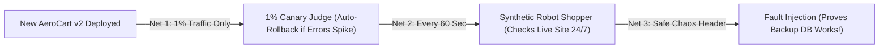

# Shift-Right Safety Nets: Synthetic Canaries, 1% Rollouts & Controlled Chaos

```json continuity
{
  "previously": "In Chapter 10, we attached a W3C `traceparent` tracking ID to every test request so we can pinpoint any backend crash or N+1 query in 5 seconds.",
  "painPoint": "Even when 100% of our pre-merge staging tests pass Green, real production has surprises staging never sees: expired production SSL certificates, real firewall rules, 9-year-old customer profiles, and sudden cloud network blips!",
  "unlock": "Master the 3 pillars of Shift-Right protection in production: 1) Synthetic Canary Bots (a robot shopper booking a test flight every 60s), 2) 1% Canary Rollouts with automated rollback, and 3) Request-Scoped Chaos Fault Injection."
}
```

```json walkthrough
[
  {
    "time": "0:00",
    "badge": "Slide 1 / 4 · Why 100% Green Staging Still Breaks in Prod",
    "caption": "Every test in CI passed! You deploy AeroCart v2.0 to production at 2:00 PM—and suddenly nobody can buy a ticket because a production firewall rule blocks the live payment gateway. Staging didn't use the production firewall!",
    "code": "# Pre-Merge CI (Shift-Left): 1,200 / 1,200 Tests PASSED!\n# Live Production (2:01 PM): Payment firewall port blocked -> 100% Outage!\n# Lesson: Staging is a rehearsal; Production is the real stage.",
    "nodes": ["100% Green in Staging", "Deploy to Live Prod", "Prod Config/SSL Surprise!"]
  },
  {
    "time": "0:28",
    "badge": "Slide 2 / 4 · Pillar 1: The 60-Second Synthetic Robot Shopper",
    "caption": "Instead of waiting for angry passengers to tweet at us, we run a 'Synthetic Canary Bot' in production every 60 seconds. It searches a flight and runs a test checkout using a special `$0.00` test card so real money never moves!",
    "code": "# Runs every 60 seconds against LIVE AeroCart Production:\nresp = session.post(\"https://aerocart.com/api/checkout\", headers={\"X-Synthetic-Bot\": \"true\"})\nassert resp.status_code == 200  # Pages on-call in 60s if Prod breaks!",
    "nodes": ["Synthetic Bot (Every 60s)", "Tests Live Prod Path", "Alerts Before Users Notice"]
  },
  {
    "time": "0:56",
    "badge": "Slide 3 / 4 · Pillar 2: 1% Canary Rollout & Auto-Rollback",
    "caption": "Why ship new code to 100% of passengers at once? We route just 1% of live traffic to the new v2 server ('Canary') and compare its error rate against a fresh v1 server ('Baseline'). If v2 has way more errors, a robot rolls it back in 10 seconds!",
    "code": "if canary_v2_error_rate > baseline_v1_error_rate + 0.005:\n    route_100_percent_traffic_to_v1()  # Instant automated rollback!\n    alert_team(\"Canary v2 rolled back automatically!\")",
    "nodes": ["99% Baseline v1 / 1% Canary v2", "Compare Live Error Rates", "Auto-Rollback in <10s"]
  },
  {
    "time": "1:24",
    "badge": "Slide 4 / 4 · Pillar 3: Controlled Chaos (Header-Scoped Faults)",
    "caption": "What happens if our Redis cache dies during Black Friday? Instead of unplugging Redis for real passengers, our synthetic bot sends a signed header (`X-Chaos-Fault: target=redis;fault=timeout`) that simulates a Redis crash ONLY for that 1 test request!",
    "code": "# Only THIS synthetic request sees Redis fail; 99.999% of real users are untouched!\nheaders = {\"X-Chaos-Fault\": \"target=redis;fault=timeout\", \"X-Chaos-Sig\": hmac_sig}\nresp = requests.get(\"https://aerocart.com/api/flights\", headers=headers)\nassert resp.status_code == 200  # Proves fallback to Postgres works!",
    "nodes": ["Signed Chaos Header", "Simulates Failure for 1 Test Only", "0% Real User Impact"]
  }
]
```

```json pretraining
[
  {
    "term": "Shift-Right Testing",
    "formula": "Code -> Build -> Deploy -> [Verify Live Prod]",
    "meaning": "Testing and monitoring your software safely on the right side of the timeline—after it is deployed to production—to catch real-world config, network, and traffic issues."
  },
  {
    "term": "Synthetic Canary Bot",
    "formula": "Robot Shopper Running Every 60s in Prod",
    "meaning": "A lightweight automated script that continuously performs key actions (login, search flight, test-card checkout) on the live website so you know within 60 seconds if production breaks."
  },
  {
    "term": "Canary Release (1% Rollout)",
    "formula": "1% Traffic to New Code (v2) vs. 99% Old Code (v1)",
    "meaning": "Named after the 'canary in a coal mine'—sending a tiny slice of real traffic to a new release first so if it crashes, 99% of your customers are completely safe."
  },
  {
    "term": "Request-Scoped Chaos Testing",
    "formula": "Inject Fault ONLY for Our Test Request",
    "meaning": "Deliberately simulating a server crash or slow database on a single test request using a special header, proving your backup plan works without hurting real customers."
  }
]
```

```json poe
{
  "question": "Your team deploys AeroCart `v2` to a 5% Canary server at 3:00 AM and compares its error rate (`0.8%`) against YESTERDAY'S 3:00 PM rush-hour error rate (`0.9%`). The script says '0.8% < 0.9%, Canary is healthy!'—yet `v2` actually has a 4x error bug because the `v1` servers running right now at 3:00 AM only have a `0.2%` error rate! What mistake did the team make?",
  "options": [
    "5% traffic is too big for a canary",
    "They compared 3:00 AM Canary traffic against yesterday's 3:00 PM traffic! Traffic patterns change by time of day—you must always compare Canary (`v2`) against a fresh Baseline (`v1`) running at the EXACT same moment",
    "Canaries can only measure CPU usage, not HTTP 500 errors",
    "You should only deploy code on Fridays"
  ],
  "answerIndex": 1,
  "explanation": "Comparing 3:00 AM today against 3:00 PM yesterday mixes time-of-day traffic differences with code changes. Always compare Canary v2 against a fresh Baseline v1 running side-by-side at the exact same timestamp!"
}
```

## 🌱 Step 1: Plain-English Story — Why Staging Can Never Be 100% Like Production

In Chapter 01, we learned about **Shifting Left**—running automated checks *before* code merges so we catch bugs early on our laptop or in CI.

So if 100% of our CI tests pass Green, why do websites still crash right after a deployment?

Because your **Staging / CI environment is a rehearsal studio**, while **Production is a live stadium during a thunderstorm**:
- Staging doesn't have an **SSL security certificate** that quietly expired at midnight on `aerocart.com`.
- Staging doesn't have a **9-year-old customer account** with a weird emoji in their middle name and 400 expired vouchers.
- Staging doesn't have **50,000 real travelers** all clicking "Book Flight" at the exact same second when a winter storm cancels flights!

Testing and protecting your app *after* it lands in production (without hurting real customers!) is called **Shifting Right**. It relies on **3 simple safety nets**:



1. **Safety Net 1 — The 1% Canary Rollout**: Instead of replacing all 100 production servers at once, we put the new `v2` code on **1 server (`1%` of traffic)** and watch its error rate compared to a healthy `v1` server running right next to it. If `v2` starts throwing `500` errors, an automatic switch routes 100% of traffic back to `v1` in **under 10 seconds**!
2. **Safety Net 2 — Synthetic Canary Bots**: Even at 3:00 AM when few humans are shopping, a robot script visits live `aerocart.com` every **60 seconds**, searches `JFK -> LHR`, and checks out using a special test flag (`X-Synthetic-Test: true`) so no real plane seat is taken and no real credit card is charged.
3. **Safety Net 3 — Controlled Chaos (Testing the Parachute)**: What if AeroCart's fast price cache (`Redis`) crashes tomorrow? Does AeroCart smoothly fall back to the main database, or does the whole site crash? Instead of pulling the plug on Redis for real passengers, our robot sends a special header that tells the server: *"Pretend Redis timed out for **this single test request only**!"*

## 🔨 Step 2: First Lines of Code — Your First Auto-Rollback Canary Judge

Let's write the brain of an **Automated Canary Judge** in **15 lines of Python 3 and Java 17**!

Every minute during a rollout, our judge looks at how many requests and `500` errors happened on the **Baseline (`v1`)** server vs. the new **Canary (`v2`)** server.
- First, we make sure both servers have handled at least `100` requests (so 1 unlucky error on the very first request doesn't cause a false alarm!).
- Second, if Canary's error rate is more than `1%` (`0.01`) higher than Baseline's, we trigger an immediate **`ROLLBACK`**!

```python
def simple_canary_judge(
    base_reqs: int, base_errors: int, canary_reqs: int, canary_errors: int
) -> str:
    if base_reqs < 100 or canary_reqs < 100:
        return "HOLD: Waiting for at least 100 requests on both v1 and v2"

    base_err_rate = base_errors / base_reqs
    canary_err_rate = canary_errors / canary_reqs

    if (canary_err_rate - base_err_rate) >= 0.01:  # Canary has >= 1% more errors!
        return f"ROLLBACK_NOW: Canary error rate ({canary_err_rate:.1%}) spiked vs Baseline ({base_err_rate:.1%})!"
    return "PROMOTE: Canary v2 looks healthy!"


print(simple_canary_judge(base_reqs=500, base_errors=1, canary_reqs=500, canary_errors=12))
```

### Java 17 Equivalent

```java
public class SimpleCanaryJudge {
    public static String judgeCanary(int baseReqs, int baseErrors, int canaryReqs, int canaryErrors) {
        if (baseReqs < 100 || canaryReqs < 100) {
            return "HOLD: Waiting for at least 100 requests on both v1 and v2";
        }
        double baseRate = (double) baseErrors / baseReqs;
        double canaryRate = (double) canaryErrors / canaryReqs;

        if ((canaryRate - baseRate) >= 0.01) {
            return String.format("ROLLBACK_NOW: Canary (%.1f%%) spiked vs Baseline (%.1f%%)!",
                canaryRate * 100, baseRate * 100);
        }
        return "PROMOTE: Canary v2 looks healthy!";
    }

    public static void main(String[] args) {
        System.out.println(judgeCanary(500, 1, 500, 12));
    }
}
```

In 15 lines of code, you just built an automatic circuit breaker that catches a broken deployment in seconds—before 99% of your users ever touch it!

## ⚡ Step 3: Where It Breaks in Real Life — Cold-Server Bias, Double-Charged Shadow Traffic & Unsafe Chaos

When teams scale Shift-Right testing across a real airline or bank, three classic traps cause painful incidents if you aren't careful:

1. **Trap 1 — Cold Canary vs. Warm Baseline**:
   When a brand-new Java or Python server (`Canary v2`) first boots up, its memory caches are empty and its JIT compiler hasn't warmed up yet—so its first 200 requests are naturally slower than a `Baseline v1` server that has been running for 5 days!
   **The Fix**: Always boot a **brand-new Baseline `v1` server at the exact same second** as your **brand-new Canary `v2` server** so both start equally cold!
2. **Trap 2 — Shadow Traffic Double-Charging Customers**:
   Sometimes teams replay a copy of live user requests onto `v2` in the background (**Shadow Mirroring**) to see if `v2` gives the same answer as `v1`. If `v2` is connected to the **real Stripe payment API or real email server**, replaying `POST /checkout` will **charge the passenger's credit card twice**! Shadow servers must strictly use **Read-Only databases and mocked payment/email sinks**.
3. **Trap 3 — Leaving Chaos Headers Wide Open to Hackers**:
   If you add a header like `X-Chaos-Fault: target=db;fault=crash` to test your backup database, what happens if a curious hacker on the internet guesses that header name and sends it on every request?! They can take down your site! Every Chaos header must be **cryptographically signed (`HMAC`)** and stripped from outside traffic at the front gate.

```json contrast
{
  "title": "Reckless 'Test in Prod' vs. Bounded Shift-Right Engineering",
  "naiveTitle": "100% Big-Bang Deploy & Unscoped Chaos",
  "naiveMetric": "100% User Blast Radius · 40m Manual Rollback",
  "naivePoints": [
    "Deploys v2 to 100% of servers at once and waits for customer support calls to notice a broken checkout",
    "Compares a cold brand-new Canary pod against 7-day-old warmed Baseline pods, causing false-alarm latency rollbacks",
    "Kills real production servers randomly ('Chaos Monkey') during peak hours or leaves `X-Chaos-Fault` headers unsigned"
  ],
  "staffTitle": "Simultaneous Control Canary + Signed Request-Scoped Chaos",
  "staffMetric": "<1% Blast Radius · <10s Auto-Rollback · 0% Chaos Leak",
  "staffPoints": [
    "Boots fresh Baseline (v1) and Canary (v2) pods simultaneously so both warm up side-by-side under identical traffic",
    "Pairs a Two-Proportion Z-Score test with a minimum practical error difference to avoid false rollbacks on tiny noise",
    "Scopes Chaos fault injection strictly to HMAC-signed synthetic test requests so 100% of real users are unaffected"
  ]
}
```

Answer the **Quick Intuition Check** and test the **Interactive Simulator** below before we look at the Staff math and production code!

## 🚀 Step 4: Staff Engineer Deep-Dive — Two-Proportion $Z$-Score Judge & HMAC-Signed Chaos

How does an enterprise Canary controller (like Netflix Kayenta or Argo Rollouts) decide mathematically whether Canary `v2` is worse than Baseline `v1`?

### 1. Simultaneous Two-Proportion $Z$-Test + Practical Effect Floor
Suppose during a 5-minute window, our fresh **Baseline (`v1`)** pod serves $n_b$ requests with $e_b$ errors ($\hat{p}_b = e_b / n_b$), and our **Canary (`v2`)** pod serves $n_c$ requests with $e_c$ errors ($\hat{p}_c = e_c / n_c$).

Using the pooled error proportion $\hat{p} = \frac{e_b + e_c}{n_b + n_c}$, we compute the **Two-Proportion $Z$-Statistic**:

$$
Z = \frac{\hat{p}_c - \hat{p}_b}{\sqrt{\hat{p}(1 - \hat{p})\left(\frac{1}{n_c} + \frac{1}{n_b}\right)}}
$$

Why do Staff engineers require **BOTH** statistical significance ($Z \ge 2.58$, which means $99.5\%$ confidence) **AND** a minimum practical difference ($\hat{p}_c - \hat{p}_b \ge 0.2\%$)?
- At small sample sizes, raw differences are noisy ($Z$ protects you).
- At massive sample sizes ($n = 1,000,000$ requests), a tiny, meaningless difference (`0.010%` vs `0.014%`) reaches $Z = 2.58$! Pairing $Z \ge 2.58$ with $\hat{p}_c - \hat{p}_b \ge 0.002$ guarantees we only roll back when the regression is **both statistically real and practically meaningful**, alongside a tail latency check ($P_{99,\text{canary}} \le 1.25 \times P_{99,\text{baseline}}$).

| Shift-Right Technique | Mutates Real User Data? | Max Blast Radius | Primary Bug Class Caught |
| :--- | :--- | :--- | :--- |
| **Synthetic Canary Bot (60s)** | Isolated test account / `$0` card | **$0\%$ real users** | Broken DNS, expired SSL cert, dead gateway |
| **Read-Only Shadow Mirroring** | **Strictly Forbidden (Stubbed Sinks)** | **$0\%$ real users** | Weird production JSON payloads, logic parity |
| **Simultaneous Canary (`1%–5%`)** | Yes ($1\%–5\%$ cohort) | **Bounded $< 1\%–5\%$** | Live DB lock contention, $P_{99}$ tail spikes, 5xx bugs |
| **HMAC-Scoped Chaos Header** | Synthetic test request only | **$0\%$ real users** | Broken fallback paths, missing circuit breakers |

### Production Blueprint: Statistical Canary Judge & HMAC-Authenticated Chaos Filter (`Python 3` & `Java 17`)

```python
from __future__ import annotations

import hmac
import math
from dataclasses import dataclass


@dataclass(frozen=True)
class CanaryVerdict:
    decision: str  # "PROMOTE" | "HOLD_INSUFFICIENT_DATA" | "ROLLBACK_IMMEDIATELY"
    z_score: float
    baseline_err_rate: float
    canary_err_rate: float
    p99_ratio: float
    reason: str


def evaluate_canary_window(
    baseline_reqs: int,
    baseline_errors: int,
    baseline_p99_ms: float,
    canary_reqs: int,
    canary_errors: int,
    canary_p99_ms: float,
    min_sample_size: int = 500,
    z_critical: float = 2.576,          # 99.5% one-sided statistical confidence
    min_abs_error_delta: float = 0.002, # 0.2% practical significance floor
    max_p99_ratio: float = 1.25,
) -> CanaryVerdict:
    if baseline_reqs < min_sample_size or canary_reqs < min_sample_size:
        return CanaryVerdict("HOLD_INSUFFICIENT_DATA", 0.0, 0.0, 0.0, 1.0, "Awaiting minimum sample size")

    p_b = baseline_errors / baseline_reqs
    p_c = canary_errors / canary_reqs
    p_pool = (baseline_errors + canary_errors) / (baseline_reqs + canary_reqs)

    if p_pool in (0.0, 1.0):
        z = 0.0
    else:
        se = math.sqrt(p_pool * (1.0 - p_pool) * ((1.0 / canary_reqs) + (1.0 / baseline_reqs)))
        z = (p_c - p_b) / se if se > 0 else 0.0

    p99_ratio = (canary_p99_ms / baseline_p99_ms) if baseline_p99_ms > 0 else 1.0

    if z >= z_critical and (p_c - p_b) >= min_abs_error_delta:
        return CanaryVerdict(
            "ROLLBACK_IMMEDIATELY",
            round(z, 3),
            round(p_b, 5),
            round(p_c, 5),
            round(p99_ratio, 3),
            f"Statistically & practically significant 5xx spike (Z={z:.2f}, +{100*(p_c - p_b):.2f}%)",
        )
    if p99_ratio > max_p99_ratio and (canary_p99_ms - baseline_p99_ms) > 25.0:
        return CanaryVerdict(
            "ROLLBACK_IMMEDIATELY",
            round(z, 3),
            round(p_b, 5),
            round(p_c, 5),
            round(p99_ratio, 3),
            f"Tail P99 latency regression ({canary_p99_ms:.1f}ms vs {baseline_p99_ms:.1f}ms)",
        )
    return CanaryVerdict("PROMOTE", round(z, 3), round(p_b, 5), round(p_c, 5), round(p99_ratio, 3), "Healthy")


def resolve_scoped_chaos_fault(
    dependency_name: str,
    chaos_spec_header: str | None,
    chaos_hmac_header: str | None,
    cluster_chaos_secret: bytes,
) -> str | None:
    """Verifies HMAC-SHA256 signature on X-Chaos-Fault and scopes fault strictly to dependency_name."""
    if not chaos_spec_header or not chaos_hmac_header:
        return None
    expected_sig = hmac.new(cluster_chaos_secret, chaos_spec_header.encode("utf-8"), "sha256").hexdigest()
    if not hmac.compare_digest(expected_sig, chaos_hmac_header):
        raise PermissionError("Rejected unsigned or forged X-Chaos-Fault header")
    parts = dict(kv.split("=", 1) for kv in chaos_spec_header.split(";") if "=" in kv)
    return parts.get("fault") if parts.get("target") == dependency_name else None
```

### Java 17 Equivalent

```java
package com.hub.sdet.shiftright;

import java.nio.charset.StandardCharsets;
import java.security.MessageDigest;
import java.util.HexFormat;
import java.util.Optional;
import javax.crypto.Mac;
import javax.crypto.spec.SecretKeySpec;

public final class ShiftRightResilienceEngine {

    public enum GateAction { PROMOTE, HOLD_WARMUP, ROLLBACK }

    public record CanaryMetrics(long requests, long errors, double p99Millis) {}

    public static GateAction judgeCanary(CanaryMetrics freshBaseline, CanaryMetrics canary) {
        if (freshBaseline.requests() < 500 || canary.requests() < 500) {
            return GateAction.HOLD_WARMUP;
        }
        double pBase = (double) freshBaseline.errors() / freshBaseline.requests();
        double pCan = (double) canary.errors() / canary.requests();
        double pPool = (double) (freshBaseline.errors() + canary.errors())
            / (freshBaseline.requests() + canary.requests());

        if (pPool > 0.0 && pPool < 1.0) {
            double se = Math.sqrt(pPool * (1.0 - pPool)
                * ((1.0 / canary.requests()) + (1.0 / freshBaseline.requests())));
            double zScore = (pCan - pBase) / se;
            if (zScore >= 2.576 && (pCan - pBase) >= 0.002) {
                return GateAction.ROLLBACK;
            }
        }
        if (freshBaseline.p99Millis() > 0
                && (canary.p99Millis() / freshBaseline.p99Millis()) > 1.25
                && (canary.p99Millis() - freshBaseline.p99Millis()) > 25.0) {
            return GateAction.ROLLBACK;
        }
        return GateAction.PROMOTE;
    }

    public static Optional<String> verifyAndExtractScopedFault(
            String dependency, String chaosSpec, String providedHmacHex, byte[] hmacSecret) throws Exception {
        if (chaosSpec == null || providedHmacHex == null) {
            return Optional.empty();
        }
        Mac mac = Mac.getInstance("HmacSHA256");
        mac.init(new SecretKeySpec(hmacSecret, "HmacSHA256"));
        byte[] expectedBytes = mac.doFinal(chaosSpec.getBytes(StandardCharsets.UTF_8));
        byte[] actualBytes = HexFormat.of().parseHex(providedHmacHex);
        if (!MessageDigest.isEqual(expectedBytes, actualBytes)) {
            throw new SecurityException("Invalid HMAC signature on X-Chaos-Fault header");
        }
        String target = null;
        String fault = null;
        for (String token : chaosSpec.split(";")) {
            String[] kv = token.split("=", 2);
            if (kv.length == 2 && "target".equals(kv[0].trim())) target = kv[1].trim();
            if (kv.length == 2 && "fault".equals(kv[0].trim())) fault = kv[1].trim();
        }
        return dependency.equals(target) ? Optional.ofNullable(fault) : Optional.empty();
    }
}
```

> [!WARNING]
> **Staff Interview Gotcha — Unauthenticated `X-Chaos-Fault` Headers Are a Production Denial-of-Service Hole!**
> In a Staff system design interview, if you propose header-based fault injection (`X-Chaos-Fault: target=db;fault=503`) without explaining **how you block outside attackers from sending that header**, you will fail the security bar! Always state two defenses: 1) Strip all `X-Chaos-*` headers from untrusted internet traffic at the public CDN/API Gateway edge, and 2) Require a short-lived cryptographic **HMAC signature** inside the service mesh.

**Up Next in Chapter 12 (Course 01 Capstone!)**: Pause and look how far you've come—from a 3-line ticket check in Chapter 01 all the way to statistical flake quarantine, OpenTelemetry traces, and automated production canaries! In our final chapter of Course 01, we'll learn how a **Staff SDET** gets 100+ engineers across 8 teams to adopt these tools using **DORA Metrics, Golden-Path SDKs, and 1-Page Executive RFCs**!

```json quiz
[
  {
    "id": "sdet-11-q1",
    "question": "Why does a Staff-grade Automated Canary system boot a brand-new Baseline (`v1`) server at the exact same moment as the new Canary (`v2`) server, rather than comparing `v2` against `v1` servers that have been running for 5 days?",
    "options": [
      "Because servers older than 24 hours stop reporting logs",
      "Because a freshly booted Canary server has cold caches, empty database connection pools, and un-warmed JIT code; comparing a cold v2 server against a warmed 5-day-old v1 server causes false-alarm latency rollbacks even when v2 is healthy",
      "Because old servers use HTTP/1.0",
      "Because fresh servers skip SSL encryption"
    ],
    "answerIndex": 1,
    "explanation": "Booting identical fresh Control (v1) and Experiment (v2) servers side-by-side equalizes warm-up effects so any difference in errors or latency comes purely from the new code."
  },
  {
    "id": "sdet-11-q2",
    "question": "Why does our production Canary Judge check BOTH a statistical Z-score (`Z >= 2.58`) AND a minimum practical error difference (`canary_err - base_err >= 0.2%`) before rolling back?",
    "options": [
      "Because Python cannot compute square roots without two if-statements",
      "Because at huge traffic volumes (e.g. 1,000,000 requests), a tiny, harmless difference like 0.010% vs 0.014% becomes 'statistically significant' (Z >= 2.58); requiring a practical floor (>= 0.2%) prevents unnecessary rollbacks over microscopic noise",
      "Because error rates below 1% are always zero",
      "Because Z-scores only work on Tuesdays"
    ],
    "answerIndex": 1,
    "explanation": "Statistical significance proves a difference is non-zero, while the practical effect threshold proves the difference is large enough to matter operationally."
  },
  {
    "id": "sdet-11-q3",
    "question": "What two safety rules are mandatory when using Shadow Traffic Mirroring and Request-Scoped Chaos Headers (`X-Chaos-Fault`) in production?",
    "options": [
      "Use XML instead of JSON and turn off passwords",
      "1) Shadow servers must use read-only databases and stubbed payment/email sinks so replayed requests never double-charge customers; 2) Chaos headers must be stripped at the public edge and verified with an HMAC cryptographic signature",
      "Run chaos tests on 100% of customer checkout traffic",
      "Only mirror failed requests"
    ],
    "answerIndex": 1,
    "explanation": "Stubbing external sinks prevents double-charging customers during shadow replay, and HMAC verification prevents outside attackers from triggering chaos faults."
  }
]
```
