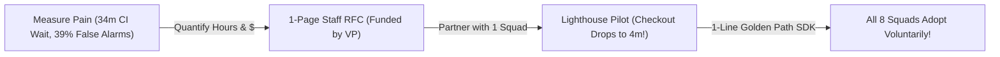

# Course 01 Capstone: Staff SDET Leadership, 1-Page RFCs & DORA Metrics

```json continuity
{
  "previously": "Across Chapters 01 to 11, we grew AeroCart's safety net from a 3-line coupon test into a 3-minute parallel CI pipeline with hermetic tenants, statistical flake quarantine, 5-second OTel trace links, and 1% production canaries.",
  "painPoint": "Now you are promoted to Staff SDET across all 8 AeroCart engineering squads (120 developers). You aren't anyone's manager—so how do you convince busy teams to adopt your new testing platform and get executives to fund your roadmap without acting like the 'QA Police'?",
  "unlock": "Translate engineering pain into a funded 1-Page Architecture RFC backed by DORA Metrics (Lead Time, Change Failure Rate, MTTR) and developer-hours saved, and drive 100% voluntary adoption using 'Paved Road' Golden Paths."
}
```

```json walkthrough
[
  {
    "time": "0:00",
    "badge": "Slide 1 / 4 · Why the 'QA Police' Approach Fails",
    "caption": "You want 8 squads to stop using slow shared staging databases. If you write a 40-page PDF of 'Mandatory Testing Rules' and block everyone's builds on Monday, developers will resent the rules and ask VPs for exemptions!",
    "code": "# ❌ The 'Gatekeeper Police' Trap:\n# 1. Post a 40-page Confluence PDF in #engineering-general\n# 2. Block all 8 teams' PRs until they rewrite 2,000 tests by hand\n# Result: 0% buy-in, frustrated teams, and executive pushback!",
    "nodes": ["40-Page Rulebook PDF", "Forced CI Blockers", "Developer Resentment & Exemptions"]
  },
  {
    "time": "0:28",
    "badge": "Slide 2 / 4 · Build a 'Paved Road' (Make the Right Way the Easy Way)",
    "caption": "Instead of policing people, build a 'Paved Road'—a 1-line helper (`@aerocart_isolated_test`) that gives developers a clean database AND a trace link in 0.1 seconds! When the safest way is also the fastest way, teams adopt it voluntarily.",
    "code": "# ✅ The 'Paved Road' Golden Path (1 line of code for developers!):\n@aerocart_isolated_test  # Auto-creates isolated tenant + W3C traceparent!\ndef test_vip_upgrade(client):\n    assert client.post(\"/upgrade\").status_code == 200",
    "nodes": ["1-Line Golden Path SDK", "Saves Devs 20 Mins/Day", "Voluntary Pull Across Teams"]
  },
  {
    "time": "0:56",
    "badge": "Slide 3 / 4 · Speaking Executive Language (1-Page RFC + $ ROI)",
    "caption": "When asking the VP of Engineering for 2 months to build this platform, don't say 'We have tech debt.' Show the math: 150 false-alarm failures/day * 15 mins wasted = 9,375 developer hours/year ($1.3M in recovered R&D time)!",
    "code": "wasted_hours_per_year = (false_red_prs_per_day * 15 / 60) * 250  # 9,375 hrs!\nannual_savings_usd = wasted_hours_per_year * 140                 # $1,312,500 / yr!",
    "nodes": ["Measure Baseline Pain", "Convert to Dev Hours & $", "1-Page RFC Approved Instantly"]
  },
  {
    "time": "1:24",
    "badge": "Slide 4 / 4 · Balancing Speed & Safety with DORA Metrics",
    "caption": "Finally, track your platform's impact using the 4 DORA Metrics: pairing Speed (Deploy Frequency & Lead Time) with Stability (Change Failure Rate & Recovery Time) so nobody can game the numbers!",
    "code": "# DORA Balanced Scorecard:\n# Speed    : Lead Time dropped 34 mins -> 6 mins!\n# Stability: Change Failure Rate (CFR) dropped 11% -> 2.4%!",
    "nodes": ["Speed: Lead Time & Deploy Freq", "Stability: CFR & MTTR", "Elite Engineering Loop"]
  }
]
```

```json pretraining
[
  {
    "term": "Paved Road (Golden Path)",
    "formula": "Easiest Way == Safest Way",
    "meaning": "Building a pre-configured tool or 1-line helper so convenient that developers choose to use it voluntarily because it saves them time."
  },
  {
    "term": "RFC (Request for Comments)",
    "formula": "Problem + $ Cost + Solution + Non-Goals",
    "meaning": "A short 1-to-2 page engineering proposal that explains a problem with real numbers, compares options, and aligns multiple teams before writing big systems."
  },
  {
    "term": "DORA Metrics (The 4 Keys)",
    "formula": "Speed (DF, Lead Time) + Stability (CFR, MTTR)",
    "meaning": "The industry-standard 4 measurements of software team health: how often you ship, how fast commits reach prod, what % of deploys break, and how fast you recover."
  },
  {
    "term": "Goodhart's Law",
    "formula": "Target a Single Number -> People Game the Number",
    "meaning": "When a manager mandates a single number like '85% code coverage', teams write fake tests without assertions just to hit 85%—unless you pair it with a real bug metric!"
  }
]
```

```json poe
{
  "question": "A VP of Engineering announces: 'Every team must hit 85% unit test line coverage by Friday or your deployments will be blocked!' Two months later, line coverage hits 88%, yet production outages (Change Failure Rate) actually get WORSE from 5% to 11%! Why did this happen, and what should a Staff SDET propose instead?",
  "options": [
    "85% was too low; raising the mandate to 100% line coverage will fix the outages",
    "Goodhart's Law: under threat of blocked deploys, developers wrote tests that called functions without asserting the outputs ('coverage theater') and skipped real API contract tests! Instead, pair CI speed (Lead Time) with Change Failure Rate (CFR) and Mutation/Contract checks on critical paths",
    "Line coverage tools introduce bugs into Python and Java compilers",
    "Teams should delete all unit tests"
  ],
  "answerIndex": 1,
  "explanation": "Line coverage only measures whether a line of code executed—not whether an `assert` checked the answer! Mandating a single vanity number causes teams to game the number instead of preventing production bugs."
}
```

## 🌱 Step 1: Plain-English Story — The "Police Officer" vs. The "Highway Builder"

Welcome to the **Capstone Chapter of Course 01**!
Take a moment to appreciate what you now know how to build:
- In **Module 1 (Ch 01–03)**, you went from a 3-line coupon test (`Arrange-Act-Assert`) to boundary/pairwise test design and the Test Pyramid.
- In **Module 2 (Ch 04–06)**, you eliminated flaky tests using deterministic state machines, consumer-driven contracts, and isolated test tenants.
- In **Module 3 & 4 (Ch 07–11)**, you scaled CI to 3 minutes with parallel sharding + TIA, built a statistical Quarantine Box, wired 5-second OpenTelemetry trace links, and protected production with 1% Canaries and Chaos headers!

Now imagine AeroCart promotes you to **Staff SDET**.
A Senior SDET makes **1 team** fast and reliable. A Staff SDET makes **all 8 teams (120 engineers)** fast and reliable—even though **none of those 120 engineers report to you!**

How do you get 8 busy teams to adopt your new testing tools when they all have tight product deadlines?
Compare two approaches:
- **Engineer A (The QA Police Officer)**: Writes a 30-page Confluence rulebook, yells in Slack when teams write flaky tests, and threatens to block releases. Result: Developers hide problems and route around QA.
- **Engineer B (The Highway Builder / "Paved Road")**: Notices developers hate spending 50 lines setting up test data. Builds a 1-line `@aerocart_test` decorator that gives any developer a fresh database and an instant trace link in `0.1 seconds`. Partners with **1 friendly squad (`Checkout`)** first, proves their CI wait time dropped from `34 minutes` to `4 minutes`, and gives the other 7 squads an automatic script to upgrade in 5 minutes!



When you make the **right way** the **easiest way**, you don't have to chase teams—teams line up asking for your tool!

## 🔨 Step 2: First Lines of Code — Turning Flaky Builds into Dollar ROI for Your RFC

Why do executives immediately approve some engineering proposals (**RFCs — Request for Comments**) while ignoring others?
Because executives allocate budget using **hours and dollars**, not complaints about "ugly code."

Let's write a 15-line **Staff RFC ROI Calculator** in **Python 3** and **Java 17**. It takes three numbers you can pull from any CI dashboard today—how many PRs your company runs per day, what percentage fail with false alarms (`1 - p^N`), and how many minutes an engineer wastes investigating each false alarm—and calculates the exact **annual developer hours and dollars saved**:

```python
def calculate_rfc_annual_savings(
    prs_per_day: int,
    false_alarm_rate: float,       # e.g. 0.35 (35% of builds fail from flakes)
    minutes_wasted_per_flake: int, # e.g. 15 mins to re-run & context-switch
    hourly_eng_cost_usd: float = 140.0,
) -> dict[str, float]:
    annual_prs = prs_per_day * 250  # 250 workdays per year
    false_red_builds = annual_prs * false_alarm_rate
    wasted_hours = (false_red_builds * minutes_wasted_per_flake) / 60.0
    recoverable_usd = wasted_hours * hourly_eng_cost_usd
    return {"wasted_hours_yr": round(wasted_hours, 1), "savings_usd_yr": round(recoverable_usd, 2)}


print(calculate_rfc_annual_savings(prs_per_day=300, false_alarm_rate=0.35, minutes_wasted_per_flake=15))
# -> {'wasted_hours_yr': 6562.5, 'savings_usd_yr': 918750.0} ($918k/year saved!)
```

### Java 17 Equivalent

```java
public class RfcRoiCalculator {
    public record RoiSummary(double wastedHoursPerYear, double annualSavingsUsd) {}

    public static RoiSummary calculateSavings(
            int prsPerDay, double falseAlarmRate, int minutesPerFlake, double hourlyCostUsd) {
        double annualPrs = prsPerDay * 250.0;
        double falseRedBuilds = annualPrs * falseAlarmRate;
        double wastedHours = (falseRedBuilds * minutesPerFlake) / 60.0;
        double savingsUsd = wastedHours * hourlyCostUsd;
        return new RoiSummary(Math.round(wastedHours * 10.0) / 10.0, Math.round(savingsUsd * 100.0) / 100.0);
    }

    public static void main(String[] args) {
        System.out.println(calculateSavings(300, 0.35, 15, 140.0));
    }
}
```

Look at that output:
- Saying *"Our tests are flaky, can I have 3 weeks to build a Quarantine Box?"* sounds like a chore.
- Saying *"False-alarm CI failures are burning **6,562 developer hours (`$918,750/year`)** across our 300 daily PRs; a 3-week Quarantine + Hermetic Tenant platform recovers 90% of that capacity"* gets approved in 5 minutes!

## ⚡ Step 3: Where It Breaks in Real Life — Metric Gaming (Goodhart's Law)

Once your leadership team loves metrics, a new danger appears: **Goodhart's Law** (*"When a measure becomes a target, it ceases to be a good measure"*).

Watch what happens when an organization tracks only **one** number in isolation:
- **If you only reward "Fast CI Speed"**: Teams can make CI finish in 10 seconds by **deleting half their tests**! (CI is fast, but production breaks constantly.)
- **If you only reward "99.9% Green Builds"**: Teams can hit 99.9% Green by **putting 400 failing tests into Quarantine and never fixing them**!
- **If you only reward "90% Line Coverage"**: Developers write tests that call functions **without writing a single `assert` statement**!

How do Staff engineers make metrics impossible to game? **Never report a metric without its tension partner ( The DORA Quartet )**:

1. **Speed Metric #1 — Deployment Frequency (`DF`)**: How often do we ship to production?
2. **Speed Metric #2 — Lead Time for Changes (`LT`)**: How many minutes from a developer's commit to running in production?
3. **Stability Metric #1 — Change Failure Rate (`CFR`)**: What percentage of deployments cause a bug, rollback, or outage in production?
4. **Stability Metric #2 — Mean Time To Recovery (`MTTR`)**: When production *does* break, how many minutes until our Canary/Trace tools restore service?

```json contrast
{
  "title": "Gatekeeper Mandates & Vanity Metrics vs. Paved-Road SDKs & Paired DORA Governance",
  "naiveTitle": "Manual QA Freezes & Single-Metric Mandates",
  "naiveMetric": "3-Day Release Bottleneck · Coverage Theater",
  "naivePoints": [
    "Requires a 3-day manual QA freeze before every bi-weekly release, slowing all 8 squads to a crawl",
    "Mandates '85% line coverage' in isolation, prompting teams to write assertion-free tests just to pass the gate",
    "Builds a massive 'v2 Framework' in secret for 9 months and tries to force all 8 squads to rewrite tests by hand"
  ],
  "staffTitle": "1-Line Paved Roads + Paired DORA & Dollar-ROI RFCs",
  "staffMetric": "40 Deploys/Day · <6m Lead Time · <2% CFR",
  "staffPoints": [
    "Ships a 1-line Golden Path SDK (`@HermeticTenant`, `traceparent`) plus an automated codemod script to upgrade repos in 5 minutes",
    "Pairs every Speed metric (`Lead Time`, `Suite Pass Rate`) with its Stability tension partner (`CFR`, `Quarantine SLA Age`)",
    "Pilots changes with 1 high-pain lighthouse squad (`Checkout`) first so success creates organic pull from the other 7 squads"
  ]
}
```

Try the **Quick Intuition Check** and explore the **Interactive ROI Simulator** below!

## 🚀 Step 4: Staff Engineer Deep-Dive — The 5-Part Staff RFC Template & DORA Auditor

When you write a Staff Quality RFC (or answer a Staff System Design / Behavioral interview prompt), structure your proposal into these **5 crisp sections**:

1. **Quantified Problem Statement (Baseline Telemetry)**:
   State the exact current pain using real percentiles: *"Across 120 engineers ($300\text{ PRs/day}$), PR CI wait time is $P_{90} = 34\text{ min}$ with a first-run pass rate of $P_{\text{suite}} = 61\%$, and production Change Failure Rate is $\text{CFR} = 11\%$."*
2. **Economic Cost of Inaction (`$` Equation)**:
   Combine flake triage drag and flow-state wait time across $R_{\text{PR/yr}}$ annual pull requests at hourly engineering cost $C_{\text{hr}}$:

$$
\text{Annual Drag (\$)} = R_{\text{PR/yr}} \times \left[ (1 - P_{\text{suite}}) \cdot T_{\text{triage}} + \alpha_{\text{flow}} \cdot \Delta T_{\text{wait}} \right] \times C_{\text{hr}}
$$

3. **Explicit Non-Goals**:
   Prevent scope creep upfront: *"Non-Goal: We will NOT rewrite existing Selenium tests into Playwright in Phase 1; Phase 1 isolates database tenants and turns on LPT sharding + Wilson Quarantine."*
4. **Alternatives Considered & Why Rejected**:
   Show architectural maturity by explaining why you rejected *Option A (Doubling cloud servers without fixing shared DB locks)* and *Option B (Adding `--reruns 3` globally, which hides race bugs)*.
5. **Lighthouse Pilot & Automated Codemod Rollout**:
   Week 1–2: Pilot on `Checkout` squad. Week 3: Publish an AST codemod (`LibCST` / `OpenRewrite`) that upgrades any squad's repo automatically in `<10 minutes`.

| Career Scope | Junior / Mid SDET | Senior SDET | Staff / Principal SDET |
| :--- | :--- | :--- | :--- |
| **Unit of Impact** | Individual test files | Single squad's CI & framework | **Org-wide Paved-Road Platform (8+ squads)** |
| **Scorecard** | Number of tests written | Squad build time & flake rate | **Paired DORA (`LT` $\leftrightarrow$ `CFR`, `MTTR`) & `$` ROI** |
| **Reaction to Flake** | Clicks "Re-run" or adds `sleep` | Fixes the race in that 1 test | **Architects Wilson Quarantine + OTel `traceparent`** |
| **How Change Happens** | Assigned Jira tickets | PR code reviews in squad | **1-Page RFC + Lighthouse Pilot + Auto-Codemods** |

### Production Blueprint: Staff RFC Economic Model & Goodhart Auditor (`Python 3` & `Java 17`)

```python
from __future__ import annotations

from dataclasses import dataclass
from typing import List


@dataclass(frozen=True)
class CiBaselineTelemetry:
    engineers: int
    prs_per_day: int
    workdays_per_year: int
    per_test_reliability: float
    blocking_test_count: int
    avg_triage_minutes_per_false_red: float
    avg_ci_wait_minutes: float
    target_ci_wait_minutes: float
    fully_loaded_hourly_usd: float = 140.0


@dataclass(frozen=True)
class RfcEconomicModel:
    current_suite_pass_rate: float
    false_red_prs_per_year: float
    annual_flake_triage_cost_usd: float
    annual_ci_wait_savings_usd: float
    total_recoverable_value_usd: float
    governance_warnings: List[str]


def compute_staff_rfc_roi(
    telemetry: CiBaselineTelemetry,
    line_coverage_pct: float,
    change_failure_rate_pct: float,
    quarantined_tests: int,
) -> RfcEconomicModel:
    p_suite = telemetry.per_test_reliability ** telemetry.blocking_test_count
    annual_prs = telemetry.prs_per_day * telemetry.workdays_per_year
    false_red_prs = annual_prs * (1.0 - p_suite)

    triage_hours = (false_red_prs * telemetry.avg_triage_minutes_per_false_red) / 60.0
    flake_cost_usd = triage_hours * telemetry.fully_loaded_hourly_usd

    wait_delta_min = max(0.0, telemetry.avg_ci_wait_minutes - telemetry.target_ci_wait_minutes)
    recovered_flow_hours = (annual_prs * wait_delta_min * 0.35) / 60.0
    wait_savings_usd = recovered_flow_hours * telemetry.fully_loaded_hourly_usd

    warnings: List[str] = []
    if line_coverage_pct >= 80.0 and change_failure_rate_pct >= 10.0:
        warnings.append(
            "GOODHART_COVERAGE_THEATER: High line coverage (>=80%) paired with high CFR (>=10%) "
            "indicates hollow assertions or unverified integration seams."
        )
    if telemetry.blocking_test_count > 0 and (quarantined_tests / telemetry.blocking_test_count) > 0.03:
        warnings.append(
            "QUARANTINE_GRAVEYARD_RISK: >3% of suite is quarantined; enforce 7-day CODEOWNERS SLA."
        )

    return RfcEconomicModel(
        current_suite_pass_rate=round(p_suite, 4),
        false_red_prs_per_year=round(false_red_prs, 1),
        annual_flake_triage_cost_usd=round(flake_cost_usd, 2),
        annual_ci_wait_savings_usd=round(wait_savings_usd, 2),
        total_recoverable_value_usd=round(flake_cost_usd + wait_savings_usd, 2),
        governance_warnings=warnings,
    )
```

### Java 17 Equivalent

```java
package com.hub.sdet.leadership;

import java.util.ArrayList;
import java.util.List;

public final class StaffQualityRoiModel {

    public enum DoraTier { ELITE, HIGH, MEDIUM, LOW }

    public record DoraSnapshot(
        double deploysPerDay,
        double leadTimeMinutes,
        double changeFailureRatePct,
        double mttrMinutes
    ) {
        public DoraTier classifyStabilityAndSpeed() {
            if (deploysPerDay >= 1.0 && leadTimeMinutes <= 60.0
                    && changeFailureRatePct <= 5.0 && mttrMinutes <= 60.0) {
                return DoraTier.ELITE;
            }
            if (deploysPerDay >= 0.14 && leadTimeMinutes <= 1440.0
                    && changeFailureRatePct <= 15.0 && mttrMinutes <= 1440.0) {
                return DoraTier.HIGH;
            }
            return (changeFailureRatePct <= 30.0) ? DoraTier.MEDIUM : DoraTier.LOW;
        }
    }

    public record RoiProjection(
        double baselineSuitePassRate,
        double annualTriageDragUsd,
        double annualFlowCompressionUsd,
        double totalAnnualRoiUsd,
        List<String> governanceAlerts
    ) {}

    public static RoiProjection evaluatePlatformRfc(
            int prsPerDay,
            int workdaysPerYear,
            double perTestReliability,
            int suiteSize,
            double triageMinutesPerFlake,
            double minutesSavedPerPr,
            double hourlyEngCostUsd,
            double lineCoveragePct,
            double cfrPct) {

        double suitePassProb = Math.pow(perTestReliability, suiteSize);
        double annualPrs = (double) prsPerDay * workdaysPerYear;
        double falseAlarmPrs = annualPrs * (1.0 - suitePassProb);

        double triageUsd = (falseAlarmPrs * triageMinutesPerFlake / 60.0) * hourlyEngCostUsd;
        double flowUsd = (annualPrs * Math.max(0.0, minutesSavedPerPr) * 0.35 / 60.0) * hourlyEngCostUsd;

        List<String> alerts = new ArrayList<>();
        if (lineCoveragePct >= 80.0 && cfrPct >= 10.0) {
            alerts.add("GOODHART_ALERT: High line coverage masking unverified seams (CFR >= 10%).");
        }
        return new RoiProjection(
            suitePassProb,
            Math.round(triageUsd * 100.0) / 100.0,
            Math.round(flowUsd * 100.0) / 100.0,
            Math.round((triageUsd + flowUsd) * 100.0) / 100.0,
            List.copyOf(alerts)
        );
    }
}
```

> [!WARNING]
> **Staff Interview Gotcha — "Mandates Without Paved Roads Breed Resentment; Paved Roads Without Codemods Stall at 15% Adoption!"**
> When asked in a Staff interview *"How did you drive a testing transformation across teams that didn't report to you?"*, never say you asked VPs to force teams, and never say you just published a library and hoped people would rewrite 3,000 tests by hand. Show how you: 1) Proved `$` ROI with **1 Lighthouse Squad**, and 2) Wrote an **automated AST migration script (`LibCST` / `OpenRewrite`)** that opened ready-to-merge PRs for the remaining squads so adoption took 5 minutes of review!

**🎉 Congratulations on Completing Course 01 (`Zero to Staff SDET`)!**
You started in Chapter 01 writing a 3-line ticket price check from absolute zero, and you now hold the complete architectural toolkit of a Staff Quality Architect.
**Ready for Course 02 (`Building Testing Frameworks from Scratch`)?** Ever wondered how Pytest and JUnit actually discover tests, inject `@fixture` dependencies, and run plugins under the hood? In Course 02, Chapter 01, we will open an empty file and build our own test framework (`MiniTest`) from scratch!

```json quiz
[
  {
    "id": "sdet-12-q1",
    "question": "Why do Staff SDETs NEVER track 'CI Pipeline Speed (Lead Time)' in isolation without pairing it against 'Change Failure Rate (CFR)'?",
    "options": [
      "Because GitHub Actions charges extra if you only track one number",
      "Because of Goodhart's Law: if you only reward fast CI speed, teams can game the number by deleting or skipping important tests—making builds finish in 60 seconds while broken code ships to customers (spiking CFR)",
      "Because Lead Time and CFR are the exact same formula",
      "Because CFR measures laptop battery life"
    ],
    "answerIndex": 1,
    "explanation": "Pairing Speed (Lead Time / Deployment Frequency) with Stability (CFR / MTTR) ensures teams speed up CI through real engineering (hermetic fakes, LPT sharding, TIA) rather than cutting corners."
  },
  {
    "id": "sdet-12-q2",
    "question": "You want 8 product squads (none reporting to you) to switch from a slow shared staging database to your new Hermetic Tenant SDK. Which strategy demonstrates true Staff-level leadership?",
    "options": [
      "Ask the CTO to threaten performance review penalties for any squad not migrated by Friday",
      "Spend 9 months secretly rewriting all 8 repositories yourself on a separate branch",
      "Partner deeply with 1 high-pain Lighthouse Squad (like Checkout), prove their PR wait time drops from 30m to 4m with 0 flakes, quantify the hours saved, and provide an automated codemod script so the other 7 squads can upgrade in 10 minutes",
      "Post a 40-page PDF in Slack and block everyone's builds"
    ],
    "answerIndex": 2,
    "explanation": "Proving real results with 1 Lighthouse Squad creates organic pull from peers, and shipping a 1-line Golden Path SDK + automated codemod drops switching friction near zero."
  },
  {
    "id": "sdet-12-q3",
    "question": "An engineering org runs 400 PRs/day across 250 workdays/year (100,000 PRs/year). Because of flaky tests, 40% of builds fail with false alarms (40,000 false-red PRs/year). Each false alarm wastes 15 minutes (0.25 hours) of developer triage at $140/hour. How much engineering capacity is wasted per year?",
    "options": [
      "~$14,000 / year",
      "~$1,400,000 / year (10,000 wasted developer hours * $140/hr)",
      "~$140,000 / year",
      "$0 / year because re-running CI is free"
    ],
    "answerIndex": 1,
    "explanation": "40,000 false-red PRs/year * 0.25 hours = 10,000 wasted engineering hours/year. At $140/hr, that is $1,400,000/year in lost R&D capacity—turning a 'testing complaint' into an undeniable executive investment!"
  }
]
```
