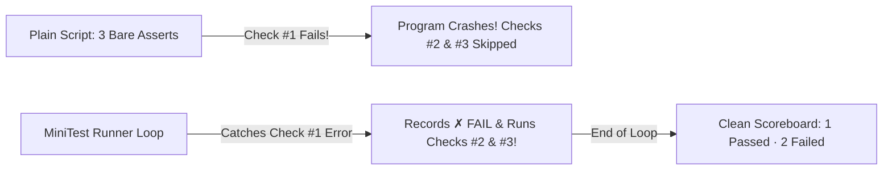

# Build MiniTest v0.1: From 3 Crashing Asserts to Your Own Test Runner

```json continuity
{
  "previously": "Brand-new course start! Even if you have never built a framework before, we start from a completely blank file.",
  "painPoint": "When you put 3 plain `assert` checks in one script and Check #1 fails, Python/Java crashes on the spot—so Checks #2 and #3 never even get a chance to run!",
  "unlock": "Build your own working 15-line test runner (`MiniTest v0.1` -> `v0.2`) that catches failures, auto-discovers `test_*` functions, prints a ✓/✗ scoreboard, and reveals how Pytest & JUnit 5 work!"
}
```

```json walkthrough
[
  {
    "time": "0:00",
    "badge": "Slide 1 / 4 · Why Plain Scripts Crash Too Early",
    "caption": "Suppose we write 3 AeroCart checks in one file: Check #1 has a bug, Check #2 is healthy, Check #3 has a bug. When Check #1 fails, Python stops dead—hiding what happened in Checks #2 and #3!",
    "code": "assert ticket_price(450, 0.2) == 360   # ✗ CRASHES HERE!\nassert bag_fee(20) == 0                # <-- Never runs!\nassert cancel_refund(100) == 100       # <-- Never runs!"
  },
  {
    "time": "0:24",
    "badge": "Slide 2 / 4 · Inventing a Test Runner in 10 Lines!",
    "caption": "How do we stop one failed check from crashing the whole program? Put each check in its own function and wrap a `for` loop + `try / except AssertionError` around them! Boom—you just invented a Test Runner!",
    "code": "for fn in [test_price, test_bag, test_refund]:\n    try:\n        fn()\n        print('✓ PASS:', fn.__name__)\n    except AssertionError as err:\n        print('✗ FAIL:', fn.__name__, err)"
  },
  {
    "time": "0:50",
    "badge": "Slide 3 / 4 · Auto-Finding Every `test_` Function",
    "caption": "Listing `[test_price, test_bag, ...]` by hand gets old fast! Next, MiniTest v0.2 automatically scans the file for any function whose name starts with `test_`—just like real Pytest!",
    "code": "discovered = [\n    obj for name, obj in globals().items()\n    if name.startswith('test_') and callable(obj)\n]"
  },
  {
    "time": "1:15",
    "badge": "Slide 4 / 4 · No More Black-Box Magic!",
    "caption": "Once you build MiniTest in 15 lines, Pytest and JUnit 5 stop feeling like scary magic—they are just supercharged versions of the exact loop you built!",
    "code": "# Stage 1: Collect (find all test_* functions safely)\n# Stage 2: Execute (Setup -> Run -> Cleanup per test)"
  }
]
```

```json pretraining
[
  {
    "term": "Test Runner",
    "formula": "Loop + try/catch + Summary Scoreboard",
    "meaning": "A small coordinator program that runs every test one-by-one so a single failure doesn't stop the rest of your tests."
  },
  {
    "term": "Test Discovery (Collection)",
    "formula": "Find all `test_*` / `@Test` automatically",
    "meaning": "Scanning your project to gather test functions automatically instead of forcing humans to list every test by hand."
  },
  {
    "term": "Collect vs. Execute Separation",
    "formula": "1. List Tests (0s) -> 2. Run Tests",
    "meaning": "Real frameworks list and filter tests first BEFORE running any heavy database or browser code."
  },
  {
    "term": "Assertion Rewriting (Pytest Secret)",
    "formula": "`assert a == b` -> Rich Variable Diff",
    "meaning": "How Pytest upgrades plain Python `assert` behind the scenes so failures show the exact numbers inside `a` and `b`."
  }
]
```

```json poe
{
  "question": "Suppose someone puts `db = connect_to_prod_vpn()` at the very top of `test_orders.py` (outside any function). What happens when you run `pytest --collect-only` on an airplane with no Wi-Fi just to see a list of test names?",
  "options": [
    "Nothing bad happens—Pytest skips top-level lines until a test runs",
    "Collection crashes before a single test even starts! Because Python executes top-level code while importing the file to look for `test_*` functions",
    "Pytest automatically mocks the VPN",
    "Only Java has this problem"
  ],
  "answerIndex": 1,
  "explanation": "When a runner imports a Python module to discover `def test_*` functions, any code sitting at the top level of the file executes immediately! Always keep connections inside setup/fixtures, never loose at the top of a test file."
}
```

## 🌱 Step 1: Plain-English Story — Why `Pytest` and `JUnit` Exist at All

When beginners first open a company project and see `pytest`, `conftest.py`, `@Test`, plugins, and hooks, it feels like walking into the cockpit of a spaceship. *What is this tool actually doing?*

Let's strip away 100% of the magic by starting with **nothing**—just a blank file.

Suppose we take 3 AeroCart checks from Course 01 and put them one after another in a plain script:
1. Check #1 tests a **broken** coupon (`$449.80 != $360.00`).
2. Check #2 tests **healthy** baggage fees (`20kg == $0`).
3. Check #3 tests a **broken** refund rule.

When you run that plain script, **Check #1 throws an `AssertionError` and crashes the entire program on Line 1!** You never find out that Check #2 passed or that Check #3 is *also* broken until you fix Check #1 first. Imagine fixing 1 bug, waiting 10 minutes, hitting Bug #2, waiting 10 minutes, hitting Bug #3... maddening!



**That single frustration is why Test Frameworks were born!**
At its heart, a testing framework like Pytest or JUnit is just a friendly **loop** that:
1. Finds all your small test functions automatically,
2. Runs each one inside a protective safety net (`try / except`) so one crash never stops the others, and
3. Prints a clean scoreboard at the end!

Let's build our very own working test framework—**`MiniTest v0.1`**—in **15 lines of code** right now!

## 🔨 Step 2: First Lines of Code — Build `MiniTest` From Scratch in 15 Lines!

Look how satisfying this is: we write two sample AeroCart tests (`test_bag_is_free` passes, `test_broken_coupon` fails on purpose), and below them we write **`run_minitest()`**—which **automatically discovers** every function starting with `test_` and runs them safely!

```python
# --- Two tiny AeroCart tests (Notice: zero imports needed!) ---
def test_bag_is_free():
    fee = 0 if 20 <= 23 else 100
    assert fee == 0


def test_broken_coupon():
    # Intentionally broken math ($450 - 0.20 = $449.80) so we see MiniTest catch it!
    assert (450 - 0.20) == 360.0, "Coupon charged $449.80 instead of $360!"


# --- MINITEST v0.1: YOUR OWN AUTO-DISCOVERING TEST RUNNER (14 LINES!) ---
def run_minitest():
    passed, failed = 0, 0
    # 1. DISCOVER: Grab every function in this file whose name starts with "test_"
    test_functions = [obj for name, obj in globals().items() if name.startswith("test_") and callable(obj)]

    # 2. RUN SAFELY: Catch AssertionError so one failure never stops the next test!
    for fn in test_functions:
        try:
            fn()
            passed += 1
            print(f"  ✓ PASS: {fn.__name__}")
        except AssertionError as err:
            failed += 1
            print(f"  ✗ FAIL: {fn.__name__} -> {err}")

    print(f"\nScoreboard: {passed} passed, {failed} failed (out of {len(test_functions)})")


run_minitest()
```

### Java 17 Equivalent (`MiniTest.java` using Method Reflection)

```java
import java.lang.reflect.InvocationTargetException;
import java.lang.reflect.Method;

public class MiniTest {
    public static void testBagIsFree() {
        int fee = (20 <= 23) ? 0 : 100;
        assert fee == 0;
    }

    public static void testBrokenCoupon() {
        double actual = 450 - 0.20;
        if (actual != 360.0) {
            throw new AssertionError("Coupon charged $" + actual + " instead of $360!");
        }
    }

    public static void main(String[] args) throws Exception {
        int passed = 0, failed = 0;
        // 1. DISCOVER: Scan MiniTest.class for methods starting with "test"
        for (Method m : MiniTest.class.getDeclaredMethods()) {
            if (!m.getName().startsWith("test")) continue;
            // 2. RUN SAFELY: Catch AssertionError inside InvocationTargetException
            try {
                m.invoke(null);
                passed++;
                System.out.println("  ✓ PASS: " + m.getName());
            } catch (InvocationTargetException ex) {
                failed++;
                System.out.println("  ✗ FAIL: " + m.getName() + " -> " + ex.getCause().getMessage());
            }
        }
        System.out.println("\nScoreboard: " + passed + " passed, " + failed + " failed");
    }
}
```

**Boom!** Read those 14 lines again—there is zero mystery! When you type `pytest` or click Run on JUnit in IntelliJ, the core engine is doing that exact **Discover → Catch → Report** dance across all the files in your folder!

## ⚡ Step 3: Where It Breaks in Real Life — `FAILED` vs. `ERROR` & Import Traps

Now let's upgrade our thinking from `MiniTest v0.1` to real-world frameworks! Watch **two real problems** our tiny 14-line loop hits as soon as 20 engineers start using it:

1. **Problem 1: Product Bug (`FAILED`) vs. Broken Setup (`ERROR`)**
   Notice our `try / except` only caught `AssertionError`. What if Wi-Fi drops and a test throws `ConnectionError`? A real runner separates:
   - **`FAILED`**: Your test ran and an `assert` caught a **product bug** (`$449.80 != $360`).
   - **`ERROR`**: Something crashed *outside* the assertion (like a missing config file or dead database). Separating the two tells you instantly whether the *app* broke or the *test environment* broke!
2. **Problem 2: Slow Top-Level Code During Discovery!**
   When `MiniTest` (or `Pytest`) scans 200 files just to list test names (`pytest --collect-only`), Python imports each `.py` file. If someone wrote `db = connect_slow_database()` at the **top of the file** (outside a function), simply *listing* the tests takes 45 seconds—or crashes completely when you're offline!

```json contrast
{
  "title": "Naive Test File vs. Clean Two-Stage Runner Discipline",
  "naiveTitle": "Heavy Work at Top of File + One Crash Bucket",
  "naiveMetric": "45s Just to List Tests · Crashes Offline",
  "naivePoints": [
    "Opens database connections or HTTP calls at the top of `test_checkout.py` outside any function",
    "Running `pytest --collect-only -k smoke` crashes if Staging VPN is disconnected",
    "Lumps `ConnectionError` and `AssertionError` together so engineers waste time debugging infra blips as app bugs"
  ],
  "staffTitle": "Pure Zero-I/O Discovery + 3-Phase Execution",
  "staffMetric": "150ms Test Discovery · Instant Triage",
  "staffPoints": [
    "Top-level imports contain ZERO network or database calls; setup only runs for tests that were actually selected",
    "Every test runs in 3 strict steps: `1. Setup` -> `2. Call` -> `3. Teardown`",
    "Reports `ERROR` if Setup crashes vs. `FAILED` if `assert` fails!"
  ]
}
```

Step through the **Runner Lifecycle Simulator** below to watch **Discovery** vs. **`Setup → Call → Teardown`** in action!

## 🚀 Step 4: Staff Engineer Deep-Dive — How Pytest Makes Plain `assert` Print Secret Values!

Have you ever noticed something magical in Python?
In plain Python, if `x = 449.80` and you run `assert x == 360.0`, Python prints a useless empty `AssertionError`—it doesn't even tell you that `x` was `449.80`! Yet when you run that **exact same line** under `pytest`, Pytest prints:
`AssertionError: assert 449.80 == 360.0 (where 449.80 = calculate_ticket_price(450, 0.20))`!

**How on earth did Pytest do that without changing Python itself?**
Here is the real Staff framework secret (**AST Bytecode Rewriting**):
1. When Pytest imports any `test_*.py` file during Discovery, it intercepts the file using Python's import hook (`sys.meta_path`) *before* Python runs it.
2. Pytest parses your code into a syntax tree (`ast.parse`) and finds every `assert left == right` statement.
3. Behind the scenes in memory, it rewrites `assert a == b` into helper variables (`_val_a = a; _val_b = b; if _val_a != _val_b: raise AssertionError(f"{_val_a} != {_val_b}")`)!

| Dimension | Our `MiniTest v0.1` | Production `Pytest` (Python 3) | Production `JUnit 5 Jupiter` (Java 17) |
| :--- | :--- | :--- | :--- |
| **How Tests Are Found** | `name.startswith("test_")` | `test_*.py` files + `def test_*` functions | Classpath scan for `@Test` / `@ParameterizedTest` annotations |
| **Why Failures Print Values** | Manual message string | Automatic **AST Bytecode Rewriting** on `test_*.py` | Explicit matcher methods (`assertEquals(360.0, actual)` or AssertJ `assertThat`) |
| **Plugin / Hook Engine** | Simple function wrapper | `pluggy` hooks (`pytest_collection_modifyitems`, `pytest_runtest_call`) | `Extension` interfaces (`BeforeEachCallback`, `InvocationInterceptor`) |

### Production Blueprint: Upgrading `MiniTest v0.2` With 3-Phase `PASS / FAIL / ERROR` Separation

```python
from dataclasses import dataclass
from typing import Callable, List, Optional


@dataclass
class TestItemResult:
    name: str
    outcome: str  # "PASSED" | "FAILED" | "ERROR"
    detail: str = ""


def execute_three_phase_item(
    name: str,
    test_fn: Callable[[], None],
    setup_fn: Optional[Callable[[], None]] = None,
    teardown_fn: Optional[Callable[[], None]] = None,
) -> TestItemResult:
    """Mirrors Pytest & JUnit 5: Setup errors -> ERROR; Call assert failures -> FAILED; Teardown ALWAYS runs!"""
    try:
        if setup_fn:
            setup_fn()
    except Exception as exc:
        if teardown_fn:
            teardown_fn()
        return TestItemResult(name=name, outcome="ERROR", detail=f"Setup crashed: {exc}")

    try:
        test_fn()
        return TestItemResult(name=name, outcome="PASSED")
    except AssertionError as assertion_bug:
        return TestItemResult(name=name, outcome="FAILED", detail=str(assertion_bug))
    except Exception as unexpected_crash:
        return TestItemResult(name=name, outcome="ERROR", detail=str(unexpected_crash))
    finally:
        if teardown_fn:
            teardown_fn()
```

### Java 17 Equivalent

```java
public class ThreePhaseMiniRunner {
    public record TestItemResult(String name, String outcome, String detail) {}

    public static TestItemResult executeItem(String name, Runnable setup, Runnable call, Runnable teardown) {
        try {
            if (setup != null) setup.run();
        } catch (Throwable setupCrash) {
            if (teardown != null) teardown.run();
            return new TestItemResult(name, "ERROR", "Setup crashed: " + setupCrash.getMessage());
        }

        try {
            call.run();
            return new TestItemResult(name, "PASSED", "");
        } catch (AssertionError productBug) {
            return new TestItemResult(name, "FAILED", productBug.getMessage());
        } catch (Throwable runtimeCrash) {
            return new TestItemResult(name, "ERROR", runtimeCrash.getMessage());
        } finally {
            if (teardown != null) teardown.run();
        }
    }
}
```

> [!WARNING]
> **Staff Interview Gotcha — Why Helper `assert`s Sometimes Lose Rich Diffs in Pytest!**
> To keep startup fast, Pytest's AST rewriter **only** rewrites files named `test_*.py`! If you move `assert order["total"] == 360` into a shared helper file `helpers/order_checks.py`, a failure prints an empty `AssertionError` with zero values! **Fix**: Put `pytest.register_assert_rewrite("helpers.order_checks")` at the top of `conftest.py` so Pytest upgrades your helper file too!

**Up Next in Chapter 02**: Look at `setup_fn` and `teardown_fn` in our code above—what happens when 50 tests need a `Database` AND a `TestUser` AND a `BookedSeat`? Copy-pasting setup code into 50 tests is a nightmare! In Chapter 02, we'll add **`@fixture` Dependency Injection & Safe Cleanup** to `MiniTest v0.3`!

```json quiz
[
  {
    "id": "fw-01-q1",
    "question": "Why did we build `MiniTest` with a `for` loop and `try / except AssertionError` instead of just writing 10 bare `assert` lines in a plain script?",
    "options": [
      "Because plain Python cannot run `assert` without installing Pytest",
      "Because in a plain script, the first failed `assert` crashes the whole program immediately—preventing tests #2 through #10 from running and hiding the full scoreboard",
      "Because `try / except` makes math functions run 100x faster",
      "Because Java does not have `if` statements"
    ],
    "answerIndex": 1,
    "explanation": "Catching `AssertionError` per test isolates each test's failure so all remaining tests execute and report a complete summary."
  },
  {
    "id": "fw-01-q2",
    "question": "In a professional runner (`MiniTest v0.2`, Pytest, JUnit 5), what is the difference between a test marked `FAILED` and a test marked `ERROR`?",
    "options": [
      "They mean the exact same thing",
      "`FAILED` means the test's `assert` check caught a wrong output (product bug), whereas `ERROR` means setup/fixture or an unexpected crash happened before or outside the assertion",
      "`ERROR` means the test passed too quickly",
      "`FAILED` only happens in browser tests"
    ],
    "answerIndex": 1,
    "explanation": "Separating `ERROR` (setup/environment fault) from `FAILED` (assertion violation) saves huge debugging time when a database or token server goes down."
  },
  {
    "id": "fw-01-q3",
    "question": "You put a reusable `assert response['price'] == expected` check inside `utils/assertions.py`, but when it fails in Pytest, it prints a blank `AssertionError` without showing the numbers! Why?",
    "options": [
      "Python dictionaries cannot be asserted",
      "By default, Pytest only performs AST assertion rewriting on `test_*.py` files; register shared helper modules with `pytest.register_assert_rewrite('utils.assertions')` in `conftest.py`",
      "You must rename every helper function to `test_helper`",
      "Pytest requires `time.sleep(1)` before assertions"
    ],
    "answerIndex": 1,
    "explanation": "Pytest's import hook only rewrites `test_*.py` and plugins unless you opt a helper module in via `pytest.register_assert_rewrite(...)` before it is imported."
  }
]
```
