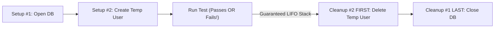

# Build MiniTest v0.3: Killing Copy-Paste Setup with Fixtures & Safe Cleanup

```json continuity
{
  "previously": "In Ch 01, we built `MiniTest v0.2`—auto-discovering `test_*` functions and separating `PASSED`, `FAILED`, and `ERROR`!",
  "painPoint": "Now we write 20 AeroCart booking tests, and EVERY test starts with the same 6 copy-pasted lines creating a test passenger—worse, when an `assert` fails mid-test, the cleanup line at the bottom never runs!",
  "unlock": "Add reusable Fixtures and 'Socks-Before-Shoes' (LIFO) automatic cleanup to `MiniTest v0.3`—then master Pytest `yield` fixtures & JUnit 5 Extensions!"
}
```

```json walkthrough
[
  {
    "time": "0:00",
    "badge": "Slide 1 / 4 · The Copy-Paste & Leaked-Data Bug",
    "caption": "Look what happens when a beginner puts cleanup at the bottom of a test: if `assert` fails on Line 3, Python jumps straight out of the function and Line 4 (`delete_user()`) NEVER RUNS! Junk users pile up and break the next test!",
    "code": "def test_vip_booking():\n    user = create_temp_user('maya@test.org')  # 1. Setup\n    assert book_seat(user, '1A') == 201       # 2. FAILS HERE! Jumps out!\n    delete_temp_user(user)                    # 3. <-- NEVER RUNS! Leaked!"
  },
  {
    "time": "0:25",
    "badge": "Slide 2 / 4 · What Is a 'Fixture' in Plain English?",
    "caption": "A Fixture is just a reusable 'Chef Prep Helper'! Your test simply asks for `(temp_user)` in its parameters—the runner creates `temp_user` before the test AND guarantees cleanup afterward, even if the test crashes!",
    "code": "# Look how clean the test becomes — ZERO setup clutter!\ndef test_vip_booking(temp_user):\n    assert book_seat(temp_user, '1A') == 201"
  },
  {
    "time": "0:52",
    "badge": "Slide 3 / 4 · Socks On First -> Shoes Off First (LIFO)!",
    "caption": "Suppose Setup opens a `Database` (#1), then creates a `User` (#2), then books an `Order` (#3). In what order MUST cleanup run? Reverse order (#3 Order -> #2 User -> #1 Close DB)! Close the DB first and deleting the Order crashes!",
    "code": "# Setup order:    1. Open DB  -> 2. Create User -> 3. Create Order\n# Teardown order: 3. Del Order -> 2. Del User    -> 1. Close DB (LIFO!)"
  },
  {
    "time": "1:15",
    "badge": "Slide 4 / 4 · Pytest `yield` Is Literally a Pause Button!",
    "caption": "In Pytest, everything BEFORE `yield` is Setup, the value yielded goes into your test, and everything AFTER `yield` is guaranteed Cleanup!",
    "code": "@pytest.fixture\ndef temp_user(db):\n    user = db.create_user('maya')   # <-- Runs BEFORE test\n    yield user                      # <-- Hands user to test!\n    db.delete_user(user)            # <-- ALWAYS runs AFTER test!"
  }
]
```

```json pretraining
[
  {
    "term": "Test Fixture",
    "formula": "Prep Ingredients -> Run Test -> Wash Dishes",
    "meaning": "A reusable helper that prepares fresh test data/connections before a test and cleans them up automatically afterward."
  },
  {
    "term": "Dependency Injection (DI)",
    "formula": "def test_booking(db, temp_user):",
    "meaning": "Instead of a test building its own database and user inside the test body, it simply asks for them by name in its parameter list!"
  },
  {
    "term": "LIFO Cleanup ('Socks & Shoes')",
    "formula": "Setup [1, 2, 3] -> Cleanup [3, 2, 1]",
    "meaning": "Last-In, First-Out: whatever resource you created LAST (an Order inside a DB) must be cleaned up FIRST before closing the DB!"
  },
  {
    "term": "Fixture Scopes",
    "formula": "function (fresh) vs. session (shared once)",
    "meaning": "Start heavy read-only tools (like a Docker DB server) once per `session`, but create mutable test data fresh per `function`!"
  }
]
```

```json poe
{
  "question": "During test setup, Fixture #1 opens a database connection (`db`), and Fixture #2 uses `db` to insert a temporary passenger (`user`). After the test finishes, what happens if the runner tears down in FIFO order (#1 `db.close()` first, then #2 `db.delete(user)`)?",
  "options": [
    "Everything works twice as fast",
    "Teardown #2 (`db.delete(user)`) crashes with 'Database connection already closed!', leaving `user` leaked in the database! Cleanup MUST run in reverse LIFO order (#2 first, then #1)",
    "Databases automatically delete users when closed",
    "Fixtures never run cleanup if a test passes"
  ],
  "answerIndex": 1,
  "explanation": "Because `user` depends on `db` still being open, you must tear down dependents in reverse Last-In, First-Out (LIFO) order: delete `user` (#2) while `db` is still open, and close `db` (#1) last!"
}
```

## 🌱 Step 1: Plain-English Story — The Dirty Kitchen Problem

In **Chapter 01**, we built **`MiniTest v0.2`**, which finds every `test_*` function and runs them safely inside a loop. Awesome!

Now watch what happens the moment we use `MiniTest v0.2` to write **20 real AeroCart booking tests**:

```python
def test_vip_seat_booking():
    db = open_test_db()                        # <-- Copy-pasted in all 20 tests!
    user = db.create_user("maya@aerocart.io")  # <-- Copy-pasted in all 20 tests!

    assert book_seat(db, user, "1A") == "CONFIRMED"   # 💥 Suppose this FAILS!

    db.delete_user(user)                       # ❌ SKIPPED! Python jumped out on the line above!
    db.close()                                 # ❌ SKIPPED! Connection leaked!
```

Two painful things just happened at once:
1. **Copy-Paste Clutter**: 80% of every test is boring setup/cleanup plumbing instead of the 1 line we actually care about!
2. **The Dirty Kitchen Leak**: Whenever `assert` fails on Line 5, Python jumps straight out of `test_vip_seat_booking()`—so `db.delete_user(user)` **never runs**! Then the *next* test tries to create `"maya@aerocart.io"`, crashes with `Duplicate Email!`, and suddenly 1 real failure causes **19 fake cascade failures**!



**How do real frameworks fix both problems?**
With **Fixtures** + **Reverse ("Socks-Before-Shoes" / `LIFO`) Cleanup**!
- Think of getting dressed in the morning: you put **Socks (#1)** on first, then **Shoes (#2)**. At night, you **must** take **Shoes (#2)** off *before* **Socks (#1)**!
- Similarly, if Setup opens **DB (#1)** and creates **User (#2)**, Cleanup must delete **User (#2)** *before* closing **DB (#1)**—and it must run inside a `finally` block so even a crashing test leaves a spotless kitchen!

## 🔨 Step 2: First Lines of Code — Build `@fixture` Into `MiniTest v0.3`!

You might think Pytest's `@pytest.fixture` uses 5,000 lines of dark magic. Nope! Watch us add **real working `@fixture` injection + LIFO `yield` cleanup** to our `MiniTest` runner in **22 lines of plain Python** using `inspect.signature`!

Read this slowly—this is one of the biggest *"Aha!"* moments in framework engineering:

```python
import inspect

FIXTURES = {}


def fixture(fn):
    """Register any generator function as a reusable MiniTest fixture!"""
    FIXTURES[fn.__name__] = fn
    return fn


# --- Define two chained fixtures (temp_user asks for db!) ---
@fixture
def db():
    conn = {"open": True, "users": set()}
    yield conn                       # 1. Hand open DB to whoever needs it
    conn["open"] = False             # 4. Runs LAST: Close DB!


@fixture
def temp_user(db):
    db["users"].add("maya")
    yield "maya"                     # 2. Hand 'maya' to the test!
    assert db["open"], "DB closed too early!"
    db["users"].remove("maya")       # 3. Runs FIRST: Delete 'maya' while DB is still open!


# --- Look how clean our test is now! Just ask for (db, temp_user) by name! ---
def test_booking_cleans_up_even_on_pass(db, temp_user):
    assert temp_user in db["users"]


# --- MINITEST v0.3 FIXTURE ENGINE (LIFO Teardown Stack!) ---
def run_with_fixtures(test_fn):
    teardown_stack = []              # Stores paused generators so we unwind in REVERSE!
    resolved = {}

    def resolve(name):
        if name in resolved:
            return resolved[name]
        gen_fn = FIXTURES[name]
        kwargs = {dep: resolve(dep) for dep in inspect.signature(gen_fn).parameters}
        gen = gen_fn(**kwargs)
        val = next(gen)              # Run code BEFORE `yield`!
        teardown_stack.append(gen)   # Push onto stack
        resolved[name] = val
        return val

    try:
        args = {p: resolve(p) for p in inspect.signature(test_fn).parameters}
        test_fn(**args)
        print(f"✓ PASS: {test_fn.__name__}")
    finally:
        # Unwind in REVERSE (LIFO: Shoes off #2 -> Socks off #1)!
        for gen in reversed(teardown_stack):
            next(gen, None)          # Run code AFTER `yield`!


run_with_fixtures(test_booking_cleans_up_even_on_pass)
```

### Java 17 Equivalent (`AutoCloseable` LIFO Stack — How JUnit 5 Extensions Work)

```java
import java.util.*;

public class MiniFixtureStack {
    public static void runTestWithLifoCleanup() {
        Deque<Runnable> lifoCleanup = new ArrayDeque<>(); // Stack: push() -> pop() is LIFO!
        try {
            // 1. Setup #1: Open DB
            Set<String> users = new HashSet<>();
            boolean[] dbOpen = {true};
            lifoCleanup.push(() -> dbOpen[0] = false);

            // 2. Setup #2: Create temp user inside DB
            users.add("maya");
            lifoCleanup.push(() -> {
                if (!dbOpen[0]) throw new IllegalStateException("DB closed too early!");
                users.remove("maya");
            });

            // 3. Run the actual test!
            assert users.contains("maya");
            System.out.println("✓ PASS: testBookingWithLifoCleanup");
        } finally {
            // 4. Always unwind LIFO (#2 remove user -> #1 close DB) even if test throws!
            while (!lifoCleanup.isEmpty()) {
                lifoCleanup.pop().run();
            }
        }
    }

    public static void main(String[] args) {
        runTestWithLifoCleanup();
    }
}
```

**Look at what you just built!** Now when you see `@pytest.fixture` with `yield` in a real codebase, you know *literally line-for-line* how it pauses at `yield`, hands the object to your test, and unwinds `reversed(teardown_stack)` inside `finally`!

## ⚡ Step 3: Where It Breaks in Real Life — What If Setup #2 Crashes Halfway Through?

Here is the real-world edge case that separates battle-tested frameworks from brittle homemade base classes:

Suppose your test asks for **3 things**:
1. `docker_db` (succeeds — starts a container!)
2. `payment_stub` (💥 **throws `PortInUseError` during setup!**)
3. `temp_user` (never reached)

If a beginner wrote setup inside a traditional `setUp()` method without a LIFO stack (`Contextlib.ExitStack`), what happens when Step #2 crashes? **`tearDown()` never knows Step #1 succeeded, or `tearDown()` crashes trying to clean up Step #3 (`NoneType` error), leaving `docker_db` running forever as a zombie container eating RAM!**

Because our `MiniTest v0.3` (and real Pytest / JUnit 5) only pushes a resource onto `teardown_stack` **the instant its setup succeeds**, crashing on #2 unwinds **exact #1** cleanly and skips #3 safely!

```json contrast
{
  "title": "Fragile `BaseTest.setUp()` Inheritance vs. Composable LIFO Fixtures",
  "naiveTitle": "Giant `BaseTest` Class Inheritance",
  "naiveMetric": "All-or-Nothing Setup · Zombie Leaks",
  "naivePoints": [
    "Every test inherits from `BaseE2ETest`, spinning up a browser, DB, and Kafka client even for a 1ms price test!",
    "If line 4 of `setUp()` throws an error, `tearDown()` crashes on `self.user.delete()` because `self.user` is still `None`!",
    "Impossible to mix-and-match: API-only tests vs. Billing tests end up in a tangled 5-level inheritance tree"
  ],
  "staffTitle": "Composable `@fixture` / JUnit5 Extensions + `ExitStack`",
  "naiveSummary": "",
  "staffMetric": "Pay-Only-For-What-You-Use · Leak-Proof",
  "staffPoints": [
    "Each test requests ONLY the exact fixtures it needs (`def test_price()` requests 0 fixtures -> runs in 0.1ms!)",
    "`ExitStack` / `yield` unwinds only the resources that actually opened, in strict LIFO order",
    "Compose behaviors like Lego bricks instead of inheriting from a 1,500-line `BaseTest` class"
  ]
}
```

Step through the **Fixture Lifecycle Simulator** below to watch how Pytest & JUnit 5 unwind cleanly even when a middle fixture throws an exception!

## 🚀 Step 4: Staff Engineer Deep-Dive — Fixture Scopes & The "Scope-Mismatch" Trap

In a real 1,000-test suite, spinning up a brand-new PostgreSQL Docker container before *every single test* (`3 seconds × 1,000 = 50 minutes`) is way too slow! Yet sharing the *same* mutable `temp_user` across 1,000 tests causes data collisions!

Production frameworks solve this with **Fixture Scopes**:

| Scope (`Pytest` / `JUnit 5`) | Created How Often? | What Belongs Here? | What MUST NEVER Live Here? |
| :--- | :---: | :--- | :--- |
| **`session`** / `LauncherSession` | **Once** per entire test run | Heavy read-only infrastructure: Docker Postgres server, compiled app binary, Browser binary (`chromium`). | Mutable user rows, auth carts, or open DB transactions! |
| **`module` / `class`** (`@BeforeAll`) | Once per file / class | Read-only reference seed data (airport list `JFK, LHR, HND`). | Shared shopping cart that Test 1 empties while Test 2 reads! |
| **`function`** (`@BeforeEach` — *Default*) | **Fresh for every single test!** | `temp_user`, `BrowserContext`, DB transaction rollback, fresh `X-Test-Tenant-ID`! | Slow 5-second container cold-starts! |

### Production Blueprint: Fast `session` Engine + Fresh `function` Isolation (`Python 3` & `Java 17`)

```python
from contextlib import ExitStack
import uuid


# In real Pytest, @pytest.fixture(scope="session") runs ONCE per suite:
def create_session_aerocart_engine() -> dict:
    return {"service": "AeroCart-InMemory-Engine", "tenants": {}}


# And @pytest.fixture(scope="function") runs FRESH per test using ExitStack:
def run_isolated_test_with_exit_stack(session_engine: dict) -> None:
    with ExitStack() as stack:
        # 1. Allocate a unique tenant namespace in 0.01ms (no slow container restart!)
        tenant_id = f"tenant-{uuid.uuid4().hex[:8]}"
        session_engine["tenants"][tenant_id] = {"orders": []}
        stack.callback(lambda: session_engine["tenants"].pop(tenant_id, None))

        # 2. Seed a test order inside that tenant
        session_engine["tenants"][tenant_id]["orders"].append("ORD-101")

        # 3. Execute test assertion
        assert session_engine["tenants"][tenant_id]["orders"] == ["ORD-101"]
    # Leaving `with ExitStack()` automatically runs all registered callbacks in LIFO order!
    assert tenant_id not in session_engine["tenants"]
```

### Java 17 Equivalent (JUnit 5 `Extension` Lifecycle Pattern)

```java
import java.util.*;

public class ScopedExtensionDemo {
    // Shared once across the suite (Session / Class scope)
    static final Map<String, List<String>> SHARED_ENGINE = new HashMap<>();

    // Fresh per test (@BeforeEach -> @AfterEach)
    public static void executeIsolatedTest() {
        String tenantId = "tenant-" + UUID.randomUUID().toString().substring(0, 8);
        SHARED_ENGINE.put(tenantId, new ArrayList<>());
        try {
            SHARED_ENGINE.get(tenantId).add("ORD-101");
            assert SHARED_ENGINE.get(tenantId).equals(List.of("ORD-101"));
        } finally {
            // Guaranteed per-test cleanup without restarting the engine!
            SHARED_ENGINE.remove(tenantId);
        }
    }
}
```

> [!WARNING]
> **Staff Interview Gotcha — Why Can a `function` Fixture Depend on a `session` Fixture, But NEVER the Reverse?**
> Think about lifetimes! A `function` fixture (`temp_user`) lives for **50 milliseconds** and gets destroyed at the end of Test #1. If a `session` fixture (which lives for **10 minutes** across all 500 tests) tried to hold onto `temp_user`, then during Tests #2 through #500 it would be holding a **deleted, dead user** (`ScopeMismatchError` in Pytest)! **Rule**: Narrower scopes (`function`) can always request wider scopes (`session`), never the reverse!

**Module 1 Complete — Up Next in Module 2 (Chapter 03)**: Our `MiniTest` framework now discovers tests automatically and injects leak-proof fixtures! Next, how do we stop our test functions from turning into ugly walls of raw HTML selectors (`#btn-checkout-v2`) and messy JSON dictionaries? Let's build clean **Page Objects, Component Wrappers & App Actions**!

```json quiz
[
  {
    "id": "fw-02-q1",
    "question": "Why is putting `db.delete_user(temp_user)` as a normal line at the very bottom of a test function (without `finally` or a fixture) a bug waiting to happen?",
    "options": [
      "Because `delete_user` makes tests pass when they should fail",
      "Because whenever an `assert` fails earlier in the test, execution jumps out immediately—skipping `delete_user()` and leaking dirty data that breaks later tests!",
      "Because Python functions cannot have more than 5 lines",
      "Because databases delete rows automatically after 1 second"
    ],
    "answerIndex": 1,
    "explanation": "An uncaught `AssertionError` aborts the test body immediately; cleanup must live inside a `finally` / `yield` fixture / JUnit `@AfterEach` callback so it runs unconditionally."
  },
  {
    "id": "fw-02-q2",
    "question": "Fixture A opens a database connection, and Fixture B uses that connection to insert a temporary flight row. In what order MUST teardown run, and why?",
    "options": [
      "A first, then B (First-In, First-Out)",
      "B first (delete the temporary flight row while the DB is still open), then A last (close the DB connection) — Last-In, First-Out (LIFO)",
      "Alphabetical order by fixture name",
      "Random order"
    ],
    "answerIndex": 1,
    "explanation": "Just like taking shoes off before socks, dependent resources must unwind in reverse creation order (LIFO) so child cleanup doesn't hit an already-closed parent connection."
  },
  {
    "id": "fw-02-q3",
    "question": "Why does Pytest immediately raise a `ScopeMismatch` error if a `scope='session'` fixture tries to request a `scope='function'` fixture?",
    "options": [
      "Because `session` fixtures run in Java while `function` fixtures run in Python",
      "Because the `function` fixture will be torn down after the very first test finishes, leaving the long-lived `session` fixture holding a destroyed/stale resource for the remaining 499 tests!",
      "Because you can only have one fixture per file",
      "Because `session` fixtures cannot return dictionaries"
    ],
    "answerIndex": 1,
    "explanation": "A long-lived (`session`) fixture cannot safely depend on an ephemeral (`function`) resource whose lifecycle ends after a single test."
  }
]
```
