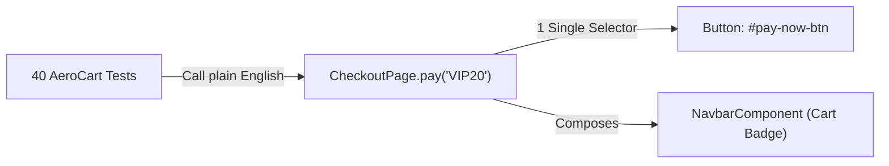

# Build MiniTest v0.3 UI Layer: From Raw Selectors to Page Objects, Components & App Actions

```json continuity
{
  "previously": "In Ch 02, we added `@fixture` setup and 'Socks-Before-Shoes' (LIFO) cleanup to `MiniTest` so every test gets a fresh browser or database cleanly.",
  "painPoint": "Now we write 40 AeroCart tests, and all 40 tests hardcode `page.click('#checkout-btn')`. On Tuesday morning, a frontend designer renames `#checkout-btn` to `#pay-now`—and all 40 tests explode at once!",
  "unlock": "Wrap raw selectors inside a single `CheckoutPage` (Page Object), break shared widgets into `NavbarComponent`s, and unlock fast API App Actions for `MiniTest v0.3`!"
}
```

```json walkthrough
[
  {
    "time": "0:00",
    "badge": "Slide 1 / 4 · The 40-Test Selector Explosion",
    "caption": "When 40 test functions each type `page.click('#checkout-btn')` directly, a tiny HTML rename forces you to edit 40 different places!",
    "code": "# ❌ Copy-pasted across 40 tests:\ndef test_vip_checkout(page):\n    page.fill('#coupon-box', 'VIP20')\n    page.click('#checkout-btn')  # Renamed to #pay-now -> 40 tests break!",
    "nodes": ["40 Raw Tests", "Hardcoded #checkout-btn", "40 Broken Tests"]
  },
  {
    "time": "0:25",
    "badge": "Slide 2 / 4 · Page Object Model (One Remote Control)",
    "caption": "Think of a Page Object like a TV Remote Control: tests press `checkout_page.pay('VIP20')`, and only the remote knows which wire (`#pay-now`) is inside!",
    "code": "class CheckoutPage:\n    def pay(self, code: str):\n        self.page.fill('#coupon-box', code)\n        self.page.click('#pay-now')  # Fix ONCE here -> all 40 tests pass!",
    "nodes": ["40 Clean Tests", "CheckoutPage.pay()", "1 Selector Fix"]
  },
  {
    "time": "0:50",
    "badge": "Slide 3 / 4 · Component Objects (Lego Bricks)",
    "caption": "What if the Top Navbar appears on 15 different pages? Instead of copy-pasting navbar methods into 15 Page Objects, build ONE `NavbarComponent`!",
    "code": "class CheckoutPage:\n    def __init__(self, page):\n        self.navbar = NavbarComponent(page)  # Compose like Lego bricks!",
    "nodes": ["SearchPage", "CheckoutPage", "Shared NavbarComponent"]
  },
  {
    "time": "1:15",
    "badge": "Slide 4 / 4 · App Actions & Screenplay (Fast Forward)",
    "caption": "When testing Checkout, don't waste 8 seconds typing in the Login UI 40 times—use an API App Action to jump straight to Checkout in 20ms!",
    "code": "def test_checkout_discount(page, api_actions):\n    api_actions.seed_logged_in_cart(page, item='JFK-LHR')  # 20ms!\n    CheckoutPage(page).apply_coupon('VIP20')",
    "nodes": ["API Seed (20ms)", "Open CheckoutPage", "Assert UI Total"]
  }
]
```

```json pretraining
[
  {
    "term": "Page Object Model (POM)",
    "formula": "Test -> CheckoutPage.pay() -> '#pay-now'",
    "meaning": "A simple helper class that acts like a 'TV remote control' for one web screen, hiding raw HTML selectors in one place so tests stay easy to read and fix."
  },
  {
    "term": "Component Object",
    "formula": "NavbarComponent + CartDrawerComponent",
    "meaning": "A mini Page Object for a reusable UI widget (like a navigation bar or seat picker) that appears across many pages."
  },
  {
    "term": "Assertion-Free Page Objects",
    "formula": "Page Object = Actions/Data | Test = `assert`",
    "meaning": "Page Objects perform clicks and return text, while `assert` stays inside the `test_*` function so the same Page Object works for both success and error tests."
  },
  {
    "term": "App Actions / Screenplay",
    "formula": "API Setup (20ms) + UI Target Check (300ms)",
    "meaning": "Using fast backend/API helpers to set up state (like logging in and filling a cart) before testing the target UI screen."
  }
]
```

```json poe
{
  "question": "Suppose you write `assert 'Thank You' in self.page.text()` directly inside `CheckoutPage.submit_payment()`. What happens tomorrow when you want to write a negative test for an expired credit card using `CheckoutPage.submit_payment()`?",
  "options": [
    "It works great for both tests",
    "Your negative test crashes inside `submit_payment()` because it demands to see `'Thank You'`, when an expired card actually shows `'Card Declined'`! Keep `assert` in the test, not locked inside action methods",
    "Page Objects cannot click buttons on error pages",
    "Python forbids calling `assert` inside classes"
  ],
  "answerIndex": 1,
  "explanation": "If `submit_payment()` hardcodes a positive assertion (`assert 'Thank You'`), you can never reuse that method to test declined cards or validation errors! Let Page Objects perform actions/return state, and let tests decide what to assert."
}
```

## 🌱 Step 1: Plain-English Story — The TV Remote Control Analogy

In **Chapter 02**, we upgraded `MiniTest` with `@fixture` injection so every test automatically receives a clean `page` object. Feeling unstoppable, our team writes **40 AeroCart checkout tests** over the weekend.

Every single one of those 40 tests has lines that look like this:
- `page.fill("#coupon-input-v1", "VIP20")`
- `page.click("#checkout-btn")`

On Monday morning, a designer refreshes the AeroCart checkout screen and renames the button ID from `#checkout-btn` to `#pay-now-btn`. **Nothing is actually broken in AeroCart**—customers can still buy flights just fine—yet **all 40 of our tests turn bright red at once!** Now you have to spend two hours hunting through 40 test functions doing find-and-replace.



**How do we make sure a button rename only ever requires a 1-line fix?**
Think of a **TV Remote Control**:
- When you want to turn up the volume, you don't open the plastic case and touch two circuit-board wires together—you press the **`volume_up()`** button on the remote!
- A **Page Object (`CheckoutPage`)** is just a TV Remote Control for a web page. All 40 tests call `checkout.pay("VIP20")`. Inside `CheckoutPage`, `#pay-now-btn` is written **once**. When a designer renames a button tomorrow, you update **1 line** inside `CheckoutPage`, and all 40 tests pass in 5 seconds!

## 🔨 Step 2: First Lines of Code — Build a Page Object + Component in 18 Lines!

Let's add clean **Page Object + Component** support to our `MiniTest v0.3` toolkit right now! Notice two rules:
1. `NavbarComponent` handles the top bar (`cart_count()`), and `CheckoutPage` **includes** it (`self.navbar = NavbarComponent(page)`).
2. Neither class contains an `assert`—they perform actions and return data, while `test_vip_checkout` owns the `assert`!

```python
class NavbarComponent:
    def __init__(self, dom: dict):
        self.dom = dom

    def cart_count(self) -> int:
        return int(self.dom["#nav-cart-badge"])


class CheckoutPage:
    def __init__(self, dom: dict):
        self.dom = dom
        self.navbar = NavbarComponent(dom)  # Compose reusable component!

    def apply_coupon_and_pay(self, code: str) -> str:
        if code == "VIP20":
            self.dom["#total-price"] = "$360.00"
        return self.dom["#total-price"]


def test_vip_checkout():
    fake_dom = {"#nav-cart-badge": "1", "#total-price": "$450.00"}
    checkout = CheckoutPage(fake_dom)
    assert checkout.navbar.cart_count() == 1
    assert checkout.apply_coupon_and_pay("VIP20") == "$360.00"
```

### Java 17 Equivalent (`CheckoutPage.java` with Component Composition)

```java
import java.util.HashMap;
import java.util.Map;

public class CheckoutPageDemo {
    static class NavbarComponent {
        private final Map<String, String> dom;
        NavbarComponent(Map<String, String> dom) { this.dom = dom; }
        int cartCount() { return Integer.parseInt(dom.get("#nav-cart-badge")); }
    }

    static class CheckoutPage {
        private final Map<String, String> dom;
        final NavbarComponent navbar;
        CheckoutPage(Map<String, String> dom) {
            this.dom = dom;
            this.navbar = new NavbarComponent(dom);
        }
        String applyCouponAndPay(String code) {
            if ("VIP20".equals(code)) dom.put("#total-price", "$360.00");
            return dom.get("#total-price");
        }
    }

    public static void main(String[] args) {
        Map<String, String> dom = new HashMap<>(Map.of("#nav-cart-badge", "1", "#total-price", "$450.00"));
        CheckoutPage checkout = new CheckoutPage(dom);
        assert checkout.navbar.cartCount() == 1;
        assert checkout.applyCouponAndPay("VIP20").equals("$360.00");
    }
}
```

**Look at `test_vip_checkout()` now!** Even a product manager who doesn't code can read `checkout.apply_coupon_and_pay("VIP20") == "$360.00"`, and there isn't a single `#` selector inside the test!

## ⚡ Step 3: Where It Breaks in Real Life — The "2,000-Line Monster `BasePage`" Trap

Once teams fall in love with Page Objects, they almost always fall into two painful traps as the app grows from 5 screens to 50 screens:

1. **Trap 1: Inheritance Monster (`class CheckoutPage(BasePage)`)**
   Instead of breaking shared widgets (`Navbar`, `SeatPicker`, `Footer`) into small **Component Objects**, someone stuffs every helper into a single parent class called `BasePage`. Six months later, `BasePage` is **2,500 lines long** with 140 methods (`click_navbar_cart()`, `dismiss_cookie_banner()`, `parse_sql_date()`), and every git pull request hits a merge conflict in `BasePage.py`!
2. **Trap 2: Re-Walking the Login Screen 100 Times!**
   If you have 100 Checkout tests and every test opens `LoginPage -> SearchPage -> SeatPage -> CheckoutPage` through the slow browser UI, each test wastes **9 seconds** before it even reaches Checkout (`9s × 100 = 15 minutes wasted`)!

```json contrast
{
  "title": "Monster BasePage + Slow UI Setup vs. Composable Components + Fast App Actions",
  "naiveTitle": "2,500-Line `BasePage` + Full UI Walkthroughs",
  "naiveMetric": "15 Min Wasted in Login UI · Constant Merge Conflicts",
  "naivePoints": [
    "Every Page Object inherits from a bloated 2,500-line `BasePage` containing unrelated methods",
    "All 100 Checkout tests type username/password in the slow Login UI and click through Search every single time",
    "Page Object methods hardcode `assert` checks inside click methods, breaking negative test cases"
  ],
  "staffTitle": "Thin Page Objects + Scoped Components + API App Actions",
  "staffMetric": "20ms API State Seed · Zero Inheritance Bloat",
  "staffPoints": [
    "Pages compose small widget classes (`self.navbar = NavbarComponent(page)`) instead of inheriting from a giant `BasePage`",
    "1 dedicated Login UI test verifies the login screen; the other 99 tests seed auth + cart via a 20ms API App Action!",
    "Page Objects expose clean actions and state while keeping `assert` / `expect()` inside the test function"
  ]
}
```

Try the **UI Abstraction Simulator** below to compare raw selectors, Page Objects, Components, and Screenplay/App Actions side by side!

## 🚀 Step 4: Staff Engineer Deep-Dive — POM vs. App Actions vs. Screenplay Economics

When should you use a **Thin Page Object + Components**, when should you add **API App Actions**, and when (if ever) do you need the **Screenplay Pattern** (`Actor.attemptsTo(...)`)?

Let's look at the exact suite runtime math when $N$ tests each require $K$ setup screens before testing the target screen:

$$\text{Suite Time}_{\text{UI-Setup}} = N \times \left( \sum_{i=1}^{K} T_{\text{UI-screen}, i} + T_{\text{target}} \right) \quad \text{vs.} \quad \text{Suite Time}_{\text{App-Action}} = N \times \left( T_{\text{API-seed}} + T_{\text{target}} \right)$$

For $N = 100$ Checkout tests where 3 UI setup screens take $3 \times 2.5\text{s} = 7.5\text{s}$ vs. an API App Action taking $0.03\text{s}$:
- **Pure UI POM walkthrough**: $100 \times (7.5\text{s} + 1.5\text{s}) = 900\text{s}$ (**15 minutes**)
- **Hybrid App Action + Checkout POM**: $100 \times (0.03\text{s} + 1.5\text{s}) = 153\text{s}$ (**2.5 minutes — 6x faster!**)

| Pattern | How It Works | Best Used When... | Watch Out For... |
| :--- | :--- | :--- | :--- |
| **Thin POM + Components** | `CheckoutPage` holds locators + composes `NavbarComponent` | Standard web/mobile UI suites (90% of teams) | Don't create a 2,000-line `BasePage` parent class! |
| **Hybrid App Actions** | Fast API/cookie helper sets up user + cart; POM tests target UI | Skipping repetitive Login / Cart seeding across 100+ UI tests | Keep 1–2 true end-to-end UI tests for Login & Search themselves! |
| **Screenplay (`Actor` / `Task`)** | `Actor("Maya").attemptsTo(BookFlight.to("LHR"))` | Multi-actor workflows (e.g., Passenger + Gate Agent + Pilot in 1 test) | High boilerplate (3x more files) if you only have single-user tests! |

### Production Blueprint: Scoped Component + Assertion-Free POM + Fast App Action (`MiniTest v0.3` / `Playwright`)

```python
from dataclasses import dataclass
from typing import Dict


@dataclass(frozen=True)
class CartSeedAction:
    """App Action: Seeds auth + cart state in 20ms without clicking through Login/Search UI!"""
    dom_state: Dict[str, str]

    def seed_checkout_ready(self, flight: str, base_price_cents: int) -> None:
        self.dom_state["cookie:session"] = "valid-jwt-token"
        self.dom_state["#cart-flight"] = flight
        self.dom_state["#total-cents"] = str(base_price_cents)


class CouponDrawerComponent:
    """Scoped Component: Reusable across CartPage, CheckoutPage, and UpgradeModal."""
    def __init__(self, dom_state: Dict[str, str], root_prefix: str = "#checkout-drawer"):
        self.dom = dom_state
        self.root = root_prefix

    def apply_code(self, code: str) -> None:
        self.dom[f"{self.root} [data-testid='coupon-input']"] = code
        if code == "VIP20":
            cents = int(self.dom["#total-cents"])
            self.dom["#total-cents"] = str(int(cents * 0.80))
            self.dom[f"{self.root} [data-testid='coupon-Banner']"] = "20% VIP Discount Applied"
        else:
            self.dom[f"{self.root} [data-testid='coupon-Banner']"] = "Invalid Coupon Code"

    def banner_text(self) -> str:
        return self.dom.get(f"{self.root} [data-testid='coupon-Banner']", "")


class AeroCheckoutPage:
    """Thin Page Object: Composes components and exposes state—ZERO internal asserts!"""
    def __init__(self, dom_state: Dict[str, str]):
        self.dom = dom_state
        self.coupon_drawer = CouponDrawerComponent(dom_state)

    def total_dollars(self) -> float:
        return int(self.dom["#total-cents"]) / 100.0
```

### Java 17 Equivalent (Composable POM + App Action)

```java
import java.util.Map;

public class AeroCheckoutArchitecture {
    public record CartSeedAction(Map<String, String> dom) {
        public void seedCheckoutReady(String flight, int baseCents) {
            dom.put("cookie:session", "valid-jwt-token");
            dom.put("#cart-flight", flight);
            dom.put("#total-cents", String.valueOf(baseCents));
        }
    }

    public static final class CouponDrawerComponent {
        private final Map<String, String> dom;
        private final String root;

        public CouponDrawerComponent(Map<String, String> dom, String root) {
            this.dom = dom;
            this.root = root;
        }

        public void applyCode(String code) {
            if ("VIP20".equals(code)) {
                int cents = Integer.parseInt(dom.get("#total-cents"));
                dom.put("#total-cents", String.valueOf((int) (cents * 0.80)));
                dom.put(root + " [data-testid='banner']", "20% VIP Discount Applied");
            } else {
                dom.put(root + " [data-testid='banner']", "Invalid Coupon Code");
            }
        }

        public String bannerText() {
            return dom.getOrDefault(root + " [data-testid='banner']", "");
        }
    }

    public static final class AeroCheckoutPage {
        private final Map<String, String> dom;
        public final CouponDrawerComponent couponDrawer;

        public AeroCheckoutPage(Map<String, String> dom) {
            this.dom = dom;
            this.couponDrawer = new CouponDrawerComponent(dom, "#checkout-drawer");
        }

        public double totalDollars() {
            return Integer.parseInt(dom.get("#total-cents")) / 100.0;
        }
    }
}
```

> [!WARNING]
> **Staff Interview Gotcha — Why Scoped Component Locators Prevent False-Positive Clicks!**
> Suppose an AeroCart screen has **two** `"Remove"` buttons: one inside the top `MiniCartDropdown` and one inside the main `CheckoutSummary`. If your component searches the entire page (`page.get_by_role("button", name="Remove")`), Playwright throws a strict-mode collision error (or worse, Selenium silently clicks the wrong `"Remove"` button!). **Always pass a `root` container locator into every Component (`root.get_by_role(...)`)** so the component only searches inside its own HTML box!

**Up Next in Chapter 04**: Our UI layer is now super clean—but look inside our test data setup: what happens when a test needs a `Passenger` object with 20 fields (`name`, `passport`, `tier`, `baggage`, `meal`...), and two tests accidentally mutate the same shared dictionary? In Chapter 04, we'll add **Fluent Immutable Data Builders ("Subway Sandwich Builders")** to `MiniTest v0.4`!

```json quiz
[
  {
    "id": "fw-03-q1",
    "question": "Why did we move `#pay-now-btn` out of 40 test functions and into a single `CheckoutPage` class?",
    "options": [
      "Because Python does not allow `#` characters inside `test_*` functions",
      "So when a designer renames `#pay-now-btn` tomorrow, we update 1 line inside `CheckoutPage` instead of repairing 40 broken test functions by hand",
      "Because classes run 50x faster than functions",
      "To hide what the test is testing"
    ],
    "answerIndex": 1,
    "explanation": "Centralizing locators inside a Page Object means UI selector changes require a single-line update rather than a 40-file search-and-replace."
  },
  {
    "id": "fw-03-q2",
    "question": "Why should you compose a `NavbarComponent` (`self.navbar = NavbarComponent(page)`) instead of putting `click_navbar_cart()` inside a giant `BasePage` parent class?",
    "options": [
      "Because Python does not support class inheritance",
      "Because not every page has a navbar (e.g., a 3D Secure bank popup), and stuffing every widget into `BasePage` creates a 2,500-line monster class with constant merge conflicts",
      "Because `BasePage` deletes cookies automatically",
      "Components do not need locators"
    ],
    "answerIndex": 1,
    "explanation": "Composition over inheritance lets each Page Object assemble only the exact widgets (`NavbarComponent`, `CouponDrawerComponent`) that actually exist on that screen."
  },
  {
    "id": "fw-03-q3",
    "question": "You have 100 UI tests for the AeroCart Checkout screen. How should those 100 tests get a logged-in user with a flight in their cart before testing Checkout?",
    "options": [
      "All 100 tests should open the Login page, type username/password slowly, search a flight, and click Add to Cart through the UI",
      "Keep 1–2 dedicated UI tests for Login & Search, and let the 100 Checkout tests seed auth + cart state in 20ms using an API App Action before opening `CheckoutPage`",
      "Skip testing Checkout completely",
      "Share a single browser tab across all 100 tests without logging out"
    ],
    "answerIndex": 1,
    "explanation": "Seeding preconditions via a fast API App Action avoids repeating 7–10 seconds of Login/Search UI navigation 100 times while still testing `CheckoutPage` in a real browser."
  }
]
```
