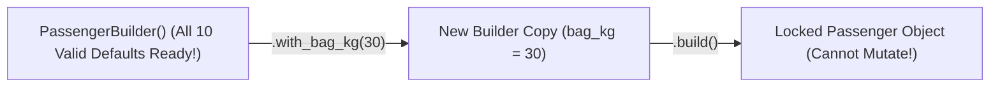

# Build MiniTest v0.4: The 'Subway Sandwich' Builder for Bulletproof Test Data

```json continuity
{
  "previously": "In Ch 03, we cleaned up our UI clicks in `MiniTest v0.3` using Page Objects, Components, and fast App Actions.",
  "painPoint": "Now look at the test data inside our AeroCart tests: every test starts with a hideous 25-line dictionary of passenger fields (`passport`, `dob`, `meal`, `tier`, `bag_kg`)—and worse, when Test A tweaks `SHARED_USER['tier'] = 'VIP'`, Test B suddenly fails!",
  "unlock": "Add a Fluent Immutable Data Builder ('Subway Sandwich Order') to `MiniTest v0.4` so tests only mention the 1 field they care about and shared templates NEVER mutate!"
}
```

```json walkthrough
[
  {
    "time": "0:00",
    "badge": "Slide 1 / 4 · Why 25-Line Test Dictionaries Hurt",
    "caption": "To test a simple 20kg bag fee, AeroCart's API demands 15 mandatory fields (passport, birth date, phone...). Copy-pasting 15 irrelevant lines into every test buries the 1 line that matters!",
    "code": "# ❌ Which of these 8 fields actually causes the $100 fee?!\np = {'name': 'Maya', 'passport': 'P99', 'meal': 'VEG',\n     'seat': '14C', 'tier': 'BRONZE', 'bag_kg': 30}",
    "nodes": ["15 Boring Fields", "1 Important Field (bag_kg)", "Noisy Unreadable Test"]
  },
  {
    "time": "0:25",
    "badge": "Slide 2 / 4 · The Shared Dictionary Poison Bug!",
    "caption": "To avoid copy-pasting, someone creates `DEFAULT_PASSENGER = {...}` at the top of the file. Then Test #1 runs `DEFAULT_PASSENGER['tier'] = 'VIP'`—secretly poisoning Test #2!",
    "code": "DEFAULT_USER['tier'] = 'VIP'   # Test 1 mutates shared dict!\n# Now Test 2 (expecting BRONZE) fails with a mystery discount!",
    "nodes": ["Shared Dict in RAM", "Test 1 Mutates 'VIP'", "Test 2 Fails Mysteriously!"]
  },
  {
    "time": "0:50",
    "badge": "Slide 3 / 4 · The 'Subway Sandwich' Builder Pattern!",
    "caption": "When you order a sandwich, you don't specify how to bake the bread—you say 'House Default, add extra jalapenos!' A Data Builder gives sensible defaults and lets you override just 1 field!",
    "code": "# ✓ Crystal clear: ONLY bag_kg=30 matters for this test!\np = PassengerBuilder().with_bag_kg(30).build()\nassert calc_bag_fee(p) == 100",
    "nodes": ["PassengerBuilder()", ".with_bag_kg(30)", ".build() -> Clean Object"]
  },
  {
    "time": "1:15",
    "badge": "Slide 4 / 4 · Frozen / Copy-on-Write = 100% Thread-Safe!",
    "caption": "By returning a brand-new copy on every `.with_*()` call (`dataclass(frozen=True)` or Java `record`), 32 parallel tests can share `VIP_TEMPLATE` with zero risk of mutating each other!",
    "code": "VIP_BASE = PassengerBuilder().with_tier('VIP')\np1 = VIP_BASE.with_bag_kg(10).build()  # Safe copy #1!\np2 = VIP_BASE.with_bag_kg(35).build()  # Safe copy #2!",
    "nodes": ["Shared VIP_BASE", "Copy #1 (10kg)", "Copy #2 (35kg)"]
  }
]
```

```json pretraining
[
  {
    "term": "Test Data Builder",
    "formula": "PassengerBuilder().with_vip().build()",
    "meaning": "A helper that fills in all boring required fields automatically with valid defaults, letting your test specify ONLY the 1 or 2 fields relevant to that test."
  },
  {
    "term": "Fluent Interface (Method Chaining)",
    "formula": ".with_tier('VIP').with_bag_kg(30)",
    "meaning": "Each `.with_*()` method returns a builder object so you can chain customizations together like a plain-English sentence."
  },
  {
    "term": "Immutability (`frozen=True` / `record`)",
    "formula": "Locked Object -> Cannot Be Changed In-Place",
    "meaning": "Once built, the object is locked (`frozen=True` in Python, `record` in Java) so no test or helper can accidentally alter a shared passenger in memory."
  },
  {
    "term": "Mystery Guest Anti-Pattern",
    "formula": "load('user_fixture_7.json') -> Who is this?!",
    "meaning": "Loading a mysterious external JSON file in a test where the reader can't see *why* the expected price is `$360` without opening another file."
  }
]
```

```json poe
{
  "question": "A teammate creates a shared base builder `VIP_BUILDER = PassengerBuilder().with_tier('VIP')`. If `.with_bag_kg(35)` modifies `self` in-place (`self.bag_kg = 35; return self`), what happens when Test A calls `VIP_BUILDER.with_bag_kg(35).build()` and then Test B calls `VIP_BUILDER.build()`?",
  "options": [
    "Test B gets the default 20kg bag",
    "Test B accidentally gets a 35kg bag and fails! Because `.with_bag_kg(35)` mutated the shared `VIP_BUILDER` in-place instead of returning a fresh copy (`replace(self, bag_kg=35)`)",
    "Builders can only be used once per file",
    "Python resets global variables between tests automatically"
  ],
  "answerIndex": 1,
  "explanation": "If `.with_*()` mutates `self` in-place, any shared base builder (`VIP_BUILDER`) gets permanently altered by the first test that touches it! Always make builders immutable (copy-on-write via `dataclasses.replace`) so every `.with_*()` returns a brand-new builder instance."
}
```

## 🌱 Step 1: Plain-English Story — Ordering a Subway Sandwich vs. Baking Bread From Scratch

In **Chapter 03**, we made our UI actions read like plain English. Now let's look at the **test data** inside our AeroCart tests!

To book a flight in AeroCart, a `Passenger` object needs **10 required fields**: `name`, `email`, `passport_no`, `nationality`, `birth_date`, `seat`, `meal_pref`, `loyalty_tier`, `bag_kg`, and `currency`.

Now suppose you just want to write a 1-line test checking that a **`30kg` bag costs `$100`**.
Without a data builder, you have two terrible options:
1. **Option A (The 10-Line Wall of Noise)**: You paste all 10 fields (`passport_no="P123"`, `meal_pref="VEGAN"`...) into the top of your baggage test. Anyone reading your test has no idea whether `"VEGAN"` or `"30kg"` caused the `$100` fee!
2. **Option B (The Poisoned Shared Dictionary)**: You put `SHARED_PASSENGER = {...}` at the top of the file. Then **Test #1** sets `SHARED_PASSENGER["loyalty_tier"] = "VIP"`. Two milliseconds later, **Test #2** runs using `SHARED_PASSENGER`—and explodes because the passenger is still secretly `"VIP"`!



**How do we get zero noise AND zero shared-data bugs?**
Think of ordering at a **Sandwich Shop**:
- You don't walk into the kitchen and tell the chef how much flour, yeast, and salt to put in the bread!
- You say: **"Give me the Standard House Sub—just swap the cheese for Swiss (`with_bag_kg(30)`)!"**
- Better yet, every time you customize a template (`VIP_PASSENGER.with_bag_kg(30)`), our **Immutable Builder** makes a **fresh photocopy** (`frozen=True` in Python, `record` in Java) so the original `VIP_PASSENGER` recipe on the wall is never scribbled on!

## 🔨 Step 2: First Lines of Code — Build an Immutable Data Builder in 18 Lines!

Watch how Python's `@dataclass(frozen=True)` and `dataclasses.replace()` let us build a **100% immutable, copy-on-write `PassengerBuilder`** for `MiniTest v0.4` in under 20 lines!

```python
from dataclasses import dataclass, replace


@dataclass(frozen=True)
class PassengerBuilder:
    # Sensible defaults for every boring required field!
    name: str = "Maya Lin"
    passport: str = "P-90210"
    tier: str = "STANDARD"
    bag_kg: int = 20

    # Copy-on-Write: replace() returns a BRAND-NEW builder without mutating self!
    def with_tier(self, tier: str) -> "PassengerBuilder":
        return replace(self, tier=tier)

    def with_bag_kg(self, kg: int) -> "PassengerBuilder":
        return replace(self, bag_kg=kg)


# Shared template — 100% safe to reuse across 50 tests because it is frozen!
VIP_PASSENGER = PassengerBuilder().with_tier("VIP")


def test_overweight_bag_for_vip():
    p = VIP_PASSENGER.with_bag_kg(32)       # Creates a new copy; VIP_PASSENGER stays 20kg!
    assert p.tier == "VIP" and p.bag_kg == 32
    assert VIP_PASSENGER.bag_kg == 20       # Original template is untouched!
```

### Java 17 Equivalent (`record Passenger` + Immutable Copy-on-Write Builder)

```java
public class ImmutableBuilderDemo {
    public record Passenger(String name, String passport, String tier, int bagKg) {}

    public record PassengerBuilder(String name, String passport, String tier, int bagKg) {
        public PassengerBuilder() {
            this("Maya Lin", "P-90210", "STANDARD", 20);
        }
        public PassengerBuilder withTier(String newTier) {
            return new PassengerBuilder(name, passport, newTier, bagKg); // New copy!
        }
        public PassengerBuilder withBagKg(int newKg) {
            return new PassengerBuilder(name, passport, tier, newKg);   // New copy!
        }
        public Passenger build() {
            return new Passenger(name, passport, tier, bagKg);
        }
    }

    public static void main(String[] args) {
        PassengerBuilder vipTemplate = new PassengerBuilder().withTier("VIP");
        Passenger heavyVip = vipTemplate.withBagKg(32).build();
        assert heavyVip.bagKg() == 32;
        assert vipTemplate.build().bagKg() == 20; // Template never mutated!
    }
}
```

**Look how clean that is!** Try doing `VIP_PASSENGER.bag_kg = 99` in Python—it immediately throws `FrozenInstanceError: cannot assign to field 'bag_kg'`! You just made shared-state data corruption physically impossible!

## ⚡ Step 3: Where It Breaks in Real Life — "Mystery Guest JSONs" & "Object Mother Explosion"

Before discovering Immutable Builders, almost every engineering team tries two shortcuts that backfire badly at scale:

1. **Shortcut 1: The "Mystery Guest" JSON File (`load("fixtures/user_gold_3.json")`)**
   A test loads `user_gold_3.json` and asserts `assert calculate_tax(user) == 18.40`.
   - *Why `18.40`?!* Looking at the test, you have **no idea**! You have to open `user_gold_3.json` in another tab to discover the user lives in `"state": "NY"`.
   - Worse, next week an intern edits `user_gold_3.json` for their own test, changing `"state": "CA"`—and **47 unrelated tests across the repo suddenly fail**!
2. **Shortcut 2: The "Object Mother" Factory Explosion (`TestUsers.create_...`)**
   Someone creates a static helper class `TestUsers` with methods like `create_vip_user()`. Soon people need combinations, and `TestUsers` explodes into 80 absurd methods:
   - `create_vip_user_with_30kg_bag_in_eur()`
   - `create_vip_user_with_30kg_bag_in_jpy_with_expired_passport()`

```json contrast
{
  "title": "Mystery JSONs & Object Mothers vs. Copy-on-Write Fluent Builders",
  "naiveTitle": "External `user_3.json` + Rigid `ObjectMother` Methods",
  "naiveMetric": "1 JSON Edit Breaks 47 Tests · Zero Signal Clarity",
  "naivePoints": [
    "Tests load `fixtures/gold_order.json` ('Mystery Guest')—readers can't see which field caused the expected result",
    "Editing a shared `.json` fixture file or mutating a shared dict breaks dozens of unrelated tests",
    "`ObjectMother` explodes into 80 rigid factory methods (`createVipUserWithExpiredCardAndHeavyBag()`)"
  ],
  "staffTitle": "Copy-on-Write Fluent Immutable Builder (`frozen=True` / `record`)",
  "staffMetric": "100% Causal Clarity · Safe Across 32 Parallel Workers",
  "staffPoints": [
    "Every test shows ONLY the causal fields right inside the test (`PassengerBuilder().with_state('NY').build()`)",
    "`frozen=True` / `replace()` guarantees shared personas (`VIP_PASSENGER`) can never be mutated in-place",
    "Auto-generates unique emails/IDs per `.build()` call so parallel tests never hit `409 Duplicate Email`"
  ]
}
```

Use the interactive **Data Builder & Abstraction Simulator** below to watch what happens when two parallel workers share a mutable dictionary vs. a Copy-on-Write Immutable Builder!

## 🚀 Step 4: Staff Engineer Deep-Dive — Combinatorial Math & Unique-Per-Build IDs

Why does an **Object Mother** (static factory methods) collapse mathematically while a **Fluent Builder** scales effortlessly?

Suppose your domain model has $K = 6$ independent test dimensions (e.g., `Tier` $\in \{3\}$, `Currency` $\in \{4\}$, `Baggage` $\in \{3\}$, `SeatClass` $\in \{3\}$, `CardState` $\in \{3\}$, `Region` $\in \{4\}$):

$$\text{Object Mother Factory Methods} = \prod_{i=1}^{K} |D_i| = 3 \times 4 \times 3 \times 3 \times 3 \times 4 = 1,296 \text{ static methods!}$$

$$\text{Fluent Builder Methods} = \sum_{i=1}^{K} 1 = 6 \text{ composable } \texttt{.with\_*()} \text{ methods!}$$

Instead of $O(\prod |D_i|)$ rigid methods, a Fluent Builder needs only $O(K)$ methods (`with_tier`, `with_currency`, `with_bag_kg`...) to express all **1,296 combinations** cleanly!

| Approach | Methods Needed for $K$ Fields | Thread / Parallel Safe? | Readability in Test |
| :--- | :---: | :---: | :--- |
| **Raw 20-Field Dict / Constructor** | $0$ (copy-pasted in every test) | ❌ Mutable dict | Terrible (19 noise fields hide 1 signal field) |
| **External JSON (`gold_user.json`)** | $1$ loader | ❌ If mutated in RAM | **"Mystery Guest"** — cause is hidden in another file |
| **Object Mother (`Users.createVipEu()`)** | $\prod |D_i|$ (explodes!) | ⚠️ Only if returning new copy | Rigid method names |
| **Copy-on-Write Fluent Builder** | **$K$ chainable methods** | **✅ 100% (`frozen=True` / `record`)** | **Self-documenting (`with_bag_kg(30)`)** |

### Production Blueprint: Nested Immutable Order Builder With Unique Per-Build IDs

Wait—there is one more Staff-level detail! What if two parallel tests both call `PassengerBuilder().build()` and insert that passenger into a real database? If `email` defaults to a static string `"maya@aerocart.io"`, Test #2 will crash with `UNIQUE constraint failed: passengers.email`!
**Solution**: Generate a fresh unique `email` / `idempotency_key` inside `.build()` whenever the test didn't explicitly override it!

```python
from dataclasses import dataclass, replace
from typing import Optional, Tuple
import uuid


@dataclass(frozen=True)
class FlightBooking:
    booking_id: str
    passenger_email: str
    tier: str
    bag_kg: int
    line_items_cents: Tuple[int, ...]


@dataclass(frozen=True)
class BookingBuilder:
    tier: str = "STANDARD"
    bag_kg: int = 20
    line_items_cents: Tuple[int, ...] = (45000,)
    _explicit_email: Optional[str] = None

    def with_tier(self, tier: str) -> "BookingBuilder":
        return replace(self, tier=tier)

    def with_bag_kg(self, bag_kg: int) -> "BookingBuilder":
        return replace(self, bag_kg=bag_kg)

    def with_items_cents(self, *cents: int) -> "BookingBuilder":
        return replace(self, line_items_cents=tuple(cents))

    def with_email(self, email: str) -> "BookingBuilder":
        return replace(self, _explicit_email=email)

    def build(self) -> FlightBooking:
        """Generates collision-free unique IDs on every .build() while keeping all values immutable!"""
        uid = uuid.uuid4().hex[:8]
        email = self._explicit_email or f"passenger-{uid}@test.aerocart.io"
        return FlightBooking(
            booking_id=f"BK-{uid}",
            passenger_email=email,
            tier=self.tier,
            bag_kg=self.bag_kg,
            line_items_cents=self.line_items_cents,
        )
```

### Java 17 Equivalent (Collision-Free Immutable Builder + `List.copyOf`)

```java
import java.util.List;
import java.util.UUID;

public class ProductionBookingBuilder {
    public record FlightBooking(
        String bookingId,
        String passengerEmail,
        String tier,
        int bagKg,
        List<Integer> lineItemsCents
    ) {
        public FlightBooking {
            lineItemsCents = List.copyOf(lineItemsCents); // Deeply unmodifiable!
        }
    }

    public record BookingBuilder(String tier, int bagKg, List<Integer> itemsCents, String explicitEmail) {
        public BookingBuilder() {
            this("STANDARD", 20, List.of(45000), null);
        }
        public BookingBuilder withTier(String newTier) {
            return new BookingBuilder(newTier, bagKg, itemsCents, explicitEmail);
        }
        public BookingBuilder withBagKg(int newBagKg) {
            return new BookingBuilder(tier, newBagKg, itemsCents, explicitEmail);
        }
        public FlightBooking build() {
            String uid = UUID.randomUUID().toString().substring(0, 8);
            String email = (explicitEmail != null) ? explicitEmail : "passenger-" + uid + "@test.aerocart.io";
            return new FlightBooking("BK-" + uid, email, tier, bagKg, itemsCents);
        }
    }
}
```

> [!WARNING]
> **Staff Interview Gotcha — Shallow `frozen=True` vs. Deep Immutability (`list` vs. `tuple`)!**
> In Python, `@dataclass(frozen=True)` stops someone from reassigning `booking.items = [...]`, **but if `booking.items` is a `list`, a test can still run `booking.items.append(999)` and mutate it in-place!** Always store collections inside frozen builders as immutable **`tuple`s** in Python (and **`List.copyOf(...)`** in Java 17) so nested collections are 100% locked too!

**Up Next in Chapter 05**: Now we can build clean requests in 1 line—but what happens when AeroCart returns a **50-field nested JSON response** with random `booking_id`s and timestamps, and `assert actual == expected` dumps a 2,000-character wall of text? In Chapter 05, we'll build a **Recursive JSON Path Diff Engine** for `MiniTest v0.5`!

```json quiz
[
  {
    "id": "fw-04-q1",
    "question": "What is the 'Mystery Guest' anti-pattern in automated tests?",
    "options": [
      "When an unknown hacker logs into the staging server",
      "When a test loads an external file like `fixtures/user_7.json` and asserts `tax == 18.40` without showing inside the test which field (`state='NY'`) caused `18.40`—and editing `user_7.json` breaks 40 unrelated tests",
      "When a test uses random UUIDs for email addresses",
      "When a test runs in headless mode"
    ],
    "answerIndex": 1,
    "explanation": "A 'Mystery Guest' hides the cause-and-effect link inside an external fixture file. Using `BookingBuilder().with_state('NY').build()` keeps the causal field visible right inside the test."
  },
  {
    "id": "fw-04-q2",
    "question": "Why should every `.with_*()` method on a shared builder (`VIP_PASSENGER.with_bag_kg(32)`) return a brand-new builder copy (`replace(self, ...)`) instead of modifying `self` in-place?",
    "options": [
      "Because Python does not allow `self.x = y` inside methods",
      "So shared base templates (`VIP_PASSENGER`) can be reused across dozens of tests (and parallel threads) without Test #1's `.with_bag_kg(32)` corrupting `VIP_PASSENGER` for Test #2!",
      "To use more RAM on purpose",
      "Because `replace()` connects to the database"
    ],
    "answerIndex": 1,
    "explanation": "Copy-on-write immutability guarantees that customizing a shared template never mutates the template itself."
  },
  {
    "id": "fw-04-q3",
    "question": "You mark a Python dataclass with `@dataclass(frozen=True)`, and one of its fields is `tags: list = ['vip']`. What happens if Test #1 runs `user.tags.append('banned')`?",
    "options": [
      "Python raises `FrozenInstanceError`",
      "The list mutates in-place! `frozen=True` only prevents reassigning `user.tags = ...`; to make collection fields truly immutable, use `tuple` in Python or `List.copyOf()` in Java 17",
      "Python converts the list to a string automatically",
      "The test passes twice"
    ],
    "answerIndex": 1,
    "explanation": "`frozen=True` freezes attribute references on the dataclass instance, not mutable objects (`list`, `dict`) stored inside those attributes. Use `tuple` for deep immutability."
  }
]
```
