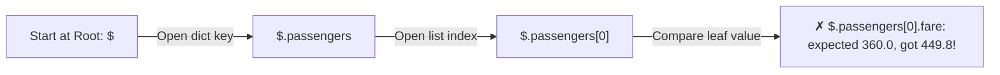

# Build MiniTest v0.5: A Recursive JSON Diff Engine That Pinpoints Exact Bugs

```json continuity
{
  "previously": "In Ch 04, we built `PassengerBuilder` in `MiniTest v0.4` so creating clean, immutable test inputs takes just 1 line of code.",
  "painPoint": "Now we send that booking to AeroCart's API and get back a 50-field nested JSON response. When we write `assert actual_json == expected_json`, two awful things happen: 1) live fields like `booking_id` and `created_at` change on every run and break the test, and 2) Python dumps a 2,000-character blob without telling us WHICH nested field was wrong!",
  "unlock": "Build a Recursive JSON Path Diff Engine for `MiniTest v0.5` that prints laser-focused paths (`$.passengers[0].fare: expected 360.0, got 449.8`) and masks dynamic timestamps/UUIDs safely!"
}
```

```json walkthrough
[
  {
    "time": "0:00",
    "badge": "Slide 1 / 4 · The 2,000-Character JSON Blob Nightmare",
    "caption": "When a deeply nested field (`$.passengers[0].baggage.fee`) is wrong inside a 50-field API response, plain `assert actual == expected` dumps a huge unreadable blob of dictionaries!",
    "code": "AssertionError: {'id': 'BK-91', 'passengers': [{'name': 'Maya', 'bag': {'fee': 100}} ... 48 more fields ...] != {'id': 'BK-91', ...}",
    "nodes": ["50-Field JSON Response", "1 Nested Bug", "Unreadable 2,000-Char Dump"]
  },
  {
    "time": "0:25",
    "badge": "Slide 2 / 4 · What We Wish `MiniTest` Printed Instead!",
    "caption": "Instead of playing 'Where's Waldo?' in terminal logs at 2 AM, what if our framework walked the JSON tree and printed the EXACT address (`JSONPath`) of every mismatch?",
    "code": "# ✓ Instant 1-second diagnosis:\n✗ Mismatch at $.passengers[0].baggage.fee: expected 0, got 100",
    "nodes": ["Walk JSON Tree", "Track Path ($.a.b[0])", "Pinpoint Exact Mismatch!"]
  },
  {
    "time": "0:50",
    "badge": "Slide 3 / 4 · How Recursion Walks Nested Dicts & Lists",
    "caption": "A JSON response is just boxes inside boxes: if both values are dicts, compare each key (`path + '.' + k`); if lists, compare each index (`path + '[' + i + ']'`); otherwise compare `expected == actual`!",
    "code": "if isinstance(exp, dict) and isinstance(act, dict):\n    for k in exp:\n        diff_json(exp[k], act[k], path=f'{path}.{k}')",
    "nodes": ["Dict -> Recurse Keys", "List -> Recurse Indexes", "Leaf -> Compare Values"]
  },
  {
    "time": "1:15",
    "badge": "Slide 4 / 4 · Smart Wildcards for `booking_id` & Timestamps",
    "caption": "Never delete `actual['booking_id']` before asserting (what if the server forgot to send `booking_id` at all?!). Instead, match dynamic fields against a pattern like `ANY_UUID` or `ignore_paths`!",
    "code": "# Checks that booking_id EXISTS and is a string, while ignoring its random characters!\ndiff_json(expected, actual, ignore_paths={'$.created_at'})",
    "nodes": ["Dynamic Field (created_at)", "Verify Key Exists", "Ignore Random Entropy"]
  }
]
```

```json pretraining
[
  {
    "term": "JSONPath Address (`$.a.b[0].c`)",
    "formula": "`$` (root) -> `.passengers` -> `[0]` -> `.fare`",
    "meaning": "A breadcrumb trail that points to the exact spot inside a nested JSON object where a number or string didn't match."
  },
  {
    "term": "Recursive Tree Walk",
    "formula": "Dict -> check keys | List -> check items | Value -> `==`",
    "meaning": "A function that calls itself whenever it opens a nested dictionary or list, carrying the breadcrumb `path` string deeper at each step."
  },
  {
    "term": "Dynamic Field Masking",
    "formula": "`booking_id`, `created_at` -> Check format, ignore exact random value",
    "meaning": "Allowing auto-generated fields (like random UUIDs or today's clock time) to pass without failing `expected == actual`."
  },
  {
    "term": "Order-Insensitive List Diff",
    "formula": "Align list items by `'id'` / `'sku'` before comparing",
    "meaning": "Matching list items by their unique ID so `[{id: 1}, {id: 2}]` and `[{id: 2}, {id: 1}]` don't cause false test failures."
  }
]
```

```json poe
{
  "question": "Every time AeroCart's `POST /bookings` endpoint runs, it generates a random `booking_id` (`'BK-8f92a'`). To stop `assert actual == expected` from failing, a beginner writes `del actual['booking_id']` before the assertion. What real production bug will this test completely miss?",
  "options": [
    "It won't miss anything—deleting dynamic keys is the best practice",
    "If a backend bug causes `POST /bookings` to return `booking_id: null` or omit `booking_id` completely, `del` or blind removal hides the bug! Instead, assert that `booking_id` matches the pattern `'BK-*'` (non-empty string) before masking it",
    "Python dictionaries cannot delete keys",
    "Deleting a key deletes the database row"
  ],
  "answerIndex": 1,
  "explanation": "Blindly deleting dynamic fields (`del actual['booking_id']`) skips verifying that the field was actually present and properly formatted! A smart diff engine checks the *type/regex contract* (`isinstance(val, str) and val.startswith('BK-')`) while ignoring the random characters."
}
```

## 🌱 Step 1: Plain-English Story — Playing "Where's Waldo?" at 2 AM

In **Chapter 04**, we built `BookingBuilder` so our test inputs are clean and readable. Now we send that booking to AeroCart's API, and the server replies with a **nested JSON receipt** containing 50 fields: flight details, a list of passengers, baggage rules, taxes, and payment info.

Suppose there is a bug buried 3 levels deep inside `passengers[0].baggage.fee` (it charged `$100` instead of `$0`).
If your test just writes `assert actual_json == expected_json`, two frustrating things happen:
1. **The Dynamic Timestamp Trap**: Before it even reaches `baggage.fee`, the test fails on `"created_at": "2026-11-10T07:05:01Z"` because the clock ticked by 1 second!
2. **The 2,000-Character Wall of Text**: Even if you remove timestamps, plain `==` just prints two giant dictionaries side-by-side. You have to squint at 2,000 characters of text trying to play *"Where's Waldo?"* to find which nested number changed!



**How do we make `MiniTest v0.5` print the exact breadcrumb address (`$.passengers[0].fare`) of every bug?**
Think of opening **nested Russian dolls (or folders on your computer)**:
- We start at the root folder called **`"$"`**.
- Whenever we step inside a dictionary key called `"passengers"`, we glue `".passengers"` onto our breadcrumb trail (`"$.passengers"`).
- Whenever we step inside list item `0`, we glue `"[0]"` onto our trail (`"$.passengers[0]"`).
- When we finally hit a plain number or string (`360.0` vs. `449.8`), if they don't match, we already have the exact GPS address in our hands: **`$.passengers[0].fare: expected 360.0, got 449.8`**!

## 🔨 Step 2: First Lines of Code — Build a Recursive JSON Diff Engine in 18 Lines!

Let's add **`diff_json()`** to `MiniTest v0.5`! Even if you have never written a recursive function before, look how natural this 18-line function is: it handles nested `dict`s, nested `list`s, and `ignore_paths`!

```python
def diff_json(expected, actual, path: str = "$", ignore: set = frozenset()) -> list:
    if path in ignore:
        return []
    if isinstance(expected, dict) and isinstance(actual, dict):
        diffs = []
        for k in expected.keys() | actual.keys():
            diffs.extend(diff_json(expected.get(k), actual.get(k), f"{path}.{k}", ignore))
        return diffs
    if isinstance(expected, list) and isinstance(actual, list) and len(expected) == len(actual):
        return [d for i, (e, a) in enumerate(zip(expected, actual)) for d in diff_json(e, a, f"{path}[{i}]", ignore)]
    if expected != actual:
        return [f"{path}: expected {expected!r}, got {actual!r}"]
    return []


# --- Test our MiniTest v0.5 JSON Diff Engine! ---
exp = {"id": "BK-1", "passengers": [{"name": "Maya", "fare": 360.0}]}
act = {"id": "BK-999", "passengers": [{"name": "Maya", "fare": 449.8}]}
assert diff_json(exp, act, ignore={"$.id"}) == ["$.passengers[0].fare: expected 360.0, got 449.8"]
```

### Java 17 Equivalent (`JsonDiffEngine.java` Walking Nested `Map` and `List`)

```java
import java.util.*;

public class MiniJsonDiff {
    public static void diff(Object exp, Object act, String path, Set<String> ignore, List<String> out) {
        if (ignore.contains(path)) return;
        if (exp instanceof Map<?, ?> eMap && act instanceof Map<?, ?> aMap) {
            Set<Object> keys = new TreeSet<>();
            keys.addAll(eMap.keySet());
            keys.addAll(aMap.keySet());
            for (Object k : keys) {
                diff(eMap.get(k), aMap.get(k), path + "." + k, ignore, out);
            }
            return;
        }
        if (!Objects.equals(exp, act)) {
            out.add(path + ": expected " + exp + ", got " + act);
        }
    }

    public static void main(String[] args) {
        Map<String, Object> exp = Map.of("id", "BK-1", " passenger", Map.of("fare", 360.0));
        Map<String, Object> act = Map.of("id", "BK-999", " passenger", Map.of("fare", 449.8));
        List<String> diffs = new ArrayList<>();
        diff(exp, act, "$", Set.of("$.id"), diffs);
        assert diffs.equals(List.of("$. passenger.fare: expected 360.0, got 449.8"));
    }
}
```

**Read that `assert` at the bottom!** Instead of dumping 50 fields when `"fare"` is wrong, `diff_json()` ignores `"$.id"` and returns the single string **`"$.passengers[0].fare: expected 360.0, got 449.8"`**!

## ⚡ Step 3: Where It Breaks in Real Life — Unordered Lists & Floating-Point Dust

Our 18-line `diff_json()` is already 10x better than plain `==`. Now let's see the **three real-world edge cases** that trip up API test suites in production:

1. **Edge Case 1: Unordered Arrays (`[Flight A, Flight B]` vs. `[Flight B, Flight A]`)**
   When AeroCart searches flights across 3 airline databases in parallel, `"BA-101"` might arrive before `"AF-202"` on Monday, and `"AF-202"` before `"BA-101"` on Tuesday! Comparing index `[0]` against `[0]` causes a false failure—unless our diff engine **aligns list items by their primary key (`id` / `flight_no`)** first!
2. **Edge Case 2: Blindly Ignoring Dynamic Fields (`ignore={"$.booking_id"}`)**
   If we blindly ignore `$.booking_id`, what happens when a bug causes the server to return `"booking_id": null`? Our test passes! Instead of blind ignores, use a **Matcher (`RegexMatcher("^BK-[0-9a-f]{8}$")`)** that checks the *format* while ignoring the random digits!
3. **Edge Case 3: Floating-Point Dust (`0.1 + 0.2 == 0.30000000000000004`)**
   When comparing tax rates or ML confidence scores, `0.3 != 0.30000000000000004` fails without a small numeric tolerance (`abs_tol=1e-6`).

```json contrast
{
  "title": "Naive `assert actual == expected` vs. Structural JSONPath Diff Engine",
  "naiveTitle": "Raw Dict `==` + Blind `del actual['id']`",
  "naiveMetric": "2,000-Char Log Dumps · False Failures on Array Order",
  "naivePoints": [
    "Dumps the entire 50-field JSON blob on failure without pointing to the broken nested path",
    "Deletes `actual['booking_id']` before asserting—missing bugs where `booking_id` is `null` or missing!",
    "Fails whenever a database query without `ORDER BY` returns `[Item B, Item A]` instead of `[Item A, Item B]`"
  ],
  "staffTitle": "Recursive JSONPath Diff + Regex Matchers + Key-Aligned Lists",
  "staffMetric": "Pinpoint `$.items[sku=A].price` · Zero False Alarms",
  "staffPoints": [
    "Reports every mismatch by exact JSONPath (`$.passengers[0].fare: expected 360.0, got 449.8`)",
    "Validates dynamic fields with Regex/Type matchers (`UUID_MATCHER`) instead of deleting them",
    "Aligns unordered arrays by domain identity key (`key='sku'`) in $O(N)$ time before comparing fields"
  ]
}
```

Test out the **Recursive JSON Diff Simulator** below to see how JSONPath pointers, dynamic regex matchers, and key-aligned arrays work step-by-step!

## 🚀 Step 4: Staff Engineer Deep-Dive — Key-Aligned Array Complexity & Float Tolerance Math

Why do we align unordered lists by an identity key (`sku` or `id`) instead of trying every possible element pairing?
Look at the CPU complexity when an API returns an unordered list of $N = 500$ flight results:
- **Naive all-pairs comparison** (comparing every element in `expected` against every element in `actual`):

$$T_{\text{naive}}(N) = O(N^2) = 500^2 = 250,000 \text{ deep object comparisons}$$

- **Hash-indexed identity-key alignment** (indexing `actual` into a dictionary by primary key `item[key_field]` first):

$$T_{\text{key-aligned}}(N) = O(N) = 500 \text{ lookups! (500x faster)}$$

And for floating-point telemetry fields (like exchange-rate ratios or AI relevance scores), IEEE-754 standard comparison checks:

$$|e - a| \le \max\bigl(\text{rel\_tol} \cdot \max(|e|, |a|),\; \text{abs\_tol}\bigr)$$

| Capability | Our `MiniTest v0.5` Blueprint | `Pytest` Ecosystem (Python 3) | `JUnit 5` Ecosystem (Java 17) |
| :--- | :--- | :--- | :--- |
| **Exact JSONPath Diffs** | Recursive `diff_payload(path="$")` | `deepdiff.DeepDiff` / Pytest `-vv` AST diff | `JSONassert` (`Skyscreamer`) / AssertJ `RecursiveComparison` |
| **Dynamic Field Contract** | `RegexMatcher(r"^BK-[a-f0-9]+$")` | `dirty-equals` (`IsUUID`, `IsNow(delta=5)`) | AssertJ `matching( regex )` / `JsonUnit` `${json-unit.regex}` |
| **Unordered List by ID** | Index list into `{item[id]: item}` | `DeepDiff(..., ignore_order=True)` | AssertJ `ignoringCollectionOrder()` |

### Production Blueprint: Full `MiniTest v0.5` Diff Engine With Regex Matchers, Float Tolerance & Keyed Arrays

```python
from dataclasses import dataclass
import math
import re
from typing import Any, Dict, List


@dataclass(frozen=True)
class RegexMatcher:
    """Asserts that a dynamic field (UUID/ISO timestamp) is a string matching pattern!"""
    pattern: str

    def matches(self, actual: Any) -> bool:
        return isinstance(actual, str) and bool(re.match(self.pattern, actual))


def diff_payload(
    expected: Any,
    actual: Any,
    path: str = "$",
    list_keys: Dict[str, str] = None,
    abs_tol: float = 1e-6,
) -> List[str]:
    list_keys = list_keys or {}

    # 1. Dynamic Regex Matcher contract check (never blindly delete dynamic fields!)
    if isinstance(expected, RegexMatcher):
        if not expected.matches(actual):
            return [f"{path}: '{actual}' did not match regex /{expected.pattern}/"]
        return []

    # 2. Recursive Dict walk
    if isinstance(expected, dict) and isinstance(actual, dict):
        errors: List[str] = []
        for k in sorted(expected.keys() | actual.keys()):
            if k not in expected:
                errors.append(f"{path}.{k}: unexpected extra key with value {actual[k]!r}")
            elif k not in actual:
                errors.append(f"{path}.{k}: missing expected key (expected {expected[k]!r})")
            else:
                errors.extend(diff_payload(expected[k], actual[k], f"{path}.{k}", list_keys, abs_tol))
        return errors

    # 3. Recursive List walk (Supports O(N) Identity-Key Alignment for unordered lists!)
    if isinstance(expected, list) and isinstance(actual, list):
        if len(expected) != len(actual):
            return [f"{path}: list length expected {len(expected)}, got {len(actual)}"]
        if path in list_keys:
            pk = list_keys[path]
            exp_map = {item[pk]: item for item in expected}
            act_map = {item[pk]: item for item in actual if pk in item}
            errors = []
            for k_val, exp_item in exp_map.items():
                sub_path = f"{path}[{pk}={k_val}]"
                if k_val not in act_map:
                    errors.append(f"{sub_path}: missing item in actual list")
                else:
                    errors.extend(diff_payload(exp_item, act_map[k_val], sub_path, list_keys, abs_tol))
            return errors
        return [
            err
            for i, (e, a) in enumerate(zip(expected, actual))
            for err in diff_payload(e, a, f"{path}[{i}]", list_keys, abs_tol)
        ]

    # 4. Numeric float tolerance check
    if isinstance(expected, float) and isinstance(actual, (int, float)):
        if not math.isclose(expected, float(actual), abs_tol=abs_tol):
            return [f"{path}: expected {expected} (±{abs_tol}), got {actual}"]
        return []

    # 5. Leaf value equality
    if expected != actual:
        return [f"{path}: expected {expected!r}, got {actual!r}"]
    return []
```

### Java 17 Equivalent (Recursive Payload Diff Engine With Regex & Float Epsilon)

```java
import java.util.*;
import java.util.regex.Pattern;

public class PayloadDiffEngine {
    public record RegexMatcher(Pattern pattern) {
        public RegexMatcher(String regex) { this(Pattern.compile(regex)); }
        public boolean matches(Object actual) {
            return actual instanceof String s && pattern.matcher(s).matches();
        }
    }

    public static void diff(Object exp, Object act, String path, List<String> errors) {
        if (exp instanceof RegexMatcher rm) {
            if (!rm.matches(act)) {
                errors.add(path + ": '" + act + "' failed regex /" + rm.pattern() + "/");
            }
            return;
        }
        if (exp instanceof Map<?, ?> eMap && act instanceof Map<?, ?> aMap) {
            Set<Object> allKeys = new TreeSet<>();
            allKeys.addAll(eMap.keySet());
            allKeys.addAll(aMap.keySet());
            for (Object k : allKeys) {
                if (!eMap.containsKey(k)) errors.add(path + "." + k + ": unexpected key");
                else if (!aMap.containsKey(k)) errors.add(path + "." + k + ": missing key");
                else diff(eMap.get(k), aMap.get(k), path + "." + k, errors);
            }
            return;
        }
        if (exp instanceof Double eNum && act instanceof Number aNum) {
            if (Math.abs(eNum - aNum.doubleValue()) > 1e-6) {
                errors.add(path + ": expected " + eNum + ", got " + aNum);
            }
            return;
        }
        if (!Objects.equals(exp, act)) {
            errors.add(path + ": expected " + exp + ", got " + act);
        }
    }
}
```

> [!WARNING]
> **Staff Interview Gotcha — Why `bool` Is Secretly an `int` in Python (`True == 1`)!**
> In Python, `bool` is a subclass of `int` (`isinstance(True, int)` is **`True`**, and **`True == 1` is `True`**!). If an API accidentally returns `{"bag_count": true}` instead of `{"bag_count": 1}`, a naive `expected != actual` check in Python **passes without catching the bug!** Always check `type(expected) is type(actual)` before comparing numbers when strict JSON schema safety matters!

**Module 2 Complete — Up Next in Module 3 (Chapter 06)**: Our `MiniTest v0.5` framework now has clean fixtures, Page Objects, Immutable Builders, and a Recursive JSON Diff Engine! There's just one huge problem left: it still runs **1 test at a time on 1 CPU core**, while the other 7 cores on your laptop sit completely idle! In Chapter 06, let's build **Multi-Worker Parallel Execution (`gw0..gw7`) & Port/DB Isolation** into `MiniTest v0.6`!

```json quiz
[
  {
    "id": "fw-05-q1",
    "question": "Why do we pass a growing `path` string (`'$' -> '$.passengers' -> '$.passengers[0].fare'`) down every recursive call in `diff_json()`?",
    "options": [
      "To make the recursion run in fewer CPU cycles",
      "So whenever a deeply nested leaf value mismatches, the error message prints the exact JSONPath address (`$.passengers[0].fare: expected 360.0, got 449.8`) instead of dumping a 2,000-character dictionary blob",
      "Because Python requires a string parameter in every function",
      "To encrypt the JSON payload"
    ],
    "answerIndex": 1,
    "explanation": "Accumulating the JSONPath breadcrumb during traversal lets the diff engine report the exact nested location of every mismatch."
  },
  {
    "id": "fw-05-q2",
    "question": "Why is using `RegexMatcher('^BK-[0-9a-f]{8}$')` on `$.booking_id` much safer than running `del actual['booking_id']` before asserting?",
    "options": [
      "Because `del` takes 10 seconds to run",
      "Because `del` blindly erases the field—so if a bug causes the API to return `booking_id: null` or omit `booking_id` completely, your test would falsely pass! `RegexMatcher` verifies the field exists and obeys the ID format while ignoring random hex digits",
      "Because JSON does not allow strings",
      "Because `RegexMatcher` rewrites the database"
    ],
    "answerIndex": 1,
    "explanation": "Constrained matchers validate structural contracts (non-null, valid UUID/timestamp format) while ignoring non-deterministic entropy."
  },
  {
    "id": "fw-05-q3",
    "question": "In Python, why can a naive `assert actual == expected` falsely pass when `expected = {'count': 1}` and a buggy API returns `actual = {'count': True}`?",
    "options": [
      "Because JSON converts `1` and `True` into strings",
      "Because in Python `bool` is a subclass of `int` and `True == 1` evaluates to `True`! A strict JSON diff engine must also verify `type(expected) is type(actual)` so `True` never masquerades as `1`",
      "Because dictionaries only compare keys, not values",
      "Because `1` is not an integer in Python"
    ],
    "answerIndex": 1,
    "explanation": "In Python, `issubclass(bool, int)` is `True`, `True == 1` is `True`, and `False == 0` is `True`. Checking `type(expected) is type(actual)` catches boolean/integer type corruption in JSON payloads."
  }
]
```
