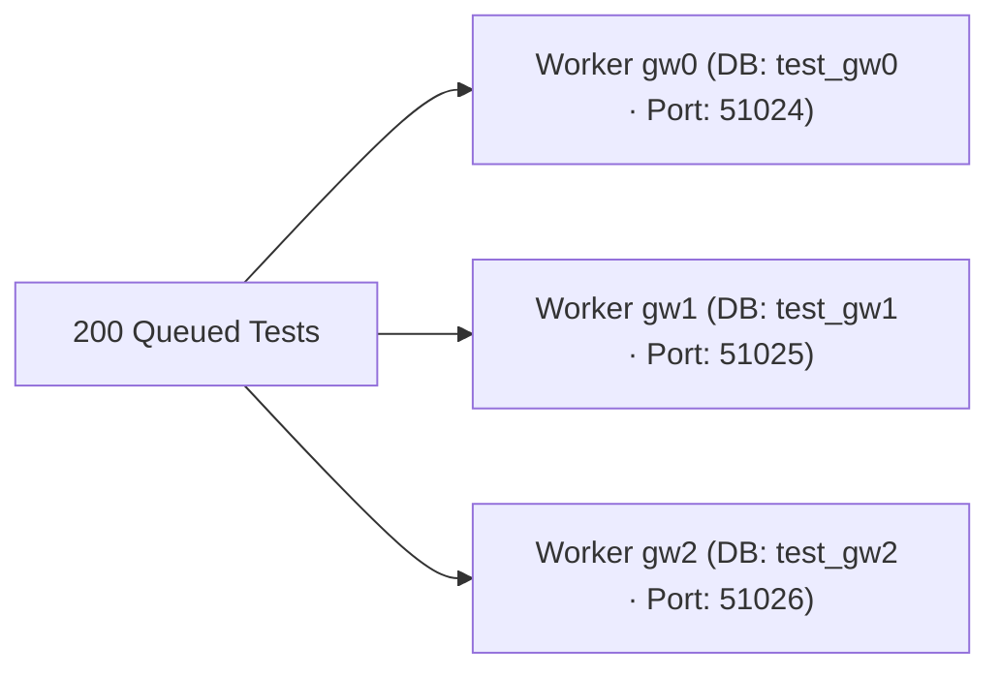

# Build MiniTest v0.6: Parallel Workers (`gw0..gw7`) Without Collisions!

```json continuity
{
  "previously": "In Modules 1–2 (`MiniTest v0.1` -> `v0.5`), we built auto-discovery, LIFO fixtures, Page Objects, Immutable Builders, and a Recursive JSON Diff Engine.",
  "painPoint": "Now our AeroCart suite has grown to 200 tests taking 16 minutes—because `MiniTest` runs 1 test at a time in a single `for` loop on 1 CPU core while the other 7 CPU cores on our machine sit 100% idle!",
  "unlock": "Upgrade `MiniTest v0.6` with a Parallel Worker Pool that assigns every worker a unique `worker_id` (`gw0`, `gw1`—just like `pytest-xdist`!) so 8 workers run 8x faster without ever colliding!"
}
```

```json walkthrough
[
  {
    "time": "0:00",
    "badge": "Slide 1 / 4 · 1 Cashier vs. 8 Open Checkout Lanes",
    "caption": "Running 200 tests in a single `for` loop is like a supermarket with 8 checkout lanes where only Lane #1 is open! Opening all 8 lanes (`workers=8`) cuts a 16-minute wait down to 2 minutes!",
    "code": "# Sequential (1 worker):  200 tests * 5s = 1,000s (16.6 mins)\n# Parallel   (8 workers): 200 tests / 8  =   125s ( 2.0 mins!)",
    "nodes": ["200 Queued Tests", "8 Parallel Workers (gw0..gw7)", "8x Faster Suite!"]
  },
  {
    "time": "0:25",
    "badge": "Slide 2 / 4 · Why Naive Parallel Tests Crash Into Each Other!",
    "caption": "Watch what happens when you turn on 4 workers without isolation: Worker 0 and Worker 1 both write to `/tmp/report.txt` and both try to start a test server on Port `8080` -> `Address already in use`!",
    "code": "# ❌ Worker gw0 AND Worker gw1 both hardcode Port 8080 & 'test_db':\nbind(('127.0.0.1', 8080))   # 💥 OSError: Address already in use!\ndb.execute('TRUNCATE cart') # 💥 Worker 0 wipes Worker 1's cart mid-test!",
    "nodes": ["Worker gw0", "Shared Port 8080 / Shared Table", "Worker gw1 Collision!"]
  },
  {
    "time": "0:50",
    "badge": "Slide 3 / 4 · The Magic Stamp: `worker_id` (`gw0`, `gw1`...)",
    "caption": "How does `pytest-xdist` keep workers from colliding? It hands each worker a badge (`gw0`, `gw1`, `gw2`...). Stamp every database name and temp folder with `worker_id` (`db_gw0`, `db_gw1`)!",
    "code": "def get_worker_db(worker_id: str) -> str:\n    return f'aerocart_test_{worker_id}'  # 'aerocart_test_gw0' vs 'gw1'!",
    "nodes": ["Worker Badge: gw0 -> db_gw0", "Worker Badge: gw1 -> db_gw1", "Zero Collisions!"]
  },
  {
    "time": "1:15",
    "badge": "Slide 4 / 4 · Never Guess Ports—Ask the OS for Port `0`!",
    "caption": "Instead of guessing `port = 8000 + worker_num` (which still collides if another app uses 8001), bind to port `0` (`sock.bind(('127.0.0.1', 0))`) and the OS kernel hands you a guaranteed free port!",
    "code": "sock.bind(('127.0.0.1', 0))              # Ask OS kernel for ANY free port\nfree_port = sock.getsockname()[1]        # e.g., 54321 (100% collision-free!)",
    "nodes": ["Bind Port 0", "OS Kernel Lock", "Unique Port 54321"]
  }
]
```

```json pretraining
[
  {
    "term": "Worker ID (`gw0`, `gw1`...)",
    "formula": "Worker #0 = `'gw0'` | Worker #1 = `'gw1'`",
    "meaning": "A unique name badge handed to each parallel worker (used by `pytest-xdist` and our `MiniTest v0.6`) so each worker can create its own private temp folder or DB schema."
  },
  {
    "term": "Multi-Process vs. Multi-Thread",
    "formula": "Python (`xdist`): Separate OS Processes | Java (`JUnit 5`): Shared-RAM Threads",
    "meaning": "Python spins up separate OS processes to bypass the GIL, while Java runs multiple threads inside one JVM using `ThreadLocal` to keep variables separate."
  },
  {
    "term": "Ephemeral Port (`bind` Port `0`)",
    "formula": "bind(('127.0.0.1', 0)) -> OS assigns free port",
    "meaning": "Asking the operating system to pick an unused network port automatically so two parallel test servers never fight over port `8080`."
  },
  {
    "term": "Cross-Worker File Lock (`FileLock`)",
    "formula": "with FileLock('db_migrate.lock'): ...",
    "meaning": "A traffic light on disk so if 8 worker processes start at the exact same millisecond, only 1 runs one-time setup while the other 7 wait politely."
  }
]
```

```json poe
{
  "question": "In `pytest-xdist`, you run `pytest -n 4` (which spawns 4 separate OS processes: `gw0`, `gw1`, `gw2`, `gw3`). If you have a `@pytest.fixture(scope='session')` that starts a Docker container, how many times will that `'session'` fixture run by default?",
  "options": [
    "Once total across the whole computer",
    "4 times! Because `gw0`, `gw1`, `gw2`, and `gw3` are 4 completely separate Python OS processes with separate memory—each process thinks IT is the whole session unless you coordinate them with a `FileLock` on disk!",
    "Zero times—`session` fixtures are disabled in parallel mode",
    "400 times"
  ],
  "answerIndex": 1,
  "explanation": "Because `pytest-xdist` spawns $N$ separate OS processes that share zero RAM, each worker runs its own `scope='session'` fixtures independently ($N$ times total)! To run an expensive setup truly once across all workers, use a disk `FileLock` inside the session fixture."
}
```

## 🌱 Step 1: Plain-English Story — 8 Supermarket Checkout Lanes, 1 Shared Cash Register!

In **Chapter 01**, we built `MiniTest` around a simple `for fn in test_functions:` loop. That loop runs **one test at a time**.
When we had 5 tests, it finished in 1 second. Now that our AeroCart suite has **200 tests**, running them one-by-one takes **16 minutes**—even though our laptop has **8 CPU cores**, and 7 of those cores are sitting completely idle!

So we decide to open all **8 checkout lanes at once** (running 8 tests simultaneously).
And immediately, **everything catches fire!** Why?
- **Worker 0** creates a test user `"maya@aerocart.io"`, and **2 milliseconds later**, **Worker 1** runs `TRUNCATE TABLE users;` to clean up its own test—wiping out Worker 0's user while Worker 0 is still checking out!
- Both **Worker 0** and **Worker 1** try to start a local mock server on `127.0.0.1:8080`, and Worker 1 crashes with `Address already in use`!



**How do we make 8 parallel workers run at full speed with ZERO collisions?**
Give every worker its own **Name Badge (`worker_id`: `gw0`, `gw1`, `gw2`...)** and its own **Private Lane**:
1. Instead of everyone fighting over one shared table `aerocart_test`, Worker `gw0` uses `aerocart_test_gw0` and Worker `gw1` uses `aerocart_test_gw1`!
2. Instead of hardcoding port `8080`, each worker asks the OS kernel for port **`0`** (`bind(('127.0.0.1', 0))`), and the OS hands each worker a guaranteed free port (`51024`, `51025`...)!

## 🔨 Step 2: First Lines of Code — Add Multi-Worker `gw0..gwN` Pool to `MiniTest v0.6`!

Look how clean this is: using Python's built-in `concurrent.futures.ThreadPoolExecutor` (or `ProcessPoolExecutor`) and a `Queue` of worker badges (`"gw0"`, `"gw1"`), we upgrade `MiniTest v0.6` so every test automatically receives its own isolated `worker_id` and OS-assigned ephemeral port!

```python
from concurrent.futures import ThreadPoolExecutor
import queue
import socket


def get_free_port() -> int:
    with socket.socket() as s:
        s.bind(("127.0.0.1", 0))            # Port 0 -> OS kernel picks a guaranteed free port!
        return s.getsockname()[1]


def run_parallel_minitest(test_fns: list, num_workers: int = 2) -> list:
    badges = queue.Queue()
    for i in range(num_workers):
        badges.put(f"gw{i}")                 # Create worker badges: 'gw0', 'gw1' (like pytest-xdist!)

    def worker_task(fn):
        wid = badges.get()
        try:
            return fn(worker_id=wid, port=get_free_port())
        finally:
            badges.put(wid)                  # Return badge to pool when test finishes!

    with ThreadPoolExecutor(max_workers=num_workers) as pool:
        return list(pool.map(worker_task, test_fns))
```

### Java 17 Equivalent (Parallel Worker Pool + `ServerSocket(0)` + `ThreadLocal` Isolation)

```java
import java.net.ServerSocket;
import java.util.List;
import java.util.concurrent.*;

public class MiniParallelRunner {
    // ThreadLocal gives each JUnit 5 worker thread its own private storage slot!
    private static final ThreadLocal<String> WORKER_ID = new ThreadLocal<>();

    public static int getFreePort() throws Exception {
        try (ServerSocket socket = new ServerSocket(0)) { // Port 0 -> OS kernel free port!
            return socket.getLocalPort();
        }
    }

    public static void main(String[] args) throws Exception {
        ExecutorService pool = Executors.newFixedThreadPool(2);
        Callable<String> testTask = () -> {
            WORKER_ID.set("gw-" + Thread.currentThread().getId());
            int port = getFreePort();
            return WORKER_ID.get() + " ran safely on schema_" + WORKER_ID.get() + " port=" + port;
        };
        List<Future<String>> results = pool.invokeAll(List.of(testTask, testTask));
        for (Future<String> r : results) System.out.println("✓ " + r.get());
        pool.shutdown();
    }
}
```

**Look at what you just built!** Whether 2 workers or 32 workers run at once, `gw0` and `gw1` never touch the same database namespace (`schema_gw0` vs `schema_gw1`) and never fight over the same port!

## ⚡ Step 3: Where It Breaks in Real Life — Python Processes (`xdist`) vs. Java Threads (`ThreadLocal`)

When you move from our `MiniTest v0.6` prototype to real-world **`pytest-xdist`** (Python) and **`JUnit 5 Parallel`** (Java), there is one huge architectural difference you MUST know:

1. **How Python (`pytest-xdist`) Runs in Parallel: Separate OS Processes (`gw0..gwN`)**
   Because Python has a Global Interpreter Lock (GIL), `pytest -n 4` spawns **4 separate OS processes**.
   - *Good news*: Global variables in memory don't collide because each process has its own RAM!
   - *The Trap*: A `scope="session"` fixture runs **4 separate times** (once in each process!). If all 4 processes try to run `CREATE DATABASE aerocart;` at millisecond `0`, 3 of them crash unless you wrap one-time setup in a disk **`FileLock`**!
2. **How Java (`JUnit 5`) Runs in Parallel: Multiple Threads Sharing 1 JVM Heap**
   To save RAM, JUnit 5 runs parallel tests as **threads inside 1 JVM**.
   - *Good news*: `@BeforeAll` / `LauncherSession` truly runs once in memory!
   - *The Trap*: If anyone stores `public static WebDriver driver;` on a class, Thread 1 and Thread 2 overwrite each other's browser mid-click! In Java, per-worker state **must** live inside `ThreadLocal<WebDriver>` (or test-scoped instances).

```json contrast
{
  "title": "Unisolated Parallel Chaos vs. Worker-Namespaced Parallel Architecture",
  "naiveTitle": "Shared Static Fields, Port Math & Unlocked Setup",
  "naiveMetric": "Random 409/Port Collisions · Flaky Under `-n 8`",
  "naivePoints": [
    "Stores `static WebDriver driver` or mutates a shared database table across all parallel workers",
    "Computes ports with `8000 + worker_id` or checks `is_port_free(8080)` (TOCTOU race condition between check and bind!)",
    "Assumes `@pytest.fixture(scope='session')` only runs once under `pytest -n 8`, causing 8 workers to fight over DB migrations"
  ],
  "staffTitle": "Worker-Scoped Schemas + Kernel Port `0` + `FileLock` / `ThreadLocal`",
  "staffMetric": "Linear Speedup Across 16 Cores · 0 Collisions",
  "staffPoints": [
    "Every worker (`gw0..gw15`) gets an isolated DB schema (`test_gw0`) or unique tenant prefix (`tnt-gw0-uuid`)",
    "Binds sockets directly to port `0` (`bind(('127.0.0.1', 0))`) so the OS kernel guarantees atomic port reservation",
    "Uses `FileLock` in `pytest-xdist` for one-time session setup and `ThreadLocal` in JUnit 5 for thread-safe context"
  ]
}
```

Explore the **Concurrency & Worker Isolation Simulator** below to watch how multi-process (`pytest-xdist`) and multi-thread (`JUnit 5`) workers isolate ports, schemas, and locks!

## 🚀 Step 4: Staff Engineer Deep-Dive — Amdahl's Law for Test Suites & Cross-Process Locking

How much faster will your test suite get when you increase workers from $1$ to $W$?
**Amdahl's Law** tells us that if a fraction $s \in [0, 1]$ of your suite's runtime is **serial overhead** (e.g., booting Docker, running database migrations, or waiting on a global lock) and $(1 - s)$ is parallelizable test execution:

$$\text{Speedup}(W) = \frac{1}{s + \dfrac{1 - s}{W}} \qquad \text{and} \qquad T_{\text{wall}}(W) = T_{\text{serial}} + \frac{T_{\text{parallel}}}{W}$$

Suppose your suite takes $1,000\text{s}$ sequentially, with $T_{\text{serial}} = 50\text{s}$ ($s = 0.05$) of one-time DB migration:
- If all $W = 10$ workers run migrations separately without a shared cache or if they serialize slowly, overhead dominates.
- With $W = 10$ cleanly isolated workers sharing 1 locked bootstrap ($50\text{s}$), total runtime drops to:

$$T_{\text{wall}}(10) = 50\text{s} + \frac{950\text{s}}{10} = 145\text{s} \quad (\mathbf{6.9\times \text{ faster!}})$$

| Dimension | Our `MiniTest v0.6` | `pytest-xdist` (`pytest -n auto`) | `JUnit 5 Parallel` (`junit.jupiter.execution.parallel`) |
| :--- | :--- | :--- | :--- |
| **Execution Unit** | Worker pool (`gw0..gw{N-1}`) | **OS Processes** (`execnet` workers `gw0..gwN`) | **JVM Threads** (`ForkJoinPool`) |
| **Memory Isolation** | Per-task `worker_id` context | Complete OS process RAM isolation | Shared JVM Heap -> Requires **`ThreadLocal<T>`** |
| **One-Time Suite Setup** | Coordinated lock | `filelock.FileLock(tmp_path_factory.getbasetemp().parent / "init.lock")` | `LauncherSessionListener` / `CloseableResource` in root store |
| **Exclusive Test Lock** | Mutex per resource tag | `@pytest.mark.xdist_group("serial_billing")` | `@ResourceLock("SYSTEM_PROPERTIES")` / `@Execution(SAME_THREAD)` |

### Production Blueprint: `pytest-xdist` `FileLock` One-Time Bootstrap + Per-Worker Schema Lease

```python
from dataclasses import dataclass
import json
import pathlib
from typing import Callable


@dataclass(frozen=True)
class WorkerEnvironment:
    worker_id: str
    schema_name: str
    ephemeral_port: int


def bootstrap_worker_environment(
    worker_id: str,
    shared_temp_dir: pathlib.Path,
    expensive_global_seed_fn: Callable[[], dict],
    allocate_port_fn: Callable[[], int],
) -> WorkerEnvironment:
    """
    Mirrors Staff pytest-xdist pattern:
    1. Coordinates one-time global seed across all gw0..gwN processes using an atomic state file.
    2. Assigns each worker its own collision-free schema (`test_gw0`, `test_gw1`) and kernel port.
    """
    seed_cache_file = shared_temp_dir / "global_seed_state.json"
    if not seed_cache_file.exists():
        # First worker initializes shared read-only metadata; others reuse it!
        seed_data = expensive_global_seed_fn()
        seed_cache_file.write_text(json.dumps(seed_data), encoding="utf-8")

    return WorkerEnvironment(
        worker_id=worker_id,
        schema_name=f"aerocart_schema_{worker_id}",
        ephemeral_port=allocate_port_fn(),
    )
```

### Java 17 Equivalent (`ThreadLocal` Context + JUnit 5 Parallel Resource Lease)

```java
import java.util.concurrent.ConcurrentHashMap;
import java.util.concurrent.atomic.AtomicBoolean;

public class ParallelWorkerIsolation {
    public record WorkerContext(String workerId, String schemaName, int port) {}

    private static final ThreadLocal<WorkerContext> CURRENT_WORKER = new ThreadLocal<>();
    private static final AtomicBoolean GLOBAL_SEED_DONE = new AtomicBoolean(false);
    private static final ConcurrentHashMap<String, Boolean> ACTIVE_SCHEMAS = new ConcurrentHashMap<>();

    public static WorkerContext acquireWorkerLease(String workerId, int kernelAssignedPort, Runnable oneTimeSeed) {
        // 1. Run global read-only seed exactly once across all JVM threads
        if (GLOBAL_SEED_DONE.compareAndSet(false, true)) {
            oneTimeSeed.run();
        }
        // 2. Bind thread-local isolated schema for this worker thread
        String schema = "aerocart_schema_" + workerId;
        ACTIVE_SCHEMAS.put(schema, true);
        WorkerContext ctx = new WorkerContext(workerId, schema, kernelAssignedPort);
        CURRENT_WORKER.set(ctx);
        return ctx;
    }

    public static void releaseWorkerLease() {
        CURRENT_WORKER.remove(); // Always clean ThreadLocal to prevent thread-pool memory leaks!
    }
}
```

> [!WARNING]
> **Staff Interview Gotcha — Why "Check-If-Port-Is-Free, Then Bind" Is a Classic Race Condition (TOCTOU)!**
> Many developers write a helper `find_free_port()` that opens a socket on port `p`, **closes it**, and returns `p` so the test server can bind to `p` 50 milliseconds later. Under `-n 16` parallel workers, during that 50ms gap between closing the check socket and starting the server, **another worker steals port `p`** (**Time-Of-Check to Time-Of-Use / TOCTOU race**)! Always pass port `0` **directly to the server listener itself** so the socket stays bound atomically from creation!

**Up Next in Chapter 07**: Our 8 parallel workers are now flying through 200 tests at 8x speed! But wait—because 8 workers are hammering AeroCart's API at the exact same time, the server occasionally replies `429 Too Many Requests` or `503 Service Unavailable`! How do we retry those blips **without** accidentally retrying real `AssertionError` bugs? Let's build **Smart Exception-Classified Retries & Rate-Limited Clients** in `MiniTest v0.7`!

```json quiz
[
  {
    "id": "fw-06-q1",
    "question": "When running 8 parallel workers (`gw0` through `gw7`), why do tests randomly fail if every worker connects to the same database table and runs `TRUNCATE TABLE orders` during teardown?",
    "options": [
      "Because SQL does not support `TRUNCATE`",
      "Because Worker `gw0` wipes the entire `orders` table right in the middle of Worker `gw1`'s checkout test! Giving each worker its own schema (`test_gw0`, `test_gw1`) or unique tenant prefix eliminates cross-worker collisions",
      "Because 8 workers use too little CPU",
      "Because `gw0` runs in Java while `gw1` runs in Python"
    ],
    "answerIndex": 1,
    "explanation": "Shared mutable tables without worker/tenant partitioning allow one worker's cleanup or mutation to destroy another worker's active test state."
  },
  {
    "id": "fw-06-q2",
    "question": "Why does a `@pytest.fixture(scope='session')` execute 8 separate times when you run `pytest -n 8` with `pytest-xdist`?",
    "options": [
      "Because of a bug in Python's `for` loop",
      "Because `pytest-xdist` spawns 8 separate OS processes (`gw0..gw7`) to bypass the GIL, and each process has its own separate session lifecycle in memory unless coordinated with a disk `FileLock`",
      "Because `session` means 'per test function'",
      "Because `pytest-xdist` runs every test 8 times"
    ],
    "answerIndex": 1,
    "explanation": "Each `xdist` worker is an independent OS process with its own Python interpreter and fixture state; use `filelock.FileLock` on a shared temp file when a bootstrap step must run only once across all workers."
  },
  {
    "id": "fw-06-q3",
    "question": "In JUnit 5 parallel execution (where multiple threads share a single JVM heap), why is storing `public static WebDriver driver;` on a `BaseTest` class disastrous?",
    "options": [
      "Because `static` variables cannot be null",
      "Because all worker threads share the exact same `static` field in JVM memory—Thread 2 overwrites `driver` while Thread 1 is clicking a button! Use `ThreadLocal<WebDriver>` or per-test instance injection instead",
      "Because Java does not support multithreading",
      "Because `static` fields make compilation slower"
    ],
    "answerIndex": 1,
    "explanation": "A mutable `static` field is shared across every thread in the JVM; concurrent writes from parallel test threads cause immediate race conditions."
  }
]
```
