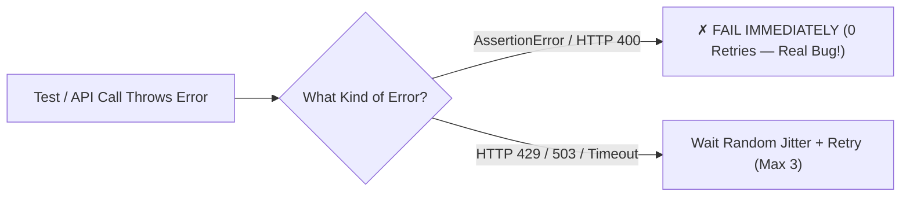

# Build MiniTest v0.7: Smart Classified Retries & Token-Bucket Rate Limiters

```json continuity
{
  "previously": "In Ch 06, we added an 8-worker parallel pool (`gw0..gw7`) to `MiniTest v0.6`, cutting our 200-test run from 16 minutes down to 2 minutes!",
  "painPoint": "Now all 8 workers hammer AeroCart's API at the exact same millisecond—triggering `429 Too Many Requests` or momentary `503 Service Unavailable` blips! A teammate adds `@retry(3)` around every test, which accidentally retries real `AssertionError` math bugs 3 times and hides race conditions!",
  "unlock": "Add a Smart Exception-Classified Retry + Token-Bucket Rate Limiter with Full Jitter to `MiniTest v0.7` that retries ONLY transient `429/503` network blips and fails fast in 0 retries on `AssertionError`!"
}
```

```json walkthrough
[
  {
    "time": "0:00",
    "badge": "Slide 1 / 4 · Why Blind `@retry(3)` Is a Trap!",
    "caption": "Suppose a test checks `assert price == 360`, and the app returns `449.80` (a real math bug!). Why on earth would you retry a deterministic math bug 3 times? Blind `@retry(3)` wastes CI time and hides flaky product bugs!",
    "code": "# ❌ Blind retry wastes 3x time on real AssertionError bugs!\n@retry(times=3)\ndef test_coupon():\n    assert calc_price(450, 0.2) == 360  # Fails 3 times for no reason!",
    "nodes": ["AssertionError ($449.8 != $360)", "Blind @retry(3)", "Wasted Time / Masked Bug!"]
  },
  {
    "time": "0:25",
    "badge": "Slide 2 / 4 · Smart Exception Classifier (Retry vs. Fail-Fast)",
    "caption": "A Smart Retry Classifier asks ONE question: 'Did the network hiccup (`503` / `429` / `TimeoutError`), or did the app give the wrong answer (`AssertionError` / `400`)?' Retry network blips; fail INSTANTLY on assertions!",
    "code": "RETRYABLE = (TimeoutError, ConnectionError)  # + HTTP 429, 502, 503, 504\n# If AssertionError -> Fail on Attempt #1 (0 retries)!",
    "nodes": ["503 / 429 -> Retry!", "AssertionError -> Fail Fast (0 Retries)!", "Clean Signal"]
  },
  {
    "time": "0:50",
    "badge": "Slide 3 / 4 · Why Fixed `sleep(2)` Causes a Thundering Herd",
    "caption": "If 8 workers all hit a `429` at `t=0s` and all `sleep(2)` together, all 8 workers slam the server again at `t=2.000s`! Add random 'Full Jitter' (`random.uniform(0, cap)`) so workers spread out!",
    "code": "# Full Jitter spreads 8 workers across different milliseconds:\nsleep_sec = random.uniform(0, min(max_cap, base * (2 ** attempt)))",
    "nodes": ["8 Workers Hit 429", "Random Full Jitter", "Smooth Desynchronized Retries"]
  },
  {
    "time": "1:15",
    "badge": "Slide 4 / 4 · Prevention > Cure: Client-Side Token Bucket",
    "caption": "Even better than retrying `429 Too Many Requests` is never triggering `429` in the first place! A Token Bucket paces your 8 workers to respect the server's speed limit (e.g., 50 req/sec) automatically!",
    "code": "client.acquire_token()  # Smoothly paces requests to <= 50 req/s!\nresp = client.post('/bookings', payload)",
    "nodes": ["Token Bucket (50/s)", "8 Parallel Workers", "Zero 429 Errors!"]
  }
]
```

```json pretraining
[
  {
    "term": "Exception Retry Classifier",
    "formula": "Transient (`429, 503, Timeout`) -> Retry | Bug (`AssertionError, 400`) -> Fail Fast!",
    "meaning": "A filter inside your test runner or HTTP client that only retries temporary network/rate-limit blips and never retries failed `assert` checks."
  },
  {
    "term": "Thundering Herd",
    "formula": "8 Workers Fail at t=0 -> All 8 Retry at exact t=2.0s!",
    "meaning": "When multiple parallel workers wait the exact same number of seconds before retrying, crashing the recovering server all over again."
  },
  {
    "term": "Exponential Backoff + Full Jitter",
    "formula": "Wait random time between `0` and `base * 2^attempt`",
    "meaning": "Doubling the maximum wait window on each retry and picking a random millisecond inside that window so parallel workers don't collide."
  },
  {
    "term": "Token Bucket Rate Limiter",
    "formula": "Bucket holds B tokens, refills at R tokens/sec",
    "meaning": "An arcade-token dispenser on the client side: each API call takes 1 token, preventing your parallel test workers from exceeding the server's rate limit."
  }
]
```

```json poe
{
  "question": "Suppose your team installs `pytest-rerunfailures` (`--reruns 3`) globally with no exception filter. A developer introduces a race condition in AeroCart's checkout button that fails 1 out of 3 clicks with `AssertionError: Order not created`. What happens in CI?",
  "options": [
    "CI fails immediately and catches the bug",
    "The test fails on Attempt #1, passes on Attempt #2, and CI turns green! Because blind test-level retries re-run `AssertionError` failures, hiding real product race conditions until customers hit them in production",
    "Pytest refuses to retry `AssertionError` by default",
    "The bug fixes itself automatically"
  ],
  "answerIndex": 1,
  "explanation": "Blindly retrying `AssertionError`s turns your test suite into a bug-hiding machine! Only transient infrastructure exceptions (`TimeoutError`, `ConnectionError`, `HTTP 429/503`) should ever be retried (`--only-rerun TimeoutError`)."
}
```

## 🌱 Step 1: Plain-English Story — The Elevator Button Smashers vs. The Smart Receptionist

In **Chapter 06**, we unleashed 8 parallel workers (`gw0` through `gw7`) in `MiniTest v0.6`. Our suite is now 8x faster!
But on Monday afternoon, **3 of our 200 tests randomly fail** with:
`HTTP 429: Too Many Requests` or `HTTP 503: Service Temporarily Busy`.

Why? Because all 8 workers fired API calls at AeroCart's staging gateway in the exact same millisecond!
To "fix" the red build, someone wraps a `@retry(3)` decorator around every test function.
At first, everyone cheers—until Friday, when a developer breaks the VIP coupon math (`$449.80 != $360.00`).
Now watch what happens:
1. Every broken test runs **3 full times** (wasting 3x the CI minutes on a deterministic math bug that will NEVER pass!).
2. Even worse, when a real UI race condition causes a button click to fail `AssertionError` 20% of the time, `@retry(3)` sweeps the bug under the rug and marks CI green!



**How do Staff Engineers build resilience into `MiniTest v0.7` without hiding bugs?**
We combine two simple ideas:
1. **The Smart Retry Filter**: Never retry `AssertionError` or `HTTP 400/401/404`! Only retry **transient infrastructure blips** (`HTTP 429`, `502`, `503`, `504`, `TimeoutError`), and use **random wait jitter** so 8 workers don't slam the server at the exact same second.
2. **The Arcade Token Dispenser (Token Bucket)**: Put a tiny counter inside our test API client that dispenses tokens at the server's speed limit (say, 20 requests/sec) so our 8 workers rarely trigger `429` in the first place!

## 🔨 Step 2: First Lines of Code — Build Smart Classified Retry Into `MiniTest v0.7`!

Look at `run_with_smart_retry()` below: in **17 lines of Python**, it retries `TransientServerError` (`429`/`503`) up to 3 times, but if a test throws `AssertionError` (a real product bug!), it **fails on Attempt #1 with zero wasted retries**!

```python
import random


class TransientServerError(Exception):
    """Represents HTTP 429 Too Many Requests or 503 Service Unavailable."""


def run_with_smart_retry(test_fn, max_attempts: int = 3) -> tuple:
    for attempt in range(1, max_attempts + 1):
        try:
            test_fn()
            return ("PASSED", attempt)
        except AssertionError:
            # REAL PRODUCT BUG! Never retry AssertionError — fail immediately!
            return ("FAILED_FAST", attempt)
        except TransientServerError:
            if attempt == max_attempts:
                return ("ERROR_EXHAUSTED", attempt)
            # Full Jitter: pick a random wait between 0 and 10ms * 2^attempt
            _jitter_ms = random.uniform(0, 10 * (2 ** attempt))


# 1) A transient 503 blip on attempt #1 recovers on attempt #2:
flaky_calls = [TransientServerError("503 Busy"), "OK"]
assert run_with_smart_retry(lambda: (_ for _ in ()).throw(flaky_calls.pop(0)) if isinstance(flaky_calls[0], Exception) else flaky_calls.pop(0)) == ("PASSED", 2)

# 2) A real AssertionError fails on attempt #1 (ZERO wasted retries!):
assert run_with_smart_retry(lambda: (_ for _ in ()).throw(AssertionError("449.8 != 360"))) == ("FAILED_FAST", 1)
```

### Java 17 Equivalent (`SmartRetryExecutor.java` — Mirrors JUnit 5 `TestExecutionExceptionHandler`)

```java
import java.util.concurrent.ThreadLocalRandom;

public class SmartRetryExecutor {
    static class TransientHttpException extends RuntimeException {
        TransientHttpException(String msg) { super(msg); }
    }

    public static String executeWithSmartRetry(Runnable testFn, int maxAttempts) {
        for (int attempt = 1; attempt <= maxAttempts; attempt++) {
            try {
                testFn.run();
                return "PASSED_ON_ATTEMPT_" + attempt;
            } catch (AssertionError productBug) {
                // Fail fast on AssertionError — 0 retries!
                return "FAILED_FAST_ON_ATTEMPT_" + attempt;
            } catch (TransientHttpException blip) {
                if (attempt == maxAttempts) return "EXHAUSTED_ON_ATTEMPT_" + attempt;
                double jitterMs = ThreadLocalRandom.current().nextDouble(0, 10.0 * (1 << attempt));
            }
        }
        return "UNREACHABLE";
    }

    public static void main(String[] args) {
        assert executeWithSmartRetry(() -> { throw new AssertionError("Bug"); }, 3)
            .equals("FAILED_FAST_ON_ATTEMPT_1");
    }
}
```

**Look at that second assertion (`attempt == 1`)**: when `AssertionError` happens, our runner stops immediately on Attempt #1!

## ⚡ Step 3: Where It Breaks in Real Life — Why Retrying Whole Tests Is Still Worse Than Client-Level Retries!

Even with an exception filter, ask yourself: **Where** should a `429` or `503` retry happen?
- **Bad Place (Whole-Test Retry)**: Suppose your test has 5 steps, and Step 4 (`POST /coupons`) gets a `503`. If you restart the *entire test* from Step 1, you throw away the browser, recreate the user, re-seed the cart, and waste 8 seconds!
- **Staff Place (HTTP Client Seam + Token Bucket + Circuit Breaker)**:
  1. Put the Token Bucket + Smart Retry **inside the `AeroCartClient` HTTP method** so only that single 30ms `POST /coupons` call retries!
  2. Add a **Suite Circuit Breaker**: What if Staging's database is completely down and **every single call** returns `503`? Without a Circuit Breaker, 500 tests × 3 retries × 10s timeout = **4 hours of hung CI**! A Circuit Breaker trips after **5 consecutive `503`s** and aborts the run in 5 seconds with a clear message: `"Staging API is down — aborting early!"`

```json contrast
{
  "title": "Blind Test-Level Reruns vs. Client-Seam Token Bucket + Classified Retry + Circuit Breaker",
  "naiveTitle": "Global `@retry(3)` on Every Test + Fixed `sleep(2)`",
  "naiveMetric": "Hides Race Conditions · 4-Hour Hang When Staging Is Down",
  "naivePoints": [
    "Retries `AssertionError` 3 times—masking real product race conditions and tripling failure runtime",
    "All 8 workers use fixed `time.sleep(2)`, creating a synchronized Thundering Herd retry storm",
    "When Staging crashes completely (`503`), all 500 tests slowly retry 3 times before timing out after 4 hours"
  ],
  "staffTitle": "Token-Bucket Client + Exception Taxonomy + Full Jitter + Circuit Breaker",
  "staffMetric": "0 Retries on Bugs · Zero 429s · 5s Outage Fail-Fast",
  "staffPoints": [
    "Fails fast in 0 retries on `AssertionError` and `400/401/403/404/422` client errors",
    "Client-side Token Bucket smooths outbound traffic below staging gateway limits, preventing `429`s",
    "AWS Full Jitter desynchronizes retries, and a Circuit Breaker aborts the suite in 5s if consecutive `503`s >= 5"
  ]
}
```

Experiment with the **Smart Retry, Token Bucket & Circuit Breaker Simulator** below to watch how Full Jitter and Token Buckets protect your parallel test workers!

## 🚀 Step 4: Staff Engineer Deep-Dive — AWS Full Jitter & Token Bucket Equations

Let's write down the two mathematical formulas every Staff SDET and Systems Engineer uses to build resilient SDK clients:

1. **Exponential Backoff with AWS Full Jitter** (for attempt $k \in \{0, 1, 2, \dots\}$ with base delay $b$ and ceiling $C_{\max}$):

$$T_{\text{sleep}}(k) \sim \text{Uniform}\!\left(0,\; \min\bigl(C_{\max},\; b \cdot 2^k\bigr)\right)$$

Why `Uniform(0, ...)` instead of fixed $b \cdot 2^k$? Because if $W = 16$ workers hit a rate limit at the exact same millisecond $t_0$, drawing uniformly from $[0, \text{window}]$ spreads their retry arrivals evenly across the entire window instead of spiking at $t_0 + b \cdot 2^k$!

2. **Token Bucket Rate Limiter State Update** (capacity $B$ tokens, refill rate $R$ tokens/second, elapsed time $\Delta t = t_{\text{now}} - t_{\text{last}}$):

$$\text{tokens}(t_{\text{now}}) = \min\bigl(B,\; \text{tokens}(t_{\text{last}}) + R \cdot \Delta t\bigr)$$

If $\text{tokens}(t_{\text{now}}) < 1$, the worker waits exact time $t_{\text{wait}} = \frac{1 - \text{tokens}(t_{\text{now}})}{R}$ seconds before sending the request.

| Error / Status Code | Retryable? | Action in `MiniTest v0.7` / `Pytest` / `JUnit 5` |
| :--- | :---: | :--- |
| **`AssertionError`** | **❌ NEVER (0 retries)** | Fail test immediately (`FAILED`) — deterministic or flaky product bug! |
| **`HTTP 400 / 401 / 403 / 404 / 422`** | **❌ NEVER (0 retries)** | Fail immediately — malformed request or auth config error! |
| **`HTTP 429 Too Many Requests`** | **✅ YES (Idempotent / Safe)** | Respect `Retry-After` header (or Full Jitter) + throttle Token Bucket! |
| **`HTTP 502 / 503 / 504` / `TimeoutError`** | **✅ YES (Up to 3 attempts)** | Retry with Full Jitter; increment Suite Circuit Breaker failure counter! |

### Production Blueprint: Thread-Safe Token Bucket + Classified Retry + Circuit Breaker (`MiniTest v0.7`)

```python
from dataclasses import dataclass, field
import random
import threading
from typing import Callable, Set, TypeVar

T = TypeVar("T")
RETRYABLE_STATUS_CODES: Set[int] = {429, 502, 503, 504}


class HttpStatusError(Exception):
    def __init__(self, status_code: int, message: str = ""):
        super().__init__(f"HTTP {status_code}: {message}")
        self.status_code = status_code


class CircuitBreakerOpenError(RuntimeError):
    """Raised when the target staging service is completely down (stops 4-hour timeout storms!)."""


@dataclass
class ResilientTestClient:
    rate_per_sec: float = 50.0
    burst_capacity: float = 10.0
    circuit_failure_threshold: int = 5
    _tokens: float = field(init=False)
    _last_time: float = 0.0
    _consecutive_5xx: int = 0
    _lock: threading.Lock = field(default_factory=threading.Lock)

    def __post_init__(self) -> None:
        self._tokens = self.burst_capacity

    def consume_token(self, now_sec: float) -> float:
        """Returns required wait seconds (0.0 if a token is immediately available)."""
        with self._lock:
            elapsed = max(0.0, now_sec - self._last_time)
            self._tokens = min(self.burst_capacity, self._tokens + elapsed * self.rate_per_sec)
            self._last_time = now_sec
            if self._tokens >= 1.0:
                self._tokens -= 1.0
                return 0.0
            wait_sec = (1.0 - self._tokens) / self.rate_per_sec
            self._tokens = 0.0
            self._last_time = now_sec + wait_sec
            return wait_sec

    def execute_request(self, call_fn: Callable[[], T], max_attempts: int = 3) -> T:
        if self._consecutive_5xx >= self.circuit_failure_threshold:
            raise CircuitBreakerOpenError("Circuit OPEN: Target service failed 5 consecutive times!")

        for attempt in range(max_attempts):
            try:
                result = call_fn()
                self._consecutive_5xx = 0  # Reset circuit breaker on healthy response!
                return result
            except AssertionError:
                raise  # NEVER retry AssertionError!
            except HttpStatusError as err:
                if err.status_code not in RETRYABLE_STATUS_CODES:
                    raise  # NEVER retry 400 / 401 / 404 / 422!
                self._consecutive_5xx += 1
                if self._consecutive_5xx >= self.circuit_failure_threshold:
                    raise CircuitBreakerOpenError("Circuit tripped OPEN during retry!") from err
                if attempt + 1 == max_attempts:
                    raise
                _sleep_ms = random.uniform(0, min(2000.0, 50.0 * (2 ** attempt)))
        raise RuntimeError("Unreachable")
```

### Java 17 Equivalent (Token Bucket + Classified Retry + Circuit Breaker)

```java
import java.util.Set;
import java.util.concurrent.ThreadLocalRandom;
import java.util.concurrent.atomic.AtomicInteger;
import java.util.function.Supplier;

public class ResilientApiClient {
    private static final Set<Integer> RETRYABLE = Set.of(429, 502, 503, 504);
    private final AtomicInteger consecutiveFailures = new AtomicInteger(0);
    private final int circuitThreshold;

    public static class HttpStatusException extends RuntimeException {
        public final int status;
        public HttpStatusException(int status) { super("HTTP " + status); this.status = status; }
    }

    public ResilientApiClient(int circuitThreshold) {
        this.circuitThreshold = circuitThreshold;
    }

    public <T> T execute(Supplier<T> requestFn, int maxAttempts) {
        if (consecutiveFailures.get() >= circuitThreshold) {
            throw new IllegalStateException("Circuit OPEN: Staging service is down!");
        }
        for (int attempt = 0; attempt < maxAttempts; attempt++) {
            try {
                T res = requestFn.get();
                consecutiveFailures.set(0);
                return res;
            } catch (AssertionError bug) {
                throw bug; // Never retry AssertionError!
            } catch (HttpStatusException ex) {
                if (!RETRYABLE.contains(ex.status)) throw ex; // Fail fast on 400/401/404!
                if (consecutiveFailures.incrementAndGet() >= circuitThreshold) {
                    throw new IllegalStateException("Circuit tripped OPEN!", ex);
                }
                if (attempt + 1 == maxAttempts) throw ex;
                double sleepMs = ThreadLocalRandom.current().nextDouble(0, Math.min(2000.0, 50.0 * (1 << attempt)));
            }
        }
        throw new IllegalStateException("Unreachable");
    }
}
```

> [!WARNING]
> **Staff Interview Gotcha — Never Retry a Non-Idempotent `POST /payments` Without an `Idempotency-Key`!**
> Suppose your test client sends `POST /payments` to charge a passenger `$360`. The server charges the card, but the Wi-Fi drops before the `200 OK` response reaches your test! If your client blindly retries `POST /payments` **without sending the exact same `Idempotency-Key: <uuid>` header** on all attempts, the server will charge the passenger **`$720` (double-charge bug)**! Always generate one `Idempotency-Key` before the retry loop and reuse that same header across every retry attempt!

**Up Next in Chapter 08**: Wait a second—look at `ResilientTestClient` that we just wrote! How do we **prove in a test** that our client actually retries `[503, 503, 200]` and trips the Circuit Breaker after five `503`s? We can't call real Stripe on the internet and ask Stripe to crash twice on command! In Chapter 08, let's build a **Stateful In-Memory Mock Server (`FakeStripeServer`)** for `MiniTest v0.8`!

```json quiz
[
  {
    "id": "fw-07-q1",
    "question": "Why must a test framework's retry analyzer NEVER retry an `AssertionError` or an `HTTP 400 Bad Request`?",
    "options": [
      "Because Python cannot catch `AssertionError` inside a `try` block",
      "Because `AssertionError` and `400` indicate deterministic product/test logic bugs (or real race conditions)—retrying them wastes CI time and masks real defects when Attempt #2 happens to pass!",
      "Because `HTTP 400` means the network cable is unplugged",
      "Because retries only work in Java"
    ],
    "answerIndex": 1,
    "explanation": "Retries exist strictly to absorb transient transport/capacity blips (`429, 502, 503, 504, TimeoutError`). Retrying `AssertionError` hides product bugs."
  },
  {
    "id": "fw-07-q2",
    "question": "What problem does 'Full Jitter' (`random.uniform(0, min(cap, base * 2^attempt))`) solve when 16 parallel test workers all hit an `HTTP 429` rate limit at the exact same millisecond?",
    "options": [
      "It encrypts the HTTP headers",
      "It desynchronizes the 16 workers' retry timestamps across the backoff window so they don't all wake up at the exact same second and slam the server with a second Thundering Herd spike",
      "It skips the test without running it",
      "It doubles the number of CPU cores"
    ],
    "answerIndex": 1,
    "explanation": "Without random jitter, workers that fail together wait the exact same deterministic backoff and collide again on every retry wave."
  },
  {
    "id": "fw-07-q3",
    "question": "Why should your `ResilientTestClient` attach the exact same `Idempotency-Key` UUID header across all retry attempts of a `POST /orders` request?",
    "options": [
      "To make the JSON payload smaller",
      "Because if Attempt #1 actually succeeded on the server before the response timed out, sending the same `Idempotency-Key` on Attempt #2 tells the server to return the original order instead of creating a duplicate order!",
      "Because HTTP `GET` requests require a body",
      "To disable TLS encryption"
    ],
    "answerIndex": 1,
    "explanation": "Generating the `Idempotency-Key` once per logical operation (outside the retry loop) guarantees safe at-least-once retry semantics without duplicate writes."
  }
]
```
