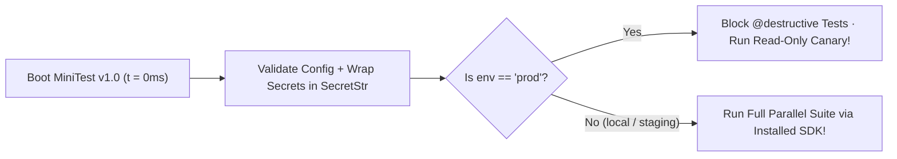

# Ship MiniTest v1.0: Multi-Env Config, `SecretStr` Redaction & SDK Packaging!

```json continuity
{
  "previously": "Across Chapters 01–09, we built `MiniTest` from a blank file into a parallel, resilient framework with LIFO fixtures, Page Objects, Immutable Builders, Recursive JSON Diffs, Stateful Mock Servers, and OTel Reporters!",
  "painPoint": "Now 15 microservice teams want to use `MiniTest`! Suddenly three nightmares hit: 1) tests hardcode `http://localhost:8090` so they can't switch to Staging, 2) `print(config)` accidentally dumps `STRIPE_SECRET_KEY` into CI logs, and 3) teams copy-paste our framework files into 15 repos that immediately drift out of sync!",
  "unlock": "Complete **`MiniTest v1.0`** by adding Fail-Fast Layered Config (`local` / `staging` / `prod`), a Zero-Leak `SecretStr` vault wrapper, a Production Destructive-Test Guardrail, and packaging our framework as an installable SDK (`pip install minitest-sdk` / Maven JAR)!"
}
```

```json walkthrough
[
  {
    "time": "0:00",
    "badge": "Slide 1 / 4 · Why Hardcoded `localhost` & Late `os.getenv` Hurt",
    "caption": "Imagine a 40-minute test run where Test #490 finally reads `os.environ['PAYMENT_URL']`—and crashes at Minute 39 because someone misspelled `PAYMENT_URL`! Validate ALL config at millisecond `0` BEFORE Test #1 starts!",
    "code": "# ❌ Crashes at Minute 39 if env var is missing!\nurl = os.environ['PAYMNT_URL']\n# ✓ Load & validate ALL config at t=0ms before running any test!",
    "nodes": ["Boot at t=0ms", "Validate All Env Vars", "Fail Fast if Typo!"]
  },
  {
    "time": "0:25",
    "badge": "Slide 2 / 4 · `SecretStr`: The Self-Masking Password Box!",
    "caption": "If `config.api_key` is a normal string, anyone who writes `print(config)` or triggers a traceback prints your live API key in CI! Wrap secrets in `SecretStr` so `print()` ALWAYS shows `'***REDACTED***'`!",
    "code": "key = SecretStr('sk_live_998877')\nprint(key)               # Prints: SecretStr('***REDACTED***')\nkey.get_secret_value()   # Returns 'sk_live_998877' ONLY when sending header!",
    "nodes": ["SecretStr('sk_live_99')", "print(config) -> ***REDACTED***", "get_secret_value() -> Wire Header"]
  },
  {
    "time": "0:50",
    "badge": "Slide 3 / 4 · The Production Safety Interlock (`ENV == 'prod'`)",
    "caption": "What if an engineer sets `AEROCART_ENV=prod` to run a smoke check, and accidentally runs `test_wipe_all_databases()`?! Build a safety lock into `MiniTest v1.0` that blocks `@destructive` tests whenever `env == 'prod'`!",
    "code": "if config.env == 'prod' and is_destructive(test_fn):\n    raise RuntimeError('SAFETY LOCK: Refusing to run destructive test on PROD!')",
    "nodes": ["AEROCART_ENV=prod", "Destructive Test Detected", "Safety Lock Blocks Execution!"]
  },
  {
    "time": "1:15",
    "badge": "Slide 4 / 4 · Ship `MiniTest v1.0` as a 1-Line Installable SDK!",
    "caption": "Never copy-paste `conftest.py` and helpers across 15 repositories! Package your framework with `pyproject.toml` (`pytest11` plugin entry-point) or a Maven `pom.xml` so every team just runs `pip install aero-minitest-sdk==1.0.0`!",
    "code": "# pyproject.toml — Auto-registers fixtures & hooks when installed!\n[project.entry-points.pytest11]\naero_minitest = \"aero_minitest.plugin\"",
    "nodes": ["1 Versioned SDK Repo", "pip install / Maven JAR", "15 Microservice Repos Updated!"]
  }
]
```

```json pretraining
[
  {
    "term": "Layered Config Precedence",
    "formula": "1. Defaults -> 2. `.env.<profile>` file -> 3. OS `ENV` vars (Highest!)",
    "meaning": "Sensible local defaults live in code, environment files override them for `staging`/`prod`, and command-line OS environment variables win over everything."
  },
  {
    "term": "Opaque `SecretStr` Wrapper",
    "formula": "`str(secret)` == `'***REDACTED***'` | `.get_secret_value()` == real secret",
    "meaning": "A tiny wrapper class around passwords and API keys that hides the secret whenever printed or logged, only revealing it when explicitly asked by the HTTP client."
  },
  {
    "term": "Production Safety Guardrail",
    "formula": "If `env == 'prod'` -> Block `DELETE / TRUNCATE / Chaos` tests!",
    "meaning": "A hard safety switch inside the runner that refuses to execute destructive database resets or chaos injections when pointed at a production URL."
  },
  {
    "term": "Internal QA SDK (`pytest11` / JUnit SPI)",
    "formula": "`pip install aero-qa-sdk==1.0.0` -> Zero copy-pasted `conftest.py`!",
    "meaning": "Packaging your fixtures, builders, diff engine, and reporters into a versioned library so 20 teams can upgrade in 5 seconds instead of copy-pasting files."
  }
]
```

```json poe
{
  "question": "Your company has 20 microservice repositories. Instead of packaging your test helpers (`AeroCartClient`, `BookingBuilder`, `diff_json`) as an installable package, teams copy-paste a `qa_helpers/` folder into all 20 repos. Six months later, AeroCart changes its login token header from `X-Auth` to `Authorization: Bearer`. What happens?",
  "options": [
    "All 20 repos update themselves automatically",
    "You have to open, review, and merge 20 separate Pull Requests across 20 repositories—and half of them have drifted with custom edits! Packaging shared fixtures/clients as a versioned SDK (`pip install aero-qa-sdk==1.2.0` / Maven dependency) fixes it in 1 place",
    "Copy-pasting code makes tests run faster",
    "Python forbids importing test helpers from installed packages"
  ],
  "answerIndex": 1,
  "explanation": "Copy-pasting framework code across repositories creates a maintenance nightmare ($O(M)$ PRs for $M$ repos). Packaging your framework as a versioned internal SDK (`pyproject.toml` + `pytest11` entry-point or Maven JAR) turns QA into a scalable platform."
}
```

## 🌱 Step 1: Plain-English Story — The Final Mile From "Cool Script" to "`MiniTest v1.0` Platform"

Pause for a second and celebrate how far you have come!
In **Chapter 01**, we started with an **empty file** and 3 crashing `assert` lines.
Step by step, you built:
- **`v0.1–v0.2`**: Auto-discovery (`test_*`) and 3-phase `PASSED / FAILED / ERROR` separation
- **`v0.3`**: `@fixture` dependency injection, LIFO cleanup, and Page Objects + Components
- **`v0.4–v0.5`**: Immutable Data Builders (`BookingBuilder`) and a Recursive JSONPath Diff Engine
- **`v0.6–v0.8`**: Parallel workers (`gw0..gw7`), Smart Classified Retries + Token Buckets, and `FakeStripeServer`
- **`v0.9`**: Failure-only dashcam reporters, redacted `cURL` reproducers, and OpenTelemetry `traceparent` links!

Now 15 engineering teams at AeroCart say: **"We love `MiniTest`! How do we use it in our repos across Local, Staging, and Production Canary?"**
To cross the finish line to **`MiniTest v1.0`**, we just need to solve **three last real-world problems**:
1. **No More Hardcoded URLs**: Tests can't hardcode `http://127.0.0.1:8090`—they need a **Layered Config** (`local` -> `staging` -> `prod`) that validates every setting at **millisecond `0`** before Test #1 runs!
2. **A Self-Masking Password Box (`SecretStr`)**: If someone runs `print(config)` in CI, `api_key` must automatically print **`***REDACTED***`** instead of leaking the real password!
3. **A Production Safety Lock + 1-Click SDK Install**: Block destructive tests if `env == "prod"`, and package everything into a clean library so teams install `MiniTest v1.0` with a single command!



## 🔨 Step 2: First Lines of Code — Build `SecretStr` + Fail-Fast Config + Prod Lock in 20 Lines!

Let's write the core of **`MiniTest v1.0`'s Config & Safety Engine** right now! Watch how `SecretStr` hides the API key whenever converted to a string or printed (`***REDACTED***`), and how `enforce_prod_guardrail()` stops destructive tests from ever touching production!

```python
from dataclasses import dataclass


class SecretStr:
    """Self-masking secret box: print() or repr() NEVER reveals the raw secret!"""
    def __init__(self, raw_secret: str):
        self._secret = raw_secret

    def get_secret_value(self) -> str:
        return self._secret

    def __repr__(self) -> str:
        return "SecretStr('***REDACTED***')"

    __str__ = __repr__


@dataclass(frozen=True)
class MiniTestConfig:
    env: str                           # "local" | "staging" | "prod"
    base_url: str
    api_key: SecretStr

    def check_test_allowed(self, is_destructive: bool) -> None:
        if self.env == "prod" and is_destructive:
            raise PermissionError("PROD GUARDRAIL: Destructive tests are blocked on prod!")


cfg = MiniTestConfig(env="prod", base_url="https://aerocart.io", api_key=SecretStr("sk_live_999"))
assert "sk_live_999" not in f"Loaded config: {cfg}"   # 100% leak-proof in logs!
assert cfg.api_key.get_secret_value() == "sk_live_999"
```

### Java 17 Equivalent (`SecretStr.java` + Fail-Fast `MiniTestConfig` Record)

```java
public class MiniTestConfigDemo {
    public static final class SecretStr {
        private final String secret;
        public SecretStr(String secret) { this.secret = secret; }
        public String getSecretValue() { return secret; }
        @Override public String toString() { return "SecretStr('***REDACTED***')"; }
    }

    public record MiniTestConfig(String env, String baseUrl, SecretStr apiKey) {
        public MiniTestConfig {
            if (!baseUrl.startsWith("http")) {
                throw new IllegalArgumentException("Boot validation failed: invalid baseUrl " + baseUrl);
            }
        }
        public void checkTestAllowed(boolean isDestructive) {
            if ("prod".equals(env) && isDestructive) {
                throw new SecurityException("PROD GUARDRAIL: Destructive test blocked on prod!");
            }
        }
    }

    public static void main(String[] args) {
        MiniTestConfig cfg = new MiniTestConfig("prod", "https://aerocart.io", new SecretStr("sk_live_999"));
        assert !cfg.toString().contains("sk_live_999"); // Never leaks in logs!
        assert cfg.apiKey().getSecretValue().equals("sk_live_999");
    }
}
```

**Look at `assert "sk_live_999" not in f"Loaded config: {cfg}"`!** Even if an engineer prints the entire `cfg` object in a crash log, Python and Java print `SecretStr('***REDACTED***')`!

## ⚡ Step 3: Where It Breaks in Real Life — Late Config Crashes & Copy-Pasted `conftest.py` Drift

Why do so many companies struggle when scaling their test framework from 1 repository to 25 repositories? Because of **three classic platform mistakes**:

1. **Mistake 1: Lazy `os.getenv("DB_URL")` Inside Test #400**
   If Test #400 reads `os.environ["BILLING_URL"]` 35 minutes into a CI run and crashes with `KeyError` because someone forgot to set `BILLING_URL` in GitHub Actions, you just wasted 35 minutes! **Always validate the entire `MiniTestConfig` schema at `t = 0ms` during test collection/session boot!**
2. **Mistake 2: Missing Production Guardrails**
   Someone runs `AEROCART_ENV=prod pytest` to check if production checkout is up—and accidentally runs `test_delete_expired_users()`, deleting real customer rows! In `MiniTest v1.0`, when `env == "prod"`, any non-`GET` mutation or `@destructive` test is automatically blocked unless it targets a dedicated synthetic canary account!
3. **Mistake 3: Copy-Pasting `conftest.py` Across 20 Repos**
   Instead of publishing an internal package (`aero-minitest-sdk`), teams copy-paste helper files from repo to repo. Within 3 months, every repo has a slightly broken version of the retry client!

```json contrast
{
  "title": "Scattered `os.getenv()` & Copy-Pasted Helpers vs. Typed `MiniTest v1.0` Platform SDK",
  "naiveTitle": "Scattered `os.getenv` + Plain Strings + Copy-Pasted Files",
  "naiveMetric": "Crashes at Minute 38 · Leaks Keys · 20 Drifted Repos",
  "naivePoints": [
    "Reads `os.getenv()` lazily inside individual tests—discovering missing env vars 38 minutes into a CI run",
    "Stores API keys as plain `str`, leaking live credentials whenever `config` or local variables are printed",
    "Copy-pastes `conftest.py` across 20 microservice repos with zero version control or production safety locks"
  ],
  "staffTitle": "Boot-Validated Config + `SecretStr` + Prod Guardrail + `pytest11` / Maven SDK",
  "staffMetric": "0ms Config Fail-Fast · Zero Leaks · 1-Line SDK Upgrade",
  "staffPoints": [
    "Validates all URLs, timeouts, and credentials at `t = 0ms` before Test #1 executes (`pydantic-settings` / typed loader)",
    "Wraps every credential in `SecretStr` and enforces a hard `env == 'prod'` interlock blocking destructive tests",
    "Ships as a versioned package (`pyproject.toml` `pytest11` entry-point / Maven JAR) shared cleanly across all repos"
  ]
}
```

Try the **SDK Config, Secret Redaction & Guardrail Simulator** below to test layered config precedence, `SecretStr` masking, and production safety locks!

## 🚀 Step 4: Staff Engineer Deep-Dive — Plugin Entry-Points (`pytest11` / JUnit `ServiceLoader`) & Complete `MiniTest v1.0`

How does installing a Python package like `pytest-xdist` or our internal **`aero-minitest-sdk`** automatically make fixtures and hooks available in every repository **without** requiring anyone to import them in `conftest.py`?

1. **In Python (`pyproject.toml` `pytest11` Entry-Point)**:
   When Pytest boots up, it queries Python's package metadata (`importlib.metadata.entry_points(group="pytest11")`) and automatically loads every registered plugin module!
   ```toml
   [project]
   name = "aero-minitest-sdk"
   version = "1.0.0"

   [project.entry-points.pytest11]
   aero_minitest = "aero_minitest.plugin"
   ```
2. **In Java 17 (`META-INF/services/org.junit.jupiter.api.extension.Extension`)**:
   When JUnit 5 boots with `-Djunit.jupiter.extensions.autodetection.enabled=true`, Java's `ServiceLoader` automatically discovers and activates every `Extension` class listed in your JAR's `META-INF/services/` file!

And look at the maintenance math across $M = 25$ microservice repositories when you update $C = 12$ core framework components per year:

$$\text{Engineering Effort}_{\text{copy-paste}} = O(M \times C) = 25 \times 12 = 300 \text{ manual PRs/year} \quad \text{vs.} \quad \text{Effort}_{\text{SDK}} = O(C) = 12 \text{ SDK releases!}$$

| `MiniTest` Evolution (`Ch 01 -> Ch 10`) | What We Built Together From Scratch | Production `Pytest` Equivalent | Production `JUnit 5` Equivalent |
| :--- | :--- | :--- | :--- |
| **`v0.1 – v0.2` (Ch 01)** | Auto-discovering runner + `PASS / FAIL / ERROR` | `pytest` collection + AST rewrite | JUnit Platform + Jupiter Engine |
| **`v0.3` (Ch 02 – Ch 03)** | `@fixture` LIFO stack + Page/Component Objects | `@pytest.fixture` (`yield`) + Playwright POM | `@BeforeEach` / `Extension` + POM |
| **`v0.4 – v0.5` (Ch 04 – Ch 05)** | Immutable `BookingBuilder` + Recursive JSONPath Diff | `@dataclass(frozen=True)` + `deepdiff` | Java `record` Builder + AssertJ / `JSONassert` |
| **`v0.6 – v0.8` (Ch 06 – Ch 08)** | Parallel `gw0..gwN` + Smart Retry + `FakeStripeServer` | `pytest-xdist` + `tenacity` + `respx` | JUnit Parallel `ThreadLocal` + Resilience4j + `WireMock` |
| **`v0.9 – v1.0` (Ch 09 – Ch 10)** | OTel Forensics + `SecretStr` Config + SDK Package | `allure-pytest` + `pydantic-settings` + `pytest11` | `TestWatcher` + OTel Agent + Maven `ServiceLoader` JAR |

### Production Blueprint: Complete `MiniTest v1.0` Layered Config Loader + Prod Safety Guardrail (`Python 3` & `Java 17`)

```python
from dataclasses import dataclass
from typing import Dict, Mapping, Optional


class ConfigValidationError(ValueError):
    """Raised at t=0ms boot time BEFORE any test runs if config is missing or invalid."""


class SecretValue:
    def __init__(self, value: str):
        if not value or not value.strip():
            raise ConfigValidationError("SecretValue cannot be empty!")
        self._value = value

    def get_secret_value(self) -> str:
        return self._value

    def __repr__(self) -> str:
        return "SecretValue('***REDACTED***')"

    __str__ = __repr__


ENV_PROFILES: Dict[str, Dict[str, str]] = {
    "local": {"BASE_URL": "http://127.0.0.1:8090", "TIMEOUT_SEC": "5"},
    "staging": {"BASE_URL": "https://staging.aerocart.io", "TIMEOUT_SEC": "15"},
    "prod": {"BASE_URL": "https://aerocart.io", "TIMEOUT_SEC": "10"},
}


@dataclass(frozen=True)
class PlatformSdkConfig:
    env: str
    base_url: str
    timeout_sec: int
    api_key: SecretValue
    allowed_prod_tenant: str = "tenant-synthetic-canary"

    @classmethod
    def load_fail_fast(cls, os_environ: Mapping[str, str]) -> "PlatformSdkConfig":
        """
        Resolves layered config (1. Profile defaults -> 2. OS Env overrides)
        and validates everything at t=0ms before Test #1 starts!
        """
        env = os_environ.get("AEROCART_ENV", "local")
        if env not in ENV_PROFILES:
            raise ConfigValidationError(f"Unknown AEROCART_ENV={env!r}; expected {sorted(ENV_PROFILES)}")

        merged = dict(ENV_PROFILES[env])
        for key in ("BASE_URL", "TIMEOUT_SEC"):
            if f"AEROCART_{key}" in os_environ:
                merged[key] = os_environ[f"AEROCART_{key}"]

        base_url = merged["BASE_URL"]
        if not base_url.startswith(("http://", "https://")):
            raise ConfigValidationError(f"Invalid BASE_URL={base_url!r}: must start with http:// or https://")

        raw_key = os_environ.get("AEROCART_API_KEY", "dev-local-key" if env == "local" else "")
        if not raw_key:
            raise ConfigValidationError(f"Missing required AEROCART_API_KEY for env={env!r} at boot!")

        return cls(
            env=env,
            base_url=base_url,
            timeout_sec=int(merged["TIMEOUT_SEC"]),
            api_key=SecretValue(raw_key),
        )

    def enforce_execution_guardrail(self, is_destructive: bool, target_tenant: Optional[str] = None) -> None:
        if self.env == "prod":
            if is_destructive:
                raise PermissionError("PROD INTERLOCK: @destructive tests are forbidden when AEROCART_ENV='prod'!")
            if target_tenant and target_tenant != self.allowed_prod_tenant:
                raise PermissionError(f"PROD INTERLOCK: Only {self.allowed_prod_tenant!r} may be used in prod!")
```

### Java 17 Equivalent (Fail-Fast Layered Config Loader + Prod Safety Guardrail)

```java
import java.util.Map;

public class PlatformSdkConfig {
    public static final class SecretValue {
        private final String raw;
        public SecretValue(String raw) {
            if (raw == null || raw.isBlank()) throw new IllegalArgumentException("Empty secret!");
            this.raw = raw;
        }
        public String getSecretValue() { return raw; }
        @Override public String toString() { return "SecretValue('***REDACTED***')"; }
    }

    private static final Map<String, String> DEFAULT_URLS = Map.of(
        "local", "http://127.0.0.1:8090",
        "staging", "https://staging.aerocart.io",
        "prod", "https://aerocart.io"
    );

    public record SdkConfig(String env, String baseUrl, SecretValue apiKey) {
        public static SdkConfig loadFailFast(Map<String, String> envVars) {
            String env = envVars.getOrDefault("AEROCART_ENV", "local");
            if (!DEFAULT_URLS.containsKey(env)) {
                throw new IllegalArgumentException("Unknown AEROCART_ENV: " + env);
            }
            String url = envVars.getOrDefault("AEROCART_BASE_URL", DEFAULT_URLS.get(env));
            if (!url.startsWith("http://") && !url.startsWith("https://")) {
                throw new IllegalArgumentException("Invalid URL: " + url);
            }
            String key = envVars.getOrDefault("AEROCART_API_KEY", "local".equals(env) ? "dev-key" : "");
            if (key.isBlank()) {
                throw new IllegalArgumentException("Missing AEROCART_API_KEY for env=" + env);
            }
            return new SdkConfig(env, url, new SecretValue(key));
        }

        public void enforceProdGuardrail(boolean isDestructive) {
            if ("prod".equals(env) && isDestructive) {
                throw new SecurityException("PROD INTERLOCK: Destructive test blocked on prod!");
            }
        }
    }
}
```

> [!WARNING]
> **Staff Interview Gotcha — Never Put Heavy Database/Network Calls Inside a Global `pytest11` SDK Plugin Hook!**
> Once you publish `aero-minitest-sdk` with a `pytest11` entry-point, Pytest loads your plugin **every single time anyone in the company runs `pytest`—even for a 10ms unit test on an airplane with no Wi-Fi!** If your plugin's top-level code or unguarded `pytest_sessionstart` tries to connect to Vault or Staging Postgres unconditionally, you will break offline unit testing across all 25 repositories! **Rule**: Validate config lazily per requested fixture (or only when integration markers/flags are active), and keep `pytest --collect-only` 100% offline-safe!

**🎉 Congratulations — You Completed Course 02 (`Zero to Mastery: Building Testing Frameworks`)!**
You started from **3 bare `assert` lines in a blank file** and engineered **`MiniTest v1.0`**—mastering test discovery, AST assertion rewriting, LIFO `@fixture` injection, Page & Component Objects, Immutable Data Builders, Recursive JSONPath Diff Engines, Parallel `gw0..gwN` Worker Isolation, Token-Bucket Smart Retries, Stateful Mock Servers, OpenTelemetry Forensic Reporters, and Multi-Env SDK Packaging!
**Up Next in Course 03 (`Modern Web & UI Automation at Scale`)**: We'll take our `MiniTest v1.0` architecture into the browser to build **`AeroBot`**—mastering Playwright's CDP WebSocket protocol, auto-waiting actionability, Shadow DOM piercing, network interception, and visual regression at scale!

```json quiz
[
  {
    "id": "fw-10-q1",
    "question": "Why should a test framework validate its entire configuration schema (`BASE_URL`, `API_KEY`, `ENV`) at boot time (`t = 0ms`) rather than reading `os.environ` inside individual tests?",
    "options": [
      "Because `os.environ` is deleted after 5 seconds",
      "So a typo or missing environment variable fails immediately in 0.01 seconds before Test #1 runs, instead of crashing at minute 38 of a 40-minute CI run!",
      "Because Python functions cannot read environment variables",
      "To make the config file larger"
    ],
    "answerIndex": 1,
    "explanation": "Boot-time schema validation (Fail-Fast) catches missing secrets or malformed URLs immediately rather than wasting CI runtime."
  },
  {
    "id": "fw-10-q2",
    "question": "How does wrapping credentials in `SecretStr` / `SecretValue` prevent accidental credential leaks in CI logs and failure tracebacks?",
    "options": [
      "It deletes the API key from the server",
      "Its `__repr__` and `__str__` methods always return `'***REDACTED***'`, so printing the config object or dumping local variables in a traceback never reveals the raw secret string",
      "It encrypts the entire hard drive",
      "It disables all error messages"
    ],
    "answerIndex": 1,
    "explanation": "An opaque `SecretStr` masks its value in `str()` and `repr()` formatting, exposing the raw string only when `.get_secret_value()` is explicitly called at the HTTP wire boundary."
  },
  {
    "id": "fw-10-q3",
    "question": "How does declaring `[project.entry-points.pytest11]` in `pyproject.toml` eliminate copy-pasted `conftest.py` files across 25 microservice repositories?",
    "options": [
      "It automatically emails `conftest.py` to every developer",
      "When any repository installs your versioned SDK package (`pip install aero-minitest-sdk`), Pytest discovers the `pytest11` entry-point automatically and registers all shared fixtures, CLI flags, and reporter hooks with zero copy-pasting",
      "It disables `conftest.py` in Python",
      "It converts Python tests into Java"
    ],
    "answerIndex": 1,
    "explanation": "Pytest's `pytest11` entry-point discovery (and JUnit 5's `ServiceLoader` SPI) allows an internal QA SDK to distribute versioned fixtures and hooks cleanly across dozens of repos."
  }
]
```
