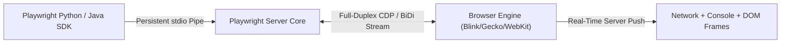

# W3C WebDriver HTTP vs Persistent CDP, Pipes & WebDriver BiDi

```json pretraining
[
  {
    "term": "Classic WebDriver Double-Hop",
    "formula": "Client --HTTP/1.1--> chromedriver --CDP--> Browser  [2x Serialization / Action]",
    "meaning": "Every `findElement`, `isDisplayed`, and `click` in classic WebDriver is an independent synchronous HTTP request/response routed through an external driver binary."
  },
  {
    "term": "Persistent Full-Duplex Pipe / WS",
    "formula": "1 Multiplexed Connection (stdio Pipe or WebSocket) -> 0 Handshake Overhead",
    "meaning": "Playwright holds a single persistent bidirectional stream directly into Chromium (CDP), Firefox, and WebKit, multiplexing JSON-RPC messages asynchronously by `id`."
  },
  {
    "term": "Server-Push Event Subscription",
    "formula": "Browser --Push--> Client (`Network.requestWillBeSent`, `Runtime.consoleAPICalled`)",
    "meaning": "Because the wire channel is full-duplex, the browser pushes console crashes, network traffic, and frame navigations in real time without client polling loops."
  },
  {
    "term": "Atomic In-Browser Action Loop",
    "formula": "1 RPC (`Frame.click(selector)`) -> Resolve + Wait + Click INSIDE Browser Engine",
    "meaning": "Resolving a selector and dispatching pointer events inside a single browser-side loop eliminates the multi-RTT gap that causes `StaleElementReferenceException`."
  }
]
```

```json poe
{
  "question": "In classic Selenium WebDriver, a test executes two consecutive lines:\n`WebElement btn = driver.findElement(By.cssSelector(\"button.pay\"));`\n`btn.click();`\nBetween line 1 (`POST /session/{id}/element` -> returns `element-6066-uuid`) and line 2 (`POST /session/{id}/element/{uuid}/click`), React completes a state update that unmounts and re-renders `<button class=\"pay\">`. Why does WebDriver throw `StaleElementReferenceException` while Playwright's `page.get_by_role('button', name='Pay').click()` succeeds deterministically?",
  "options": [
    "Playwright catches `StaleElementReferenceException` and refreshes the entire browser tab",
    "WebDriver splits resolution and interaction across two separate HTTP round-trips tied to a cached DOM node UUID (`element-6066`), whereas Playwright's `Locator` is a stateless query recipe sent in a **single RPC** (`click`) that re-resolves the live DOM node inside the browser engine on every animation frame until actionable",
    "Playwright disables React virtual DOM re-rendering via CDP",
    "Chromium caches deleted DOM nodes in memory for 10 seconds when CDP is attached"
  ],
  "answerIndex": 1,
  "explanation": "A WebDriver `WebElement` is an eager handle pointing to a specific in-memory C++ `Node` in Blink's node map; if React replaces that node during the 15ms HTTP gap before `/click` arrives, the UUID is dead. Playwright's `Locator` never caches a stale node UUID across wire hops—the browser/server resolves the selector fresh inside the atomic actionability loop."
}
```

## Part I — First-Principles Mental Model: Polling Half-Duplex HTTP vs Streaming Full-Duplex Pipes

To understand why UI automation was notorious for flakiness from 2010 to 2020, inspect the **network physics** on the wire.

### 1. Classic W3C WebDriver (Request/Response Polling)
Classic WebDriver was designed in the era of server-rendered multi-page apps:
- Your test script sends an HTTP `POST /session/{s}/element` to an external OS binary (`chromedriver` / `geckodriver`).
- `chromedriver` translates that HTTP JSON into a Chrome DevTools Protocol (`CDP`) command, waits for Chromium, and returns an opaque node reference (`{"element-6066-11e4": "f.8A92..."}`).
- Checking visibility, enabled state, scrolling, and clicking requires **3 to 5 sequential HTTP round-trips**. Across a remote cloud Selenium Grid (`80ms` WAN RTT per command), a single 40-step test burns `40 * 4 * 80ms = 12.8 seconds` in pure wire latency—widening every race window where SPA frameworks mutate the DOM between check and click!
- Worse, HTTP/1.1 is **client-pull only**: the browser cannot proactively push `window.onerror`, `fetch()` requests, or CORS blocks to the test client.

### 2. Playwright's Persistent Pipe / WebSocket Architecture (and W3C WebDriver BiDi)
Playwright (and the modern **W3C WebDriver BiDi** specification now converging Selenium 4/5 toward bidirectional transport) eliminates the per-command HTTP bottleneck:
- Locally, Playwright's Node.js driver spawns Chromium/Firefox/WebKit communicating over **OS `stdio` pipes** (or a single persistent **WebSocket** when connecting remotely via `connect_over_cdp` / remote browser server).
- Every JSON-RPC frame carries an integer `id` and `sessionId` (`BrowserContext` target), allowing hundreds of concurrent network interceptions, console listeners, and frame navigations to stream asynchronously over **one socket**.



```json contrast
{
  "title": "Classic WebDriver Multi-Hop HTTP vs Playwright Multiplexed Pipe / CDP",
  "naiveTitle": "Classic W3C WebDriver HTTP/JSON",
  "naiveMetric": "4–6 HTTP RTTs/Click · Stale UUID Races",
  "naivePoints": [
    "Requires version-matched middleman `chromedriver` binary; browser auto-update breaks CI overnight",
    "`findElement` caches a brittle DOM node UUID that turns stale if React/Vue re-renders 5ms before `click()`",
    "Cannot natively intercept/modify HTTP responses or listen to `console.error` without heavy proxy sidecars (BrowserMob)"
  ],
  "staffTitle": "Persistent Full-Duplex Pipe + Lazy Locator",
  "staffMetric": "1 Atomic RPC · Native Network & Event Push",
  "staffPoints": [
    "Pins deterministic browser builds (`npx playwright install --with-deps`) speaking directly over OS pipes/WebSockets",
    "Evaluates all 5 actionability checks + pointer dispatch atomically inside the browser's `requestAnimationFrame` loop",
    "Streams real-time `request`, `response`, `pageerror`, and `websocket` events over the same persistent channel"
  ]
}
```

---

## Part II — Wire Protocol Architecture Comparison

Explore the **`arch-playwright-vs-selenium`** interactive visualizer to compare packet counts, latency budgets, and React re-render race windows across Classic WebDriver, WebDriver BiDi, and Playwright CDP/Pipes.

| Protocol Capability | W3C WebDriver Classic (HTTP) | W3C WebDriver BiDi (Selenium 4.x+) | Playwright Native (CDP + Patched Engines) |
| :--- | :--- | :--- | :--- |
| **Transport Layer** | Stateless HTTP/1.1 per command | Persistent WebSocket (`ws://`) | OS `stdio` Pipe (local) / Persistent WebSocket (remote) |
| **Server-Push Events** | None (client must poll `ExpectedConditions`) | Standardized (`log.entryAdded`, `network.*`) | Full (`page.on('console')`, `page.route()`, `requestfinished`) |
| **Element Handle Model** | Eager `WebElement` UUID (prone to `StaleElement`) | Eager or BiDi `SharedReference` | Lazy, stateless `Locator` re-evaluated per action |
| **Cross-Browser Coverage** | Chromium, Firefox, Safari (OS-locked), Edge | Chromium, Firefox (maturing Safari/WebKit) | Chromium, Firefox, AND **WebKit on Linux/macOS/Windows** |

---

## Part III — Production Implementation Blueprints (Python 3 & Java 17)

### Python 3 Blueprint: Full-Duplex Server-Push Guard (Zero Uncaught `pageerror` / `5xx` Leaks) + Scoped CDP
```python
from __future__ import annotations
from dataclasses import dataclass, field
from typing import Generator, List
import pytest
from playwright.sync_api import BrowserContext, ConsoleMessage, Error, Page


@dataclass
class BrowserTelemetryGuard:
    """Captures real-time server-pushed JS exceptions & console errors over the persistent pipe."""
    uncaught_page_errors: List[str] = field(default_factory=list)
    severe_console_errors: List[str] = field(default_factory=list)

    def attach(self, page: Page) -> None:
        page.on("pageerror", lambda exc: self.uncaught_page_errors.append(str(exc)))
        page.on("console", self._on_console)

    def _on_console(self, msg: ConsoleMessage) -> None:
        if msg.type == "error" and "favicon.ico" not in msg.text:
            self.severe_console_errors.append(msg.text)

    def assert_clean(self) -> None:
        assert not self.uncaught_page_errors, f"Uncaught JS runtime errors: {self.uncaught_page_errors}"
        assert not self.severe_console_errors, f"Console.error emissions: {self.severe_console_errors}"


@pytest.fixture(scope="function")
def monitored_page(context: BrowserContext) -> Generator[Page, None, None]:
    page = context.new_page()
    guard = BrowserTelemetryGuard()
    guard.attach(page)
    yield page
    guard.assert_clean()


def emulate_4x_cpu_slowdown_via_cdp(context: BrowserContext, page: Page) -> None:
    """Drop down to raw Chromium CDP session ONLY for hardware/profiler emulation."""
    cdp = context.new_cdp_session(page)
    cdp.send("Emulation.setCPUThrottlingRate", {"rate": 4})
```

### Java 17 Blueprint: Real-Time Bidirectional Console/Error Listener & Lazy Locator Execution
```java
package com.aerocart.qa.playwright;

import com.microsoft.playwright.*;
import com.microsoft.playwright.options.AriaRole;
import java.util.List;
import java.util.concurrent.CopyOnWriteArrayList;

public final class BidirectionalPageHarness implements AutoCloseable {

    private final BrowserContext context;
    private final Page page;
    private final List<String> uncaughtErrors = new CopyOnWriteArrayList<>();

    public BidirectionalPageHarness(Browser sharedBrowser) {
        this.context = sharedBrowser.newContext();
        this.page = context.newPage();
        // Zero-polling server-push subscription over Playwright's persistent pipe:
        this.page.onPageError(err -> uncaughtErrors.add(err));
        this.page.onConsoleMessage(msg -> {
            if ("error".equals(msg.type())) {
                uncaughtErrors.add("console.error: " + msg.text());
            }
        });
    }

    public Page page() { return page; }

    public void checkoutResiliently() {
        // Lazy Locator: zero wire traffic on creation; atomic resolve+wait+click in 1 RPC!
        Locator payButton = page.getByRole(AriaRole.BUTTON, new Page.GetByRoleOptions().setName("Pay Now"));
        payButton.click();
    }

    @Override
    public void close() {
        try {
            if (!uncaughtErrors.isEmpty()) {
                throw new AssertionError("Uncaught browser runtime errors: " + uncaughtErrors);
            }
        } finally {
            context.close();
        }
    }
}
```

> [!WARNING]
> **Staff Interview Gotcha — Using Deprecated `ElementHandle` (`page.query_selector`) Instead of `Locator` in Playwright**:
> Engineers migrating from Selenium often write `btn = page.query_selector("button.pay"); btn.click()` in Playwright! That **re-introduces Selenium's exact `ElementHandle` staleness bug** into Playwright because `query_selector` returns an eager point-in-time DOM node handle! Always use `page.locator(...)` / `page.get_by_role(...)` (`Locator`), and remember that `context.new_cdp_session(page)` is **Chromium-only**—gate raw CDP profiling behind `browser_name == "chromium"` so Firefox and WebKit CI matrices stay green.

---

## Part IV — Scenario Retrieval-Practice Mastery Gate

```json quiz
[
  {
    "id": "pw-01-q1",
    "question": "Why does calling `handle = page.query_selector('#submit'); handle.click()` in Playwright defeat Playwright's architectural protection against stale DOM elements?",
    "options": [
      "`query_selector` uses HTTP/1.0 instead of pipes",
      "`query_selector` eagerly resolves and binds a specific DOM `ElementHandle` at call time; if the SPA replaces `#submit` in the DOM before `handle.click()` executes, the handle points to a detached node, whereas a `Locator` (`page.locator('#submit').click()`) re-evaluates the query dynamically until actionable",
      "`query_selector` only works inside `<iframe>` elements",
      "`ElementHandle` disables JavaScript in the page"
    ],
    "answerIndex": 1,
    "explanation": "`ElementHandle` points to a fixed in-memory DOM object; `Locator` captures *how to find* the element on every action or assertion attempt, making SPA re-renders completely transparent."
  },
  {
    "id": "pw-01-q2",
    "question": "A test runs against a remote cloud browser (`85ms` network RTT between CI runner and browser container). Why is classic W3C WebDriver disproportionately slower and flakier over high-RTT links than Playwright's RPC model?",
    "options": [
      "WebDriver encrypts JSON twice with RSA-4096",
      "Classic WebDriver issues chatty client-side polling loops (`findElement` -> `isDisplayed` -> `isEnabled` -> `click`), paying the `85ms` WAN penalty on every step, whereas Playwright sends one high-level `click` intent and executes the entire `requestAnimationFrame` actionability loop locally inside the remote browser container",
      "TCP Nagle's algorithm blocks WebSockets",
      "Playwright compresses HTML pages before rendering"
    ],
    "answerIndex": 1,
    "explanation": "Co-locating the auto-wait + actionability loop inside the browser side of the protocol collapses $K$ client-polled round-trips into a single high-level RPC, eliminating WAN RTT amplification."
  },
  {
    "id": "pw-01-q3",
    "question": "Your cross-browser suite runs on `chromium`, `firefox`, and `webkit` in Linux Docker containers. An engineer adds `context.new_cdp_session(page)` unconditionally in a global `autouse` fixture. What happens in CI?",
    "options": [
      "All three browsers execute the CDP command identically",
      "`chromium` passes, while `firefox` and `webkit` immediately fail because raw Chrome DevTools Protocol (`new_cdp_session`) is strictly a Chromium/Blink engine API—cross-browser hooks must use Playwright's unified APIs (`page.route`, `page.on`, `clock`) or guard `if browser_type.name == 'chromium':`",
      "WebKit converts CDP into AppleScript automatically on Linux",
      "Docker ignores `new_cdp_session` in headless mode"
    ],
    "answerIndex": 1,
    "explanation": "Playwright's unified `Page`/`BrowserContext` API abstracts Chromium CDP, Firefox Juggler/BiDi, and WebKit inspection protocols. Dropping down to `new_cdp_session` couples directly to Blink/V8 internals and must be guarded by browser engine name."
  }
]
```
