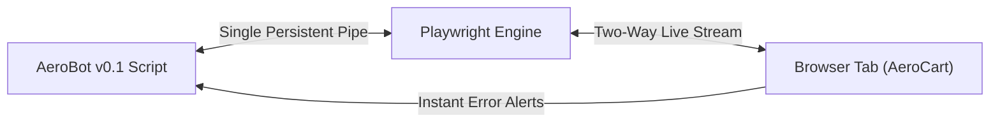

# W3C WebDriver HTTP vs Persistent CDP, Pipes & WebDriver BiDi

```json continuity
{
  "previously": "Welcome to Day 1 of Course 03! Zero prior UI automation background needed. Throughout this 10-chapter course, we will build AeroBot from a 4-line browser click into a zero-flake, sharded Playwright test platform for AeroCart.",
  "painPoint": "When teams try to automate a modern React checkout button using classic request-response tools, the button re-renders mid-click and crashes with StaleElementReferenceException.",
  "unlock": "We will build AeroBot v0.1 over a persistent two-way browser pipe that resolves and clicks elements inside a single atomic browser frame."
}
```

```json walkthrough
[
  {
    "time": "0:00",
    "badge": "🌱 The Walkie-Talkie Problem",
    "caption": "Imagine directing a robot chef across a restaurant by mailing paper letters through a courier. Every time you ask 'Is the pan hot?' and wait for a reply, the kitchen state has already changed. That is classic HTTP WebDriver.",
    "code": "Client --[HTTP POST /element]--> chromedriver --[CDP]--> Chrome"
  },
  {
    "time": "0:25",
    "badge": "🔨 AeroBot v0.1: Direct Open Phone Line",
    "caption": "Playwright throws away the middleman courier and opens a single persistent two-way pipe directly into the browser engine. One command tells the browser to find, wait, and click all by itself.",
    "code": "page.get_by_role('button', name='Pay Now').click()  # 1 atomic RPC!"
  },
  {
    "time": "0:50",
    "badge": "⚡ Why Two Round-Trips Break in React",
    "caption": "If step one grabs a memory ID for a button and step two clicks that ID 20 milliseconds later, a React state update in between replaces the button node and crashes your test.",
    "code": "findElement() -> [React re-renders DOM node] -> click(old_uuid) -> STALE!"
  },
  {
    "time": "1:15",
    "badge": "🚀 Staff Full-Duplex Telemetry",
    "caption": "Because our pipe is two-way, the browser immediately pushes console errors and uncaught crashes to AeroBot in real time without polling.",
    "code": "page.on('pageerror', lambda err: errors.append(str(err)))"
  }
]
```

```json pretraining
[
  {
    "term": "Classic WebDriver Double-Hop",
    "formula": "Test -> HTTP Request -> Driver Binary -> Browser Engine",
    "meaning": "Instead of talking directly to the browser, classic Selenium sends a separate web request to a helper program (like chromedriver) for every single check and click."
  },
  {
    "term": "Persistent Full-Duplex Pipe",
    "formula": "1 Open Connection <-> Unlimited Two-Way Messages",
    "meaning": "Like a live phone call instead of text messages, Playwright keeps one direct pipe open to the browser so both sides can talk and listen at the exact same time."
  },
  {
    "term": "Server-Push Event Stream",
    "formula": "Browser -> Instant Notification -> Test Script",
    "meaning": "The moment a JavaScript error or network request happens inside the tab, the browser pushes that alert straight to your test without your test having to ask."
  },
  {
    "term": "Lazy Locator Recipe",
    "formula": "Store 'How to Find' -> Resolve Live Inside Browser on Action",
    "meaning": "Instead of saving a fragile memory address of a button that might get redrawn, Playwright saves the search instructions and finds the fresh button right when clicking."
  }
]
```

## 🌱 Step 1: Plain-English Story — Mailing Letters vs an Open Phone Line

Imagine trying to guide a friend through buying a concert ticket on their phone, but you are only allowed to communicate by mailing paper postcards back and forth:
1. You mail Card #1: *"Do you see the blue 'Pay Now' button?"*
2. Your friend mails back: *"Yes, it is item #42 on my screen."*
3. You mail Card #2: *"Great, tap item #42!"*

By the time Card #2 arrives, the website just finished loading a discount badge and redrew the button as item #99. Your friend taps where #42 used to be, hits nothing, and panics.

For over a decade, classic UI automation (`W3C WebDriver`) worked just like those postcards. Every step (`findElement`, `isDisplayed`, `click`) sent a separate HTTP request to a middleman program (`chromedriver`), which translated it for Chrome and sent a reply back.

**Playwright** (and the modern **W3C WebDriver BiDi** standard) replaces postcards with a **single open phone line** (`stdio` pipe or WebSocket) wired directly into Chromium, Firefox, and WebKit. Instead of asking for an item number and mailing a second command to click it, our test bot—**`AeroBot`**—sends one instruction over the open pipe: *"When the 'Pay Now' button is ready, click it."*



---

## 🔨 Step 2: First Lines of Code — AeroBot v0.1 First Atomic Click

Let's write the very first version of **`AeroBot` (`v0.1`)**. Notice how creating a `Locator` sends **zero** network messages; only calling `.click()` sends a single instruction over the pipe, while `.on("pageerror", ...)` listens for any silent JavaScript crashes pushed back by the browser.

```python
# aerobot_v01.py — AeroBot v0.1: Persistent pipe + real-time error listener
from playwright.sync_api import Page, expect

def test_aerocart_instant_checkout(page: Page) -> None:
    js_crashes: list[str] = []
    page.on("pageerror", lambda err: js_crashes.append(str(err)))

    page.goto("http://127.0.0.1:8090")
    # Lazy recipe: zero wire traffic until .click() runs inside the browser!
    pay_btn = page.get_by_role("button", name="Pay Now")
    pay_btn.click()

    expect(page.get_by_text("Booking Confirmed")).to_be_visible()
    assert not js_crashes, f"Browser pushed JS crashes: {js_crashes}"
```

### Java 17 Equivalent

```java
// AeroBotV01.java — AeroBot v0.1: Persistent pipe + real-time error listener
import com.microsoft.playwright.*;
import com.microsoft.playwright.options.AriaRole;
import java.util.ArrayList;
import java.util.List;
import static com.microsoft.playwright.assertions.PlaywrightAssertions.assertThat;

public class AeroBotV01 {
    public static void verifyInstantCheckout(Page page) {
        List<String> jsCrashes = new ArrayList<>();
        page.onPageError(err -> jsCrashes.add(err));

        page.navigate("http://127.0.0.1:8090");
        Locator payBtn = page.getByRole(AriaRole.BUTTON, new Page.GetByRoleOptions().setName("Pay Now"));
        payBtn.click(); // Resolved + checked + clicked in 1 browser-side loop

        assertThat(page.getByText("Booking Confirmed")).isVisible();
        if (!jsCrashes.isEmpty()) throw new AssertionError("JS crashes: " + jsCrashes);
    }
}
```

---

## ⚡ Step 3: Where It Breaks in Real Life — The Stale Element Race Window

Why did classic UI tests fail randomly on fast single-page apps (`React`, `Vue`, `Next.js`)? Because splitting **"find the element"** and **"click the element"** across two network round-trips creates a race window right in the middle:

1. Command 1 (`POST /element`) finds `<button class="pay">` and returns an internal browser memory handle (`element-6066-uuid`).
2. **5 milliseconds later**, AeroCart's React state updates the cart tax and replaces that `<button>` DOM node with a brand-new `<button>` node.
3. Command 2 (`POST /element/{uuid}/click`) arrives asking to click the old UUID—and crashes with `StaleElementReferenceException`!

Even worse, if an engineer migrating to Playwright accidentally uses the legacy `page.query_selector("button.pay")` (`ElementHandle`) instead of `page.get_by_role(...)` (`Locator`), they **re-create the exact same stale-handle bug** inside Playwright!

```json contrast
{
  "title": "Classic Multi-Hop Handle vs AeroBot Persistent Pipe + Lazy Locator",
  "naiveTitle": "Multi-Hop HTTP / Eager ElementHandle",
  "naiveMetric": "4–6 Round-Trips · Stale UUID Crashes",
  "naivePoints": [
    "Requires external middleman driver binary matching exact browser version",
    "Caches an eager DOM node memory UUID that dies if React re-renders 5ms before click()",
    "Cannot hear console.error or network 500s without polling or external proxies"
  ],
  "staffTitle": "AeroBot Persistent Pipe + Lazy Locator",
  "staffMetric": "1 Atomic RPC · 0 Stale Node Races",
  "staffPoints": [
    "Speaks directly over OS stdio pipes or WebSockets with pinned browser engines",
    "Sends a stateless selector recipe; re-resolves the live DOM node inside the browser on every frame",
    "Streams real-time pageerror, console, and network events over the same full-duplex pipe"
  ]
}
```

```json poe
{
  "question": "In classic Selenium WebDriver, a test executes two consecutive lines:\n`WebElement btn = driver.findElement(By.cssSelector(\"button.pay\"));`\n`btn.click();`\nBetween line 1 (`POST /session/{id}/element` -> returns `element-6066-uuid`) and line 2 (`POST /session/{id}/element/{uuid}/click`), React completes a state update that unmounts and re-renders `<button class=\"pay\">`. Why does WebDriver throw `StaleElementReferenceException` while Playwright's `page.get_by_role('button', name='Pay').click()` succeeds deterministically?",
  "options": [
    "Playwright catches `StaleElementReferenceException` and refreshes the entire browser tab",
    "WebDriver splits resolution and interaction across two separate HTTP round-trips tied to a cached DOM node UUID (`element-6066`), whereas Playwright's `Locator` is a stateless query recipe sent in a **single RPC** (`click`) that re-resolves the live DOM node inside the browser engine on every animation frame until actionable",
    "Playwright disables React virtual DOM re-rendering via CDP",
    "Chromium caches deleted DOM nodes in memory for 10 seconds when CDP is attached"
  ],
  "answerIndex": 1,
  "explanation": "A WebDriver `WebElement` is an eager handle pointing to a specific in-memory C++ `Node` in Blink's node map; if React replaces that node during the 15ms HTTP gap before `/click` arrives, the UUID is dead. Playwright's `Locator` never caches a stale node UUID across wire hops—the browser/server resolves the selector fresh inside the atomic actionability loop."
}
```

---

## 🚀 Step 4: Staff Engineer Deep-Dive — Wire Latency Math & Telemetry Harness

### 1. Wire-Protocol Latency Amplification Over Remote Grids

When running against remote cloud browsers with network round-trip time $\text{RTT}_{\text{WAN}}$ (typically $60\text{--}100\text{ ms}$), total protocol overhead for a test with $N$ actions and $K$ polling round-trips per action is:

$$T_{\text{wire}} = N \times K \times \text{RTT}_{\text{WAN}}$$

In classic HTTP WebDriver ($K \approx 4$ round-trips per action: `findElement`, `isDisplayed`, `isEnabled`, `click`), a $50$-step test over an $80\text{ ms}$ link burns $50 \times 4 \times 80\text{ ms} = 16.0\text{ seconds}$ of pure network wait time, widening the React re-render race window to $\Delta t_{\text{race}} \ge \text{RTT}_{\text{WAN}}$ on every click. By co-locating the actionability loop inside the browser process ($K = 1$ RPC), Playwright collapses wire overhead by $4\times$ and shrinks $\Delta t_{\text{race}} \to 0$ (evaluated synchronously inside a single `requestAnimationFrame` tick).

| Protocol Capability | W3C WebDriver Classic (HTTP) | W3C WebDriver BiDi (Selenium 4.x+) | Playwright Native (CDP + Patched Engines) |
| :--- | :--- | :--- | :--- |
| **Transport Layer** | Stateless HTTP/1.1 per command | Persistent WebSocket (`ws://`) | OS `stdio` Pipe (local) / Persistent WebSocket (remote) |
| **Server-Push Events** | None (client polls `ExpectedConditions`) | Standardized (`log.entryAdded`, `network.*`) | Full (`page.on('console')`, `page.route()`, `pageerror`) |
| **Element Handle Model** | Eager `WebElement` UUID (stale-prone) | Eager or BiDi `SharedReference` | Lazy stateless `Locator` re-evaluated per action |
| **Cross-Browser Coverage** | Chromium, Firefox, Safari (macOS-only) | Chromium, Firefox (maturing WebKit) | Chromium, Firefox, and **WebKit on Linux/macOS/Windows** |

### 2. Production Dual-Language Blueprint: Full-Duplex Telemetry Guard

```python
from __future__ import annotations
from dataclasses import dataclass, field
from typing import Generator, List
import pytest
from playwright.sync_api import BrowserContext, ConsoleMessage, Page

@dataclass
class AeroBotTelemetryGuard:
    """Captures server-pushed JS exceptions & console errors over the persistent pipe."""
    uncaught_page_errors: List[str] = field(default_factory=list)
    severe_console_errors: List[str] = field(default_factory=list)

    def attach(self, page: Page) -> None:
        page.on("pageerror", lambda exc: self.uncaught_page_errors.append(str(exc)))
        page.on("console", self._on_console)

    def _on_console(self, msg: ConsoleMessage) -> None:
        if msg.type == "error" and "favicon.ico" not in msg.text:
            self.severe_console_errors.append(msg.text)

    def assert_clean(self) -> None:
        assert not self.uncaught_page_errors, f"Uncaught JS errors: {self.uncaught_page_errors}"
        assert not self.severe_console_errors, f"Console.error logs: {self.severe_console_errors}"

@pytest.fixture(scope="function")
def monitored_page(context: BrowserContext) -> Generator[Page, None, None]:
    page = context.new_page()
    guard = AeroBotTelemetryGuard()
    guard.attach(page)
    yield page
    guard.assert_clean()

def emulate_cpu_slowdown_if_chromium(context: BrowserContext, page: Page, browser_name: str) -> None:
    """Guard raw Chromium CDP sessions so Firefox and WebKit matrices never crash."""
    if browser_name == "chromium":
        cdp = context.new_cdp_session(page)
        cdp.send("Emulation.setCPUThrottlingRate", {"rate": 4})
```

```java
package com.aerocart.qa.playwright;

import com.microsoft.playwright.*;
import com.microsoft.playwright.options.AriaRole;
import java.util.List;
import java.util.concurrent.CopyOnWriteArrayList;

public final class BidirectionalPageHarness implements AutoCloseable {
    private final BrowserContext context;
    private final Page page;
    private final List<String> uncaughtErrors = new CopyOnWriteArrayList<>();

    public BidirectionalPageHarness(Browser sharedBrowser) {
        this.context = sharedBrowser.newContext();
        this.page = context.newPage();
        this.page.onPageError(err -> uncaughtErrors.add(err));
        this.page.onConsoleMessage(msg -> {
            if ("error".equals(msg.type()) && !msg.text().contains("favicon.ico")) {
                uncaughtErrors.add("console.error: " + msg.text());
            }
        });
    }

    public Page page() { return page; }

    public void checkoutResiliently() {
        Locator payButton = page.getByRole(AriaRole.BUTTON, new Page.GetByRoleOptions().setName("Pay Now"));
        payButton.click();
    }

    @Override
    public void close() {
        try {
            if (!uncaughtErrors.isEmpty()) {
                throw new AssertionError("Uncaught browser runtime errors: " + uncaughtErrors);
            }
        } finally {
            context.close();
        }
    }
}
```

> [!WARNING]
> **Staff Interview Gotcha — Using Deprecated `ElementHandle` (`page.query_selector`) Instead of `Locator`**:
> Engineers migrating from Selenium often write `btn = page.query_selector("button.pay"); btn.click()` in Playwright. That **re-introduces Selenium's exact staleness bug** because `query_selector` returns an eager point-in-time DOM handle! Always use `page.locator(...)` / `page.get_by_role(...)` (`Locator`), and remember that `context.new_cdp_session(page)` is **Chromium-only**—always guard raw CDP calls behind `browser_name == "chromium"` so Firefox and WebKit CI matrices stay green.

**Up Next in Chapter 2**: Now that **`AeroBot v0.1`** talks to the browser over a fast pipe, what happens when we run **500 tests in a row**? Launching a fresh Chrome OS process for every test burns 10 minutes of CPU boot time! In **Chapter 2**, we will upgrade **`AeroBot` to `v0.2`** using **Incognito `BrowserContext` Memory Partitioning** to isolate tests in `12ms` instead of `1,200ms`.

```json quiz
[
  {
    "id": "pw-01-q1",
    "question": "Why does calling `handle = page.query_selector('#submit'); handle.click()` in Playwright defeat Playwright's architectural protection against stale DOM elements?",
    "options": [
      "`query_selector` uses HTTP/1.0 instead of pipes",
      "`query_selector` eagerly resolves and binds a specific DOM `ElementHandle` at call time; if the SPA replaces `#submit` in the DOM before `handle.click()` executes, the handle points to a detached node, whereas a `Locator` (`page.locator('#submit').click()`) re-evaluates the query dynamically until actionable",
      "`query_selector` only works inside `<iframe>` elements",
      "`ElementHandle` disables JavaScript in the page"
    ],
    "answerIndex": 1,
    "explanation": "`ElementHandle` points to a fixed in-memory DOM object; `Locator` captures *how to find* the element on every action or assertion attempt, making SPA re-renders completely transparent."
  },
  {
    "id": "pw-01-q2",
    "question": "A test runs against a remote cloud browser (`85ms` network RTT between CI runner and browser container). Why is classic W3C WebDriver disproportionately slower and flakier over high-RTT links than Playwright's RPC model?",
    "options": [
      "WebDriver encrypts JSON twice with RSA-4096",
      "Classic WebDriver issues chatty client-side polling loops (`findElement` -> `isDisplayed` -> `isEnabled` -> `click`), paying the `85ms` WAN penalty on every step, whereas Playwright sends one high-level `click` intent and executes the entire `requestAnimationFrame` actionability loop locally inside the remote browser container",
      "TCP Nagle's algorithm blocks WebSockets",
      "Playwright compresses HTML pages before rendering"
    ],
    "answerIndex": 1,
    "explanation": "Co-locating the auto-wait + actionability loop inside the browser side of the protocol collapses $K$ client-polled round-trips into a single high-level RPC, eliminating WAN RTT amplification."
  },
  {
    "id": "pw-01-q3",
    "question": "Your cross-browser suite runs on `chromium`, `firefox`, and `webkit` in Linux Docker containers. An engineer adds `context.new_cdp_session(page)` unconditionally in a global `autouse` fixture. What happens in CI?",
    "options": [
      "All three browsers execute the CDP command identically",
      "`chromium` passes, while `firefox` and `webkit` immediately fail because raw Chrome DevTools Protocol (`new_cdp_session`) is strictly a Chromium/Blink engine API—cross-browser hooks must use Playwright's unified APIs (`page.route`, `page.on`, `clock`) or guard `if browser_type.name == 'chromium':`",
      "WebKit converts CDP into AppleScript automatically on Linux",
      "Docker ignores `new_cdp_session` in headless mode"
    ],
    "answerIndex": 1,
    "explanation": "Playwright's unified `Page`/`BrowserContext` API abstracts Chromium CDP, Firefox Juggler/BiDi, and WebKit inspection protocols. Dropping down to `new_cdp_session` couples directly to Blink/V8 internals and must be guarded by browser engine name."
  }
]
```
