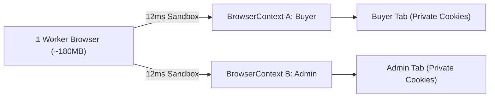

# Browser OS Processes vs BrowserContext Incognito Sandboxes

```json continuity
{
  "previously": "In Chapter 1, we built AeroBot v0.1 using a persistent two-way browser pipe that finds and clicks elements in a single atomic browser loop.",
  "painPoint": "When we run 500 AeroBot v0.1 tests in a row, launching a brand-new Chrome process for every test wastes 8+ minutes of CPU boot time—while reusing a single browser leaks login cookies and cart items between tests!",
  "unlock": "We will upgrade AeroBot to v0.2 by booting one Browser process per worker and isolating every test inside a 12ms, 4MB incognito BrowserContext sandbox."
}
```

```json walkthrough
[
  {
    "time": "0:00",
    "badge": "🌱 The Hotel Building vs Room Keycards",
    "caption": "Demolishing and rebuilding an entire hotel building between every guest takes months. Handing each new guest a fresh, wiped room inside the same building takes 12 milliseconds. That is Browser vs BrowserContext.",
    "code": "1 Worker Browser (~180MB) -> 500 Fresh BrowserContexts (~12ms, ~4MB each)"
  },
  {
    "time": "0:25",
    "badge": "🔨 AeroBot v0.2: Instant Incognito Sandboxes",
    "caption": "Instead of calling chromium.launch() in every test, AeroBot v0.2 calls browser.new_context(). Each context gets its own private cookie jar, localStorage, and timezone.",
    "code": "ctx = browser.new_context(locale='en-US', timezone_id='UTC')"
  },
  {
    "time": "0:50",
    "badge": "⚡ Why Two Tabs in One Context Collide",
    "caption": "If you test Alice and Bob trading a flight ticket by opening two Page tabs inside the same BrowserContext, Bob's login overwrites Alice's session cookie! Multi-user tests need two BrowserContexts.",
    "code": "alice_ctx = browser.new_context(); bob_ctx = browser.new_context()"
  },
  {
    "time": "1:15",
    "badge": "🚀 Staff Resource Math & JVM Thread Safety",
    "caption": "Scoping Browser to the worker session and BrowserContext to each test cuts startup overhead by 70x while guaranteeing zero IndexedDB or Service Worker leaks.",
    "code": "stack.callback(ctx.close)  # LIFO teardown in < 5ms"
  }
]
```

```json pretraining
[
  {
    "term": "Heavy Browser OS Process",
    "formula": "chromium.launch() -> ~850ms Cold Boot | ~180MB RAM",
    "meaning": "Starting the main browser program boots the graphics engine, JavaScript compiler, and network stack—expensive if you do it before every single test."
  },
  {
    "term": "Lightweight BrowserContext Sandbox",
    "formula": "browser.new_context() -> ~12ms Creation | ~4MB RAM",
    "meaning": "Like opening a brand-new Incognito window inside an already-running browser: completely private cookies and storage, created in a blink."
  },
  {
    "term": "Page (Tab / Popup Window)",
    "formula": "context.new_page() -> Shares Context Cookie Jar",
    "meaning": "A single browser tab inside a BrowserContext. Two tabs in the same context share login cookies (great for OAuth popups), while two different contexts share nothing."
  },
  {
    "term": "Multi-Persona Context Isolation",
    "formula": "Buyer Context != Admin Context -> 2 Users in 1 Browser",
    "meaning": "To test two users interacting live (like a buyer and a fraud admin), create two BrowserContexts inside one Browser process for total cookie separation."
  }
]
```

## 🌱 Step 1: Plain-English Story — The Hotel Building vs Fresh Room Keycards

Imagine managing a hotel where every time a guest checks out, you **dynamically demolish the entire concrete building** and construct a brand-new hotel from scratch for the next guest. Sure, the next guest gets clean sheets—but they have to wait six months on the sidewalk before checking in!

On the other hand, what if you never cleaned the room at all and just let Guest #2 sleep in Guest #1's unmade bed? That is fast, but Guest #2 finds Guest #1's leftover luggage and wallet on the nightstand.

In UI automation, teams used to face this exact trap:
- **Rebuilding the hotel per test (`chromium.launch()`)**: 100% clean state, but booting Chrome from cold disk takes nearly **1 full second (`~850ms`)** and `~180MB` of RAM per test. Across 500 tests, you waste over **7 minutes** just watching browser windows boot!
- **Letting guests share a room (`deleteAllCookies()`)**: Fast, but wiping cookies forgets to clear `localStorage`, `IndexedDB`, and cached Service Workers—causing Test #2 to mysteriously log in as Test #1's user!

Playwright solves this with a 3-tier hierarchy:
1. **`Browser` (The Hotel Building)**: Booted **once per worker** (`~850ms`).
2. **`BrowserContext` (A Fresh Incognito Room)**: Created before every test in **`12 milliseconds`** (`~4MB` RAM). It has its own isolated cookies, `localStorage`, timezone, and permissions, and vanishes completely when closed.
3. **`Page` (A Tab Inside That Room)**: Tabs inside the *same* `BrowserContext` share cookies (just like an OAuth login popup), while tabs in *different* `BrowserContext`s cannot see a single byte of each other's data.



---

## 🔨 Step 2: First Lines of Code — AeroBot v0.2 Multi-Persona Sandboxes

Let's upgrade **`AeroBot` to `v0.2`**. Using a single running `Browser`, we spin up two completely isolated incognito `BrowserContext`s in `24ms` total—one for a shopper in Tokyo and one for a flight admin in London—without leaking a single cookie between them.

```python
# aerobot_v02.py — AeroBot v0.2: Two isolated incognito personas in 1 Browser
from playwright.sync_api import Browser, expect

def test_buyer_and_admin_isolated_sessions(browser: Browser) -> None:
    buyer_ctx = browser.new_context(locale="ja-JP", timezone_id="Asia/Tokyo")
    admin_ctx = browser.new_context(locale="en-GB", timezone_id="Europe/London")
    try:
        buyer_page = buyer_ctx.new_page()
        admin_page = admin_ctx.new_page()
        buyer_page.goto("http://127.0.0.1:8090")
        admin_page.goto("http://127.0.0.1:8090")
        assert buyer_ctx.cookies() == [] and admin_ctx.cookies() == []
    finally:
        admin_ctx.close()
        buyer_ctx.close()
```

### Java 17 Equivalent

```java
// AeroBotV02.java — AeroBot v0.2: Two isolated incognito personas in 1 Browser
import com.microsoft.playwright.*;

public class AeroBotV02 {
    public static void verifyIsolatedPersonas(Browser browser) {
        try (BrowserContext buyerCtx = browser.newContext(
                 new Browser.NewContextOptions().setLocale("ja-JP").setTimezoneId("Asia/Tokyo"));
             BrowserContext adminCtx = browser.newContext(
                 new Browser.NewContextOptions().setLocale("en-GB").setTimezoneId("Europe/London"))) {
            Page buyerPage = buyerCtx.newPage();
            Page adminPage = adminCtx.newPage();
            buyerPage.navigate("http://127.0.0.1:8090");
            adminPage.navigate("http://127.0.0.1:8090");
        }
    }
}
```

---

## ⚡ Step 3: Where It Breaks in Real Life — The Two-Tab Cookie Collision

What happens when an engineer wants to test Alice transferring a flight ticket to Bob, and writes this?

```python
# BUG: Both pages are created inside the SAME BrowserContext!
alice_page = context.new_page()
bob_page = context.new_page()
```

When Alice logs in on `alice_page`, AeroCart sets a `session_id=alice` cookie inside `context`. Five lines later, when Bob logs in on `bob_page`, AeroCart overwrites that exact same cookie jar with `session_id=bob`! When the test switches back to `alice_page` and clicks **"Transfer Ticket"**, Alice's tab secretly sends Bob's cookie—and the test explodes!

Remember the golden rule:
- **Multiple `Page`s inside 1 `BrowserContext`** = Multiple tabs in the **same** browser window (shared cookies & `localStorage`, used for `target="_blank"` popups).
- **Multiple `BrowserContext`s inside 1 `Browser`** = Completely separate incognito users (`alice_ctx` vs `bob_ctx`).

```json contrast
{
  "title": "Per-Test Browser Launch or Shared-Context Tabs vs AeroBot v0.2 Per-Test BrowserContext",
  "naiveTitle": "launch() Per Test OR Shared-Context Tabs",
  "naiveMetric": "850ms/Test Boot OR Cookie Overwrites",
  "naivePoints": [
    "Calling chromium.launch() inside every test burns 7+ minutes of OS process boot per 500 tests",
    "Reusing one context with clear_cookies() leaks localStorage JWTs, IndexedDB carts, and Service Workers",
    "Opening two Page tabs in the same context for Alice & Bob overwrites their session cookies"
  ],
  "staffTitle": "AeroBot v0.2 Worker Browser + Context Sandbox",
  "staffMetric": "12ms/Test Isolation · 100% Storage Wipe",
  "staffPoints": [
    "Boots 1 Browser process per worker and creates a fresh BrowserContext per test in ~12ms",
    "Closing a BrowserContext atomically wipes cookies, localStorage, IndexedDB, and permissions",
    "Spawns buyer_ctx + admin_ctx in the same Browser using <8MB extra RAM for multi-actor tests"
  ]
}
```

```json poe
{
  "question": "To test real-time ticket transfer between Alice (`sender`) and Bob (`recipient`), an engineer creates two tabs inside the same `BrowserContext`:\n`alice_page = context.new_page()`\n`bob_page = context.new_page()`\nAlice logs in on `alice_page`, then Bob logs in on `bob_page`. When the test switches back to `alice_page` and clicks `'Transfer Ticket'`, the backend rejects the request because Alice is now authenticated as **Bob**! Why?",
  "options": [
    "Playwright only supports one active `Page` per CPU core",
    "All `Page`s (tabs) created inside the **same `BrowserContext`** share the exact same cookie jar, `localStorage`, and `IndexedDB` origin storage—just like opening two normal tabs in one Chrome window! Bob's login overwrote the shared `session_id` cookie for `alice_page`. Multi-persona tests must create **two separate `BrowserContext`s** (`alice_ctx = browser.new_context()`, `bob_ctx = browser.new_context()`)",
    "Cookies are stored globally on the `Browser` binary across all contexts",
    "HTTP/2 merges headers across distinct incognito profiles"
  ],
  "answerIndex": 1,
  "explanation": "`BrowserContext` is the exact security and storage boundary (analogous to an independent Chrome Incognito profile). Tabs (`Page`s) *within* one `BrowserContext` intentionally share cookies and `localStorage` (needed when testing popups/OAuth redirects), whereas separate `BrowserContext`s are 100% storage-isolated."
}
```

---

## 🚀 Step 4: Staff Engineer Deep-Dive — Amortized Boot Math & Thread-Local Lifecycles

### 1. Worker Process & Storage Partition Mathematics

Let $T_{\text{launch}} \approx 850\text{ ms}$ ($M_{\text{browser}} \approx 180\text{ MB}$ RSS) be the cost of spawning a cold Chromium process tree, and $T_{\text{ctx}} \approx 12\text{ ms}$ ($M_{\text{ctx}} \approx 4\text{ MB}$) be the cost of allocating an in-memory `StoragePartition` via CDP `Target.createBrowserContext`. Across $N$ tests on a single worker:

$$\Delta T_{\text{saved}} = N \cdot T_{\text{launch}} - \left(T_{\text{launch}} + N \cdot T_{\text{ctx}}\right) = (N - 1)\left(T_{\text{launch}} - T_{\text{ctx}}\right)$$

For $N = 500$ tests, a worker-scoped `Browser` + function-scoped `BrowserContext` saves $499 \times (850 - 12)\text{ ms} \approx 418.2\text{ seconds}$ ($6.97\text{ minutes}$) of pure process initialization overhead per worker, while reducing concurrent memory for $P$ actors inside a single test from $P \cdot M_{\text{browser}}$ down to $M_{\text{browser}} + P \cdot M_{\text{ctx}}$.

| Resource / Emulation Property | Owned By Tier | Shared Across `Page` Tabs in Same `BrowserContext`? | Shared Across Different `BrowserContext`s? |
| :--- | :--- | :--- | :--- |
| **OS PID, GPU & Font Engine** | `Browser` | Yes | Yes ($45\times$ RAM savings) |
| **Cookies (`HttpOnly` & Session)** | `BrowserContext` | **Yes** (enables OAuth popups) | **No (100% Isolated)** |
| **`localStorage` & `IndexedDB`** | `BrowserContext` | **Yes** (per origin) | **No (100% Isolated)** |
| **Viewport, Locale, Timezone, Geo** | `BrowserContext` | Yes (default per context) | **No** (`Asia/Tokyo` vs `UTC`) |
| **DOM Tree, JS Heap & URL History** | `Page` | No (each tab has its own document) | No |

### 2. Production Dual-Language Blueprint: LIFO Multi-Persona Context Factory

```python
from __future__ import annotations
from contextlib import ExitStack
from typing import Callable, Generator
import pytest
from playwright.sync_api import Browser, BrowserContext, sync_playwright

@pytest.fixture(scope="session")
def shared_browser() -> Generator[Browser, None, None]:
    """Booted ONCE per parallel worker (~850ms amortized across hundreds of tests)."""
    with sync_playwright() as pw:
        browser = pw.chromium.launch(headless=True)
        try:
            yield browser
        finally:
            browser.close()

@pytest.fixture(scope="function")
def persona_context_factory(
    shared_browser: Browser,
) -> Generator[Callable[..., BrowserContext], None, None]:
    """Allocates 1..K isolated BrowserContexts (~12ms each) and closes them in LIFO order."""
    with ExitStack() as stack:
        def _new_persona(*, locale: str = "en-US", timezone_id: str = "UTC") -> BrowserContext:
            ctx = shared_browser.new_context(
                locale=locale,
                timezone_id=timezone_id,
                viewport={"width": 1440, "height": 900},
            )
            stack.callback(ctx.close)
            return ctx

        yield _new_persona
```

```java
package com.aerocart.qa.isolation;

import com.microsoft.playwright.*;
import org.junit.jupiter.api.*;

@TestInstance(TestInstance.Lifecycle.PER_CLASS)
public abstract class IsolatedPlaywrightTestBase {
    private Playwright playwright;
    protected Browser browser;
    protected BrowserContext context;
    protected Page page;

    @BeforeAll
    void launchWorkerBrowserOnce() {
        playwright = Playwright.create();
        browser = playwright.chromium().launch(new BrowserType.LaunchOptions().setHeadless(true));
    }

    @BeforeEach
    void createHermeticContext() {
        context = browser.newContext(new Browser.NewContextOptions()
                .setViewportSize(1440, 900)
                .setLocale("en-US")
                .setTimezoneId("UTC"));
        page = context.newPage();
    }

    @AfterEach
    void destroyHermeticContext() {
        if (context != null) context.close();
    }

    @AfterAll
    void shutdownWorkerBrowser() {
        if (browser != null) browser.close();
        if (playwright != null) playwright.close();
    }
}
```

> [!WARNING]
> **Staff Interview Gotcha — Sharing Playwright Java Objects Across JVM Threads**:
> Playwright's Java `Playwright`, `Browser`, `BrowserContext`, and `Page` instances are **NOT thread-safe** (`PlaywrightException: Object cannot be accessed from multiple threads`)! In JUnit 5 parallel execution (`concurrent`), never share a single `static Browser` across multiple Java threads—instead store a **per-thread `Playwright` + `Browser` pair inside a `ThreadLocal`** and create a fresh `BrowserContext` on that thread before each `@Test`!

**Up Next in Chapter 3**: Now that **`AeroBot v0.2`** creates isolated contexts in `12ms`, what happens when AeroCart embeds a **Shadow DOM** promo widget, a **cross-origin Stripe `<iframe>`**, and **Next.js SSR Hydration** where buttons appear on screen 400ms *before* React attaches their click listeners? In **Chapter 3**, we upgrade **`AeroBot` to `v0.3`** to conquer Shadow DOM, IFrames, and Hydration Races.

```json quiz
[
  {
    "id": "pw-02-q1",
    "question": "Clicking `'Pay with SSO'` on `checkout_page` opens a popup window (`target='_blank'`) on `auth.corp.com`, sets an `HttpOnly` session cookie on `.corp.com`, and closes itself. Why does `checkout_page` immediately receive that cookie without extra wiring?",
    "options": [
      "Playwright copies all cookies across every `BrowserContext` on the machine",
      "Popup windows opened from `checkout_page` (`context.expect_page()`) live inside the **exact same `BrowserContext`** as the opener `Page`, so they naturally share the context's cookie jar and origin storage while remaining isolated from other concurrent tests",
      "`HttpOnly` cookies are stored in the OS kernel environment variables",
      "SSO popups bypass `BrowserContext` sandboxes"
    ],
    "answerIndex": 1,
    "explanation": "Multiple `Page`s within a single `BrowserContext` share cookies and origin storage just like tabs in one incognito browser window—making multi-tab SSO/OAuth popups seamless while preserving total isolation across parallel tests."
  },
  {
    "id": "pw-02-q2",
    "question": "A 600-test Playwright suite takes 16 minutes because an engineer wrote `with sync_playwright() as p: browser = p.chromium.launch()` inside every single `test_*` function. Switching `browser` to `scope='session'` and `browser.new_context()` to `scope='function'` eliminates approximately how much pure browser-startup overhead per worker?",
    "options": [
      "Zero—`new_context()` forks a full new Chromium process anyway",
      "Roughly `599 * (~850ms - 12ms) ≈ 500 seconds (>8 minutes)` of cold OS process startup per serial worker, plus avoids repeated GPU/V8 initialization spikes",
      "Only 2 milliseconds total",
      "It slows down tests because `context.close()` takes 5 seconds"
    ],
    "answerIndex": 1,
    "explanation": "Amortizing the `~850ms` `chromium.launch()` cost once per worker and paying only `~12ms` per `BrowserContext` yields a ~70x reduction in per-test browser initialization overhead with identical storage isolation."
  },
  {
    "id": "pw-02-q3",
    "question": "In JUnit 5 with `junit.jupiter.execution.parallel.enabled=true` (8 JVM threads in 1 process), what happens if 8 threads simultaneously call `STATIC_BROWSER.newContext()` on a single shared Playwright Java `Browser` instance?",
    "options": [
      "Playwright Java synchronizes all calls via an internal `ReentrantLock`",
      "Playwright Java throws thread-affinity errors or corrupts channel state because Playwright Java API objects (`Playwright`, `Browser`, `BrowserContext`, `Page`) are strictly single-thread-affine—each JVM worker thread must own its own `ThreadLocal` `Playwright` + `Browser` instance",
      "Java converts `BrowserContext` into virtual threads automatically",
      "Only cookies leak; calls succeed"
    ],
    "answerIndex": 1,
    "explanation": "Playwright's official Java documentation explicitly mandates single-thread affinity per `Playwright` connection pipe. In multi-threaded JUnit 5/TestNG suites, initialize one `Playwright` + `Browser` per worker thread (`ThreadLocal`) and reuse it across all `@Test`s scheduled onto that thread."
  }
]
```
