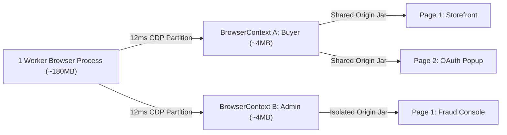

# Browser OS Processes vs BrowserContext Incognito Sandboxes

```json pretraining
[
  {
    "term": "Heavy `Browser` OS Process Tree",
    "formula": "chromium.launch() -> ~850ms Cold Boot | ~180–260MB RSS (Browser + GPU + Net)",
    "meaning": "Spawning a brand-new OS browser binary initializes V8 isolates, GPU compositors, font caches, and network services—expensive if repeated per test."
  },
  {
    "term": "Lightweight `BrowserContext` Sandbox",
    "formula": "browser.new_context() -> ~8–15ms | ~3–5MB Incremental Heap",
    "meaning": "An isolated incognito profile inside an already-running Browser: zero shared cookies, localStorage, sessionStorage, IndexedDB, cache, or permissions."
  },
  {
    "term": "Suite Latency & RAM Math",
    "formula": "500 Tests * 850ms = 425s Boot Overhead vs 1 Browser + 500 * 12ms = 6.85s",
    "meaning": "Lifecycle scoping (`Browser` = worker-session, `BrowserContext` = per-test function) saves >7 minutes of pure process-spawn overhead on a 500-test shard."
  },
  {
    "term": "Multi-Context Single-Test Topology",
    "formula": "ctx_buyer != ctx_seller -> 2 Independent Sessions in 1 Process (<10MB)",
    "meaning": "Testing live chat, auction bidding, or RBAC approval between two concurrent users requires two `BrowserContext`s, NOT two `Page` tabs in the same context!"
  }
]
```

```json poe
{
  "question": "To test real-time ticket transfer between Alice (`sender`) and Bob (`recipient`), an engineer creates two tabs inside the same `BrowserContext`:\n`alice_page = context.new_page()`\n`bob_page = context.new_page()`\nAlice logs in on `alice_page`, then Bob logs in on `bob_page`. When the test switches back to `alice_page` and clicks `'Transfer Ticket'`, the backend rejects the request because Alice is now authenticated as **Bob**! Why?",
  "options": [
    "Playwright only supports one active `Page` per CPU core",
    "All `Page`s (tabs) created inside the **same `BrowserContext`** share the exact same cookie jar, `localStorage`, and `IndexedDB` origin storage—just like opening two normal tabs in one Chrome window! Bob's login overwrote the shared `session_id` cookie for `alice_page`. Multi-persona tests must create **two separate `BrowserContext`s** (`alice_ctx = browser.new_context()`, `bob_ctx = browser.new_context()`)",
    "Cookies are stored globally on the `Browser` binary across all contexts",
    "HTTP/2 merges headers across distinct incognito profiles"
  ],
  "answerIndex": 1,
  "explanation": "`BrowserContext` is the exact security and storage boundary (analogous to an independent Chrome Incognito profile). Tabs (`Page`s) *within* one `BrowserContext` intentionally share cookies and `localStorage` (needed when testing popups/OAuth redirects), whereas separate `BrowserContext`s are 100% storage-isolated."
}
```

## Part I — First-Principles Mental Model: The Three-Tier Browser Hierarchy

In legacy Selenium suites, achieving clean state isolation between Test #1 and Test #2 forced an agonizing choice:
1. **Call `driver.quit()` and spawn a fresh browser binary per test**: 100% clean state, but `850ms–1,400ms` process startup penalty on every single test (`1,000 tests = 20 minutes` spent purely waiting for Chrome windows to boot!).
2. **Reuse one browser and manually call `driver.manage().deleteAllCookies()`**: Fast, but **fundamentally leaky**—`deleteAllCookies()` leaves behind `localStorage`, `sessionStorage`, `IndexedDB`, Service Workers, HTTP disk cache, geolocation grants, and in-flight `fetch` keep-alive state, triggering Heisenbugs across test ordering!

Playwright solves this at the **browser engine storage-partition layer** via a strict 3-tier object hierarchy:
- **Tier 1 — `Browser` (Worker/Session Scope)**: The heavy OS process tree (`Browser Main` + `GPU` + `Network Service`). Launched **once per parallel worker** (`~850ms`, `~180MB` RSS). Holds **zero** user cookies or origin state.
- **Tier 2 — `BrowserContext` (Test Function Scope)**: Created via `browser.new_context()` (`~12ms`, `~4MB` RAM) via a single CDP `Target.createBrowserContext` frame. Allocates a brand-new, hermetically isolated in-memory `StoragePartition` (cookies, `localStorage`, `IndexedDB`, Service Workers, TLS client certs, viewport, timezone, locale). Destroyed in `<5ms` via `context.close()` at test teardown!
- **Tier 3 — `Page` (Tab / Popup Window inside a Context)**: Created via `context.new_page()`. Multiple `Page`s inside the **same** `BrowserContext` share cookies/storage (ideal for `target="_blank"` SSO popups), while `Page`s in **different** `BrowserContext`s cannot see a single byte of each other's state.



```json contrast
{
  "title": "Per-Test `chromium.launch()` or Shared-Context Cookie Clearing vs Per-Test `BrowserContext`",
  "naiveTitle": "`launch()` Per Test OR `clearCookies()`",
  "naiveMetric": "850ms/Test Boot OR IndexedDB State Leaks",
  "naivePoints": [
    "Calling `playwright.chromium.launch()` inside every test function burns 14+ minutes of OS process fork/boot per 1,000 tests",
    "Reusing one context with `clear_cookies()` leaks `localStorage` JWTs, Service Workers, and `IndexedDB` offline carts",
    "Launching 2 full Chrome binaries per worker for two-actor chat tests doubles CI container RAM and triggers Linux OOMKills"
  ],
  "staffTitle": "Session `Browser` + Function `BrowserContext`",
  "staffMetric": "12ms/Test Isolation · 100% Storage Wipe",
  "staffPoints": [
    "Boots `Browser` once per worker process and creates/destroys a fresh `BrowserContext` per test in ~12ms",
    "Destroying `BrowserContext` atomically frees cookies, `localStorage`, `IndexedDB`, Service Workers, and permissions",
    "Spawns `buyer_ctx` + `admin_ctx` inside the same `Browser` process using <8MB extra RAM for multi-actor tests"
  ]
}
```

---

## Part II — Storage & Configuration Boundary Matrix

Step through the **`arch-playwright-vs-selenium`** visualizer to compare memory allocation curves and state isolation boundaries across `Browser`, `BrowserContext`, and `Page`.

| Resource / Emulation Property | Owned By Tier | Shared Across Tabs in Same `BrowserContext`? | Shared Across Different `BrowserContext`s? |
| :--- | :--- | :--- | :--- |
| **OS PID, GPU & Font Engine** | `Browser` | Yes | Yes (huge RAM & startup savings!) |
| **Cookies (`HttpOnly` & Session)** | `BrowserContext` | **Yes** | **No (100% Isolated)** |
| **`localStorage` & `IndexedDB`** | `BrowserContext` | **Yes** (per origin) | **No (100% Isolated)** |
| **Viewport, Locale, Timezone, Geo** | `BrowserContext` | Yes (default per context) | **No** (`ctx_jp` in `Asia/Tokyo`, `ctx_us` in `UTC`) |
| **DOM Tree, JS Heap & URL History** | `Page` | No (each tab has its own document) | No |

---

## Part III — Production Implementation Blueprints (Python 3 & Java 17)

### Python 3 Blueprint: Worker-Scoped `Browser` + Function-Scoped Multi-Persona `BrowserContext` Factory
```python
from __future__ import annotations
from contextlib import ExitStack
from typing import Callable, Generator
import pytest
from playwright.sync_api import Browser, BrowserContext, Playwright, sync_playwright


@pytest.fixture(scope="session")
def shared_browser() -> Generator[Browser, None, None]:
    """Launched ONCE per parallel xdist worker (~850ms amortized across hundreds of tests)."""
    with sync_playwright() as pw:
        browser = pw.chromium.launch(headless=True)
        try:
            yield browser
        finally:
            browser.close()


@pytest.fixture(scope="function")
def persona_context_factory(
    shared_browser: Browser,
) -> Generator[Callable[..., BrowserContext], None, None]:
    """
    Creates 1..K hermetically isolated BrowserContexts (~12ms, ~4MB each) inside one test
    and tears them all down in strict LIFO order via ExitStack.
    """
    with ExitStack() as stack:
        def _new_persona(*, locale: str = "en-US", timezone_id: str = "UTC") -> BrowserContext:
            ctx = shared_browser.new_context(
                locale=locale,
                timezone_id=timezone_id,
                viewport={"width": 1440, "height": 900},
            )
            stack.callback(ctx.close)
            return ctx

        yield _new_persona


def test_live_seat_lock_between_two_isolated_buyers(
    persona_context_factory: Callable[..., BrowserContext],
) -> None:
    tokyo_buyer = persona_context_factory(locale="ja-JP", timezone_id="Asia/Tokyo").new_page()
    london_buyer = persona_context_factory(locale="en-GB", timezone_id="Europe/London").new_page()
    # Both pages share 1 Chromium binary (~188MB total) with ZERO shared cookies or localStorage!
    assert tokyo_buyer.context is not london_buyer.context
```

### Java 17 Blueprint: Thread-Safe JUnit 5 Per-Worker `Browser` & Per-Test `BrowserContext`
```java
package com.aerocart.qa.isolation;

import com.microsoft.playwright.*;
import org.junit.jupiter.api.*;

@TestInstance(TestInstance.Lifecycle.PER_CLASS)
public abstract class IsolatedPlaywrightTestBase {

    private Playwright playwright;
    protected Browser browser;
    protected BrowserContext context;
    protected Page page;

    @BeforeAll
    void launchWorkerBrowserOnce() {
        // 1 Browser OS process per test class / worker lifecycle
        playwright = Playwright.create();
        browser = playwright.chromium().launch(new BrowserType.LaunchOptions().setHeadless(true));
    }

    @BeforeEach
    void createHermeticContext() {
        // ~12ms incognito StoragePartition per @Test method
        context = browser.newContext(new Browser.NewContextOptions()
                .setViewportSize(1440, 900)
                .setLocale("en-US")
                .setTimezoneId("UTC"));
        page = context.newPage();
    }

    @AfterEach
    void destroyHermeticContext() {
        if (context != null) context.close(); // Instantly wipes cookies, localStorage, IndexedDB, SW
    }

    @AfterAll
    void shutdownWorkerBrowser() {
        if (browser != null) browser.close();
        if (playwright != null) playwright.close();
    }
}
```

> [!WARNING]
> **Staff Interview Gotcha — Sharing Playwright Java Objects Across JVM Threads**:
> Playwright's Java `Playwright`, `Browser`, `BrowserContext`, and `Page` instances are **NOT thread-safe** (`PlaywrightException: Object cannot be accessed from multiple threads`)! In JUnit 5 parallel mode (`concurrent`), never share a single `static Browser` across multiple Java threads—instead store a **per-thread `Playwright` + `Browser` pair inside a `ThreadLocal`** (closed when the worker thread exits via `LauncherSessionListener`), and create a fresh `BrowserContext` on that thread before each `@Test`!

---

## Part IV — Scenario Retrieval-Practice Mastery Gate

```json quiz
[
  {
    "id": "pw-02-q1",
    "question": "Clicking `'Pay with SSO'` on `checkout_page` opens a popup window (`target='_blank'`) on `auth.corp.com`, sets an `HttpOnly` session cookie on `.corp.com`, and closes itself. Why does `checkout_page` immediately receive that cookie without extra wiring?",
    "options": [
      "Playwright copies all cookies across every `BrowserContext` on the machine",
      "Popup windows opened from `checkout_page` (`context.expect_page()`) live inside the **exact same `BrowserContext`** as the opener `Page`, so they naturally share the context's cookie jar and origin storage while remaining isolated from other concurrent tests",
      "`HttpOnly` cookies are stored in the OS kernel environment variables",
      "SSO popups bypass `BrowserContext` sandboxes"
    ],
    "answerIndex": 1,
    "explanation": "Multiple `Page`s within a single `BrowserContext` share cookies and origin storage just like tabs in one incognito browser window—making multi-tab SSO/OAuth popups seamless while preserving total isolation across parallel tests."
  },
  {
    "id": "pw-02-q2",
    "question": "A 600-test Playwright suite takes 16 minutes because an engineer wrote `with sync_playwright() as p: browser = p.chromium.launch()` inside every single `test_*` function. Switching `browser` to `scope='session'` and `browser.new_context()` to `scope='function'` eliminates approximately how much pure browser-startup overhead per worker?",
    "options": [
      "Zero—`new_context()` forks a full new Chromium process anyway",
      "Roughly `599 * (~850ms - 12ms) ≈ 500 seconds (>8 minutes)` of cold OS process startup per serial worker, plus avoids repeated GPU/V8 initialization spikes",
      "Only 2 milliseconds total",
      "It slows down tests because `context.close()` takes 5 seconds"
    ],
    "answerIndex": 1,
    "explanation": "Amortizing the `~850ms` `chromium.launch()` cost once per worker and paying only `~12ms` per `BrowserContext` yields a ~70x reduction in per-test browser initialization overhead with identical storage isolation."
  },
  {
    "id": "pw-02-q3",
    "question": "In JUnit 5 with `junit.jupiter.execution.parallel.enabled=true` (8 JVM threads in 1 process), what happens if 8 threads simultaneously call `STATIC_BROWSER.newContext()` on a single shared Playwright Java `Browser` instance?",
    "options": [
      "Playwright Java synchronizes all calls via an internal `ReentrantLock`",
      "Playwright Java throws thread-affinity errors or corrupts channel state because Playwright Java API objects (`Playwright`, `Browser`, `BrowserContext`, `Page`) are strictly single-thread-affine—each JVM worker thread must own its own `ThreadLocal` `Playwright` + `Browser` instance",
      "Java converts `BrowserContext` into virtual threads automatically",
      "Only cookies leak; calls succeed"
    ],
    "answerIndex": 1,
    "explanation": "Playwright's official Java documentation explicitly mandates single-thread affinity per `Playwright` connection pipe. In multi-threaded JUnit 5/TestNG suites, initialize one `Playwright` + `Browser` per worker thread (`ThreadLocal`) and reuse it across all `@Test`s scheduled onto that thread."
  }
]
```
