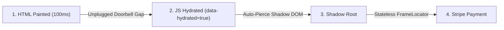

# Critical Rendering Path, Shadow DOM, Iframes & SSR Hydration Races

```json continuity
{
  "previously": "In Chapter 2, we upgraded AeroBot to v0.2 with 12ms incognito BrowserContext sandboxes so 500 tests run with zero cookie or localStorage leaks.",
  "painPoint": "When AeroCart adds a Shadow DOM address widget, a cross-origin Stripe payment iframe, and Next.js Server-Side Rendering (SSR), AeroBot v0.2 clicks buttons before React attaches event listeners and fails to reach inside the payment iframe!",
  "unlock": "We will upgrade AeroBot to v0.3 with automatic Shadow DOM piercing, stateless FrameLocator lenses, and a deterministic SSR hydration contract."
}
```

```json walkthrough
[
  {
    "time": "0:00",
    "badge": "🌱 The Storefront Mannequin Illusion",
    "caption": "In Server-Side Rendered apps like Next.js, the browser paints a realistic HTML button at 100ms, but React only wires up its click listener at 350ms. Clicking at 150ms is like pressing an unplugged doorbell!",
    "code": "t=100ms (HTML Painted, 0 JS!) -> [Dead Click Gap] -> t=350ms (Hydrated!)"
  },
  {
    "time": "0:25",
    "badge": "🔨 AeroBot v0.3: Shadow & IFrame Lenses",
    "caption": "Playwright's Role and CSS locators automatically walk right through open Shadow DOM walls, and FrameLocator lets us type into a Stripe iframe without ever switching global page focus.",
    "code": "page.frame_locator(\"iframe[title='Secure Card']\").get_by_label('CVV').fill('123')"
  },
  {
    "time": "0:50",
    "badge": "⚡ Why XPath and switchTo() Break",
    "caption": "XPath is completely blind to Shadow DOM roots, and Selenium's stateful switchTo().frame() leaves your test stranded inside the iframe if you forget to switch back.",
    "code": "locator('//aero-card//button') -> 0 matches (Blocked by #shadow-root!)"
  },
  {
    "time": "1:15",
    "badge": "🚀 Staff SSR Hydration Contract",
    "caption": "Instead of using brittle sleeps or networkidle, we synchronize on a data-hydrated='true' attribute or disabled button state once React's root useEffect completes.",
    "code": "expect(page.locator(\"body[data-hydrated='true']\")).to_be_attached()"
  }
]
```

```json pretraining
[
  {
    "term": "Open Shadow DOM Piercing",
    "formula": "get_by_role() / CSS Locator -> Walks Inside #shadow-root Automatically",
    "meaning": "Web Components hide their internal HTML inside a private bubble called Shadow DOM. Playwright's Role and CSS locators see right through open bubbles automatically, while XPath hits a brick wall."
  },
  {
    "term": "Stateless FrameLocator",
    "formula": "page.frame_locator('iframe[title=...]').get_by_label('Card')",
    "meaning": "A magnifying glass pointed at a payment iframe: you can type into the iframe on line 1 and click a main-page button on line 2 without ever calling switchTo()."
  },
  {
    "term": "SSR Hydration Uncanny Valley",
    "formula": "HTML Paint (Button Visible) -> 200ms Gap -> JS Hydrated (onClick Wired)",
    "meaning": "The brief window where a server-rendered button looks 100% ready on screen, but the JavaScript code that makes it actually work hasn't finished loading yet."
  },
  {
    "term": "Critical Rendering Path",
    "formula": "HTML + CSS -> Layout Box -> Paint Pixels",
    "meaning": "The steps the browser takes to turn raw HTML text into visible, clickable boxes with real width and height on screen."
  }
]
```

## 🌱 Step 1: Plain-English Story — The Unplugged Doorbell & The Armored Bank Window

As AeroCart grows into a real airline checkout page, our test bot runs into three modern frontend traps:

1. **The Private VIP Bubble (`Shadow DOM`)**: The UI team builds a reusable `<aero-address-picker>` Web Component. Inside it lives a private `#shadow-root` bubble so its styles never clash with the rest of the page. Old XPath locators (`//button`) walk up to the bubble and go completely blind! Playwright's Role and CSS locators walk right through open Shadow bubbles automatically.
2. **The Armored Bank Window (`Cross-Origin <iframe>`)**: For credit card security, Stripe locks the card number input inside a separate mini-webpage (`<iframe>`). In older tools, you had to climb *inside* the window (`switchTo().frame()`) and remember to climb back out (`switchTo().defaultContent()`). Playwright gives you **`FrameLocator`**—a stateless lens that lets you type into the iframe on one line and click the main page on the next.
3. **The Unplugged Doorbell (`SSR Hydration Race`)**: Modern frameworks (`Next.js`, `Remix`) send a fast HTML snapshot first so human eyes see the page in `100ms`, and attach the JavaScript click listeners `250ms` later (**Hydration**). If **`AeroBot`** clicks the visible button at `120ms`, it presses an unplugged doorbell—nothing happens!



---

## 🔨 Step 2: First Lines of Code — AeroBot v0.3 Shadow, Iframe & Hydration

Let's upgrade **`AeroBot` to `v0.3`**. Notice how we wait for the page's hydration marker (`data-hydrated="true"`), click inside a Shadow DOM component, fill a cross-origin `<iframe>` via `frame_locator`, and click **"Pay Now"** on the main page with zero `switchTo()` calls!

```python
# aerobot_v03.py — AeroBot v0.3: Hydration sync + Shadow DOM + Stateless FrameLocator
from playwright.sync_api import Page, expect

def test_aerocart_shadow_and_iframe_checkout(page: Page) -> None:
    page.goto("http://127.0.0.1:8090")
    expect(page.locator("body[data-hydrated='true']")).to_be_attached()

    # Pierces <aero-address-card> #shadow-root automatically:
    page.get_by_role("button", name="Confirm Address").click()

    # Stateless lens into cross-origin payment iframe:
    stripe = page.frame_locator("iframe[title='Secure Card Input']")
    stripe.get_by_label("Card number").fill("4242424242424242")

    # Immediately click main-document button—no switchTo().defaultContent()!
    page.get_by_role("button", name="Pay Now").click()
```

### Java 17 Equivalent

```java
// AeroBotV03.java — AeroBot v0.3: Hydration sync + Shadow DOM + Stateless FrameLocator
import com.microsoft.playwright.*;
import com.microsoft.playwright.options.AriaRole;
import static com.microsoft.playwright.assertions.PlaywrightAssertions.assertThat;

public class AeroBotV03 {
    public static void completeCheckout(Page page) {
        page.navigate("http://127.0.0.1:8090");
        assertThat(page.locator("body[data-hydrated='true']")).isAttached();

        page.getByRole(AriaRole.BUTTON, new Page.GetByRoleOptions().setName("Confirm Address")).click();

        FrameLocator stripe = page.frameLocator("iframe[title='Secure Card Input']");
        stripe.getByLabel("Card number").fill("4242424242424242");

        page.getByRole(AriaRole.BUTTON, new Page.GetByRoleOptions().setName("Pay Now")).click();
    }
}
```

---

## ⚡ Step 3: Where It Breaks in Real Life — Why `networkidle` & XPath Fail

When teams hit dead clicks on Next.js apps or fail to find elements inside Web Components, they often reach for three anti-patterns that make CI even flakier:

1. **Using XPath (`//aero-modal//button`)**: The W3C XPath engine has zero concept of Shadow DOM. The moment your frontend adopts Web Components, every XPath locator returns `0 matches`.
2. **Matching iframes by index (`iframe >> nth=0`)**: When marketing injects a Google Tag Manager or Intercom hidden `<iframe>` at the top of `<body>`, `nth=0` suddenly points to an ad tracker instead of Stripe! Always match iframes by semantic `title` or `name`.
3. **Waiting for `wait_until="networkidle"`**: `networkidle` forces a mandatory **500ms sleep** on every navigation, **times out after 30s** if the app has live WebSockets or SSE flight tickers, and **still doesn't guarantee** React finished CPU hydration!

```json contrast
{
  "title": "XPath + Stateful switchTo() + networkidle vs AeroBot v0.3 Shadow Role + FrameLocator + Hydration Gate",
  "naiveTitle": "XPath + switchTo() + networkidle",
  "naiveMetric": "Blind to Shadow DOM · 500ms+ Tax · Dead Clicks",
  "naivePoints": [
    "XPath //aero-modal//button fails completely because XPath cannot cross #shadow-root boundaries",
    "Stateful switchTo().frame(0) breaks whenever analytics scripts inject a tracking iframe at index 0",
    "wait_until='networkidle' hangs on WebSockets/SSE and still races against React main-thread hydration"
  ],
  "staffTitle": "AeroBot v0.3 Role + FrameLocator + Hydration Gate",
  "staffMetric": "Auto Shadow Pierce · Stateless Iframe · 0 Dead Clicks",
  "staffPoints": [
    "get_by_role('button', name='Confirm') pierces nested open Shadow DOM roots transparently",
    "page.frame_locator('iframe[title=\"Secure Card Input\"]') targets cross-origin iframes statelessly",
    "Synchronizes SSR interactivity via disabled={!isHydrated} or body[data-hydrated='true']"
  ]
}
```

```json poe
{
  "question": "A Next.js storefront renders `<button>Add to Cart</button>` via Server-Side Rendering (SSR). In CI under CPU throttling, Playwright sees the button is Attached, Visible, Stable, and Enabled at `t = 120ms` and clicks it cleanly—yet the cart stays at `0`! React hydration only finished attaching `onClick` handlers at `t = 290ms`. Why didn't Playwright's 5 actionability checks catch this, and what is the deterministic Staff solution?",
  "options": [
    "Add `page.wait_for_timeout(3000)` before every click in Next.js apps",
    "From the browser engine's perspective at `t = 120ms`, raw SSR HTML `<button>` IS a genuine, visible, enabled, unobstructed DOM button—Blink cannot guess that a future JS bundle intends to attach a synthetic click listener 170ms later! The deterministic fix is either disabling interactive controls until hydrated (`disabled={!isHydrated}` / `data-hydrated='true'` attribute) or using `expect(trigger).to_pass()` for idempotent UI toggles",
    "Switch from CSS locators to XPath",
    "Use `wait_until='networkidle'` on every `page.goto()`"
  ],
  "answerIndex": 1,
  "explanation": "The **SSR Hydration Uncanny Valley** is a real UX defect for fast human users on mobile networks too! Having the frontend render interactive buttons `disabled` until hydrated (or flipping `data-hydrated='true'` inside `useEffect` on root mount) fixes both real user dead-clicks AND makes Playwright's native `Enabled` / attribute gate 100% deterministic without sleeps."
}
```

---

## 🚀 Step 4: Staff Engineer Deep-Dive — Hydration Window Math & Nested Iframe Orchestration

### 1. The SSR Hydration Vulnerability Window ($\Delta t_{\text{uncanny}}$)

Let $t_{\text{FCP}}$ be the First Contentful Paint timestamp when the browser parses SSR HTML and computes layout boxes, and let $t_{\text{TTI}}$ be the Time to Interactive when JavaScript bundles finish downloading ($T_{\text{net}}$), parsing/compiling ($T_{\text{parse}}$), and executing `hydrateRoot()` ($T_{\text{exec}}$):

$$\Delta t_{\text{uncanny}} = t_{\text{TTI}} - t_{\text{FCP}} = T_{\text{net}} + \gamma_{\text{CPU}} \cdot \left(T_{\text{parse}} + T_{\text{exec}}\right)$$

Under CI container CPU throttling ($\gamma_{\text{CPU}} = 4\times$), $\Delta t_{\text{uncanny}}$ stretches from $80\text{ ms}$ on a developer MacBook to $450\text{--}900\text{ ms}$ in CI. Because a fast automated locator resolves in $\sim 15\text{ ms}$ after $t_{\text{FCP}}$, any click dispatched in $(t_{\text{FCP}}, t_{\text{TTI}})$ lands on an unhydrated DOM node with probability approaching $1.0$ unless gated by `disabled={!hydrated}` or a root hydration attribute.

| Boundary | XPath (`//...`) | Playwright CSS (`page.locator`) | Playwright Role (`get_by_role`) | Staff Architecture Rule |
| :--- | :--- | :--- | :--- | :--- |
| **Standard Light DOM** | Traverses | Traverses | Traverses AXTree | Prefer `get_by_role` / `get_by_label`. |
| **Open Shadow DOM (`#shadow-root`)** | **BLIND (Fails!)** | **Pierces Automatically** | **Pierces Automatically** | Ban XPath in Web Component apps. |
| **Closed Shadow DOM (`mode: 'closed'`)** | Blind | Blind | Exposed only via ARIA | Require `mode: 'open'` testability seam. |
| **Cross-Origin `<iframe>`** | Fails without frame lens | Requires `page.frame_locator(...)` | `frame_locator(...).get_by_role(...)` | Match `iframe` by `title`/`name`, never index `[0]`. |

### 2. Production Dual-Language Blueprint: Nested PCI `FrameLocator` + Hydration Sync

```python
from __future__ import annotations
from playwright.sync_api import Locator, Page, expect

class PciHostedCardComponent:
    """Stateless cross-origin payment iframe component—zero switchTo() state mutations!"""

    def __init__(self, page: Page) -> None:
        vault_frame = page.frame_locator("iframe[title='PCI Secure Payment Frame']")
        cvv_nested_frame = vault_frame.frame_locator("iframe[name='cvv-subframe']")

        self.pan_input: Locator = vault_frame.get_by_label("Card number")
        self.expiry_input: Locator = vault_frame.get_by_label("Expiration date")
        self.cvv_input: Locator = cvv_nested_frame.get_by_label("Security code")

    def enter_card(self, pan: str, expiry: str, cvv: str) -> None:
        self.pan_input.fill(pan)
        self.expiry_input.fill(expiry)
        self.cvv_input.fill(cvv)

def open_hydrated_ssr_route(page: Page, path: str) -> None:
    """Navigates to an SSR route and deterministically awaits React hydration completion."""
    page.goto(path, wait_until="domcontentloaded")
    expect(page.locator("body[data-app-hydrated='true']")).to_be_attached()
```

```java
package com.aerocart.qa.dom;

import com.microsoft.playwright.*;
import com.microsoft.playwright.options.AriaRole;
import static com.microsoft.playwright.assertions.PlaywrightAssertions.assertThat;

public final class CheckoutDomOrchestrator {
    private final Page page;
    private final FrameLocator stripeFrame;

    public CheckoutDomOrchestrator(Page page) {
        this.page = page;
        this.stripeFrame = page.frameLocator("iframe[title='Secure Card Input']");
    }

    public void completeShadowAndIframeCheckout(String cardPan, String cvv) {
        assertThat(page.locator("body[data-app-hydrated='true']")).isAttached();
        page.getByRole(AriaRole.BUTTON, new Page.GetByRoleOptions().setName("Confirm Shipping Address")).click();

        stripeFrame.getByLabel("Card number").fill(cardPan);
        stripeFrame.getByLabel("CVC").fill(cvv);

        page.getByRole(AriaRole.BUTTON, new Page.GetByRoleOptions().setName("Authorize Payment")).click();
        assertThat(page.getByRole(AriaRole.HEADING, new Page.GetByRoleOptions().setName("Receipt"))).isVisible();
    }
}
```

> [!WARNING]
> **Staff Interview Gotcha — Why `wait_until="networkidle"` Is Officially Discouraged in Playwright**:
> Playwright's official documentation explicitly discourages `page.goto(url, wait_until="networkidle")` for test synchronization! First, `networkidle` waits **at least 500ms** of zero network connections on *every* navigation. Second, modern apps with WebSockets, Server-Sent Events (SSE), or analytics heartbeats **never reach `networkidle`**, causing `30,000ms` navigation timeouts! Always navigate with `load` / `domcontentloaded` and synchronize on concrete **Web-First UI assertions (`expect(locator).to_be_visible()`)**.

**Up Next in Chapter 4**: Now that **`AeroBot v0.3`** pierces Shadow DOM and cross-origin iframes, what happens when AeroCart's flight results page renders **20 identical `"Book Flight"` buttons** and a Tailwind CSS refactor renames every `.btn-primary` class? In **Chapter 4**, we upgrade **`AeroBot` to `v0.4`** using **Accessibility Tree (`AXTree`) Semantic Locators, Scoped `.filter()` Chains, and Strict Mode**.

```json quiz
[
  {
    "id": "pw-03-q1",
    "question": "A design system wraps its `<button>` inside two nested Web Components (`<ds-modal>` -> `#shadow-root (open)` -> `<ds-footer>` -> `#shadow-root (open)` -> `<button>Save</button>`). Why does `page.locator('//ds-modal//button').click()` time out while `page.get_by_role('button', name='Save').click()` succeeds immediately?",
    "options": [
      "XPath requires uppercase tag names (`//DS-MODAL//BUTTON`)",
      "The W3C XPath specification has zero concept of Shadow DOM trees and cannot cross `#shadow-root` boundaries, whereas Playwright's Accessibility (`get_by_role`) and CSS locator engines pierce open Shadow roots automatically",
      "`ds-modal` is a reserved HTML5 tag",
      "Shadow DOM buttons can only be clicked via `element.dispatchEvent` in JavaScript"
    ],
    "answerIndex": 1,
    "explanation": "XPath evaluates strictly against a single light-DOM `Document` tree and stops at Shadow boundaries. Playwright's Role and CSS engines natively walk into open Shadow roots across arbitrarily deep component hierarchies."
  },
  {
    "id": "pw-03-q2",
    "question": "Why does Playwright discourage `page.goto(url, wait_until='networkidle')` in modern Single-Page and SSR applications?",
    "options": [
      "`networkidle` ignores HTTPS requests",
      "It imposes a mandatory `500ms` quiet-window tax on every navigation, hangs indefinitely (`TimeoutError`) whenever background analytics/SSE/WebSocket polling is active, and STILL does not guarantee synchronous JS hydration or `requestAnimationFrame` layout completion",
      "`networkidle` clears `localStorage`",
      "It only tracks image downloads, not `fetch()` or `XHR`"
    ],
    "answerIndex": 1,
    "explanation": "`networkidle` is both too slow (forced 500ms floor) and unreliable (broken by streaming telemetry, yet blind to main-thread CPU hydration work after bundle download completes)."
  },
  {
    "id": "pw-03-q3",
    "question": "What is the key architectural advantage of `page.frame_locator('iframe[title=\"Checkout\"]')` over `page.frame(name='checkout')` when testing dynamic SPAs?",
    "options": [
      "`frame_locator` disables CORS inside the browser",
      "`page.frame(...)` returns a nullable point-in-time `Frame | None` snapshot (returning `None` if the iframe hasn't mounted yet and becoming detached if the iframe reloads), whereas `FrameLocator` is lazy and automatically re-resolves and waits for the iframe across late mounts and navigations",
      "`frame_locator` runs 10x faster by skipping CSS layout",
      "`page.frame(...)` only works on Chromium"
    ],
    "answerIndex": 1,
    "explanation": "Just as `Locator` supersedes `ElementHandle`, `FrameLocator` supersedes eager `Frame` lookups—handling lazy-loaded payment iframes and internal iframe redirects with zero `NoneType` race conditions."
  }
]
```
