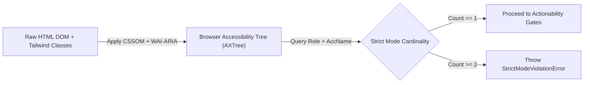

# Accessibility Tree (`AXTree`) Locators, Strict Mode & Composition

```json pretraining
[
  {
    "term": "Browser Accessibility Tree (`AXTree`)",
    "formula": "DOM + WAI-ARIA + CSS Visibility -> Semantic `AXNode(role, accessibleName, state)`",
    "meaning": "Every browser computes a parallel semantic tree for screen readers; querying `AXTree` tests the exact user-perceivable contract rather than private `<div>` wrappers."
  },
  {
    "term": "Locator Resilience Hierarchy",
    "formula": "getByRole > getByLabel > getByPlaceholder/Text > getByTestId >> CSS/XPath",
    "meaning": "Semantic locators survive CSS-to-Tailwind migrations AND simultaneously verify accessibility; `data-testid` is a clean fallback for non-semantic canvases/charts."
  },
  {
    "term": "Playwright Strict Mode Invariant",
    "formula": "|MatchedNodes(locator)| > 1 ==> Immediate `StrictModeViolationError`",
    "meaning": "Classic `driver.findElement` silently clicked the FIRST match (often a hidden mobile-nav duplicate!); Playwright throws immediately until disambiguated."
  },
  {
    "term": "Relational Locator Filtering",
    "formula": "rows.filter(has_text='INV-1042').get_by_role('button', name='Refund')",
    "meaning": "Composing `.filter(has=...)` and `.filter(has_text=...)` replaces brittle ancestor-hopping XPath (`../../td[4]/button`) with readable set algebra."
  }
]
```

```json poe
{
  "question": "A responsive header renders TWO `'Sign In'` buttons in the DOM: `<button class=\"hidden md:block\">Sign In</button>` (desktop) and `<button class=\"md:hidden\">Sign In</button>` (mobile drawer, currently `display: none` at `1440x900` viewport). Compare what happens when calling:\n(A) `page.locator(\"button:has-text('Sign In')\").click()` vs\n(B) `page.get_by_role(\"button\", name=\"Sign In\").click()`",
  "options": [
    "Both (A) and (B) fail with `StrictModeViolationError` matching 2 elements",
    "(A) throws `StrictModeViolationError: resolved to 2 elements` because raw CSS matches hidden DOM nodes too, whereas (B) **succeeds cleanly**! Why? Because `display: none` / `aria-hidden='true'` elements are excluded from the Browser Accessibility Tree (`AXTree`) unless `include_hidden=True` is requested",
    "(A) clicks the hidden mobile button while (B) throws an error",
    "`get_by_role` disables Playwright Strict Mode automatically"
  ],
  "answerIndex": 1,
  "explanation": "This is one of the deepest superpowers of `AXTree` locators! Per WAI-ARIA Accessible Name & Role computation rules, elements styled `display: none` or `visibility: hidden` are pruned from the active Accessibility Tree. Thus `get_by_role('button', name='Sign In')` sees **exactly 1** exposed accessible button on desktop, satisfying Strict Mode naturally!"
}
```

## Part I — First-Principles Mental Model: Querying the User Contract (`AXTree`), Not Implementation Noise

Why did 70% of UI test maintenance in the 2010s consist of fixing broken CSS/XPath selectors (`div.sc-bdvvtL > ul > li:nth-child(3) > span.btn_v2`) every sprint? Because CSS class hashes (`styled-components`, CSS Modules, Tailwind utility chains) and wrapper `<div>` depth are **private styling implementation details**, not user-facing contracts!

### How the Browser Engine Computes `AXTree`
Alongside the DOM and Layout trees, Blink, Gecko, and WebKit maintain an **Accessibility Tree (`AXTree`)** driven by the W3C **ACCNAME (Accessible Name and Description Computation)** specification:
1. Native HTML semantics map automatically (`<a href="...">` $\to$ `role="link"`, `<button>` or `<input type="submit">` $\to$ `role="button"`, `<h2>` $\to$ `role="heading", level=2`).
2. Accessible names derive from inner visible text, associated `<label for="id">`, `aria-label`, or `aria-labelledby`.
3. Hidden subtrees (`display: none`, `visibility: hidden`, `aria-hidden="true"`) are stripped unless explicitly queried.

When your test calls `page.get_by_role("button", name="Complete Booking")`, two things happen simultaneously:
- **Refactor Immunity**: Frontend engineers can migrate `<input type="submit" value="Complete Booking">` to `<button class="bg-emerald-700 px-4"><span>Complete Booking</span></button>`—your test stays **100% green**!
- **Free Shift-Left Accessibility Gate**: If a developer accidentally replaces `<button>` with an inaccessible `<div onClick={...}>Complete Booking</div>` (breaking keyboard navigation and screen readers for visually impaired customers!), `get_by_role("button", ...)` **immediately catches the regression**!



```json contrast
{
  "title": "Brittle Structural XPath / Silent First-Match vs AXTree `getByRole` + Strict Mode",
  "naiveTitle": "Structural XPath + `.first` Abuse",
  "naiveMetric": "Breaks on Styling PRs · Silent Wrong Clicks",
  "naivePoints": [
    "Uses `//div[@class='flex-col']/div[2]/span[text()='Delete']`—breaks when a designer adds a badge `<div>`",
    "Classic `findElement` (or slapping `.first` everywhere) silently clicks the wrong row's `'Delete'` button",
    "Passes happily when `<button>` degrades into an unfocusable `<div onclick>` lacking keyboard/ARIA semantics"
  ],
  "staffTitle": "`getByRole` + Relational `.filter()` + Strict",
  "staffMetric": "Tailwind-Immune · Enforces WCAG Semantics",
  "staffPoints": [
    "Queries `get_by_role('row').filter(has_text='ORD-882').get_by_role('button', name='Delete')`",
    "Strict Mode (`count == 1`) fails fast with exact multi-match diagnostics whenever a locator becomes ambiguous",
    "Reserves `get_by_test_id()` strictly for non-semantic visual surfaces (`<canvas>`, SVG charts, dynamic metric values)"
  ]
}
```

---

## Part II — The Staff Locator Priority & Trade-Off Matrix

Experiment with the **`pw-locators-actionability`** simulator to compare how DOM refactors affect XPath, CSS, `data-testid`, and `AXTree` role queries.

| Priority | Playwright API | Underlying Browser Source | Survives CSS/DOM Wrapper Refactors? | Verifies User / a11y Semantics? |
| :--- | :--- | :--- | :--- | :--- |
| **1 (Gold)** | `get_by_role(role, name=..., exact=True)` | Browser `AXTree` (Role + ACCNAME) | **Yes** | **Yes** (catches broken `<div onclick>` & missing ARIA) |
| **2** | `get_by_label(...)` | `<label for>` / `aria-labelledby` / `aria-label` | **Yes** | **Yes** (proves form inputs are screen-reader labeled) |
| **3** | `get_by_placeholder` / `get_by_text` | Input placeholder / visible text nodes | **Yes** | Partial (visible copy, non-interactive containers) |
| **4 (Escape Hatch)** | `get_by_test_id(...)` (`data-testid`) | Explicit QA/Dev contract attribute | **Yes** | **No** (passes even if button is an inaccessible `<span>` or localized text vanishes!) |
| **5 (Last Resort)** | CSS / XPath (`page.locator(...)`) | Raw DOM tag/class hierarchy | **No (Brittle)** | **No** |

---

## Part III — Production Implementation Blueprints (Python 3 & Java 17)

### Python 3 Blueprint: Relational Table Row Filtering & Exact Strict-Mode Disambiguation
```python
from __future__ import annotations
import re
from playwright.sync_api import Locator, Page, expect


class FlightManageBookingsTable:
    """Zero XPath (`../..`), zero `.nth(i)`—100% relational AXTree + filter algebra."""

    def __init__(self, page: Page) -> None:
        self.page = page
        self.bookings_grid = page.get_by_role("table", name="Active Bookings")

    def row_for_pnr(self, pnr_code: str) -> Locator:
        # Narrows to the exact semantic `row` containing the unique PNR cell text
        return self.bookings_grid.get_by_role("row").filter(has_text=pnr_code)

    def cancel_booking(self, pnr_code: str) -> None:
        row = self.row_for_pnr(pnr_code)
        # Note `exact=True`: prevents `"Cancel"` from ambiguously matching `"Cancel Insurance"`!
        row.get_by_role("button", name="Cancel", exact=True).click()

        dialog = self.page.get_by_role("alertdialog", name=re.compile(r"Confirm cancellation", re.I))
        expect(dialog).to_be_visible()
        dialog.get_by_role("button", name="Confirm Cancel").click()

    def assert_booking_status(self, pnr_code: str, expected_status: str) -> None:
        status_badge = self.row_for_pnr(pnr_code).get_by_test_id("booking-status-pill")
        expect(status_badge).to_have_text(expected_status)
```

### Java 17 Blueprint: Composable `Locator.filter()` & Custom `testIdAttribute` Configuration
```java
package com.aerocart.qa.locators;

import com.microsoft.playwright.*;
import com.microsoft.playwright.options.AriaRole;
import static com.microsoft.playwright.assertions.PlaywrightAssertions.assertThat;

public final class SeatMapRelationalPicker {

    private final Page page;

    public SeatMapRelationalPicker(Playwright playwright, Page page) {
        // Organization-wide convention: standardize `data-qa` or `data-testid` once at boot
        playwright.selectors().setTestIdAttribute("data-testid");
        this.page = page;
    }

    public void upgradePassengerSeat(String passengerFullName, String seatCode) {
        // Compose relational `has` filter: find the passenger card that CONTAINS a specific heading
        Locator passengerCard = page.getByTestId("passenger-card")
                .filter(new Locator.FilterOptions().setHas(
                        page.getByRole(AriaRole.HEADING,
                                new Page.GetByRoleOptions().setName(passengerFullName).setExact(true))));

        passengerCard.getByRole(AriaRole.BUTTON,
                new Locator.GetByRoleOptions().setName("Select Seat")).click();

        // Exact accessible name match avoids `"1A"` substring-matching `"11A"` or `"21A"`!
        Locator targetSeat = page.getByRole(AriaRole.BUTTON,
                new Page.GetByRoleOptions().setName("Seat " + seatCode).setExact(true));
        targetSeat.click();

        assertThat(passengerCard).containsText(seatCode);
    }
}
```

> [!WARNING]
> **Staff Interview Gotcha — Substring Matching Trap Without `exact=True` (`"Pay"` Matches `"Apple Pay"` & `"Pay Later"`)**:
> By default, Playwright's `get_by_role("button", name="Pay")` performs a **case-insensitive substring match**! The day your product team adds an `"Apple Pay"` or `"Pay in 4"` button onto the checkout screen, `get_by_role("button", name="Pay")` resolves to **3 elements** and fails with `StrictModeViolationError`! Default to `exact=True` (`.setExact(true)` in Java) for short action verbs (`"Pay"`, `"Save"`, `"Edit"`, `"Cancel"`, `"1A"`), and **never** silence a `StrictModeViolationError` by blindly appending `.first`—always scope to the parent region/row!

---

## Part IV — Scenario Retrieval-Practice Mastery Gate

```json quiz
[
  {
    "id": "pw-04-q1",
    "question": "A seat-map renders buttons labeled `'Seat 1A'`, `'Seat 11A'`, and `'Seat 21A'`. Why does `page.get_by_role('button', name='1A').click()` fail in Playwright, and what is the exact fix?",
    "options": [
      "Numbers are not allowed inside ARIA accessible names",
      "Because `name='1A'` without `exact=True` performs a case-insensitive **substring** match, matching all three buttons (`'Seat 1A'`, `'Seat 11A'`, `'Seat 21A'`) and tripping `StrictModeViolationError`! Fix: pass the full accessible name with `name='Seat 1A', exact=True`",
      "Buttons inside SVG seat maps require XPath",
      "Add `.first` so it clicks whichever seat appears first in the DOM"
    ],
    "answerIndex": 1,
    "explanation": "Default `name=` matching is case-insensitive substring matching (`'1a'` is a substring of `'seat 11a'`). Specifying `name='Seat 1A', exact=True` enforces exact string equality against the computed Accessible Name."
  },
  {
    "id": "pw-04-q2",
    "question": "A junior engineer asks: 'Why shouldn't we put `data-testid` on every single element and use `get_by_test_id()` 100% of the time instead of `get_by_role()`?' What is the strongest Staff engineering answer?",
    "options": [
      "`data-testid` slows down HTML parsing by 40% in Chromium",
      "A test clicking `get_by_test_id('submit-btn')` will **still pass** if a refactor turns `<button>` into an unfocusable `<div data-testid='submit-btn'>` with `color: transparent` or broken label text—whereas `get_by_role('button', name='Submit')` tests the actual human & screen-reader contract while reserving `data-testid` for non-semantic containers/charts",
      "Playwright deprecated `get_by_test_id()`",
      "`data-testid` does not support Strict Mode"
    ],
    "answerIndex": 1,
    "explanation": "`data-testid` is invisible to end users. Over-relying on it for buttons, links, and form inputs blinds your suite to broken labels, broken keyboard semantics, and missing accessible names."
  },
  {
    "id": "pw-04-q3",
    "question": "When `locator.count()` is called on a `Locator` matching 4 table rows, does Strict Mode throw `StrictModeViolationError`?",
    "options": [
      "Yes, any `Locator` matching >1 node throws immediately on every method",
      "No! Strict Mode applies to **single-element actions and single-element assertions** (`click()`, `fill()`, `text_content()`, `to_be_visible()`), whereas explicitly plural/collection operations (`count()`, `all()`, `to_have_count(4)`) naturally operate on $0..N$ elements",
      "Only in Python, not Java",
      "`count()` mutates the locator into `.first`"
    ],
    "answerIndex": 1,
    "explanation": "Strict Mode guards operations that implicitly assume a unique target (`click`, `fill`, `inner_text`). Collection assertions like `expect(rows).to_have_count(4)` are first-class multi-element Web-First operations."
  }
]
```
