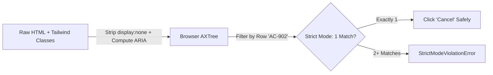

# Accessibility Tree (`AXTree`) Locators, Strict Mode & Composition

```json continuity
{
  "previously": "In Chapter 3, we upgraded AeroBot to v0.3 to pierce Shadow DOM roots, target cross-origin Stripe iframes statelessly, and synchronize on SSR hydration.",
  "painPoint": "When AeroCart's frontend team migrates from Bootstrap to Tailwind CSS and renders 15 flight rows each with a 'Cancel' button, our old CSS selectors break overnight and click the wrong flight row!",
  "unlock": "We will upgrade AeroBot to v0.4 using Accessibility Tree (AXTree) semantic locators, Strict Mode cardinality guards, and relational .filter() composition."
}
```

```json walkthrough
[
  {
    "time": "0:00",
    "badge": "🌱 Reading the Menu vs Memorizing Paint Colors",
    "caption": "Finding a restaurant button by its CSS class (.bg-blue-600.px-4) is like ordering food by the color of the waiter's shirt. Querying the browser's Accessibility Tree (get_by_role) orders by the actual item name on the menu!",
    "code": "page.get_by_role('button', name='Complete Booking', exact=True)"
  },
  {
    "time": "0:25",
    "badge": "🔨 AeroBot v0.4: Relational Row Filtering",
    "caption": "Instead of brittle XPath parent-hopping (../../td[4]), AeroBot v0.4 finds the table row containing flight PNR 'AC-902' and clicks the exact 'Cancel' button inside that row.",
    "code": "page.get_by_role('row').filter(has_text='AC-902').get_by_role('button', name='Cancel', exact=True)"
  },
  {
    "time": "0:50",
    "badge": "⚡ How Strict Mode Saves You From Silent Bugs",
    "caption": "Classic Selenium silently clicked the very first match—often a hidden mobile menu button! Playwright's Strict Mode fails immediately if a locator matches 2 or more elements.",
    "code": "StrictModeViolationError: get_by_role('button', name='Pay') resolved to 2 elements!"
  },
  {
    "time": "1:15",
    "badge": "🚀 Staff Free Accessibility Gate",
    "caption": "Because display:none nodes are pruned from the AXTree, get_by_role ignores hidden mobile duplicates automatically AND catches regressions if a developer replaces <button> with an inaccessible <div>!",
    "code": "DOM + WAI-ARIA + CSS Visibility -> Browser AXTree"
  }
]
```

```json pretraining
[
  {
    "term": "Browser Accessibility Tree (AXTree)",
    "formula": "DOM + ARIA Labels + CSS Visibility -> Semantic User Tree",
    "meaning": "A clean map of the page built by the browser for screen readers, listing only visible elements by their real purpose (like 'button', 'heading', or 'textbox') and label."
  },
  {
    "term": "Locator Resilience Hierarchy",
    "formula": "get_by_role > get_by_label > get_by_text > get_by_test_id >> CSS/XPath",
    "meaning": "The priority order for choosing locators so your tests survive CSS styling changes while checking that real humans and screen readers can use the page."
  },
  {
    "term": "Strict Mode Guard",
    "formula": "Matches > 1 Element -> Immediate StrictModeViolationError",
    "meaning": "Playwright refuses to guess which button you meant if your locator matches two or more elements, forcing you to make the selector unambiguous."
  },
  {
    "term": "Relational .filter() Chaining",
    "formula": "rows.filter(has_text='AC-902').get_by_role('button', name='Cancel')",
    "meaning": "Narrowing down a list of cards or rows by the text or child element inside them, replacing fragile XPath '../../' parent traversal."
  }
]
```

## 🌱 Step 1: Plain-English Story — Ordering From the Menu vs Memorizing Paint Colors

Imagine walking into a coffee shop and ordering by saying: *"I want the item listed on the third line of the green chalkboard inside the wooden frame."* The next morning, the barista repaints the board blue—and your order breaks!

Now imagine ordering by saying: *"I would like the button labeled **'Confirm Booking'**."* Even if the design team switches from CSS Modules to Tailwind, changes the font, or wraps the button in three extra `<div>` tags, your test still works because the **human-visible contract** never changed.

How does the browser know what is a button and what its label is? Every modern browser (`Chromium`, `Firefox`, `WebKit`) builds a parallel tree alongside the DOM called the **Accessibility Tree (`AXTree`)** for screen readers:
1. It translates tags into **Roles** (`<button>` $\to$ `button`, `<a href>` $\to$ `link`, `<h2>` $\to$ `heading`).
2. It computes each element's **Accessible Name** from its visible text, `<label>`, or `aria-label`.
3. It **automatically strips out hidden elements** (`display: none`, `visibility: hidden`).

Even better, Playwright turns on **Strict Mode** by default: if `get_by_role("button", name="Cancel")` matches **15 flight rows**, Playwright refuses to guess and throws a helpful `StrictModeViolationError` until you narrow it down with `.filter(has_text="AC-902")`!



---

## 🔨 Step 2: First Lines of Code — AeroBot v0.4 Semantic Filtering & Strict Mode

Let's upgrade **`AeroBot` to `v0.4`**. Instead of using fragile XPath indices to cancel flight `AC-902` in a multi-row bookings table, we combine `get_by_role("row")`, `.filter(has_text="AC-902")`, and `exact=True`.

```python
# aerobot_v04.py — AeroBot v0.4: AXTree role locators + relational row filtering
from playwright.sync_api import Page, expect

def test_cancel_specific_flight_row(page: Page) -> None:
    page.goto("http://127.0.0.1:8090")
    bookings_table = page.get_by_role("table", name="Active Bookings")

    # Narrow to the exact row for PNR 'AC-902', then click its exact 'Cancel' button:
    flight_row = bookings_table.get_by_role("row").filter(has_text="AC-902")
    flight_row.get_by_role("button", name="Cancel", exact=True).click()

    expect(flight_row.get_by_test_id("booking-status")).to_have_text("Cancelled")
```

### Java 17 Equivalent

```java
// AeroBotV04.java — AeroBot v0.4: AXTree role locators + relational row filtering
import com.microsoft.playwright.*;
import com.microsoft.playwright.options.AriaRole;
import static com.microsoft.playwright.assertions.PlaywrightAssertions.assertThat;

public class AeroBotV04 {
    public static void cancelSpecificFlightRow(Page page) {
        page.navigate("http://127.0.0.1:8090");
        Locator table = page.getByRole(AriaRole.TABLE, new Page.GetByRoleOptions().setName("Active Bookings"));

        Locator flightRow = table.getByRole(AriaRole.ROW)
                .filter(new Locator.FilterOptions().setHasText("AC-902"));
        flightRow.getByRole(AriaRole.BUTTON,
                new Locator.GetByRoleOptions().setName("Cancel").setExact(true)).click();

        assertThat(flightRow.getByTestId("booking-status")).hasText("Cancelled");
    }
}
```

---

## ⚡ Step 3: Where It Breaks in Real Life — The Substring & Hidden Duplicate Traps

Two real-world traps catch teams off guard when writing locators on complex apps:

1. **The Responsive Duplicate Trap**: A responsive navbar renders **two** `"Sign In"` buttons in the HTML: one for desktop (`display: block`) and one inside a collapsed mobile drawer (`display: none`). A raw CSS locator (`page.locator("button:has-text('Sign In')")`) sees **both** DOM nodes and crashes with `StrictModeViolationError`! By contrast, `page.get_by_role("button", name="Sign In")` queries the **`AXTree`**, which automatically prunes `display: none` nodes—seeing **only the 1 visible desktop button**!
2. **The Substring Ambiguity Trap**: By default, `name="Pay"` performs a **case-insensitive substring match**. The day your team adds `"Apple Pay"` and `"Pay Later"` buttons to checkout, `get_by_role("button", name="Pay")` matches **all 3 buttons**! Passing `exact=True` (`.setExact(true)`) enforces an exact string match.

```json contrast
{
  "title": "Structural XPath & .first Abuse vs AeroBot v0.4 AXTree Role + Relational .filter() + Strict Mode",
  "naiveTitle": "Structural XPath + .first Hacks",
  "naiveMetric": "Breaks on CSS PRs · Clicks Wrong Row",
  "naivePoints": [
    "Uses //div[@class='flex-col']/div[2]/button—breaks whenever a designer changes Tailwind classes",
    "Slapping .first onto an ambiguous locator silently clicks Row 1's Delete button instead of Row 4",
    "Passes happily even if a developer replaces <button> with an inaccessible <div onclick> that breaks keyboards"
  ],
  "staffTitle": "AeroBot v0.4 getByRole + .filter() + exact=True",
  "staffMetric": "Tailwind-Immune · Free WCAG Accessibility Gate",
  "staffPoints": [
    "Queries get_by_role('row').filter(has_text='AC-902').get_by_role('button', name='Cancel', exact=True)",
    "Strict Mode fails fast with diagnostic DOM dumps whenever a selector matches >= 2 elements",
    "Automatically ignores display:none mobile duplicates pruned from the Browser Accessibility Tree"
  ]
}
```

```json poe
{
  "question": "A responsive header renders TWO `'Sign In'` buttons in the DOM: `<button class=\"hidden md:block\">Sign In</button>` (desktop) and `<button class=\"md:hidden\">Sign In</button>` (mobile drawer, currently `display: none` at `1440x900` viewport). Compare what happens when calling:\n(A) `page.locator(\"button:has-text('Sign In')\").click()` vs\n(B) `page.get_by_role(\"button\", name=\"Sign In\").click()`",
  "options": [
    "Both (A) and (B) fail with `StrictModeViolationError` matching 2 elements",
    "(A) throws `StrictModeViolationError: resolved to 2 elements` because raw CSS matches hidden DOM nodes too, whereas (B) **succeeds cleanly**! Why? Because `display: none` / `aria-hidden='true'` elements are excluded from the Browser Accessibility Tree (`AXTree`) unless `include_hidden=True` is requested",
    "(A) clicks the hidden mobile button while (B) throws an error",
    "`get_by_role` disables Playwright Strict Mode automatically"
  ],
  "answerIndex": 1,
  "explanation": "This is one of the deepest superpowers of `AXTree` locators! Per WAI-ARIA Accessible Name & Role computation rules, elements styled `display: none` or `visibility: hidden` are pruned from the active Accessibility Tree. Thus `get_by_role('button', name='Sign In')` sees **exactly 1** exposed accessible button on desktop, satisfying Strict Mode naturally!"
}
```

---

## 🚀 Step 4: Staff Engineer Deep-Dive — Relational Set Algebra & ACCNAME Pipeline

### 1. Relational Set Algebra & Strict Mode Cardinality Invariant

Let $E_{\text{DOM}}$ be the set of all DOM elements in the document and $E_{\text{AX}} \subset E_{\text{DOM}}$ be the subset exposed in the Browser Accessibility Tree (excluding `display: none`, `visibility: hidden`, and `aria-hidden="true"`). A relational locator chain filters $E_{\text{AX}}$ by role predicate $R$, accessible name predicate $N_{\text{exact}}$, and descendant/text containment predicate $H$:

$$L(E_{\text{AX}}) = \left\{\, x \in E_{\text{AX}} \;\middle|\; \text{role}(x) = R \;\land\; \text{accName}(x) = N_{\text{exact}} \;\land\; \exists y \in \text{descendants}(x) : H(y) \,\right\}$$

Playwright's **Strict Mode** enforces the cardinality invariant $|L(E_{\text{AX}})| = 1$ on every single-element action (`click()`, `fill()`, `hover()`), throwing `StrictModeViolationError` immediately if $|L(E_{\text{AX}})| \ge 2$.

| Priority | Playwright API | Browser Engine Source | Survives CSS/DOM Wrapper Refactors? | Verifies WCAG / Screen-Reader Semantics? |
| :--- | :--- | :--- | :--- | :--- |
| **1 (Gold)** | `get_by_role(role, name=..., exact=True)` | Browser `AXTree` (`ACCNAME`) | **Yes** | **Yes** (catches `<div onclick>` & missing ARIA) |
| **2** | `get_by_label(...)` | `<label for>` / `aria-labelledby` | **Yes** | **Yes** (proves form inputs are accessible) |
| **3** | `get_by_placeholder` / `get_by_text` | Placeholder / visible text | **Yes** | Partial (non-interactive copy containers) |
| **4 (Fallback)** | `get_by_test_id(...)` (`data-testid`) | Explicit QA attribute | **Yes** | **No** (passes even if text/role is broken) |
| **5 (Avoid)** | CSS / XPath (`page.locator(...)`) | Raw DOM tag/class hierarchy | **No (Brittle)** | **No** |

### 2. Production Dual-Language Blueprint: Relational Seat & Booking Selector

```python
from __future__ import annotations
import re
from playwright.sync_api import Locator, Page, expect

class FlightManageBookingsTable:
    """Zero XPath ('../..'), zero .nth(i)—100% relational AXTree + filter algebra."""

    def __init__(self, page: Page) -> None:
        self.page = page
        self.bookings_grid = page.get_by_role("table", name="Active Bookings")

    def row_for_pnr(self, pnr_code: str) -> Locator:
        return self.bookings_grid.get_by_role("row").filter(has_text=pnr_code)

    def cancel_booking(self, pnr_code: str) -> None:
        row = self.row_for_pnr(pnr_code)
        row.get_by_role("button", name="Cancel", exact=True).click()

        dialog = self.page.get_by_role("alertdialog", name=re.compile(r"Confirm cancellation", re.I))
        expect(dialog).to_be_visible()
        dialog.get_by_role("button", name="Confirm Cancel", exact=True).click()

    def assert_booking_status(self, pnr_code: str, expected_status: str) -> None:
        status_badge = self.row_for_pnr(pnr_code).get_by_test_id("booking-status-pill")
        expect(status_badge).to_have_text(expected_status)
```

```java
package com.aerocart.qa.locators;

import com.microsoft.playwright.*;
import com.microsoft.playwright.options.AriaRole;
import static com.microsoft.playwright.assertions.PlaywrightAssertions.assertThat;

public final class SeatMapRelationalPicker {
    private final Page page;

    public SeatMapRelationalPicker(Playwright playwright, Page page) {
        playwright.selectors().setTestIdAttribute("data-testid");
        this.page = page;
    }

    public void upgradePassengerSeat(String passengerFullName, String seatCode) {
        Locator passengerCard = page.getByTestId("passenger-card")
                .filter(new Locator.FilterOptions().setHas(
                        page.getByRole(AriaRole.HEADING,
                                new Page.GetByRoleOptions().setName(passengerFullName).setExact(true))));

        passengerCard.getByRole(AriaRole.BUTTON,
                new Locator.GetByRoleOptions().setName("Select Seat").setExact(true)).click();

        // exact=true prevents "Seat 1A" from matching "Seat 11A" or "Seat 21A"
        page.getByRole(AriaRole.BUTTON,
                new Page.GetByRoleOptions().setName("Seat " + seatCode).setExact(true)).click();

        assertThat(passengerCard).containsText(seatCode);
    }
}
```

> [!WARNING]
> **Staff Interview Gotcha — Substring Matching Trap Without `exact=True` (`"1A"` Matches `"11A"` & `"21A"`)**:
> By default, `get_by_role("button", name="1A")` performs a **case-insensitive substring match**, matching `"Seat 1A"`, `"Seat 11A"`, and `"Seat 21A"`! Always pass `exact=True` (`.setExact(true)` in Java) for short labels or codes, and **never** silence a `StrictModeViolationError` by blindly slapping `.first` onto the locator—always disambiguate via parent region or `.filter(has_text=...)`.

**Up Next in Chapter 5**: Once **`AeroBot v0.4`** resolves the exact target element via the `AXTree`, what happens during the **next 50 milliseconds** if the button is still sliding in on a CSS drawer animation or covered by a loading spinner? In **Chapter 5**, we upgrade **`AeroBot` to `v0.5`** by mastering **The 5 Actionability Gates & Web-First Assertions**.

```json quiz
[
  {
    "id": "pw-04-q1",
    "question": "A seat-map renders buttons labeled `'Seat 1A'`, `'Seat 11A'`, and `'Seat 21A'`. Why does `page.get_by_role('button', name='1A').click()` fail in Playwright, and what is the exact fix?",
    "options": [
      "Numbers are not allowed inside ARIA accessible names",
      "Because `name='1A'` without `exact=True` performs a case-insensitive **substring** match, matching all three buttons (`'Seat 1A'`, `'Seat 11A'`, `'Seat 21A'`) and tripping `StrictModeViolationError`! Fix: pass the full accessible name with `name='Seat 1A', exact=True`",
      "Buttons inside SVG seat maps require XPath",
      "Add `.first` so it clicks whichever seat appears first in the DOM"
    ],
    "answerIndex": 1,
    "explanation": "Default `name=` matching is case-insensitive substring matching (`'1a'` is a substring of `'seat 11a'`). Specifying `name='Seat 1A', exact=True` enforces exact string equality against the computed Accessible Name."
  },
  {
    "id": "pw-04-q2",
    "question": "A junior engineer asks: 'Why shouldn't we put `data-testid` on every single element and use `get_by_test_id()` 100% of the time instead of `get_by_role()`?' What is the strongest Staff engineering answer?",
    "options": [
      "`data-testid` slows down HTML parsing by 40% in Chromium",
      "A test clicking `get_by_test_id('submit-btn')` will **still pass** if a refactor turns `<button>` into an unfocusable `<div data-testid='submit-btn'>` with `color: transparent` or broken label text—whereas `get_by_role('button', name='Submit')` tests the actual human & screen-reader contract while reserving `data-testid` for non-semantic containers/charts",
      "Playwright deprecated `get_by_test_id()`",
      "`data-testid` does not support Strict Mode"
    ],
    "answerIndex": 1,
    "explanation": "`data-testid` is invisible to end users. Over-relying on it for buttons, links, and form inputs blinds your suite to broken labels, broken keyboard semantics, and missing accessible names."
  },
  {
    "id": "pw-04-q3",
    "question": "When `locator.count()` is called on a `Locator` matching 4 table rows, does Strict Mode throw `StrictModeViolationError`?",
    "options": [
      "Yes, any `Locator` matching >1 node throws immediately on every method",
      "No! Strict Mode applies to **single-element actions and single-element assertions** (`click()`, `fill()`, `text_content()`, `to_be_visible()`), whereas explicitly plural/collection operations (`count()`, `all()`, `to_have_count(4)`) naturally operate on $0..N$ elements",
      "Only in Python, not Java",
      "`count()` mutates the locator into `.first`"
    ],
    "answerIndex": 1,
    "explanation": "Strict Mode guards operations that implicitly assume a unique target (`click`, `fill`, `inner_text`). Collection assertions like `expect(rows).to_have_count(4)` are first-class multi-element Web-First operations."
  }
]
```
