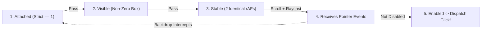

# The Five Actionability Gates & Web-First Retrying Assertions

```json pretraining
[
  {
    "term": "5-Gate `click()` Pipeline",
    "formula": "Attached -> Visible -> Stable (2 rAFs) -> Receives Events (Hit-Test) -> Enabled",
    "meaning": "Before dispatching synthetic `mousedown`/`mouseup`/`click` coordinates, Playwright verifies all 5 physical browser gates inside the rendering engine."
  },
  {
    "term": "2-Frame Layout Stability (`rAF`)",
    "formula": "BoundingBox(Frame_t) == BoundingBox(Frame_{t+1})  [~33.3ms at 60Hz]",
    "meaning": "Waiting for identical `x, y, width, height` across two consecutive `requestAnimationFrame` ticks prevents clicking mid-slide on CSS drawer transitions."
  },
  {
    "term": "Pointer Hit-Target Verification",
    "formula": "document.elementFromPoint(cx, cy) in SelfOrDescendants(target)",
    "meaning": "Simulates casting a ray at the click point: if a translucent modal backdrop or toast overlay intercepts `(cx, cy)`, Playwright waits for the overlay to clear!"
  },
  {
    "term": "Web-First Polling vs One-Shot Trap",
    "formula": "expect(loc).to_be_visible() [Polls up to 5s] != assert loc.is_visible() [0ms Snapshot!]",
    "meaning": "`loc.is_visible()` does NOT wait—it evaluates instantaneously at `t=0ms` and returns `False` if an async API response arrives 20ms later!"
  }
]
```

```json poe
{
  "question": "After clicking `'Apply Coupon'`, an async `POST /coupons` call takes `85ms` before rendering `<div role='status'>Discount Applied</div>`. Compare these two lines written immediately after `.click()`:\nLine A: `assert page.get_by_role('status').is_visible()`\nLine B: `expect(page.get_by_role('status')).to_be_visible()`\nWhy does Line A fail 98% of the time in CI while Line B passes 100% of the time in `~90ms`?",
  "options": [
    "`is_visible()` always returns `False` for `role='status'` elements",
    "`locator.is_visible()` is a **synchronous point-in-time boolean snapshot with ZERO auto-waiting**—evaluated at `t = 1ms` while the `POST` is still in flight, it immediately returns `False` and crashes `assert False`! By contrast, `expect(locator).to_be_visible()` is a **Web-First retrying assertion** that polls inside the browser until `t ≈ 85ms` (bounded by the 5,000ms assertion timeout)",
    "`expect()` pauses backend database transactions",
    "`is_visible()` requires XPath selectors"
  ],
  "answerIndex": 1,
  "explanation": "`assert locator.is_visible()` and `assert locator.text_content() == ' Paid'` are the #1 cause of self-inflicted flakiness in Playwright codebases! Boolean predicates (`is_visible()`, `is_enabled()`, `is_checked()`) intentionally do not wait; assertions MUST use `expect(locator).to_be_visible()` / `to_have_text()`."
}
```

## Part I — First-Principles Mental Model: Inside Playwright's `requestAnimationFrame` Engine

When you call `locator.click()`, Playwright does **not** guess coordinates and fire a blind mouse click. Inside the target browser context, Playwright runs a deterministic multi-gate state machine synchronized to the browser's `requestAnimationFrame` (`rAF`) loop until the action timeout (`30s` default) expires:

1. **Gate 1 — Attached**: Resolves the selector in the DOM/AXTree (enforcing Strict Mode `count == 1`) and confirms the node is connected (`node.isConnected === true`).
2. **Gate 2 — Visible**: Confirms non-empty computed bounding box and `visibility !== 'hidden'` (`opacity: 0` elements *do* occupy layout boxes and are technically considered visible by W3C/Playwright—an important nuance!).
3. **Gate 3 — Stable (`2` Consecutive Animation Frames)**: Reads `getBoundingClientRect()` on animation frame $F_t$ and again on $F_{t+1}$. If a slide-in CSS drawer or accordion is animating, `rect.x` or `rect.y` changes between frames, so Playwright **holds fire** until two consecutive frames report identical geometry!
4. **Gate 4 — Scrolled Into View & Receives Events (Hit-Target Raycast)**: Scrolls the element into viewport if needed, computes the click point `(cx, cy)`, and calls `elementFromPoint(cx, cy)`. If a full-screen loading spinner backdrop (`<div class="modal-backdrop z-50">`) or sticky cookie banner covers `(cx, cy)`, Playwright logs `"<div class='modal-backdrop'> intercepts pointer events — retrying..."` and waits cleanly for the spinner to unmount!
5. **Gate 5 — Enabled (and Editable for `fill()`)**: Confirms neither the element nor an enclosing `<fieldset>` carries `disabled` or `aria-disabled="true"` (plus not `readonly` for `fill()`).

Only when **all 5 gates pass on the exact same frame** does Playwright dispatch the input event—and if the DOM detaches mid-check, it loops cleanly back to Gate 1!



```json contrast
{
  "title": "One-Shot Snapshot Getters & `force=True` Abuse vs 5-Gate Auto-Waiting & Web-First `expect()`",
  "naiveTitle": "`assert loc.is_visible()` + `click(force=True)`",
  "naiveMetric": "Instant Race Failures · Clicks Through Modals",
  "naivePoints": [
    "Writes `assert badge.text_content() == 'Confirmed'`—reads stale `'Pending'` text 10ms before React state updates",
    "Slaps `.click(force=True)` whenever a toast or backdrop intercepts pointer events, bypassing Gate 2/3/4/5!",
    "Adds hardcoded `time.sleep(2)` everywhere to compensate for non-retrying `inner_text()` assertions"
  ],
  "staffTitle": "Native 5-Gate `click()` + Web-First `expect()`",
  "staffMetric": "0ms Wasted Sleep · Catches Z-Index Bugs",
  "staffPoints": [
    "Uses `expect(badge).to_have_text('Confirmed')`—resolves in 45ms when fast and polls up to 5s under CI load",
    "Treats `'subtree intercepts pointer events'` timeouts as real UI/UX defects (broken sticky footer or stuck spinner)",
    "Uses `expect_to_pass` (`toPass`) polling blocks for complex multi-field invariants without fixed sleeps"
  ]
}
```

---

## Part II — Actionability Gate Matrix Across Playwright Commands

Use the **`pw-locators-actionability`** interactive simulator to step frame-by-frame through CSS slide animations, z-index spinner backdrops, and `disabled` state transitions.

| Action Method | Attached | Visible | Stable (2 `rAF`) | Receives Events (Hit-Test) | Enabled | Editable (`!readonly`) |
| :--- | :---: | :---: | :---: | :---: | :---: | :---: |
| `locator.click()` / `dblclick()` | Yes | Yes | Yes | **Yes** | Yes | No |
| `locator.fill("text")` | Yes | Yes | No | No | Yes | **Yes** |
| `locator.check()` / `uncheck()` | Yes | Yes | Yes | **Yes** | Yes | No |
| `locator.hover()` | Yes | Yes | Yes | **Yes** | No | No |
| `locator.is_visible()` | **NO WAIT** | **0ms Check** | No | No | No | No |

---

## Part III — Production Implementation Blueprints (Python 3 & Java 17)

### Python 3 Blueprint: Web-First Assertions (`expect`), Custom Polling Blocks & Anti-Pattern Elimination
```python
from __future__ import annotations
import re
from playwright.sync_api import Page, expect


def verify_async_checkout_transition(page: Page) -> None:
    pay_btn = page.get_by_role("button", name="Submit Payment", exact=True)
    status_pill = page.get_by_test_id("payment-lifecycle-badge")
    receipt_url_re = re.compile(r".*/orders/ORD-[A-Z0-9]{8}/receipt$")

    # 5-Gate click: automatically waits for slide-in animation & any preceding spinner backdrop to clear
    pay_btn.click()

    # Web-First Assertions: poll inside browser engine with exponential/frame cadence (zero time.sleep!)
    expect(pay_btn).to_be_disabled()
    expect(status_pill).to_have_text("CONFIRMED", timeout=8_000)
    expect(page).to_have_url(receipt_url_re)

    # Multi-element collection Web-First assertion: waits until all 3 line-item rows finish rendering
    line_items = page.get_by_role("table", name="Order Summary").get_by_role("row")
    expect(line_items).to_have_count(4)  # 1 header row + 3 line-item rows


def assert_cart_subtotal_reconciles_with_line_items(page: Page) -> None:
    """
    Polling multi-locator mathematical invariant: during optimistic UI updates, line items
    and footer total may update 1 frame apart. Wrap multi-read invariants in a retrying poll!
    """
    subtotal_locator = page.get_by_test_id("cart-subtotal-cents")
    expect(subtotal_locator).to_have_attribute("data-reconciled", "true")
```

### Java 17 Blueprint: `PlaywrightAssertions.assertThat` + `assertAll` Poll-Safe Synchronization
```java
package com.aerocart.qa.actionability;

import com.microsoft.playwright.*;
import com.microsoft.playwright.assertions.LocatorAssertions;
import com.microsoft.playwright.options.AriaRole;
import java.util.regex.Pattern;
import static com.microsoft.playwright.assertions.PlaywrightAssertions.assertThat;

public final class CheckoutActionabilitySpec {

    public void verifyOrderSettlementWithoutSleeps(Page page) {
        Locator confirmBtn = page.getByRole(AriaRole.BUTTON,
                new Page.GetByRoleOptions().setName("Place Order").setExact(true));
        Locator toastAlert = page.getByRole(AriaRole.ALERT);

        // Automatically waits for Attached + Visible + 2-rAF Stable + Hit-Target Unobstructed + Enabled
        confirmBtn.click();

        // Retrying Web-First assertions ( NEVER write `assertTrue(toastAlert.isVisible())`! )
        assertThat(toastAlert).isVisible(new LocatorAssertions.IsVisibleOptions().setTimeout(10_000));
        assertThat(toastAlert).containsText("Booking confirmed");
        assertThat(page).hasURL(Pattern.compile(".*/confirmation/[a-f0-9-]+$"));
    }
}
```

> [!WARNING]
> **Staff Interview Gotcha — Why `.click(force=True)` Masks Critical Production UX Outages**:
> When CI fails with `TimeoutError: <div class="cookie-consent-overlay"> from <aside> intercepts pointer events`, junior engineers reflexively add `.click(force=True)` and celebrate a green build. What did they actually do? `force=True` disables the **Visible, Stable, and Receives Events (Hit-Target)** checks and dispatches a synthetic coordinates event straight through the overlay—meaning **real human customers on production cannot click the Checkout button because an undismissed overlay is physically blocking it!** Fix the overlay state (dismiss/seed consent cookie) instead of blinding Gate 4 with `force=True`.

---

## Part IV — Scenario Retrieval-Practice Mastery Gate

```json quiz
[
  {
    "id": "pw-05-q1",
    "question": "How does Playwright's **Gate 3 (Stable)** determine that a sliding CSS modal button has finished moving before dispatching `click()`?",
    "options": [
      "It parses all `.css` stylesheets and reads `transition-duration`",
      "It sleeps a fixed `300ms` before every click",
      "It measures the element's bounding box across **two consecutive `requestAnimationFrame` callbacks** and only proceeds once both frames report identical geometry",
      "It disables CSS animations globally via CDP"
    ],
    "answerIndex": 2,
    "explanation": "Comparing `getBoundingClientRect()` across two consecutive browser animation frames (`rAF`) proves empirically that layout motion has settled without hardcoding CSS transition durations."
  },
  {
    "id": "pw-05-q2",
    "question": "Why does `locator.fill('alice@aerocart.com')` NOT require the **Receives Events (Hit-Target)** or **2-rAF Stable** gates that `locator.click()` enforces, while adding an **Editable** gate instead?",
    "options": [
      "It is an oversight in Playwright's implementation",
      "`fill()` focuses and programmatically sets the input value + dispatches `input`/`change` events rather than simulating physical `(x, y)` mouse raycasting, so it requires `Attached + Visible + Enabled + Editable (!readonly)`",
      "`fill()` works on `display: none` hidden inputs",
      "`fill()` bypasses Strict Mode"
    ],
    "answerIndex": 1,
    "explanation": "Knowing the exact per-action gate table separates true Playwright internals mastery from guesswork: `fill()` checks `Attached`, `Visible`, `Enabled`, and `Editable`, whereas pointer actions (`click`, `hover`, `check`) enforce `Stable` and `Receives Events`."
  },
  {
    "id": "pw-05-q3",
    "question": "An engineer writes `assert 'Invalid Promo' in page.get_by_role('alert').text_content()` after clicking `'Apply'`. Sometimes it fails because an earlier info alert `'Enter code above'` is still mounted for `60ms` before switching to `'Invalid Promo'`. Why did `text_content()` fail to wait for `'Invalid Promo'`?",
    "options": [
      "`text_content()` auto-waits ONLY for an element matching `role='alert'` to be **Attached**—since the old alert was already attached, `text_content()` returned `'Enter code above'` at `t=0ms` and Python's bare `assert` failed immediately! Using `expect(page.get_by_role('alert')).to_contain_text('Invalid Promo')` retries until the text updates",
      "`text_content()` strips spaces from strings",
      "`role='alert'` cannot change text dynamically",
      "Python `in` operator is incompatible with UTF-8"
    ],
    "answerIndex": 0,
    "explanation": "`text_content()` waits only for element attachment, NOT for a specific expected text value! Whenever an existing element's text mutates asynchronously, only `expect(locator).to_have_text(...)` / `to_contain_text(...)` retries until the target string appears."
  }
]
```
