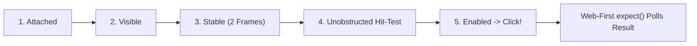

# The Five Actionability Gates & Web-First Retrying Assertions

```json continuity
{
  "previously": "In Chapter 4, we upgraded AeroBot to v0.4 using Browser Accessibility Tree (AXTree) locators, relational .filter() chains, and Strict Mode.",
  "painPoint": "Even when AeroBot v0.4 finds the right button, what if the button is still sliding in on a CSS drawer animation, covered by a loading spinner backdrop, or checked with a non-waiting assert locator.is_visible() that fails 80ms before the API responds?",
  "unlock": "We will upgrade AeroBot to v0.5 by harnessing Playwright's 5-Gate requestAnimationFrame actionability state machine and Web-First retrying expect() assertions."
}
```

```json walkthrough
[
  {
    "time": "0:00",
    "badge": "🌱 The 5 Pre-Flight Safety Checks",
    "caption": "Before clicking a button, Playwright acts like a careful pilot running 5 safety gates inside the browser: Is it attached? Visible? Done sliding across the screen? Unblocked by overlays? Enabled?",
    "code": "Attached -> Visible -> Stable (2 rAFs) -> Receives Events -> Enabled"
  },
  {
    "time": "0:25",
    "badge": "🔨 AeroBot v0.5: Web-First Retrying Assertions",
    "caption": "Instead of taking a 0ms snapshot with is_visible() that fails while an API is in flight, AeroBot v0.5 uses expect(locator).to_be_visible() which polls inside the browser and resolves the instant the element appears.",
    "code": "expect(page.get_by_role('status')).to_have_text('Discount Applied')"
  },
  {
    "time": "0:50",
    "badge": "⚡ The is_visible() & force=True Traps",
    "caption": "Writing assert locator.is_visible() does ZERO waiting! And slapping click(force=True) onto a blocked button clicks straight through a modal backdrop that would block a real human customer.",
    "code": "assert badge.is_visible()  # BUG: 0ms snapshot, no auto-wait!"
  },
  {
    "time": "1:15",
    "badge": "🚀 Staff 2-Frame Stability & Raycasting",
    "caption": "Playwright compares getBoundingClientRect() across 2 consecutive requestAnimationFrame ticks (~33ms at 60Hz) and casts a pointer ray via elementFromPoint(cx, cy) to prove nothing covers the target.",
    "code": "document.elementFromPoint(cx, cy) in SelfOrDescendants(target)"
  }
]
```

```json pretraining
[
  {
    "term": "The 5 Actionability Gates",
    "formula": "Attached -> Visible -> Stable -> Receives Events -> Enabled",
    "meaning": "The five physical checks Playwright automatically runs inside the browser before every click so it never clicks a moving, hidden, covered, or disabled button."
  },
  {
    "term": "2-Frame Layout Stability (rAF)",
    "formula": "Box(Frame 1) == Box(Frame 2) -> Motion Settled!",
    "meaning": "Playwright measures the button's position on two back-to-back screen redraws (~33ms); if the coordinates changed, the button is still sliding in, so Playwright waits."
  },
  {
    "term": "Pointer Hit-Target Raycast",
    "formula": "elementFromPoint(cx, cy) == Target Button (Not a Spinner Overlay!)",
    "meaning": "Playwright checks what is actually sitting on top of the click coordinates; if a loading spinner or cookie banner covers the button, it waits for the overlay to disappear."
  },
  {
    "term": "Web-First Retrying Assertion",
    "formula": "expect(loc).to_be_visible() [Polls up to 5s] vs loc.is_visible() [0ms Snapshot]",
    "meaning": "Web-First assertions keep checking inside the browser until the UI updates, whereas is_visible() checks once at 0 milliseconds and gives up immediately."
  }
]
```

## 🌱 Step 1: Plain-English Story — The 5-Point Pre-Flight Checklist vs Blindly Pressing Buttons

Imagine reaching out to press an elevator button while your eyes are closed:
- What if the button hasn't slid into view yet? You tap the wall!
- What if a maintenance worker taped a plastic sign *over* the button? Your finger hits the plastic cover!
- What if the button is temporarily switched off? Nothing happens!

When you call `locator.click()` in Playwright, it never clicks blindly. Inside the browser's rendering loop (`requestAnimationFrame`), Playwright runs a **5-Gate Pre-Flight Checklist** before dispatching the mouse click:

1. **Attached**: Is the element connected to the live DOM (`count == 1`)?
2. **Visible**: Does it have a non-zero width and height on screen?
3. **Stable**: Has it stopped moving? Playwright checks its position on **two back-to-back animation frames** so it never clicks a sliding drawer mid-flight!
4. **Receives Events (Hit-Test)**: Is anything covering it? Playwright checks the exact `(x, y)` click point; if a loading spinner backdrop is on top, Playwright waits for the spinner to vanish!
5. **Enabled**: Is the button free of `disabled` or `aria-disabled="true"`?

Once the click happens, how should we verify the result? Never use `assert locator.is_visible()`—that takes an **instant 0ms photo** before the server responds! Always use **Web-First Assertions** (`expect(locator).to_be_visible()`), which watch the page and pass the millisecond the update arrives.



---

## 🔨 Step 2: First Lines of Code — AeroBot v0.5 5-Gate Click & Web-First Assertions

Let's upgrade **`AeroBot` to `v0.5`**. We replace every fragile `assert locator.is_visible()` or `time.sleep()` with Playwright's 5-gate `.click()` and retrying `expect()` assertions.

```python
# aerobot_v05.py — AeroBot v0.5: 5-Gate auto-waiting click + Web-First expect()
import re
from playwright.sync_api import Page, expect

def test_coupon_and_checkout_settlement(page: Page) -> None:
    page.goto("http://127.0.0.1:8090")
    # 5-Gate click: waits for drawer slide-in (2 rAFs) and spinner overlay clearance
    page.get_by_role("button", name="Submit Payment", exact=True).click()

    # Web-First assertions poll inside the browser (zero time.sleep, zero 0ms race!):
    status_badge = page.get_by_test_id("payment-lifecycle-badge")
    expect(status_badge).to_have_text("CONFIRMED", timeout=5_000)
    expect(page).to_have_url(re.compile(r".*/orders/ORD-[A-Z0-9]+/receipt$"))
```

### Java 17 Equivalent

```java
// AeroBotV05.java — AeroBot v0.5: 5-Gate auto-waiting click + Web-First assertThat()
import com.microsoft.playwright.*;
import com.microsoft.playwright.options.AriaRole;
import java.util.regex.Pattern;
import static com.microsoft.playwright.assertions.PlaywrightAssertions.assertThat;

public class AeroBotV05 {
    public static void verifyCheckoutSettlement(Page page) {
        page.navigate("http://127.0.0.1:8090");
        page.getByRole(AriaRole.BUTTON,
                new Page.GetByRoleOptions().setName("Submit Payment").setExact(true)).click();

        Locator statusBadge = page.getByTestId("payment-lifecycle-badge");
        assertThat(statusBadge).hasText("CONFIRMED");
        assertThat(page).hasURL(Pattern.compile(".*/orders/ORD-[A-Z0-9]+/receipt$"));
    }
}
```

---

## ⚡ Step 3: Where It Breaks in Real Life — The `is_visible()` & `force=True` Traps

Even in Playwright codebases, two habits re-introduce massive flakiness:

1. **The `assert locator.is_visible()` 0ms Trap**: An engineer clicks **"Apply Coupon"** and writes `assert page.get_by_role("status").is_visible()` on the next line. Because `is_visible()` is a **0ms snapshot question** (not an assertion!), it checks the DOM at `t = 1ms` while the `POST /coupons` request is still in flight, returns `False`, and fails the test! Even worse: `locator.text_content()` only waits for the element to be *attached*, so if a status badge changes from `"Pending"` to `"Confirmed"` after `80ms`, `assert badge.text_content() == "Confirmed"` reads `"Pending"` at `0ms` and crashes!
2. **The `.click(force=True)` Blindfold**: When a test fails with `<div class="modal-backdrop"> intercepts pointer events`, engineers sometimes add `.click(force=True)`. That turns off Gates 2, 3, and 4 and fires a click straight through a stuck loading spinner that would completely block a real customer!

```json contrast
{
  "title": "0ms Snapshot Getters & force=True Abuse vs AeroBot v0.5 5-Gate Click & Web-First expect()",
  "naiveTitle": "assert loc.is_visible() + click(force=True)",
  "naiveMetric": "0ms Race Crashes · Clicks Through Overlays",
  "naivePoints": [
    "assert badge.is_visible() checks at 0ms with zero waiting—failing whenever an API takes 50ms",
    "assert badge.text_content() == 'Paid' reads stale 'Pending' text before React updates the node",
    "click(force=True) bypasses hit-target raycasting and hides real broken z-index modal overlays"
  ],
  "staffTitle": "AeroBot v0.5 5-Gate Click + Web-First expect()",
  "staffMetric": "0ms Wasted Sleep · Catches Stuck Overlays",
  "staffPoints": [
    "expect(badge).to_be_visible() and to_have_text('Paid') poll inside the browser until state settles",
    "2-rAF stability gate guarantees sliding drawers and modals finish moving before coordinates fire",
    "Treats 'subtree intercepts pointer events' as a real UI bug or awaits overlay dismissal cleanly"
  ]
}
```

```json poe
{
  "question": "After clicking `'Apply Coupon'`, an async `POST /coupons` call takes `85ms` before rendering `<div role='status'>Discount Applied</div>`. Compare these two lines written immediately after `.click()`:\nLine A: `assert page.get_by_role('status').is_visible()`\nLine B: `expect(page.get_by_role('status')).to_be_visible()`\nWhy does Line A fail 98% of the time in CI while Line B passes 100% of the time in `~90ms`?",
  "options": [
    "`is_visible()` always returns `False` for `role='status'` elements",
    "`locator.is_visible()` is a **synchronous point-in-time boolean snapshot with ZERO auto-waiting**—evaluated at `t = 1ms` while the `POST` is still in flight, it immediately returns `False` and crashes `assert False`! By contrast, `expect(locator).to_be_visible()` is a **Web-First retrying assertion** that polls inside the browser until `t ≈ 85ms` (bounded by the 5,000ms assertion timeout)",
    "`expect()` pauses backend database transactions",
    "`is_visible()` requires XPath selectors"
  ],
  "answerIndex": 1,
  "explanation": "`assert locator.is_visible()` and `assert locator.text_content() == ' Paid'` are the #1 cause of self-inflicted flakiness in Playwright codebases! Boolean predicates (`is_visible()`, `is_enabled()`, `is_checked()`) intentionally do not wait; assertions MUST use `expect(locator).to_be_visible()` / `to_have_text()`."
}
```

---

## 🚀 Step 4: Staff Engineer Deep-Dive — `rAF` Stability Math & Hit-Target Raycasting

### 1. Formalizing 2-Frame Stability & Hit-Target Raycasting

Let $B(e, k) = \langle x_k, y_k, w_k, h_k \rangle$ be the `DOMRect` returned by `e.getBoundingClientRect()` on animation frame $k$ (where $\Delta t_{\text{rAF}} = \frac{1000}{60} \approx 16.67\text{ ms}$ on a $60\text{ Hz}$ compositor). Playwright's pointer actionability predicate $\mathcal{A}_{\text{click}}(e, k)$ requires all five gates to hold simultaneously on frame $k$:

$$\mathcal{A}_{\text{click}}(e, k) \iff \text{Attached}(e) \land \text{Visible}(e) \land \bigl(B(e, k) = B(e, k-1)\bigr) \land \bigl(\text{elementFromPoint}(c_x, c_y) \in \text{Subtree}(e)\bigr) \land \text{Enabled}(e)$$

Notice that not every action requires all 5 gates! Knowing the exact gate matrix per action is a classic Staff SDET interview discriminator:

| Action Method | Gate 1: Attached | Gate 2: Visible | Gate 3: Stable (`2 rAF`) | Gate 4: Hit-Target Raycast | Gate 5: Enabled | Gate 6: Editable (`!readonly`) |
| :--- | :---: | :---: | :---: | :---: | :---: | :---: |
| `locator.click()` / `dblclick()` | Yes | Yes | **Yes** | **Yes** | Yes | No |
| `locator.fill("text")` | Yes | Yes | No | No | Yes | **Yes** |
| `locator.check()` / `uncheck()` | Yes | Yes | **Yes** | **Yes** | Yes | No |
| `locator.hover()` | Yes | Yes | **Yes** | **Yes** | No | No |
| `locator.is_visible()` | **0ms Check** | **0ms Check** | No | No | No | No |

### 2. Production Dual-Language Blueprint: Zero-Sleep Actionability & Multi-Row Assertions

```python
from __future__ import annotations
import re
from playwright.sync_api import Page, expect

def verify_async_checkout_transition(page: Page) -> None:
    pay_btn = page.get_by_role("button", name="Submit Payment", exact=True)
    status_pill = page.get_by_test_id("payment-lifecycle-badge")
    receipt_url_re = re.compile(r".*/orders/ORD-[A-Z0-9]{8}/receipt$")

    # 5-Gate click: waits for slide-in animation & any preceding spinner backdrop to clear
    pay_btn.click()

    # Web-First Assertions: poll inside browser engine with zero time.sleep!
    expect(pay_btn).to_be_disabled()
    expect(status_pill).to_have_text("CONFIRMED", timeout=8_000)
    expect(page).to_have_url(receipt_url_re)

    # Collection Web-First assertion: waits until all 3 line-item rows + 1 header row mount
    line_items = page.get_by_role("table", name="Order Summary").get_by_role("row")
    expect(line_items).to_have_count(4)
```

```java
package com.aerocart.qa.actionability;

import com.microsoft.playwright.*;
import com.microsoft.playwright.assertions.LocatorAssertions;
import com.microsoft.playwright.options.AriaRole;
import java.util.regex.Pattern;
import static com.microsoft.playwright.assertions.PlaywrightAssertions.assertThat;

public final class CheckoutActionabilitySpec {
    public void verifyOrderSettlementWithoutSleeps(Page page) {
        Locator confirmBtn = page.getByRole(AriaRole.BUTTON,
                new Page.GetByRoleOptions().setName("Place Order").setExact(true));
        Locator toastAlert = page.getByRole(AriaRole.ALERT);

        confirmBtn.click();

        assertThat(toastAlert).isVisible(new LocatorAssertions.IsVisibleOptions().setTimeout(10_000));
        assertThat(toastAlert).containsText("Booking confirmed");
        assertThat(page).hasURL(Pattern.compile(".*/confirmation/[a-f0-9-]+$"));
    }
}
```

> [!WARNING]
> **Staff Interview Gotcha — Why `.click(force=True)` Masks Critical Production UX Outages**:
> When CI fails with `TimeoutError: <div class="cookie-consent-overlay"> intercepts pointer events`, junior engineers reflexively add `.click(force=True)`. What did they actually do? `force=True` disables the **Visible, Stable, and Receives Events (Hit-Target)** checks and fires a synthetic event straight through the overlay—meaning **real human customers on production cannot click Checkout because an undismissed overlay is physically blocking it!** Always fix or dismiss the blocking overlay instead of blinding Gate 4 with `force=True`.

**Up Next in Chapter 6**: Even with 5-gate actionability, why is **`AeroBot v0.5`** still wasting `4.5 seconds` typing username, password, and 2FA codes into the login UI before every single test? In **Chapter 6**, we upgrade **`AeroBot` to `v0.6`** with **Zero-UI Authentication (`storageState`) & Worker-Scoped Identity Pools** to log in any test in `15ms`!

```json quiz
[
  {
    "id": "pw-05-q1",
    "question": "How does Playwright's **Gate 3 (Stable)** determine that a sliding CSS modal button has finished moving before dispatching `click()`?",
    "options": [
      "It parses all `.css` stylesheets and reads `transition-duration`",
      "It sleeps a fixed `300ms` before every click",
      "It measures the element's bounding box across **two consecutive `requestAnimationFrame` callbacks** and only proceeds once both frames report identical geometry",
      "It disables CSS animations globally via CDP"
    ],
    "answerIndex": 2,
    "explanation": "Comparing `getBoundingClientRect()` across two consecutive browser animation frames (`rAF`) proves empirically that layout motion has settled without hardcoding CSS transition durations."
  },
  {
    "id": "pw-05-q2",
    "question": "Why does `locator.fill('alice@aerocart.com')` NOT require the **Receives Events (Hit-Target)** or **2-rAF Stable** gates that `locator.click()` enforces, while adding an **Editable** gate instead?",
    "options": [
      "It is an oversight in Playwright's implementation",
      "`fill()` focuses and programmatically sets the input value + dispatches `input`/`change` events rather than simulating physical `(x, y)` mouse raycasting, so it requires `Attached + Visible + Enabled + Editable (!readonly)`",
      "`fill()` works on `display: none` hidden inputs",
      "`fill()` bypasses Strict Mode"
    ],
    "answerIndex": 1,
    "explanation": "Knowing the exact per-action gate table separates true Playwright internals mastery from guesswork: `fill()` checks `Attached`, `Visible`, `Enabled`, and `Editable`, whereas pointer actions (`click`, `hover`, `check`) enforce `Stable` and `Receives Events`."
  },
  {
    "id": "pw-05-q3",
    "question": "An engineer writes `assert 'Invalid Promo' in page.get_by_role('alert').text_content()` after clicking `'Apply'`. Sometimes it fails because an earlier info alert `'Enter code above'` is still mounted for `60ms` before switching to `'Invalid Promo'`. Why did `text_content()` fail to wait for `'Invalid Promo'`?",
    "options": [
      "`text_content()` auto-waits ONLY for an element matching `role='alert'` to be **Attached**—since the old alert was already attached, `text_content()` returned `'Enter code above'` at `t=0ms` and Python's bare `assert` failed immediately! Using `expect(page.get_by_role('alert')).to_contain_text('Invalid Promo')` retries until the text updates",
      "`text_content()` strips spaces from strings",
      "`role='alert'` cannot change text dynamically",
      "Python `in` operator is incompatible with UTF-8"
    ],
    "answerIndex": 0,
    "explanation": "`text_content()` waits only for element attachment, NOT for a specific expected text value! Whenever an existing element's text mutates asynchronously, only `expect(locator).to_have_text(...)` / `to_contain_text(...)` retries until the target string appears."
  }
]
```
