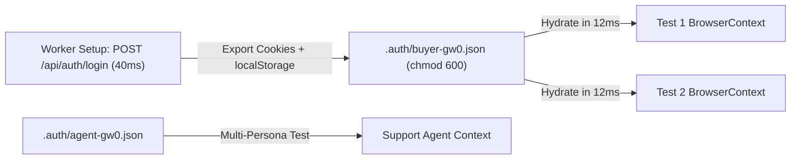

# Zero-UI Auth, `storageState.json` Hydration & Multi-Persona Flows

```json pretraining
[
  {
    "term": "Login Tax Math",
    "formula": "500 Tests * 3.5s UI Login = 1,750s (29.1 min) Wasted vs 1 Setup + 12ms Hydrate",
    "meaning": "Driving the SSO/MFA UI form 500 times tests login 499 redundant times and exposes all 500 tests to IdP network jitter and CAPTCHA rate limits."
  },
  {
    "term": "`storageState` Snapshot Schema",
    "formula": "{ cookies: [...HttpOnly/SameSite], origins: [{ origin, localStorage: [...] }] }",
    "meaning": "Playwright serializes both `HttpOnly` browser cookies AND per-origin `localStorage` keys to JSON, hydrating new `BrowserContext`s before navigation #1."
  },
  {
    "term": "Shared-Jar `APIRequestContext`",
    "formula": "context.request.post('/api/login') -> Mutates BrowserContext Cookie Jar Directly!",
    "meaning": "Executing an API login via `context.request` automatically populates `Set-Cookie` headers into the bound `BrowserContext` in ~40ms with zero UI rendering."
  },
  {
    "term": "Worker-Scoped Account Partitioning",
    "formula": "gw0 -> buyer_0.json | gw1 -> buyer_1.json  [Zero Cross-Worker Cart/Token Races]",
    "meaning": "Read-only tests can share one `storageState.json`, but stateful tests mutating server-side carts/settings MUST use per-worker auth identities!"
  }
]
```

```json poe
{
  "question": "An SPA stores its OAuth access token inside **`sessionStorage`** (NOT `cookies` and NOT `localStorage`). An engineer authenticates once in a setup fixture, calls `context.storage_state(path='.auth/user.json')`, and passes `storage_state='.auth/user.json'` to 200 tests—yet every single test redirects back to `/login` unauthenticated! Why did `storage_state` miss the token, and what is the clean fix?",
  "options": [
    "`.auth/user.json` must be encrypted with AES-256 for Chromium to read it",
    "Playwright's `storage_state()` captures **cookies** and **`localStorage`** (plus optional `IndexedDB`), NOT tab-ephemeral `window.sessionStorage`! To hydrate `sessionStorage`, dump `window.sessionStorage` via `page.evaluate()` during setup and inject it into new contexts via `context.add_init_script(...)` before `page.goto()`",
    "`sessionStorage` is wiped whenever `headless=True`",
    "JSON files cannot store JWT strings longer than 256 bytes"
  ],
  "answerIndex": 1,
    "explanation": "By W3C Web Storage spec, `sessionStorage` is bound to a single top-level browsing tab session rather than persistent profile storage, so `storage_state` intentionally omits it. Capturing `JSON.stringify(sessionStorage)` once and registering `context.add_init_script` restores `sessionStorage` on origin load in <2ms."
}
```

## Part I — First-Principles Mental Model: Authenticate Once per Worker/Persona, Hydrate in 12ms

Suppose your suite has 500 E2E UI specs:
- **5 specs** in `tests/auth/test_login_and_mfa.py` actually verify the Login UI, password validation, OAuth redirect, and TOTP MFA challenge.
- **495 specs** test Search, Seat Selection, Checkout, Refunds, and Admin Dashboards.

If all 495 downstream specs type credentials into `/login`, click `'Sign In'`, wait for Okta/Auth0 redirects, and wait for dashboard bundles:
1. **Latency Explosion**: `495 * 3.5s = 28.8 minutes` of pure redundant login animations.
2. **Single Point of Failure Amplification**: A 2-second rate-limit hiccup on your staging Identity Provider fails 100% of cart and search tests.

### The Two Staff Zero-UI Auth Architectures
1. **API Login $\to$ `storageState` File Hydration**: A worker-scoped setup fixture sends a single `POST /api/v1/auth/login` via `playwright.request.new_context()`, receives `Set-Cookie` (or writes the returned JWT into `localStorage`), exports `.auth/buyer-gw0.json` (git-ignored + mode `0600`!), and every test creates `browser.new_context(storage_state=auth_file)` in **12ms**—landing on `/checkout` already authenticated!
2. **Multi-Persona Concurrent Collaboration**: Need to verify that when a **Support Agent** clicks `'Approve Refund'` in the Admin Portal, the **Customer** sees `'Refund Issued'` appear live via WebSocket on their Order page? Spawn `customer_ctx = browser.new_context(storage_state=customer_auth)` and `agent_ctx = browser.new_context(storage_state=agent_auth)` side-by-side inside the **same test**!



```json contrast
{
  "title": "500x UI Login Form vs Worker-Scoped API `storageState` Hydration",
  "naiveTitle": "UI Login Inside `beforeEach` + 1 Shared User",
  "naiveMetric": "+29m Suite Tax · Cross-Worker Cart Wipes",
  "naivePoints": [
    "Types username/password and waits for Auth0 redirect before every single test across 500 specs",
    "All 16 parallel CI workers share `qa_user@corp.com`: Worker 3's `'Empty Cart'` test deletes Worker 7's checkout items!",
    "Commits `.auth/admin.json` to Git by mistake, leaking live staging session cookies into repository history"
  ],
  "staffTitle": "Worker-Partitioned API `storageState`",
  "staffMetric": "40ms Once + 12ms/Test · Zero Shared State",
  "staffPoints": [
    "Authenticates `buyer-gw0`..`buyer-gw15` via headless `APIRequestContext` once per worker session",
    "Writes `.auth/*.json` to ephemeral `tmp_path_factory` (`0600` permissions, strictly `.gitignore`d)",
    "Supports simultaneous `buyer_page` + `support_agent_page` multi-actor verification in <10MB RAM"
  ]
}
```

---

## Part II — Auth State Storage Mechanisms & Trade-Offs

Use the **`pw-network-auth-sharding`** interactive simulator to inspect how `storageState.json` hydrates cookies and `localStorage` across parallel worker personas.

| App Auth Mechanism | Captured by `storage_state()`? | Hydration Strategy | Parallel Worker Rule |
| :--- | :---: | :--- | :--- |
| **`HttpOnly` / `Secure` Cookies** | **Yes** (`cookies[]`) | Native `browser.new_context(storage_state=path)` | Partition user per worker if server stores mutable session/cart per user ID! |
| **`localStorage` JWT / Refresh** | **Yes** (`origins[].localStorage`) | Native `browser.new_context(storage_state=path)` | Refresh if TTL < remaining shard runtime (~15m). |
| **`IndexedDB` (Firebase Auth)** | **Opt-in** (`indexed_db=True`) | Pass `indexed_db=True` when saving `storage_state` | Supported in modern Playwright (`>=1.51`); else `add_init_script`. |
| **`window.sessionStorage`** | **No** (Tab-scoped) | Inject JSON snapshot via `context.add_init_script(...)` | Guard script check `if (window.location.origin === TARGET_ORIGIN)`! |

---

## Part III — Production Implementation Blueprints (Python 3 & Java 17)

### Python 3 Blueprint: Worker-Scoped API Auth Hydration + Multi-Actor Buyer/Agent Collaboration Test
```python
from __future__ import annotations
import os
import pathlib
from typing import Generator
import pytest
from playwright.sync_api import Browser, BrowserContext, Page, Playwright, expect


def _mint_worker_storage_state(
    pw: Playwright, base_url: str, role: str, worker_id: str, out_file: pathlib.Path
) -> pathlib.Path:
    """Authenticates via fast HTTP API (~35ms), saves cookies/storage with 0600 perms, zero UI boot!"""
    api_ctx = pw.request.new_context(base_url=base_url)
    try:
        resp = api_ctx.post(
            "/api/v1/auth/test-token",
            data={"email": f"{role}.{worker_id}@aerocart.test", "role": role},
        )
        assert resp.ok, f"Auth seed failed ({resp.status}): {resp.text()}"
        api_ctx.storage_state(path=str(out_file))
        os.chmod(out_file, 0o600)  # Strict owner-only read/write permissions
        return out_file
    finally:
        api_ctx.dispose()


@pytest.fixture(scope="session")
def buyer_auth_file(
    playwright: Playwright, tmp_path_factory: pytest.TempPathFactory, request: pytest.FixtureRequest
) -> pathlib.Path:
    worker = getattr(request.config, "workerinput", {}).get("workerid", "gw0")
    auth_path = tmp_path_factory.mktemp("auth") / f"buyer-{worker}.json"
    base_url = os.getenv("AEROCART_BASE_URL", "http://127.0.0.1:3000")
    return _mint_worker_storage_state(playwright, base_url, "buyer", worker, auth_path)


@pytest.fixture(scope="session")
def agent_auth_file(
    playwright: Playwright, tmp_path_factory: pytest.TempPathFactory, request: pytest.FixtureRequest
) -> pathlib.Path:
    worker = getattr(request.config, "workerinput", {}).get("workerid", "gw0")
    auth_path = tmp_path_factory.mktemp("auth") / f"agent-{worker}.json"
    base_url = os.getenv("AEROCART_BASE_URL", "http://127.0.0.1:3000")
    return _mint_worker_storage_state(playwright, base_url, "support_agent", worker, auth_path)


def test_agent_refund_reflects_live_on_buyer_screen(
    browser: Browser, buyer_auth_file: pathlib.Path, agent_auth_file: pathlib.Path
) -> None:
    buyer_ctx: BrowserContext = browser.new_context(storage_state=str(buyer_auth_file))
    agent_ctx: BrowserContext = browser.new_context(storage_state=str(agent_auth_file))
    try:
        buyer_page: Page = buyer_ctx.new_page()
        agent_page: Page = agent_ctx.new_page()

        buyer_page.goto("/orders/ORD-9012")
        buyer_page.get_by_role("button", name="Request Refund").click()
        expect(buyer_page.get_by_test_id("refund-state")).to_have_text("PENDING_APPROVAL")

        agent_page.goto("/admin/refund-queue")
        agent_page.get_by_role("row").filter(has_text="ORD-9012").get_by_role("button", name="Approve").click()

        # Verify real-time push update on Buyer's isolated BrowserContext!
        expect(buyer_page.get_by_test_id("refund-state")).to_have_text("REFUNDED")
    finally:
        agent_ctx.close()
        buyer_ctx.close()
```

### Java 17 Blueprint: `APIRequestContext` Zero-UI Auth Seed & Multi-Persona Context Hydration
```java
package com.aerocart.qa.auth;

import com.microsoft.playwright.*;
import com.microsoft.playwright.options.RequestOptions;
import java.nio.file.Path;
import java.util.Map;

public final class StorageStateAuthProvisioner {

    public static Path createAuthenticatedState(
            Playwright playwright, String baseUrl, String email, String role, Path targetJson) {

        APIRequestContext api = playwright.request().newContext(
                new APIRequest.NewContextOptions().setBaseURL(baseUrl));
        try {
            APIResponse response = api.post("/api/v1/auth/login",
                    RequestOptions.create().setData(Map.of("email", email, "role", role)));
            if (!response.ok()) {
                throw new IllegalStateException("API login failed HTTP " + response.status());
            }
            // Persists Set-Cookie headers directly into storageState JSON format
            api.storageState(new APIRequestContext.StorageStateOptions().setPath(targetJson));
            return targetJson;
        } finally {
            api.dispose();
        }
    }

    public static BrowserContext newPersonaContext(Browser browser, Path storageStateJson) {
        return browser.newContext(new Browser.NewContextOptions().setStorageStatePath(storageStateJson));
    }
}
```

> [!WARNING]
> **Staff Interview Gotcha — Single-Use Refresh Token Rotation Invalidating Shared `storageState.json`**:
> Modern OAuth 2.1 / Auth0 configurations often enable **Refresh Token Rotation with Reuse Detection**: the moment Test #1's silent token refresh consumes `refresh_token_v1` to obtain `refresh_token_v2`, the auth server marks `refresh_token_v1` as **spent**—and when Test #2 boots from the static `.auth/user.json` and presents `refresh_token_v1` again, the auth server detects "token replay" and **revokes the entire user session family (`401 Unauthorized`)**! Solution: issue adequately scoped access-token TTLs (`30m`) for test runs so silent refresh doesn't fire mid-shard, AND mint **distinct sessions per parallel worker** (`buyer-gw0`..`buyer-gw15`).

---

## Part IV — Scenario Retrieval-Practice Mastery Gate

```json quiz
[
  {
    "id": "pw-06-q1",
    "question": "16 parallel Playwright workers load the EXACT same `.auth/shared_buyer.json` (`user_id = 42`). Even though each worker creates its own isolated `BrowserContext` in memory, why do `test_add_item_to_cart` and `test_clear_entire_cart` still flake intermittently?",
    "options": [
      "`storage_state` shares browser RAM across OS processes",
      "`BrowserContext` isolates **client-side browser storage**, NOT **server-side database state**! Because all 16 workers authenticate as `user_id = 42` in Postgres, Worker 4 calling `DELETE /api/cart` wipes the server-side cart rows that Worker 9 just added! Stateful tests require **worker-scoped accounts** (`buyer-gw0`..`buyer-gw15`)",
      "Cookies expire when read by two processes simultaneously",
      "Chromium locks `.json` files exclusively for 60 seconds"
    ],
    "answerIndex": 1,
    "explanation": "Client-side incognito isolation does nothing to stop two browsers logged into the *same backend account* from mutating the same `carts WHERE user_id = 42` rows in Postgres! Partition accounts per worker (`gw0..gwN`) for any test that mutates user-scoped backend state."
  },
  {
    "id": "pw-06-q2",
    "question": "Why must `.auth/*.json` (`storageState` files) NEVER be committed to Git or uploaded inside public CI artifacts?",
    "options": [
      "They contain binary machine code specific to macOS vs Linux",
      "They contain live, unencrypted bearer `HttpOnly` session cookies and `localStorage` tokens—anyone reading `.auth/admin.json` can import it into a browser context and impersonate that authenticated session without knowing the password or passing MFA!",
      "Git corrupts JSON files larger than 4KB",
      "Playwright refuses to load tracked files"
    ],
    "answerIndex": 1,
    "explanation": "A `storageState.json` file IS a live session credential bundle. Always generate it dynamically into ephemeral temp directories (`tmp_path_factory` / `.auth/` in `.gitignore`) with `0600` file permissions."
  },
  {
    "id": "pw-06-q3",
    "question": "If you inject `sessionStorage` tokens via `context.add_init_script(script)`, what security precaution must `script` include when the page under test embeds third-party analytics or payment `<iframe>`s?",
    "options": [
      "Disable JavaScript on all iframes",
      "Check `if (window.location.origin === EXPECTED_APP_ORIGIN)` inside the init script BEFORE writing tokens into `window.sessionStorage`, because `context.add_init_script` runs in EVERY frame/origin navigated within that `BrowserContext`!",
      "Convert `sessionStorage` to cookies",
      "`add_init_script` never runs inside iframes"
    ],
    "answerIndex": 1,
    "explanation": "`context.add_init_script` executes before page scripts in every document and subframe inside that `BrowserContext`. Guarding `window.location.origin === APP_ORIGIN` prevents leaking auth tokens into third-party iframe `sessionStorage`."
  }
]
```
