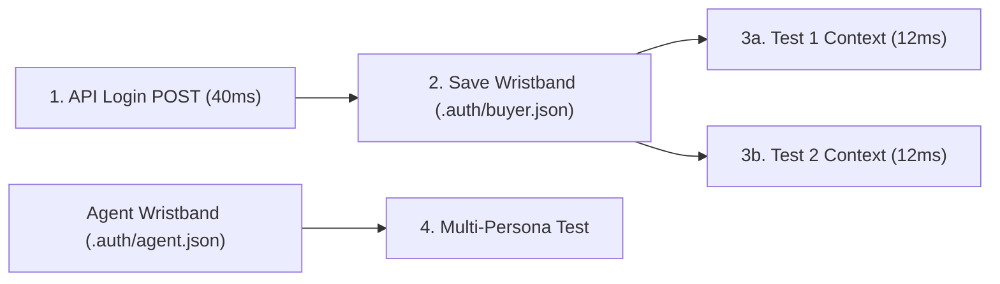

# Zero-UI Auth, `storageState.json` Hydration & Multi-Persona Flows

```json continuity
{
  "previously": "In Chapter 5, we upgraded AeroBot v0.5 with Page Object Components (`SeatMapDrawer`) and functional fixture factories so 100 checkout tests stay DRY and readable.",
  "painPoint": "Every one of our 100 AeroBot tests starts by opening `/login`, typing a username and password, and waiting 3.5 seconds for the login redirect—wasting nearly 6 minutes just logging in over and over!",
  "unlock": "We will upgrade AeroBot to v0.6 with Zero-UI API Auth and `storageState.json` hydration, logging in once in 40 milliseconds and booting every test already signed in within 12 milliseconds!"
}
```

```json walkthrough
[
  {
    "time": "0:00",
    "badge": "1. The Wristband Shortcut",
    "caption": "Typing your password into the login screen before every single test is like waiting in the ticket booth line before every ride at a theme park. Instead, get your VIP wristband once at the gate and walk straight onto every ride!",
    "code": "# 1 API call -> save VIP wristband (.auth/buyer.json)\napi.storage_state(path='.auth/buyer.json')"
  },
  {
    "time": "0:22",
    "badge": "2. 12ms Context Boot",
    "caption": "Playwright's storageState snapshots your browser's cookies and localStorage into a tiny JSON file. Passing that file to browser.new_context boots a fresh tab already logged in within 12 milliseconds!",
    "code": "ctx = browser.new_context(\n    storage_state='.auth/buyer.json'\n)"
  },
  {
    "time": "0:48",
    "badge": "3. Worker Account Collision",
    "caption": "If 16 parallel workers share the exact same buyer account on the backend database, Worker 2's 'Empty Cart' test will accidentally delete Worker 5's checkout cart! Every parallel worker needs its own test account.",
    "code": "# Partition per worker: buyer-gw0, buyer-gw1...\nemail = f'buyer.{worker_id}@aerocart.test'"
  },
  {
    "time": "1:12",
    "badge": "4. Multi-Persona Choreography",
    "caption": "Because each BrowserContext has its own isolated cookie jar, AeroBot v0.6 can open a Buyer tab and a Support Agent tab side-by-side in the same test to verify live refund approvals in real time!",
    "code": "buyer_ctx = browser.new_context(storage_state=buyer_json)\nagent_ctx = browser.new_context(storage_state=agent_json)"
  }
]
```

```json pretraining
[
  {
    "term": "The UI Login Tax",
    "formula": "500 Tests * 3.5s UI Login = 29 Minutes Wasted vs 1 API Call + 12ms Hydrate",
    "meaning": "Typing into the login page before all 500 tests tests the login box 499 extra times for no reason, slowing down your suite and breaking everything if the login page hiccups."
  },
  {
    "term": "`storageState.json` (The VIP Wristband)",
    "formula": "{ cookies: [...], origins: [{ origin, localStorage: [...] }] }",
    "meaning": "A small JSON snapshot file where Playwright saves your logged-in browser cookies and localStorage keys so future browser tabs can start already signed in."
  },
  {
    "term": "`APIRequestContext` (Headless API Login)",
    "formula": "playwright.request.new_context() -> POST /api/login (40ms)",
    "meaning": "Playwright's built-in HTTP client that can log in directly against your backend API in 40 milliseconds without even opening a visual login page."
  },
  {
    "term": "Worker-Scoped Account Partitioning",
    "formula": "Worker gw0 -> buyer_0@test | Worker gw1 -> buyer_1@test",
    "meaning": "Giving each parallel test runner its own dedicated user account in the database so two tests running at the same time never overwrite each other's shopping cart."
  }
]
```

```json poe
{
  "question": "An SPA stores its OAuth access token inside **`sessionStorage`** (NOT `cookies` and NOT `localStorage`). An engineer authenticates once in a setup fixture, calls `context.storage_state(path='.auth/user.json')`, and passes `storage_state='.auth/user.json'` to 200 tests—yet every single test redirects back to `/login` unauthenticated! Why did `storage_state` miss the token, and what is the clean fix?",
  "options": [
    "`.auth/user.json` must be encrypted with AES-256 for Chromium to read it",
    "Playwright's `storage_state()` captures **cookies** and **`localStorage`** (plus optional `IndexedDB`), NOT tab-ephemeral `window.sessionStorage`! To hydrate `sessionStorage`, dump `window.sessionStorage` via `page.evaluate()` during setup and inject it into new contexts via `context.add_init_script(...)` before `page.goto()`",
    "`sessionStorage` is wiped whenever `headless=True`",
    "JSON files cannot store JWT strings longer than 256 bytes"
  ],
  "answerIndex": 1,
  "explanation": "By W3C Web Storage spec, `sessionStorage` is bound to a single top-level browsing tab session rather than persistent profile storage, so `storage_state` intentionally omits it. Capturing `JSON.stringify(sessionStorage)` once and registering `context.add_init_script` restores `sessionStorage` on origin load in <2ms."
}
```

---

## 🌱 Step 1: Plain-English Story — The Theme Park VIP Wristband

Imagine visiting a theme park with 500 roller coasters. At the first ride, you wait 4 minutes at the ticket booth, show your ID, pay, and get a paper ticket. Now imagine if **every single ride** forced you to walk all the way back to the front gate and wait in that 4-minute ticket booth line again! You would spend 33 hours standing in ticket lines before riding everything once.

That is what happens when `AeroBot v0.5` logs in through the `/login` UI screen before every checkout, seat-map, and refund test:
- **2 tests** in `test_login.py` actually test the login screen itself.
- **498 tests** just want to be signed in so they can test flights, seats, and refunds!

Instead of waiting in the UI login line 498 times, **Zero-UI Auth** works like a **Theme Park VIP Wristband**:
1. Before the suite starts, `AeroBot v0.6` sends one fast HTTP `POST /api/v1/auth/login` request directly to the server (taking just 40 milliseconds, no browser screen needed).
2. It saves the resulting login cookies and browser storage into a tiny file called `.auth/buyer.json`—our **VIP Wristband**.
3. Every test simply clips on `.auth/buyer.json` when opening its `BrowserContext` (`browser.new_context(storage_state=".auth/buyer.json")`), starting on `/checkout` already logged in within **12 milliseconds**!



---

## 🔨 Step 2: First Lines of Code — Minting & Wearing `AeroBot v0.6`'s Wristband

Let's write a 15-line snippet for **`AeroBot v0.6`** that logs in via Playwright's headless `APIRequestContext`, saves `.auth/buyer.json`, and boots a browser page that lands directly on `/orders` already signed in.

```python
# aerobot_v06_storage_state.py — Minting and hydrating storageState in 12ms
from playwright.sync_api import Browser, Playwright, expect

def test_aerobot_v06_zero_ui_login(playwright: Playwright, browser: Browser) -> None:
    # 1. Fast 40ms API login (zero UI rendering!) -> save VIP wristband
    api = playwright.request.new_context(base_url="http://127.0.0.1:3000")
    api.post("/api/v1/auth/login", data={"email": "buyer@aerocart.test", "role": "buyer"})
    api.storage_state(path=".auth/buyer.json")
    api.dispose()

    # 2. Boot a fresh BrowserContext wearing the wristband in 12ms!
    ctx = browser.new_context(storage_state=".auth/buyer.json")
    page = ctx.new_page()
    page.goto("http://127.0.0.1:3000/orders")
    expect(page.get_by_test_id("user-greeting")).to_have_text("Welcome, buyer@aerocart.test")
    ctx.close()
```

### Java 17 Equivalent

```java
// AeroBotV06StorageStateTest.java — Minting and hydrating storageState in Java 17
import com.microsoft.playwright.*;
import com.microsoft.playwright.options.RequestOptions;
import java.nio.file.Paths;
import java.util.Map;
import static com.microsoft.playwright.assertions.PlaywrightAssertions.assertThat;

public class AeroBotV06StorageStateTest {
    void verifyZeroUiAuthHydration(Playwright pw, Browser browser) {
        APIRequestContext api = pw.request().newContext(
                new APIRequest.NewContextOptions().setBaseURL("http://127.0.0.1:3000"));
        api.post("/api/v1/auth/login", RequestOptions.create().setData(
                Map.of("email", "buyer@aerocart.test", "role", "buyer")));
        api.storageState(new APIRequestContext.StorageStateOptions().setPath(Paths.get(".auth/buyer.json")));
        api.dispose();

        BrowserContext ctx = browser.newContext(
                new Browser.NewContextOptions().setStorageStatePath(Paths.get(".auth/buyer.json")));
        Page page = ctx.newPage();
        page.navigate("http://127.0.0.1:3000/orders");
        assertThat(page.getByTestId("user-greeting")).hasText("Welcome, buyer@aerocart.test");
        ctx.close();
    }
}
```

---

## ⚡ Step 3: Where It Breaks in Real Life — The Shared Shopping Cart Collision

Our `AeroBot v0.6` wristband made tests 200x faster to sign in! Excited, we turn on **16 parallel test workers** (`pytest -n 16`), all wearing the exact same `.auth/buyer.json` wristband (`buyer@aerocart.test`, database `user_id = 42`).

Suddenly, tests start failing randomly:
- **Worker 3** runs `test_add_flight_to_cart` and expects `"1 item in cart"`.
- At the exact same millisecond, **Worker 7** runs `test_empty_entire_cart`, which sends `DELETE /api/v1/cart` to the backend database for `user_id = 42`!
- Worker 3's cart is wiped out mid-test on the backend database!

Why did `BrowserContext` isolation not save us? Because `BrowserContext` isolates **client-side browser memory** (cookies and tabs on your laptop), NOT **server-side database rows**! If 16 browsers log into the same `user_id = 42` account on the server, they all share the same database shopping cart. Furthermore, if a developer accidentally commits `.auth/buyer.json` to Git, live session cookies are leaked to the world!

```json contrast
{
  "title": "500x UI Login Form vs Worker-Scoped API `storageState` Hydration",
  "naiveTitle": "UI Login Inside `beforeEach` + 1 Shared User",
  "naiveMetric": "+29m Suite Tax · Cross-Worker Cart Wipes",
  "naivePoints": [
    "Types username/password and waits for Auth0 redirect before every single test across 500 specs",
    "All 16 parallel CI workers share `qa_user@corp.com`: Worker 3's `'Empty Cart'` test deletes Worker 7's checkout items!",
    "Commits `.auth/admin.json` to Git by mistake, leaking live staging session cookies into repository history"
  ],
  "staffTitle": "Worker-Partitioned API `storageState`",
  "staffMetric": "40ms Once + 12ms/Test · Zero Shared State",
  "staffPoints": [
    "Authenticates `buyer-gw0`..`buyer-gw15` via headless `APIRequestContext` once per worker session",
    "Writes `.auth/*.json` to ephemeral `tmp_path_factory` (`0600` permissions, strictly `.gitignore`d)",
    "Supports simultaneous `buyer_page` + `support_agent_page` multi-actor verification in <10MB RAM"
  ]
}
```

---

## 🚀 Step 4: Staff Engineer Deep-Dive — Login Tax Math, Storage Matrix & Multi-Persona Flows

### 1. Quantitative Login Tax Amortization Model

For a suite of $N_{\text{tests}}$ total tests run across $W$ parallel workers, compare per-test UI login time $T_{\text{ui\_login}} \approx 3500\text{ ms}$ against per-worker API setup $T_{\text{api\_auth}} \approx 40\text{ ms}$ and per-test context hydration $T_{\text{hydrate}} \approx 12\text{ ms}$:

$$\Delta T_{\text{saved}} = N_{\text{tests}} \cdot T_{\text{ui\_login}} - \left( W \cdot T_{\text{api\_auth}} + N_{\text{tests}} \cdot T_{\text{hydrate}} \right)$$

For $N_{\text{tests}} = 500$ and $W = 16$ workers:

$$\Delta T_{\text{saved}} = 500(3.5\text{ s}) - \left( 16(0.04\text{ s}) + 500(0.012\text{ s}) \right) = 1750\text{ s} - 6.64\text{ s} = 1743.36\text{ s} \approx 29.06\text{ minutes saved!}$$

### 2. Auth State Storage Mechanisms & Trade-Offs

Use the **`pw-network-auth-sharding`** interactive simulator to inspect how `storageState.json` hydrates cookies and `localStorage` across parallel worker personas.

| App Auth Mechanism | Captured by `storage_state()`? | Hydration Strategy | Parallel Worker Rule |
| :--- | :---: | :--- | :--- |
| **`HttpOnly` / `Secure` Cookies** | **Yes** (`cookies[]`) | Native `browser.new_context(storage_state=path)` | Partition user per worker if server stores mutable session/cart per user ID! |
| **`localStorage` JWT / Refresh** | **Yes** (`origins[].localStorage`) | Native `browser.new_context(storage_state=path)` | Refresh if TTL < remaining shard runtime (~15m). |
| **`IndexedDB` (Firebase Auth)** | **Opt-in** (`indexed_db=True`) | Pass `indexed_db=True` when saving `storage_state` | Supported in modern Playwright (`>=1.51`); else `add_init_script`. |
| **`window.sessionStorage`** | **No** (Tab-scoped) | Inject JSON snapshot via `context.add_init_script(...)` | Guard script check `if (window.location.origin === TARGET_ORIGIN)`! |

### 3. Production Blueprints: Worker-Scoped Auth + Multi-Persona Collaboration (Python 3 & Java 17)

Because each `BrowserContext` has an isolated cookie jar, `AeroBot v0.6` can spawn a **Buyer** context and a **Support Agent** context inside the **exact same test** to verify real-time multi-user workflows!

```python
from __future__ import annotations
import os
import pathlib
import pytest
from playwright.sync_api import Browser, BrowserContext, Page, Playwright, expect


def _mint_worker_storage_state(
    pw: Playwright, base_url: str, role: str, worker_id: str, out_file: pathlib.Path
) -> pathlib.Path:
    """Authenticates via fast HTTP API (~35ms), saves cookies/storage with 0600 perms, zero UI boot!"""
    api_ctx = pw.request.new_context(base_url=base_url)
    try:
        resp = api_ctx.post(
            "/api/v1/auth/test-token",
            data={"email": f"{role}.{worker_id}@aerocart.test", "role": role},
        )
        assert resp.ok, f"Auth seed failed ({resp.status}): {resp.text()}"
        api_ctx.storage_state(path=str(out_file))
        os.chmod(out_file, 0o600)  # Strict owner-only read/write permissions
        return out_file
    finally:
        api_ctx.dispose()


@pytest.fixture(scope="session")
def buyer_auth_file(
    playwright: Playwright, tmp_path_factory: pytest.TempPathFactory, request: pytest.FixtureRequest
) -> pathlib.Path:
    worker = getattr(request.config, "workerinput", {}).get("workerid", "gw0")
    auth_path = tmp_path_factory.mktemp("auth") / f"buyer-{worker}.json"
    base_url = os.getenv("AEROCART_BASE_URL", "http://127.0.0.1:3000")
    return _mint_worker_storage_state(playwright, base_url, "buyer", worker, auth_path)


@pytest.fixture(scope="session")
def agent_auth_file(
    playwright: Playwright, tmp_path_factory: pytest.TempPathFactory, request: pytest.FixtureRequest
) -> pathlib.Path:
    worker = getattr(request.config, "workerinput", {}).get("workerid", "gw0")
    auth_path = tmp_path_factory.mktemp("auth") / f"agent-{worker}.json"
    base_url = os.getenv("AEROCART_BASE_URL", "http://127.0.0.1:3000")
    return _mint_worker_storage_state(playwright, base_url, "support_agent", worker, auth_path)


def test_agent_refund_reflects_live_on_buyer_screen(
    browser: Browser, buyer_auth_file: pathlib.Path, agent_auth_file: pathlib.Path
) -> None:
    buyer_ctx: BrowserContext = browser.new_context(storage_state=str(buyer_auth_file))
    agent_ctx: BrowserContext = browser.new_context(storage_state=str(agent_auth_file))
    try:
        buyer_page: Page = buyer_ctx.new_page()
        agent_page: Page = agent_ctx.new_page()

        buyer_page.goto("/orders/ORD-9012")
        buyer_page.get_by_role("button", name="Request Refund").click()
        expect(buyer_page.get_by_test_id("refund-state")).to_have_text("PENDING_APPROVAL")

        agent_page.goto("/admin/refund-queue")
        agent_page.get_by_role("row").filter(has_text="ORD-9012").get_by_role("button", name="Approve").click()

        # Verify real-time push update on Buyer's isolated BrowserContext!
        expect(buyer_page.get_by_test_id("refund-state")).to_have_text("REFUNDED")
    finally:
        agent_ctx.close()
        buyer_ctx.close()
```

#### Java 17 Equivalent

```java
package com.aerocart.qa.auth;

import com.microsoft.playwright.*;
import com.microsoft.playwright.options.RequestOptions;
import java.nio.file.Path;
import java.util.Map;

public final class StorageStateAuthProvisioner {

    public static Path createAuthenticatedState(
            Playwright playwright, String baseUrl, String email, String role, Path targetJson) {

        APIRequestContext api = playwright.request().newContext(
                new APIRequest.NewContextOptions().setBaseURL(baseUrl));
        try {
            APIResponse response = api.post("/api/v1/auth/login",
                    RequestOptions.create().setData(Map.of("email", email, "role", role)));
            if (!response.ok()) {
                throw new IllegalStateException("API login failed HTTP " + response.status());
            }
            // Persists Set-Cookie headers directly into storageState JSON format
            api.storageState(new APIRequestContext.StorageStateOptions().setPath(targetJson));
            return targetJson;
        } finally {
            api.dispose();
        }
    }

    public static BrowserContext newPersonaContext(Browser browser, Path storageStateJson) {
        return browser.newContext(new Browser.NewContextOptions().setStorageStatePath(storageStateJson));
    }
}
```

> [!WARNING]
> **Staff Interview Gotcha — Single-Use Refresh Token Rotation Invalidating Shared `storageState.json`**:
> Modern OAuth 2.1 / Auth0 configurations often enable **Refresh Token Rotation with Reuse Detection**: the moment Test #1's silent token refresh consumes `refresh_token_v1` to obtain `refresh_token_v2`, the auth server marks `refresh_token_v1` as **spent**—and when Test #2 boots from the static `.auth/user.json` and presents `refresh_token_v1` again, the auth server detects "token replay" and **revokes the entire user session family (`401 Unauthorized`)**! Solution: issue adequately scoped access-token TTLs (`30m`) for test runs so silent refresh doesn't fire mid-shard, AND mint **distinct sessions per parallel worker** (`buyer-gw0`..`buyer-gw15`).

**Up Next in Chapter 7:** `AeroBot v0.6` boots authenticated tests in 12ms, but what happens when a third-party payment gateway (`Stripe` or `Adyen`) goes down on staging or returns a rare `HTTP 503` error? In Chapter 7, we will build **`AeroBot v0.7`** with `page.route()` network interception, API response patching, and deterministic HAR replay!

---

```json quiz
[
  {
    "id": "pw-06-q1",
    "question": "16 parallel Playwright workers load the EXACT same `.auth/shared_buyer.json` (`user_id = 42`). Even though each worker creates its own isolated `BrowserContext` in memory, why do `test_add_item_to_cart` and `test_clear_entire_cart` still flake intermittently?",
    "options": [
      "`storage_state` shares browser RAM across OS processes",
      "`BrowserContext` isolates **client-side browser storage**, NOT **server-side database state**! Because all 16 workers authenticate as `user_id = 42` in Postgres, Worker 4 calling `DELETE /api/cart` wipes the server-side cart rows that Worker 9 just added! Stateful tests require **worker-scoped accounts** (`buyer-gw0`..`buyer-gw15`)",
      "Cookies expire when read by two processes simultaneously",
      "Chromium locks `.json` files exclusively for 60 seconds"
    ],
    "answerIndex": 1,
    "explanation": "Client-side incognito isolation does nothing to stop two browsers logged into the *same backend account* from mutating the same `carts WHERE user_id = 42` rows in Postgres! Partition accounts per worker (`gw0..gwN`) for any test that mutates user-scoped backend state."
  },
  {
    "id": "pw-06-q2",
    "question": "Why must `.auth/*.json` (`storageState` files) NEVER be committed to Git or uploaded inside public CI artifacts?",
    "options": [
      "They contain binary machine code specific to macOS vs Linux",
      "They contain live, unencrypted bearer `HttpOnly` session cookies and `localStorage` tokens—anyone reading `.auth/admin.json` can import it into a browser context and impersonate that authenticated session without knowing the password or passing MFA!",
      "Git corrupts JSON files larger than 4KB",
      "Playwright refuses to load tracked files"
    ],
    "answerIndex": 1,
    "explanation": "A `storageState.json` file IS a live session credential bundle. Always generate it dynamically into ephemeral temp directories (`tmp_path_factory` / `.auth/` in `.gitignore`) with `0600` file permissions."
  },
  {
    "id": "pw-06-q3",
    "question": "If you inject `sessionStorage` tokens via `context.add_init_script(script)`, what security precaution must `script` include when the page under test embeds third-party analytics or payment `<iframe>`s?",
    "options": [
      "Disable JavaScript on all iframes",
      "Check `if (window.location.origin === EXPECTED_APP_ORIGIN)` inside the init script BEFORE writing tokens into `window.sessionStorage`, because `context.add_init_script` runs in EVERY frame/origin navigated within that `BrowserContext`!",
      "Convert `sessionStorage` to cookies",
      "`add_init_script` never runs inside iframes"
    ],
    "answerIndex": 1,
    "explanation": "`context.add_init_script` executes before page scripts in every document and subframe inside that `BrowserContext`. Guarding `window.location.origin === APP_ORIGIN` prevents leaking auth tokens into third-party iframe `sessionStorage`."
  }
]
```
