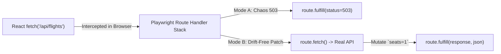

# Network Interception (`route`), API Augmentation & HAR Replay

```json pretraining
[
  {
    "term": "Pure `route.fulfill()` Stubbing",
    "formula": "Intercept(URL) -> Return Synthetic { status: 503 | 429 | [] } (0 Backend RTT)",
    "meaning": "Deterministically verifies UI empty states, retry banners, and skeleton loaders that are nearly impossible to trigger on demand against a live backend."
  },
  {
    "term": "Hybrid `route.fetch()` Augmentation",
    "formula": "Real Backend `fetch()` -> Patch 1 Field (`stock: 1`) -> `fulfill(response)`",
    "meaning": "Fetches the real live microservice payload so 99% of schema fields stay authentic and drift-free, while surgically overriding one edge-case field!"
  },
  {
    "term": "Pre-Action `expect_response` Listener",
    "formula": "with page.expect_response(pred): button.click()  [Register BEFORE Trigger!]",
    "meaning": "Subscribing to the network event stream *before* clicking guarantees a fast 3ms loopback response can never race ahead of listener registration."
  },
  {
    "term": "Sanitized HAR Replay (`route_from_har`)",
    "formula": "Record `.har` (Scrub Auth) -> Replay Offline with `not_found='abort'`",
    "meaning": "Replays complex multi-endpoint GraphQL/REST waterfalls deterministically while immediately failing if the UI makes an unexpected unrecorded call."
  }
]
```

```json poe
{
  "question": "An engineer writes these two lines sequentially in Python:\n`page.get_by_role('button', name='Save Profile').click()`\n`with page.expect_response('**/api/v1/profile') as resp_info: pass`\nAgainst a remote staging server (`140ms` RTT) it passes, but against a fast local container (`2ms` RTT) it intermittently times out after `30,000ms`! Why?",
  "options": [
    "`expect_response` does not support `localhost` URLs",
    "Classic listener registration race! Because `.click()` ran **before** entering the `with page.expect_response(...)` context manager, on a fast `2ms` backend the `PUT /api/v1/profile` response arrived and finished *before* `expect_response` even started listening—so `expect_response` waited 30s for a second response that never came! Always place `click()` **inside** the `with page.expect_response(...):` block",
    "Playwright buffers responses for 30 seconds on loopback interfaces",
    "`**/api/v1/profile` only matches `GET` requests"
  ],
  "answerIndex": 1,
  "explanation": "In Playwright Python (`with page.expect_response(...): trigger()`) and Java (`page.waitForResponse(pred, () -> trigger())`), the listener MUST be armed *before* the UI action triggers the network request so zero fast responses slip through the gap."
}
```

## Part I — First-Principles Mental Model: Surgical Control of the Browser Network Seam

Trying to test every UI state—`HTTP 503 Service Unavailable` toast, `HTTP 429 Rate Limit` countdown, `"Only 1 seat left!"` urgency badge, `8,000ms` slow-network skeleton shimmer, and empty-account onboarding—by mutating a real Postgres database and crashing real Kubernetes pods is slow, destructive, and flaky.

Playwright intercepts requests directly inside the browser's network stack (`context.route()` across all tabs/popups, or `page.route()` on a single tab) with **four distinct tactical modes**:

1. **`route.fulfill()` (Pure Synthetic Stub)**: Short-circuits the network completely. Ideal for `500`/`503`/`429` error banners, empty-state arrays (`[]`), and blocking noisy third-party ad/analytics scripts (`route.abort()`).
2. **`route.fetch()` + JSON Mutation (Response Augmentation — Staff Favorite!)**: Instead of maintaining a 200-line hardcoded fake JSON file that silently drifts from backend schema changes, `resp = route.fetch()` forwards the request to the **real backend**, parses `data = resp.json()`, patches just `data["seats_remaining"] = 1`, and passes `route.fulfill(response=resp, json=data)` back to the UI!
3. **`route_from_har(..., not_found="abort")` (Hermetic Waterfall Replay)**: Replays recorded HTTP Archive fixtures for complex analytics dashboards. Setting `not_found="abort"` ensures new unrecorded API calls fail loudly rather than leaking out to staging!
4. **LIFO Route Precedence**: In Playwright, **later-registered `page.route` handlers run first** (LIFO stack!), delegating upstream via `route.fallback()` (not `route.continue_()`, which immediately sends to the wire!).



```json contrast
{
  "title": "Hardcoded Stale JSON Mocks & Post-Click Listeners vs `route.fetch()` Augmentation & Pre-Armed Waits",
  "naiveTitle": "200-Line Static Stub + `route.continue_()`",
  "naiveMetric": "Silent Schema Drift · Listener Race Flakes",
  "naivePoints": [
    "Hardcodes full `flights_mock.json`; stays green when backend renames `priceCents` -> `totalAmountCents`, crashing prod!",
    "Calls `route.continue_()` inside a logging handler, bypassing all downstream mock handlers registered earlier",
    "Calls `click()` BEFORE `expect_response()`, causing intermittent 30s timeouts on fast local containers"
  ],
  "staffTitle": "`route.fetch()` Patch + `route.fallback()`",
  "staffMetric": "Zero Schema Drift · 100% Race-Free Sync",
  "staffPoints": [
    "Augments live API responses via `route.fetch()` so real backend contracts are exercised on every run",
    "Chains composable route middlewares cleanly using `route.fallback()` instead of terminal `route.continue_()`",
    "Arms `with page.expect_response(...):` BEFORE clicking to synchronize hybrid UI+API assertions deterministically"
  ]
}
```

---

## Part II — Network Interception Mode Selection Matrix

Use the **`pw-network-auth-sharding`** simulator to trace `route.fulfill()`, `route.fetch()` JSON patching, and LIFO `route.fallback()` chaining.

| Objective | Recommended Playwright Primitive | Scope (`page` vs `context`) | Key Pitfall to Avoid |
| :--- | :--- | :--- | :--- |
| **Test UI `503` / `429` Resilience** | `route.fulfill(status=503, json=...)` | `page.route` | Forgetting `Content-Type: application/json` (automatic when passing `json=`). |
| **Test Rare Field Edge Case (`stock=1`)** | `resp = route.fetch()` $\to$ mutate $\to$ `fulfill` | `page.route` | Mutating without preserving status/headers via `response=resp`. |
| **Inject Global `traceparent` / Block Ads** | `route.fallback(headers=...)` / `route.abort()` | `context.route` (covers popups & SW!) | Using `route.continue_()` instead of `route.fallback()` when stacking multiple handlers. |
| **Hermetic Complex Dashboard** | `page.route_from_har(har, not_found="abort")` | `page` / `context` | Recording raw `Authorization` headers into Git-tracked `.har` files—always scrub! |

---

## Part III — Production Implementation Blueprints (Python 3 & Java 17)

### Python 3 Blueprint: Drift-Free `route.fetch()` Augmentation, `503` Recovery & Armed `expect_response`
```python
from __future__ import annotations
from playwright.sync_api import Page, Route, expect


def test_low_inventory_badge_via_drift_free_augmentation(page: Page) -> None:
    """Hits the REAL backend schema via route.fetch(), overriding ONLY `seats_left = 1`."""
    def _patch_scarcity(route: Route) -> None:
        real_resp = route.fetch()
        payload = real_resp.json()
        payload["seats_left"] = 1
        route.fulfill(response=real_resp, json=payload)

    page.route("**/api/v1/flights/FL-402/availability", _patch_scarcity)
    page.goto("/flights/FL-402")
    expect(page.get_by_test_id("scarcity-pill")).to_have_text("Only 1 seat left at this fare!")


def test_ui_graceful_retry_on_transient_503_then_200(page: Page) -> None:
    """Deterministic chaos: first checkout POST returns 503, user clicks 'Try Again', second succeeds."""
    attempts = {"count": 0}

    def _chaos_handler(route: Route) -> None:
        attempts["count"] += 1
        if attempts["count"] == 1:
            route.fulfill(status=503, json={"error": "upstream_gateway_unavailable"})
        else:
            route.fallback()  # Delegate attempt #2 cleanly to downstream handlers / live server!

    page.route("**/api/v1/checkout", _chaos_handler)
    page.goto("/checkout/seeded-cart")

    # Arm `expect_response` BEFORE clicking so fast responses never race ahead!
    with page.expect_response(lambda r: "/api/v1/checkout" in r.url and r.status == 503):
        page.get_by_role("button", name="Pay Now", exact=True).click()

    expect(page.get_by_role("alert")).to_contain_text("Payment service temporarily busy")

    with page.expect_response(lambda r: "/api/v1/checkout" in r.url and r.status == 200):
        page.get_by_role("button", name="Try Again", exact=True).click()

    expect(page.get_by_role("heading", name="Booking Confirmed")).to_be_visible()
```

### Java 17 Blueprint: `APIResponse` Fetch-Augmentation & Race-Free `waitForResponse` Callback
```java
package com.aerocart.qa.network;

import com.google.gson.JsonObject;
import com.google.gson.JsonParser;
import com.microsoft.playwright.*;
import com.microsoft.playwright.options.AriaRole;
import java.nio.charset.StandardCharsets;
import static com.microsoft.playwright.assertions.PlaywrightAssertions.assertThat;

public final class NetworkInterceptionPatterns {

    public void verifyScarcityAndSynchronizeCheckout(Page page) {
        // 1. Drift-free augmentation: fetch real response, mutate 1 JSON key, fulfill
        page.route("**/api/v1/flights/*/availability", route -> {
            APIResponse real = route.fetch();
            JsonObject json = JsonParser.parseString(real.text()).getAsJsonObject();
            json.addProperty("seats_left", 1);
            route.fulfill(new Route.FulfillOptions()
                    .setResponse(real)
                    .setBodyBytes(json.toString().getBytes(StandardCharsets.UTF_8)));
        });

        page.navigate("/flights/FL-402");
        assertThat(page.getByTestId("scarcity-pill")).hasText("Only 1 seat left at this fare!");

        // 2. Race-free synchronization: pass click Runnable INSIDE waitForResponse!
        Response checkoutResp = page.waitForResponse(
                r -> r.url().endsWith("/api/v1/checkout") && "POST".equals(r.request().method()),
                () -> page.getByRole(AriaRole.BUTTON, new Page.GetByRoleOptions().setName("Book Seat")).click());

        if (checkoutResp.status() != 201) {
            throw new AssertionError("Expected 201 Created, got " + checkoutResp.status());
        }
    }
}
```

> [!WARNING]
> **Staff Interview Gotcha — `route.continue_()` vs `route.fallback()` Handler Starvation**:
> Suppose a base fixture registers `page.route("**/api/**", mock_catalog)` first, and your test registers `page.route("**/api/**", inject_trace_header)` second. Because Playwright evaluates route handlers in **LIFO order** (newest registered runs first!), `inject_trace_header` executes *first*. If `inject_trace_header` calls **`route.continue_(headers=...)`**, Playwright immediately dispatches the request onto the network and **completely skips `mock_catalog`!** Always call **`route.fallback(headers=...)`** inside middleware/header handlers so earlier-registered mocks still intercept the request!

---

## Part IV — Scenario Retrieval-Practice Mastery Gate

```json quiz
[
  {
    "id": "pw-07-q1",
    "question": "A test registers Handler 1 (`page.route('**/api/orders', fulfill_mock_200)`) in `beforeEach`, and then registers Handler 2 (`page.route('**/api/**', add_correlation_header)`) inside the test body. In what order do they execute, and what must Handler 2 call so Handler 1 still runs?",
    "options": [
      "FIFO order (Handler 1 runs first); Handler 2 calls `route.abort()`",
      "**LIFO order** (Handler 2 runs first because it was registered later)! Handler 2 MUST call `route.fallback(headers=...)`—if it called `route.continue_(headers=...)`, Playwright would immediately send the request to the live server and skip Handler 1 completely",
      "Playwright throws an error when two routes match the same URL",
      "Both handlers run in parallel threads simultaneously"
    ],
    "answerIndex": 1,
    "explanation": "Playwright stacks route handlers LIFO so narrow test-specific overrides naturally take precedence over general fixture routes, while `route.fallback()` passes control down the stack instead of straight to the network."
  },
  {
    "id": "pw-07-q2",
    "question": "Why is `route.fetch()` + mutating one JSON field architecturally superior to `route.fulfill(path='static_mock.json')` when testing a `'Low Stock'` badge in an E2E staging suite?",
    "options": [
      "`route.fetch()` bypasses browser CORS checks",
      "Because `route.fetch()` retrieves the live backend response first, 99% of the payload reflects the real current microservice contract (catching breaking field renames immediately), while deterministically forcing `stock = 1` for the UI badge under test",
      "`route.fulfill` only supports plain text, not JSON",
      "`static_mock.json` cannot exceed 1KB"
    ],
    "answerIndex": 1,
    "explanation": "Response augmentation (`route.fetch()` -> patch -> `fulfill`) gives you deterministic edge-case control *without* blinding the test to real upstream contract changes."
  },
  {
    "id": "pw-07-q3",
    "question": "When replaying recorded network traffic in CI via `page.route_from_har('dashboard.har', url='**/api/**', not_found='abort')`, why is `not_found='abort'` critical?",
    "options": [
      "It deletes the `.har` file after the test finishes",
      "With default `not_found='fallback'`, any newly added or altered frontend API request missing from `dashboard.har` silently leaks out onto the real network in CI (causing hangs or flaky 401s); `'abort'` fails deterministically so engineers know to re-record or stub the new endpoint",
      "It compresses HAR JSON by 90%",
      "It disables HTTPS certificate validation"
    ],
    "answerIndex": 1,
    "explanation": "Hermetic HAR tests must never silently fall through to external networks when an endpoint URL or query parameter changes; `not_found='abort'` enforces strict hermeticity."
  }
]
```
