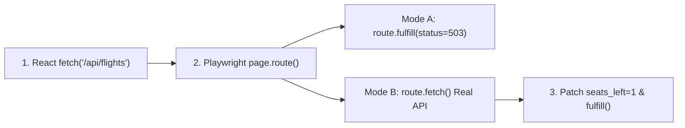

# Network Interception (`route`), API Augmentation & HAR Replay

```json continuity
{
  "previously": "In Chapter 6, we upgraded AeroBot v0.6 with Zero-UI API Auth and `storageState.json` hydration, booting every browser test already logged in within 12 milliseconds.",
  "painPoint": "Now we need to test what happens when AeroCart's flight checkout API returns a rare `HTTP 503 Service Unavailable` error or when a flight has `'Only 1 seat left!'`—but we cannot crash the real staging server on demand without breaking everyone else's tests!",
  "unlock": "We will upgrade AeroBot to v0.7 with `page.route()` network interception, live `route.fetch()` response patching, and HAR replay so we can simulate any server response right inside the browser tab!"
}
```

```json walkthrough
[
  {
    "time": "0:00",
    "badge": "1. The Browser Mailroom",
    "caption": "Imagine sitting inside your browser's mailroom. Whenever React sends a letter to the backend server, Playwright's page.route lets you intercept that letter and hand back any reply you want!",
    "code": "page.route('**/api/v1/checkout', lambda r: r.fulfill(status=503))"
  },
  {
    "time": "0:25",
    "badge": "2. Stale Mock Trap",
    "caption": "If you replace the whole API response with a 200-line fake JSON file, what happens when the backend team renames 'price' to 'amountCents'? Your fake JSON stays green in CI while production crashes!",
    "code": "# DANGER: Hardcoded mock hides backend schema changes!"
  },
  {
    "time": "0:50",
    "badge": "3. Live route.fetch() Patching",
    "caption": "Instead of faking the whole JSON, route.fetch calls the real backend server, takes the real live JSON response, edits just 'seats_left = 1', and hands it to the browser!",
    "code": "real = route.fetch()\ndata = real.json(); data['seats_left'] = 1\nroute.fulfill(response=real, json=data)"
  },
  {
    "time": "1:15",
    "badge": "4. Pre-Armed Network Waits",
    "caption": "Always open your expect_response listener block BEFORE clicking the button, so a fast 2-millisecond local response never finishes before you start listening!",
    "code": "with page.expect_response('**/api/v1/checkout'):\n    page.get_by_role('button', name='Pay').click()"
  }
]
```

```json pretraining
[
  {
    "term": "`route.fulfill()` (Synthetic Reply)",
    "formula": "Intercept(URL) -> Return { status: 503 | 429 | [] } Instantly",
    "meaning": "Intercepts a browser request before it even leaves your laptop and replies with a fake status code or JSON body—perfect for testing error banners and empty screens."
  },
  {
    "term": "`route.fetch()` (Live Response Patching)",
    "formula": "Fetch Real Backend JSON -> Edit 1 Field (`seats_left: 1`) -> `fulfill`",
    "meaning": "Lets the request hit the real server first so 99% of the data is genuine, then tweaks just one field right before the browser reads it."
  },
  {
    "term": "Pre-Armed `expect_response`",
    "formula": "with page.expect_response(url): button.click()",
    "meaning": "Starting to listen for a network reply BEFORE clicking a button so a super-fast local server reply is never missed."
  },
  {
    "term": "HAR Replay (`route_from_har`)",
    "formula": "Record Network Tape (`.har`) -> Replay Offline with `not_found='abort'`",
    "meaning": "Recording a whole sequence of API calls into a `.har` archive file and playing them back offline like a cassette tape."
  }
]
```

```json poe
{
  "question": "An engineer writes these two lines sequentially in Python:\n`page.get_by_role('button', name='Save Profile').click()`\n`with page.expect_response('**/api/v1/profile') as resp_info: pass`\nAgainst a remote staging server (`140ms` RTT) it passes, but against a fast local container (`2ms` RTT) it intermittently times out after `30,000ms`! Why?",
  "options": [
    "`expect_response` does not support `localhost` URLs",
    "Classic listener registration race! Because `.click()` ran **before** entering the `with page.expect_response(...)` context manager, on a fast `2ms` backend the `PUT /api/v1/profile` response arrived and finished *before* `expect_response` even started listening—so `expect_response` waited 30s for a second response that never came! Always place `click()` **inside** the `with page.expect_response(...):` block",
    "Playwright buffers responses for 30 seconds on loopback interfaces",
    "`**/api/v1/profile` only matches `GET` requests"
  ],
  "answerIndex": 1,
  "explanation": "In Playwright Python (`with page.expect_response(...): trigger()`) and Java (`page.waitForResponse(pred, () -> trigger())`), the listener MUST be armed *before* the UI action triggers the network request so zero fast responses slip through the gap."
}
```

---

## 🌱 Step 1: Plain-English Story — The Mailroom Sticker Trick

Suppose you want to verify two tricky screens in **AeroCart**:
1. What does the passenger see if the payment server crashes with `HTTP 503 Service Unavailable` right when they click **"Pay Now"**?
2. Does the orange **"Only 1 seat left at this fare!"** urgency badge appear when a flight has `seats_left: 1`?

If you try to test those by unplugging the real staging database or booking 179 out of 180 seats in Postgres before every test, your tests will be slow, brittle, and ruin the staging server for your teammates.

Instead, Playwright's **`page.route()`** lets **`AeroBot v0.7`** sit right inside the browser tab's **mailroom**:
- **Full Replacement (`route.fulfill`)**: When React tries to send `POST /api/v1/checkout`, `AeroBot` intercepts the envelope at the browser door and immediately hands back a `503 Service Unavailable` note—the real server never even knows!
- **The Mailroom Sticker Trick (`route.fetch` + patch)**: When React asks for flight details, `AeroBot` lets the mailman fetch the real letter from the backend server (`route.fetch()`), opens the envelope, places a small sticker over `"seats_left": 42` so it reads `"seats_left": 1`, and hands the real letter to React!



---

## 🔨 Step 2: First Lines of Code — Intercepting & Patching in `AeroBot v0.7`

Let's write a 15-line snippet for **`AeroBot v0.7`** that uses the Mailroom Sticker Trick (`route.fetch()`) to test the `"Only 1 seat left!"` badge without faking the rest of the flight JSON.

```python
# aerobot_v07_route_patch.py — Live API response patching via route.fetch()
from playwright.sync_api import Page, Route, expect

def test_aerobot_v07_scarcity_badge(page: Page) -> None:
    def patch_one_seat_left(route: Route) -> None:
        real_resp = route.fetch()          # 1. Fetch real JSON from live backend
        data = real_resp.json()
        data["seats_left"] = 1             # 2. Override ONLY the scarcity field
        route.fulfill(response=real_resp, json=data)

    page.route("**/api/v1/flights/FL-402/availability", patch_one_seat_left)
    page.goto("http://127.0.0.1:3000/flights/FL-402")
    expect(page.get_by_test_id("scarcity-pill")).to_have_text("Only 1 seat left at this fare!")
```

### Java 17 Equivalent

```java
// AeroBotV07RoutePatchTest.java — Live API response patching in Java 17
import com.google.gson.*;
import com.microsoft.playwright.*;
import java.nio.charset.StandardCharsets;
import static com.microsoft.playwright.assertions.PlaywrightAssertions.assertThat;

public class AeroBotV07RoutePatchTest {
    void verifyScarcityBadge(Page page) {
        page.route("**/api/v1/flights/FL-402/availability", route -> {
            APIResponse real = route.fetch();
            JsonObject json = JsonParser.parseString(real.text()).getAsJsonObject();
            json.addProperty("seats_left", 1);
            route.fulfill(new Route.FulfillOptions().setResponse(real)
                    .setBodyBytes(json.toString().getBytes(StandardCharsets.UTF_8)));
        });
        page.navigate("http://127.0.0.1:3000/flights/FL-402");
        assertThat(page.getByTestId("scarcity-pill")).hasText("Only 1 seat left at this fare!");
    }
}
```

---

## ⚡ Step 3: Where It Breaks in Real Life — Stale Mocks, Listener Races & Handler Starvation

As our team writes more network tests with `AeroBot v0.7`, three real-world bugs bite us:
1. **Silent Schema Drift from Static JSON Files**: A teammate replaces the entire `/api/v1/flights` response with a hardcoded `mock_flights.json` file containing `"priceCents": 19900`. A week later, the backend team renames `"priceCents"` to `"totalAmountCents"`. Every test using `mock_flights.json` stays 100% green in CI, and production crashes with `$NaN`! Using `route.fetch()` prevents this because 99% of the response still comes from the live server.
2. **The 2ms Localhost Listener Race**: A developer clicks `"Pay Now"` on line 1 and calls `page.expect_response(...)` on line 2. On a fast local container, the HTTP response finishes in 2ms *before* line 2 starts listening, causing a 30-second timeout!
3. **`route.continue_()` Starving Earlier Mocks**: Playwright runs route handlers in **LIFO order** (newest registered runs first). If a logging handler registered second calls `route.continue_()` instead of `route.fallback()`, it sends the request straight to the internet and skips the mock handler registered first!

```json contrast
{
  "title": "Hardcoded Stale JSON Mocks & Post-Click Listeners vs `route.fetch()` Augmentation & Pre-Armed Waits",
  "naiveTitle": "200-Line Static Stub + `route.continue_()`",
  "naiveMetric": "Silent Schema Drift · Listener Race Flakes",
  "naivePoints": [
    "Hardcodes full `flights_mock.json`; stays green when backend renames `priceCents` -> `totalAmountCents`, crashing prod!",
    "Calls `route.continue_()` inside a logging handler, bypassing all downstream mock handlers registered earlier",
    "Calls `click()` BEFORE `expect_response()`, causing intermittent 30s timeouts on fast local containers"
  ],
  "staffTitle": "`route.fetch()` Patch + `route.fallback()`",
  "staffMetric": "Zero Schema Drift · 100% Race-Free Sync",
  "staffPoints": [
    "Augments live API responses via `route.fetch()` so real backend contracts are exercised on every run",
    "Chains composable route middlewares cleanly using `route.fallback()` instead of terminal `route.continue_()`",
    "Arms `with page.expect_response(...):` BEFORE clicking to synchronize hybrid UI+API assertions deterministically"
  ]
}
```

---

## 🚀 Step 4: Staff Engineer Deep-Dive — Drift Probability, Route Matrix & Chaos Recovery

### 1. Schema Drift Detection Coverage Under Response Augmentation

Let a microservice response contain $F_{\text{total}}$ schema fields, and suppose $F_{\text{patched}}$ fields are overridden during a test. Under pure static stubbing ($F_{\text{patched}} = F_{\text{total}}$), live contract coverage $C_{\text{contract}}$ is $0\%$. Under `route.fetch()` augmentation where only $F_{\text{patched}} = 1$ field is mutated:

$$C_{\text{contract}} = \frac{F_{\text{total}} - F_{\text{patched}}}{F_{\text{total}}} = 1 - \frac{1}{F_{\text{total}}}$$

For a 25-field flight payload ($F_{\text{total}} = 25, F_{\text{patched}} = 1$), `route.fetch()` preserves $C_{\text{contract}} = \frac{24}{25} = 96\%$ live contract verification while still achieving $100\%$ determinism on the target edge case.

### 2. Network Interception Mode Selection Matrix

Use the **`pw-network-auth-sharding`** simulator to trace `route.fulfill()`, `route.fetch()` JSON patching, and LIFO `route.fallback()` chaining.

| Objective | Recommended Playwright Primitive | Scope (`page` vs `context`) | Key Pitfall to Avoid |
| :--- | :--- | :--- | :--- |
| **Test UI `503` / `429` Resilience** | `route.fulfill(status=503, json=...)` | `page.route` | Forgetting `Content-Type: application/json` (automatic when passing `json=`). |
| **Test Rare Field Edge Case (`stock=1`)** | `resp = route.fetch()` $\to$ mutate $\to$ `fulfill` | `page.route` | Mutating without preserving status/headers via `response=resp`. |
| **Inject Global `traceparent` / Block Ads** | `route.fallback(headers=...)` / `route.abort()` | `context.route` (covers popups & SW!) | Using `route.continue_()` instead of `route.fallback()` when stacking multiple handlers. |
| **Hermetic Complex Dashboard** | `page.route_from_har(har, not_found="abort")` | `page` / `context` | Recording raw `Authorization` headers into Git-tracked `.har` files—always scrub! |

### 3. Production Blueprints: `503 -> 200` Chaos Retry & Pre-Armed Synchronization (Python 3 & Java 17)

```python
from __future__ import annotations
from playwright.sync_api import Page, Route, expect


def test_low_inventory_badge_via_drift_free_augmentation(page: Page) -> None:
    """Hits the REAL backend schema via route.fetch(), overriding ONLY `seats_left = 1`."""
    def _patch_scarcity(route: Route) -> None:
        real_resp = route.fetch()
        payload = real_resp.json()
        payload["seats_left"] = 1
        route.fulfill(response=real_resp, json=payload)

    page.route("**/api/v1/flights/FL-402/availability", _patch_scarcity)
    page.goto("/flights/FL-402")
    expect(page.get_by_test_id("scarcity-pill")).to_have_text("Only 1 seat left at this fare!")


def test_ui_graceful_retry_on_transient_503_then_200(page: Page) -> None:
    """Deterministic chaos: first checkout POST returns 503, user clicks 'Try Again', second succeeds."""
    attempts = {"count": 0}

    def _chaos_handler(route: Route) -> None:
        attempts["count"] += 1
        if attempts["count"] == 1:
            route.fulfill(status=503, json={"error": "upstream_gateway_unavailable"})
        else:
            route.fallback()  # Delegate attempt #2 cleanly to downstream handlers / live server!

    page.route("**/api/v1/checkout", _chaos_handler)
    page.goto("/checkout/seeded-cart")

    # Arm `expect_response` BEFORE clicking so fast responses never race ahead!
    with page.expect_response(lambda r: "/api/v1/checkout" in r.url and r.status == 503):
        page.get_by_role("button", name="Pay Now", exact=True).click()

    expect(page.get_by_role("alert")).to_contain_text("Payment service temporarily busy")

    with page.expect_response(lambda r: "/api/v1/checkout" in r.url and r.status == 200):
        page.get_by_role("button", name="Try Again", exact=True).click()

    expect(page.get_by_role("heading", name="Booking Confirmed")).to_be_visible()
```

#### Java 17 Equivalent

```java
package com.aerocart.qa.network;

import com.google.gson.JsonObject;
import com.google.gson.JsonParser;
import com.microsoft.playwright.*;
import com.microsoft.playwright.options.AriaRole;
import java.nio.charset.StandardCharsets;
import static com.microsoft.playwright.assertions.PlaywrightAssertions.assertThat;

public final class NetworkInterceptionPatterns {

    public void verifyScarcityAndSynchronizeCheckout(Page page) {
        // 1. Drift-free augmentation: fetch real response, mutate 1 JSON key, fulfill
        page.route("**/api/v1/flights/*/availability", route -> {
            APIResponse real = route.fetch();
            JsonObject json = JsonParser.parseString(real.text()).getAsJsonObject();
            json.addProperty("seats_left", 1);
            route.fulfill(new Route.FulfillOptions()
                    .setResponse(real)
                    .setBodyBytes(json.toString().getBytes(StandardCharsets.UTF_8)));
        });

        page.navigate("/flights/FL-402");
        assertThat(page.getByTestId("scarcity-pill")).hasText("Only 1 seat left at this fare!");

        // 2. Race-free synchronization: pass click Runnable INSIDE waitForResponse!
        Response checkoutResp = page.waitForResponse(
                r -> r.url().endsWith("/api/v1/checkout") && "POST".equals(r.request().method()),
                () -> page.getByRole(AriaRole.BUTTON, new Page.GetByRoleOptions().setName("Book Seat")).click());

        if (checkoutResp.status() != 201) {
            throw new AssertionError("Expected 201 Created, got " + checkoutResp.status());
        }
    }
}
```

> [!WARNING]
> **Staff Interview Gotcha — `route.continue_()` vs `route.fallback()` Handler Starvation**:
> Suppose a base fixture registers `page.route("**/api/**", mock_catalog)` first, and your test registers `page.route("**/api/**", inject_trace_header)` second. Because Playwright evaluates route handlers in **LIFO order** (newest registered runs first!), `inject_trace_header` executes *first*. If `inject_trace_header` calls **`route.continue_(headers=...)`**, Playwright immediately dispatches the request onto the network and **completely skips `mock_catalog`!** Always call **`route.fallback(headers=...)`** inside middleware/header handlers so earlier-registered mocks still intercept the request!

**Up Next in Chapter 8:** `AeroBot v0.7` now controls HTTP calls, but AeroCart has a **10-minute seat-hold countdown timer** and a **live WebSocket price ticker**! Waiting 10 real minutes in CI for a seat hold to expire would ruin our test speed. In Chapter 8, we will build **`AeroBot v0.8`** with `page.clock` time travel and `page.route_web_socket()` live frame injection!

---

```json quiz
[
  {
    "id": "pw-07-q1",
    "question": "A test registers Handler 1 (`page.route('**/api/orders', fulfill_mock_200)`) in `beforeEach`, and then registers Handler 2 (`page.route('**/api/**', add_correlation_header)`) inside the test body. In what order do they execute, and what must Handler 2 call so Handler 1 still runs?",
    "options": [
      "FIFO order (Handler 1 runs first); Handler 2 calls `route.abort()`",
      "**LIFO order** (Handler 2 runs first because it was registered later)! Handler 2 MUST call `route.fallback(headers=...)`—if it called `route.continue_(headers=...)`, Playwright would immediately send the request to the live server and skip Handler 1 completely",
      "Playwright throws an error when two routes match the same URL",
      "Both handlers run in parallel threads simultaneously"
    ],
    "answerIndex": 1,
    "explanation": "Playwright stacks route handlers LIFO so narrow test-specific overrides naturally take precedence over general fixture routes, while `route.fallback()` passes control down the stack instead of straight to the network."
  },
  {
    "id": "pw-07-q2",
    "question": "Why is `route.fetch()` + mutating one JSON field architecturally superior to `route.fulfill(path='static_mock.json')` when testing a `'Low Stock'` badge in an E2E staging suite?",
    "options": [
      "`route.fetch()` bypasses browser CORS checks",
      "Because `route.fetch()` retrieves the live backend response first, 99% of the payload reflects the real current microservice contract (catching breaking field renames immediately), while deterministically forcing `stock = 1` for the UI badge under test",
      "`route.fulfill` only supports plain text, not JSON",
      "`static_mock.json` cannot exceed 1KB"
    ],
    "answerIndex": 1,
    "explanation": "Response augmentation (`route.fetch()` -> patch -> `fulfill`) gives you deterministic edge-case control *without* blinding the test to real upstream contract changes."
  },
  {
    "id": "pw-07-q3",
    "question": "When replaying recorded network traffic in CI via `page.route_from_har('dashboard.har', url='**/api/**', not_found='abort')`, why is `not_found='abort'` critical?",
    "options": [
      "It deletes the `.har` file after the test finishes",
      "With default `not_found='fallback'`, any newly added or altered frontend API request missing from `dashboard.har` silently leaks out onto the real network in CI (causing hangs or flaky 401s); `'abort'` fails deterministically so engineers know to re-record or stub the new endpoint",
      "It compresses HAR JSON by 90%",
      "It disables HTTPS certificate validation"
    ],
    "answerIndex": 1,
    "explanation": "Hermetic HAR tests must never silently fall through to external networks when an endpoint URL or query parameter changes; `not_found='abort'` enforces strict hermeticity."
  }
]
```
