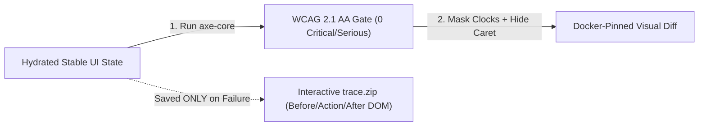

# AeroBot v0.9: Trace Viewer Forensics, WCAG 2.1 AA (`axe-core`) & Visual Diffing

```json continuity
{
  "previously": "In Chapter 08, AeroBot v0.8 conquered time-dependent modals (`page.clock`) and live WebSocket seat-sniping events (`page.route_web_socket`).",
  "painPoint": "Even when every text assertion (`expect(heading).to_have_text('Receipt')`) passes, two silent disasters still slip into production: (1) a CSS bug turns our checkout button white-on-white or breaks screen-reader accessibility, and (2) when a test fails at 3:00 AM in CI, a blurry screenshot doesn't show which network call or console error caused it!",
  "unlock": "Upgrade to AeroBot v0.9 with an airplane Black Box flight recorder (`trace.zip` saved only on failure), automated WCAG 2.1 AA (`axe-core`) checks, and masked visual regression!"
}
```

```json walkthrough
[
  {
    "time": "0:00",
    "badge": "Slide 1 / 4 · Why Screenshots & MP4 Videos Aren't Enough",
    "caption": "When a test fails on CI, a static PNG screenshot only shows the crime scene AFTER the crash—it doesn't show you the 500 error in the Network tab or let you inspect the DOM!",
    "code": "# Static PNG -> Can't inspect DOM or read network responses!\n# Playwright trace.zip -> Full interactive Before/Action/After DOM + HAR!"
  },
  {
    "time": "0:24",
    "badge": "Slide 2 / 4 · Zero-Overhead Tracing (Save Only on Failure!)",
    "caption": "AeroBot v0.9 records DOM snapshots in memory during every test, but calls `tracing.stop()` with NO path when a test passes—discarding the buffer in 0ms and only writing `trace.zip` when a test fails!",
    "code": "if test_failed:\n    context.tracing.stop(path='trace-failure.zip')\nelse:\n    context.tracing.stop()  # 0ms discard!"
  },
  {
    "time": "0:50",
    "badge": "Slide 3 / 4 · Catching 57% of Accessibility Bugs in 80ms",
    "caption": "Functional tests pass even if a button has low 1.8:1 contrast or no screen-reader label. Running `axe-core` (`wcag21aa`) catches critical & serious accessibility regressions automatically!",
    "code": "results = Axe().run(page)\nblocking = [v for v in results['violations'] if v['impact'] in ('critical', 'serious')]\nassert not blocking"
  },
  {
    "time": "1:15",
    "badge": "Slide 4 / 4 · Eliminating Visual Diff Flake",
    "caption": "Why do screenshots taken on a MacBook fail on Linux CI? Different OS font engines! Generate baselines inside the pinned Playwright Linux Docker container, freeze CSS animations, hide input carets, and mask live clocks!",
    "code": "card.screenshot(\n    animations='disabled',\n    caret='hide',\n    mask=[page.get_by_test_id('live-clock')]\n)"
  }
]
```

```json pretraining
[
  {
    "term": "Playwright `trace.zip` Black Box",
    "formula": "Before/Action/After DOM Snapshots + Network HAR + Console + Source",
    "meaning": "An interactive flight recorder that saves the actual HTML/CSS DOM before and after every click so you can open DevTools on a failed CI run hours later."
  },
  {
    "term": "Automated WCAG Gate (`axe-core`)",
    "formula": "Scans Live DOM against WCAG 2.1 AA Rules in <80ms",
    "meaning": "An automated accessibility inspector that checks color contrast, missing form labels, and broken ARIA attributes on every screen."
  },
  {
    "term": "OS Font Rasterization Drift",
    "formula": "macOS CoreText != Linux FreeType -> 2–8% Pixel Mismatch",
    "meaning": "Macs and Linux servers draw text pixels slightly differently; visual comparison baselines must always be recorded and checked on the exact same Linux Docker image."
  },
  {
    "term": "Dynamic Masking & Caret Hiding",
    "formula": "mask=[clock] + animations='disabled' + caret='hide'",
    "meaning": "Covering changing clocks with solid boxes and hiding the blinking text cursor so visual screenshot checks never fail on harmless movement."
  }
]
```

```json poe
{
  "question": "A developer generates golden visual regression baselines (`checkout.png`) on their MacBook Pro and pushes the PR. In GitHub Actions (`ubuntu-24.04`), `expect(page).to_have_screenshot('checkout.png')` fails on **every single text paragraph** with `1,840 mismatched pixels`, even though the layout and CSS are 100% identical! Why?",
  "options": [
    "PNG files use big-endian byte order on macOS and little-endian on Linux",
    "Operating systems use different font rasterization and anti-aliasing engines (**Apple CoreText** on macOS vs **FreeType** on Linux)! Visual regression baselines MUST be generated and verified inside the **exact same pinned Playwright Linux container**",
    "GitHub Actions strips CSS custom properties in headless mode",
    "Playwright converts RGB colors to CMYK on Ubuntu"
  ],
  "answerIndex": 1,
  "explanation": "Sub-pixel glyph hinting and anti-aliasing differ across CoreText (macOS), DirectWrite (Windows), and FreeType (Linux). Staff teams generate and verify visual snapshots inside the same pinned `mcr.microsoft.com/playwright` Linux Docker container."
}
```

## 🌱 Step 1: Plain-English Story — The Airplane Black Box & The Blind Spot of Text Checks

Suppose a rogue CSS change accidentally sets the `"Confirm $360 Payment"` button to **white text on a white background (`#FFFFFF` on `#FEFEFE`)**, or pushes half the form off the screen.
- What does a standard text assertion (`expect(btn).to_have_text("Confirm $360 Payment")`) say? **✓ PASS!** Because the text is still in the HTML!
- Meanwhile, real flyers cannot see the button, and visually impaired flyers using screen readers hit unlabeled `<button><svg/></button>` icons.

And what happens when a test fails on a remote CI server at 2:00 AM?
- Watching a blurry `.mp4` video is like looking at a security camera from across the street—you see the click happen, but you can't open the Chrome Network tab to see *why* the server returned `HTTP 500`.
- Playwright's **`trace.zip`** is an **Airplane Black Box Flight Recorder**: for every single step, it saves the live HTML/CSS DOM **Before**, **During** (with a red dot showing the exact `(x, y)` click point!), and **After** the action, plus every network response and console log!



## 🔨 Step 2: First Lines of Code — Failure-Only Flight Recorder & Masked Screenshot (`AeroBot v0.9`)

Let's upgrade **`AeroBot v0.9`** with a smart trace recorder (which saves `trace.zip` **only** if a test fails, costing `0ms` on passing tests!) and a flake-free masked component screenshot:

```python
from playwright.sync_api import BrowserContext, Page


def run_with_blackbox_trace(context: BrowserContext, test_fn) -> None:
    # 1. Start recording DOM snapshots + network + console in memory
    context.tracing.start(screenshots=True, snapshots=True, sources=True)
    page = context.new_page()
    try:
        test_fn(page)
    except Exception:
        # 2a. Test FAILED -> Write full interactive trace.zip for time-travel debugging!
        context.tracing.stop(path="artifacts/failure-trace.zip")
        raise
    else:
        # 2b. Test PASSED -> Call stop() with NO path to discard buffer in 0ms!
        context.tracing.stop()


def take_flake_free_summary_screenshot(page: Page, path: str) -> bytes:
    card = page.get_by_test_id("checkout-order-summary")
    return card.screenshot(
        path=path,
        animations="disabled",
        caret="hide",
        mask=[page.get_by_test_id("live-clock")],
        scale="css",
    )
```

### Java 17 Equivalent

```java
import com.microsoft.playwright.*;
import com.microsoft.playwright.options.*;
import java.nio.file.Path;
import java.util.List;

public class AeroBotV09ForensicsStarter {
    public static void finishBlackBoxTrace(BrowserContext context, boolean testFailed, Path zipPath) {
        if (testFailed) {
            // Save full interactive DOM + Network trace.zip ONLY on failure!
            context.tracing().stop(new Tracing.StopOptions().setPath(zipPath));
        } else {
            // 0ms discard when passing!
            context.tracing().stop();
        }
    }

    public static byte[] captureFlakeFreeSummaryPng(Page page, Path outPath) {
        Locator card = page.getByTestId("checkout-order-summary");
        return card.screenshot(new Locator.ScreenshotOptions()
                .setPath(outPath)
                .setAnimations(ScreenshotAnimations.DISABLED)
                .setCaret(ScreenshotCaret.HIDE)
                .setMask(List.of(page.getByTestId("live-clock")))
                .setScale(ScreenshotScale.CSS));
    }
}
```

## ⚡ Step 3: Where It Breaks in Real Life — Mac vs. Linux Fonts, Blinking Carets & Unmasked Clocks

Why do so many teams abandon visual regression testing after two weeks, calling it "too flaky"? Because they hit three classic traps:
1. **Mac Laptop vs. Linux CI Font Rendering**: Generating `.png` baselines on macOS (`CoreText`) and asserting them on Ubuntu CI (`FreeType`) produces `2–8%` pixel mismatches on every single letter!
2. **Blinking Input Carets**: If the previous step typed into an `<input>`, the blinking cursor bar (`|`) is visible in 50% of screenshots and invisible in the other 50% unless `caret="hide"` is set!
3. **Retina `2x` vs. Headless `1x` DPI**: Without `scale="css"`, a Retina MacBook captures a `2880x1800` image while CI captures `1440x900`!

```json contrast
{
  "title": "Laptop Full-Page Screenshots vs Container-Pinned Masked Component Diffs + `axe-core`",
  "naiveTitle": "macOS Baselines + Unmasked Carousels",
  "naiveMetric": "35% False-Positive Pixel Flake · 4GB Repo",
  "naivePoints": [
    "Generates `.png` baselines on macOS laptops that immediately fail against Linux FreeType font rendering in CI",
    "Captures 8,000px full-page screenshots containing live timestamps, blinking input carets, and rotating banners",
    "Runs `trace: 'on'` unconditionally, zipping and uploading gigabytes of archives for 99% passing tests"
  ],
  "staffTitle": "Docker Baselines + Masks + `axe-core` + Retry Trace",
  "staffMetric": "0% Font Drift · Automated WCAG 2.1 AA Gate",
  "staffPoints": [
    "Generates & verifies visual snapshots exclusively inside `mcr.microsoft.com/playwright:vX.Y.Z-noble` containers",
    "Passes `animations='disabled'`, `caret='hide'`, `scale='css'`, and `mask=[live_clock]` to eliminate pixel noise",
    "Runs `axe-core` (`wcag21aa`) on key UI states and writes `trace.zip` strictly on failure or first-retry"
  ]
}
```

Explore the **`pw-locators-actionability`** simulator below to inspect how actionability coordinates, `axe-core` violation nodes, and masked visual bounding boxes align.

## 🚀 Step 4: Staff Engineer Deep-Dive — WCAG 2.1 Luminance Contrast Math & Production Gate Blueprints

When `axe-core` evaluates **WCAG 2.1 Success Criterion 1.4.3 (Contrast Minimum)** across text nodes during `AeroBot v0.9`'s audit, it computes the relative luminance $L \in [0, 1]$ of the foreground text and composited background colors:

$$CR(L_{\text{lighter}}, L_{\text{darker}}) = \frac{L_{\text{lighter}} + 0.05}{L_{\text{darker}} + 0.05} \ge \begin{cases} 4.5 : 1 & \text{(Normal text under WCAG 2.1 AA)} \\ 3.0 : 1 & \text{(Large text }\ge 18\text{pt or }\ge 14\text{pt bold)} \end{cases}$$

Similarly, for **Trace Storage Economics** across $N$ daily CI test executions with failure rate $f \ll 1$ and average compressed trace size $S_{\text{zip}} \approx 8\text{ MB}$:

$$\text{Storage}_{\text{always-on}} = N \cdot S_{\text{zip}}, \qquad \text{Storage}_{\text{on-failure}} = f \cdot N \cdot S_{\text{zip}} \implies \mathbf{98\%\text{ CI I/O & storage reduction at }f = 0.02}$$

| Quality Gate | Tool / API | Recommended Policy | Noise Elimination Strategy |
| :--- | :--- | :--- | :--- |
| **Time-Travel Forensics** | `context.tracing.start(screenshots=True, snapshots=True)` | Save `trace.zip` **only on failure** (`stop(path=...)` vs `stop()` discard) | Never pass `path=` on passing tests—omitting `path` skips zip compression in `0ms`! |
| **Accessibility (a11y)** | `axe-playwright-python` / `@axe-core/playwright` (`Deque`) | Gate PRs on `0` `critical` & `serious` WCAG 2.1 AA violations | Scope `.include(...)` on newly opened modals/drawers; `.exclude(...)` third-party widgets. |
| **Visual Regression** | `locator.screenshot(mask=..., animations='disabled', caret='hide', scale='css')` | Component-scoped locator screenshots over 10,000px full-page dumps | Pin Docker image tag + `animations="disabled"` + `caret="hide"` + `scale="css"`. |

### Production Blueprint: Failure-Only `trace.zip` Pytest Fixture & WCAG 2.1 AA Gate (Python 3)

```python
from __future__ import annotations
import pathlib
from typing import Any, Dict, Generator, List
import pytest
from playwright.sync_api import BrowserContext, Page


@pytest.hookimpl(hookwrapper=True)
def pytest_runtest_makereport(item: pytest.Item, call: pytest.CallInfo[Any]) -> Generator[None, Any, None]:
    """conftest.py hook: attaches `rep_setup`, `rep_call`, and `rep_teardown` onto `request.node`."""
    outcome = yield
    rep = outcome.get_result()
    setattr(item, f"rep_{rep.when}", rep)


@pytest.fixture(scope="function")
def traced_page(
    context: BrowserContext, request: pytest.FixtureRequest, tmp_path: pathlib.Path
) -> Generator[Page, None, None]:
    """Starts DOM+Network tracing in memory; writes `.zip` ONLY if the test fails!"""
    context.tracing.start(screenshots=True, snapshots=True, sources=True)
    page = context.new_page()
    yield page

    rep_call = getattr(request.node, "rep_call", None)
    if rep_call is not None and rep_call.failed:
        safe_name = request.node.name.replace("/", "_")
        trace_file = tmp_path / f"trace-{safe_name}.zip"
        context.tracing.stop(path=str(trace_file))
    else:
        # Passing test: stop() with NO path discards in-memory chunks immediately!
        context.tracing.stop()


def assert_wcag21_aa_zero_serious_violations(axe_results: Dict[str, Any]) -> None:
    """Filters Deque axe-core JSON output to fail strictly on critical/serious WCAG 2.1 AA defects."""
    blocking: List[str] = [
        f"[{v['impact']}] {v['id']}: {v['help']} (nodes={len(v.get('nodes', []))})"
        for v in axe_results.get("violations", [])
        if v.get("impact") in ("critical", "serious")
    ]
    assert not blocking, "WCAG 2.1 AA Accessibility Gate Failed:\n" + "\n".join(blocking)
```

### Java 17 Equivalent

```java
package com.aerocart.qa.forensics;

import com.deque.html.axecore.playwright.AxeBuilder;
import com.deque.html.axecore.results.AxeResults;
import com.deque.html.axecore.results.Rule;
import com.microsoft.playwright.*;
import java.nio.file.Path;
import java.util.List;

public final class ForensicsAndAccessibilityGates {

    public static void startFlightRecorder(BrowserContext context) {
        context.tracing().start(new Tracing.StartOptions()
                .setScreenshots(true)
                .setSnapshots(true)
                .setSources(true));
    }

    public static void finishFlightRecorder(BrowserContext context, boolean testFailed, Path failureZip) {
        if (testFailed) {
            context.tracing().stop(new Tracing.StopOptions().setPath(failureZip));
        } else {
            context.tracing().stop();
        }
    }

    public static void assertWcag21AaCompliant(Page page) {
        AxeResults results = new AxeBuilder(page)
                .withTags(List.of("wcag2a", "wcag2aa", "wcag21a", "wcag21aa"))
                .exclude("[data-third-party-chat-widget]")
                .analyze();

        List<Rule> severe = results.getViolations().stream()
                .filter(r -> "critical".equals(r.getImpact()) || "serious".equals(r.getImpact()))
                .toList();

        if (!severe.isEmpty()) {
            throw new AssertionError("WCAG 2.1 AA violations detected: " + severe);
        }
    }
}
```

> [!WARNING]
> **Staff Interview Gotcha — Why Passing `path='/dev/null'` to `tracing.stop()` Still Wastes CPU!**
> Passing `path="/dev/null"` forces Playwright to serialize and ZIP-compress 50MB of DOM snapshots on CPU before throwing the bytes away! Always call `context.tracing.stop()` **with no arguments** on passing tests so Playwright drops the in-memory ring buffer in `0ms` without running ZIP compression.

**Up Next in Chapter 10**: Our `AeroBot` suite now has 2,000 tests! When we try to run them inside Docker/Kubernetes containers in CI, Chromium mysteriously crashes mid-test with `TargetClosedError: Page crashed`! In Chapter 10, we'll complete **`AeroBot v1.0`** by mastering **Containerized `/dev/shm` Physics, LPT Shard Bin-Packing, and Blob Report Merging**!

```json quiz
[
  {
    "id": "pw-09-q1",
    "question": "When using `context.tracing.start(screenshots=True, snapshots=True)` manually in Python or Java fixtures, how do you discard the recorded trace in 0ms on passing tests while saving `trace.zip` on failing tests?",
    "options": [
      "Delete `~/.cache/ms-playwright` after every passing test",
      "Call `context.tracing.stop(path='trace.zip')` inside the failure branch and call `context.tracing.stop()` (with no `path` argument) on passing tests",
      "Tracing cannot be stopped once started until `browser.close()`",
      "Pass `path='/dev/null'` which still zips 50MB of DOM snapshots on CPU"
    ],
    "answerIndex": 1,
    "explanation": "Calling `tracing.stop()` with no `path` argument skips ZIP archive assembly completely and frees the in-memory buffer in 0ms."
  },
  {
    "id": "pw-09-q2",
    "question": "An engineering director asks whether adding `@axe-core/playwright` (`wcag21aa`) to every page means the company can cancel all manual keyboard/screen-reader accessibility testing. What is the accurate Staff assessment?",
    "options": [
      "Yes, `axe-core` catches 100% of WCAG 2.1 AA criteria mathematically",
      "No—automated DOM analyzers like `axe-core` deterministically catch ~50–57% of WCAG defects (contrast ratios, missing labels, invalid ARIA roles, duplicate IDs) with zero false positives, but must be paired with keyboard Tab-focus and screen-reader flow checks",
      "No, `axe-core` only checks HTML4 syntax",
      "Yes, as long as `getByRole` is also used"
    ],
    "answerIndex": 1,
    "explanation": "Deque's empirical studies show `axe-core` catches ~57% of accessibility defects automatically in CI, while keyboard focus-order assertions (`page.keyboard.press('Tab')`) and screen-reader checks cover behavioral UX."
  },
  {
    "id": "pw-09-q3",
    "question": "Even inside a pinned Linux Docker container with `animations='disabled'`, a screenshot assertion on a login form fails 40% of the time with a thin `1px x 18px` vertical line difference inside the password input! What caused it and which option fixes it?",
    "options": [
      "GPU memory corruption in Docker",
      "The focused `<input>` element's blinking text insertion caret, eliminated deterministically by passing `caret='hide'` to the screenshot options",
      "FreeType randomizes password bullet glyphs",
      "PNG compression is lossy"
    ],
    "answerIndex": 1,
    "explanation": "A `1px x 18px` vertical bar toggling inside a focused `<input>` is the signature of the native browser text caret blinking every ~530ms; `caret='hide'` suppresses caret painting during capture."
  }
]
```
