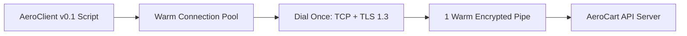

# TCP Handshakes, TLS 1.3 ECDHE & HTTP/2 Connection Pooling

```json continuity
{
  "previously": "Welcome to Day 1 of Course 04! Zero prior networking background needed. Throughout this course, we will build AeroClient — evolving a 5-line flight-search script into a Staff-grade HTTP/2, OAuth2, Pydantic, GraphQL, gRPC, and Pact API test harness.",
  "painPoint": "Our very first 5-line test calls requests.get() inside a 500-iteration loop. Even though the AeroCart server processes each query in 4ms, every test call takes 42ms and crashes around call #28,000 with 'Cannot assign requested address'.",
  "unlock": "We will build AeroClient v0.1 with warm connection pooling and HTTP/2 multiplexing so 1,000 API checks share a single encrypted wire tube in milliseconds."
}
```

```json walkthrough
[
  {
    "time": "0:00",
    "badge": "1. The Cold Call Tax",
    "caption": "Imagine driving to the airport, going through security, and throwing your car away after buying a single cup of coffee. That is what calling requests.get() without a session pool does on every API request.",
    "code": "# ❌ Cold unpooled call: dials a brand-new TCP + TLS socket every time!\nresp = requests.get('https://api.aerocart.internal/v1/flights')"
  },
  {
    "time": "0:22",
    "badge": "2. First 10 Lines (AeroClient v0.1)",
    "caption": "By wrapping our HTTP calls inside a reusable Session in Python or HttpClient in Java 17, we dial the server once and keep the encrypted phone line open on the desk.",
    "code": "# ✅ AeroClient v0.1: Keep the socket warm across all checks\nsession = requests.Session()\nresp = session.get('https://api.aerocart.internal/v1/flights')"
  },
  {
    "time": "0:48",
    "badge": "3. The 60-Second Port Graveyard",
    "caption": "When you close a socket without pooling, Linux locks that local port in a 60-second quarantine called TIME_WAIT so stray packets don't confuse future calls. At 500 calls a second, you run out of all 28,232 ports in under a minute.",
    "code": "OSError: [Errno 99] Cannot assign requested address\n# 28,232 ephemeral ports stuck in 60s TIME_WAIT!"
  },
  {
    "time": "1:12",
    "badge": "4. HTTP/2 & Stale Socket Safety",
    "caption": "Staff engineers upgrade the warm pool to HTTP/2 so 100 concurrent calls interleave over one socket, and set client idle eviction to 45 seconds so we never write to a socket the load balancer just hung up on.",
    "code": "adapter = HTTPAdapter(pool_connections=8, pool_maxsize=32, pool_block=True)\n# Set idle eviction (45s) < AWS ALB idle timeout (60s)"
  }
]
```

```json pretraining
[
  {
    "term": "Cold Socket Penalty",
    "formula": "1 TCP Trip + 1 TLS Trip before byte zero",
    "meaning": "Every time you call an HTTPS URL without a connection pool, your computer has to play two full rounds of network ping-pong with the server just to say hello and lock the padlock before your actual API data can leave."
  },
  {
    "term": "Ephemeral Port Ceiling (TIME_WAIT)",
    "formula": "RPS × 60s quarantine ≤ 28,232 local ports",
    "meaning": "When your script hangs up a network connection, the operating system puts that local plug number into a 60-second cooling-off quarantine so late stray packets don't mix into a new call. Open and close too fast, and you run out of plugs."
  },
  {
    "term": "HTTP/2 Stream Multiplexing",
    "formula": "1 Open Socket → 100 Parallel Requests",
    "meaning": "Instead of needing 100 separate phone lines for 100 parallel tests, HTTP/2 tags each message chunk with a stream number so all 100 conversations travel simultaneously down a single warm cable."
  },
  {
    "term": "Stale Keep-Alive Race",
    "formula": "Client Idle TTL (45s) < Server Idle TTL (60s)",
    "meaning": "If a server hangs up an idle phone line at exactly 60 seconds, and your test tries to speak into that same line at 60.000 seconds, your request crashes. Always hang up from the client side a few seconds earlier (like 45s)."
  }
]
```

## 🌱 Step 1: Plain-English Story — The Phone Call That Hung Up After Every Sentence

Imagine you work at the AeroCart travel desk and need to verify the gate numbers for 100 departing flights.

If you call the airline headquarters, wait for the receptionist to pick up, read your badge number, verify your security passphrase, ask *"What gate is Flight 101?"*, and **immediately slam the phone down** — how long will it take to check all 100 flights? You will spend 90% of your morning listening to the dial tone and repeating your security passphrase 100 times in a row!

Worse still, imagine your office switchboard has a safety rule: every time someone hangs up an extension line, that line is locked in a **60-second cooling-off quarantine** to make sure the previous caller really disconnected. If your team makes and hangs up 500 one-question calls per second, within a single minute every extension in the building is locked in quarantine and nobody can dial out at all.

That is *exactly* what happens when a beginner API test script calls `requests.get("https://...")` inside a loop:
1. **The TCP Handshake (1 Round-Trip)**: Your computer knocks on the server's door, the server waves back, and your computer confirms the connection is live.
2. **The TLS 1.3 Security Handshake (1 Round-Trip)**: Both sides swap mathematical lockboxes so no eavesdropper on the internet can read your flight bookings.
3. **The Hang-Up Penalty**: Without a **connection pool**, your script hangs up the socket right after reading the JSON response, burning two full network round-trips on the next call and piling up dead sockets in the operating system's 60-second quarantine.



---

## 🔨 Step 2: First Lines of Code — Building `AeroClient v0.1` with a Warm Session

Let's write our very first working version of **`AeroClient` (`v0.1`)**. Instead of opening and throwing away a socket on every assertion, we hold onto a single persistent session object so our second, third, and hundredth API checks skip the handshake completely.

```python
import requests

class AeroClientV01:
    def __init__(self, base_url: str) -> None:
        self.base_url = base_url.rstrip("/")
        # Open a reusable connection pool instead of one-off sockets
        self.session = requests.Session()

    def get_flight(self, flight_id: str) -> dict:
        resp = self.session.get(f"{self.base_url}/v1/flights/{flight_id}", timeout=3.0)
        resp.raise_for_status()
        return resp.json()
```

### Java 17 Equivalent

```java
import java.net.URI;
import java.net.http.*;

public class AeroClientV01 {
    private final HttpClient pool = HttpClient.newBuilder()
        .version(HttpClient.Version.HTTP_2) // Share one warm HTTP/2 pipe!
        .build();

    public String getFlight(String baseUrl, String flightId) throws Exception {
        HttpRequest req = HttpRequest.newBuilder(URI.create(baseUrl + "/v1/flights/" + flightId)).GET().build();
        return pool.send(req, HttpResponse.BodyHandlers.ofString()).body();
    }
}
```

---

## ⚡ Step 3: Where It Breaks in Real Life — Port Exhaustion & The 32-Thread Pool Trap

Our `AeroClient v0.1` works great on a single laptop thread. Now let's scale up to our nightly CI run where **32 parallel test workers** fire 600 checks per second against the staging cluster (`19ms` network round-trip time):

1. **Unpooled Scripts Crash at Second 48 (`EADDRNOTAVAIL`)**: An unpooled script creates 600 sockets per second and closes them immediately. Linux keeps every closed client socket in `TIME_WAIT` for `60 seconds`. Since a Linux machine only has `28,232` ephemeral ports (`32768–60999`), at $28,232 / 600 \approx 47\text{ seconds}$ the runner runs out of local ports and crashes with `OSError: [Errno 99] Cannot assign requested address`.
2. **Default `requests.Session()` Pool Overflow**: Even with `requests.Session()`, Python's underlying `urllib3` pool defaults to `pool_maxsize=10` and `pool_block=False`. When 32 threads share that session, 22 overflow threads silently create temporary sockets and **immediately close them** after every call — bringing back the exact same handshake latency and `TIME_WAIT` port exhaustion!

```json contrast
{
  "title": "Per-Call Ephemeral Sockets vs Warm Pooled HTTP/2 Client",
  "naiveTitle": "requests.get() or Default Unsized Pool",
  "naiveMetric": "+38ms/req · 28k TIME_WAIT Exhaustion",
  "naivePoints": [
    "Allocates a fresh OS file descriptor, TCP 3-way handshake, and X25519 TLS 1.3 key derivation on every assertion",
    "Saturates Linux ip_local_port_range (32768-60999) at >470 RPS, throwing intermittent EADDRNOTAVAIL",
    "Default urllib3 pool_maxsize=10 silently discards sockets from threads 11..32 after every request"
  ],
  "staffTitle": "Session-Scoped Pool + HTTP/2 ALPN",
  "staffMetric": "0ms Handshake · 1 Socket / 100 Streams",
  "staffPoints": [
    "Negotiates TLS 1.3 + ALPN h2 once per worker fixture; amortizes handshake across 10,000+ API calls",
    "HPACK header compression shrinks repetitive 1.8KB Bearer JWT headers down to indexed 2-byte references",
    "Explicit pool_maxsize >= worker_threads with pool_block=True and client idle eviction below server timeout"
  ]
}
```

```json poe
{
  "question": "An SDET suite fires 600 unpooled requests.get('https://api.internal/v1/orders') calls per second from a single Linux CI runner (ephemeral port range 32768–60999, 19ms cross-AZ RTT). What fails around second 48?",
  "options": [
    "Server TLS certificates expire due to OCSP stapling rate limits",
    "The CI runner exhausts all ~28,232 ephemeral ports stuck in 60-second TIME_WAIT, crashing with OSError: [Errno 99] Cannot assign requested address while wasting ~38ms per call on TCP+TLS handshakes",
    "HTTP/1.1 automatically upgrades to HTTP/3 QUIC over UDP",
    "DNS cache TTL expires and blocks libc getaddrinfo()"
  ],
  "answerIndex": 1,
  "explanation": "600 sockets/sec * 48 sec = 28,800 sockets in TIME_WAIT, exceeding the Linux default ephemeral port pool (60999 - 32768 = 28,231 ports) while paying 2 * 19ms = 38ms of avoidable TCP + TLS 1.3 handshake overhead on every single request."
}
```

---

## 🚀 Step 4: Staff Engineer Deep-Dive — Handshake Latency Math, TLS 1.3 ECDHE & Production Blueprints

### 1. Cold vs. Warm Wire Latency & `TIME_WAIT` Queueing Math

When an unpooled HTTPS call executes over a network path with round-trip time $\text{RTT}$, total request latency $T_{\text{cold}}$ includes both transport and cryptographic setup before application processing $T_{\text{app}}$:

$$T_{\text{cold}} = \underbrace{1 \cdot \text{RTT}}_{\text{TCP SYN/SYN-ACK}} + \underbrace{1 \cdot \text{RTT} + T_{\text{ECDHE}}}_{\text{TLS 1.3 1-RTT Handshake}} + \underbrace{1 \cdot \text{RTT} + T_{\text{app}}}_{\text{HTTP Request/Response}} = 3 \cdot \text{RTT} + T_{\text{ECDHE}} + T_{\text{app}}$$

Why does **TLS 1.3 (RFC 8446)** require only $1 \cdot \text{RTT}$ whereas **TLS 1.2** required $2 \cdot \text{RTT}$? In TLS 1.3, the client optimistically embeds its ephemeral Diffie-Hellman public key (`X25519` `key_share` extension) inside the very first `ClientHello` packet. The server computes the shared master secret immediately and replies with `ServerHello`, `EncryptedExtensions`, `Certificate`, `CertificateVerify`, and `Finished` in a single flight, negotiating `ALPN: h2` at the same time.

By Little's Law, the steady-state number of client sockets $N_{\text{TW}}$ trapped in the kernel's `TIME_WAIT` table ($2 \times \text{MSL} = 60\text{s}$ on Linux) at unpooled request rate $\lambda$ is:

$$N_{\text{TW}} = \lambda \cdot T_{\text{TIME\_WAIT}} \le P_{\text{max}} - P_{\text{min}} + 1 \implies \lambda_{\text{ceiling}} = \frac{60999 - 32768 + 1}{60\text{s}} \approx 470.5\text{ req/s}$$

### 2. Wire Protocol Trade-Off Matrix

| Protocol & Strategy | Handshake Cost (Warm) | Max Concurrent In-Flight / Socket | Header Overhead | Dominant Bottleneck & Failure Mode |
| :--- | :--- | :--- | :--- | :--- |
| **HTTP/1.1 (`Connection: close`)** | `2 RTT` (`TCP + TLS 1.3`) | `1` request | Verbose ASCII (`~1.5 KB` JWT) | `TIME_WAIT` port exhaustion & `38ms+` cold overhead |
| **HTTP/1.1 Pooled (`Keep-Alive`)** | `0 RTT` | `1` request (Application HoL) | Verbose ASCII (`~1.5 KB` JWT) | Stale pooled socket race (`RemoteDisconnected`) if client idle TTL $\ge$ LB idle TTL |
| **HTTP/2 (`ALPN: h2`)** | `0 RTT` | `100–250` streams (`SETTINGS_MAX_CONCURRENT_STREAMS`) | Binary **HPACK** (`~20 B` delta) | **TCP-Layer Head-of-Line Blocking**: 1 lost packet stalls all 100 streams |
| **HTTP/3 (`QUIC / UDP`)** | `0 RTT` (`0-RTT` resumption) | `100+` independent QUIC streams | Binary **QPACK** | Higher user-space UDP crypto CPU (`sendmsg`/`GSO`) & corporate firewall UDP blocks |

### 3. Dual-Language Production Blueprints: `AeroClient` Wire-Telemetry Pool

#### Python 3 Blueprint: Thread-Safe Pooled Adapter with Handshake & Socket Reuse Telemetry
```python
from __future__ import annotations
from dataclasses import dataclass
import socket
import time
from typing import Any, Dict
import urllib3
import requests
from requests.adapters import HTTPAdapter


@dataclass(frozen=True)
class WireTimingReport:
    status_code: int
    total_ms: float
    socket_reused: bool
    pool_num_connections: int


class InstrumentedPooledClient:
    """
    Production AeroClient HTTP connection pool tuned for 32+ parallel CI workers:
    - Reuses warm TLS 1.3 sockets across thousands of API assertions.
    - Enables TCP_NODELAY to disable Nagle's 40ms delayed-ACK interaction on small JSON payloads.
    """

    def __init__(self, base_url: str, pool_maxsize: int = 32) -> None:
        self.base_url = base_url.rstrip("/")
        self.session = requests.Session()
        adapter = HTTPAdapter(
            pool_connections=8,
            pool_maxsize=pool_maxsize,
            pool_block=True,  # Backpressure instead of spawning unbounded unpooled sockets!
        )
        adapter.poolmanager.connection_pool_kw["socket_options"] = [
            (socket.IPPROTO_TCP, socket.TCP_NODELAY, 1),
        ]
        self.session.mount("https://", adapter)
        self.session.mount("http://", adapter)
        self._seen_sock_fds: set[int] = set()

    def request_with_telemetry(
        self, method: str, path: str, timeout: tuple[float, float] = (2.0, 5.0), **kwargs: Any
    ) -> WireTimingReport:
        url = f"{self.base_url}/{path.lstrip('/')}"
        t0 = time.perf_counter()
        resp = self.session.request(method, url, timeout=timeout, stream=True, **kwargs)
        try:
            sock_fd = -1
            raw_conn = getattr(resp.raw, "_connection", None)
            if raw_conn and getattr(raw_conn, "sock", None):
                sock_fd = raw_conn.sock.fileno()
            _ = len(resp.content)  # Drain payload so urllib3 returns socket cleanly to pool!
        finally:
            resp.close()

        elapsed_ms = round((time.perf_counter() - t0) * 1000.0, 2)
        reused = sock_fd != -1 and sock_fd in self._seen_sock_fds
        if sock_fd != -1:
            self._seen_sock_fds.add(sock_fd)

        adapter: HTTPAdapter = self.session.get_adapter(url)  # type: ignore[assignment]
        pools: Dict[Any, urllib3.connectionpool.ConnectionPool] = adapter.poolmanager.pools._container  # type: ignore[attr-defined]
        num_conns = sum(getattr(p, "num_connections", 0) for p in pools.values())
        return WireTimingReport(resp.status_code, elapsed_ms, reused, num_conns)

    def close(self) -> None:
        self.session.close()
```

#### Java 17 Blueprint: `java.net.http.HttpClient` with TLS 1.3, HTTP/2 & Tuned Keep-Alive
```java
package com.aerocart.api.wire;

import java.io.IOException;
import java.net.URI;
import java.net.http.HttpClient;
import java.net.http.HttpRequest;
import java.net.http.HttpResponse;
import java.time.Duration;
import java.util.concurrent.Executors;
import javax.net.ssl.SSLSession;

public final class PooledHttp2GatewayClient implements AutoCloseable {

    public record WireCallResult(
        int statusCode,
        HttpClient.Version negotiatedProtocol,
        String tlsProtocol,
        String cipherSuite,
        long latencyMicros,
        String body
    ) {}

    private final HttpClient client;
    private final URI baseUri;

    public PooledHttp2GatewayClient(URI baseUri, int maxWorkerThreads) {
        // Set -Djdk.httpclient.keepalive.timeout=45 (< 60s ALB idle timeout)
        this.baseUri = baseUri;
        this.client = HttpClient.newBuilder()
            .version(HttpClient.Version.HTTP_2)
            .connectTimeout(Duration.ofSeconds(2))
            .executor(Executors.newFixedThreadPool(maxWorkerThreads))
            .build();
    }

    public WireCallResult getJson(String relativePath, String bearerToken)
            throws IOException, InterruptedException {
        HttpRequest request = HttpRequest.newBuilder()
            .uri(baseUri.resolve(relativePath))
            .timeout(Duration.ofSeconds(5))
            .header("Accept", "application/json")
            .header("Authorization", "Bearer " + bearerToken)
            .GET()
            .build();

        long startNs = System.nanoTime();
        HttpResponse<String> response = client.send(request, HttpResponse.BodyHandlers.ofString());
        long micros = (System.nanoTime() - startNs) / 1_000L;

        String tlsVer = response.sslSession().map(SSLSession::getProtocol).orElse("PLAINTEXT");
        String cipher = response.sslSession().map(SSLSession::getCipherSuite).orElse("NONE");

        return new WireCallResult(
            response.statusCode(),
            response.version(),
            tlsVer,
            cipher,
            micros,
            response.body()
        );
    }

    @Override
    public void close() {
        client.executor().ifPresent(exec -> {
            if (exec instanceof java.util.concurrent.ExecutorService es) {
                es.shutdown();
            }
        });
    }
}
```

> [!WARNING] **Staff Interview Gotcha — The Stale Keep-Alive Race Condition (`RemoteDisconnected`):** Pooling sockets introduces a classic distributed race condition. If an Nginx ingress or AWS ALB closes idle connections at `keepalive_timeout = 60s`, and your test client's connection pool also sets `keepalive_expiry = 60s`, the server may send a `TCP FIN` at `t = 60.000s` **at the exact millisecond** your client dequeues that socket from its pool and writes `POST /v1/payments`. Because `POST` is non-idempotent, `urllib3` / `HttpClient` **cannot safely auto-retry** after a write failure, surfacing a flaky `RemoteDisconnected` or `ConnectionResetError` in CI. **Invariant:** Always configure client pool idle eviction strictly smaller than the upstream server idle timeout ($T_{\text{client\_idle}} \le 0.75 \times T_{\text{server\_idle}}$, e.g., `45s` vs `60s`), and always consume/close response streams (`stream=True`) so sockets actually return to the pool instead of leaking!

---

### Up Next in Chapter 02
Now that `AeroClient v0.1` holds a warm connection pool, what happens when a momentary Wi-Fi or load-balancer hiccup drops the response to `POST /v1/checkouts`? If `AeroClient` retries blindly, it charges the flyer's credit card twice! In **Chapter 02**, we will upgrade to **`AeroClient v0.2`** with **Idempotency-Key envelopes, ETag conditional caching, and keyset cursor pagination**.

```json quiz
[
  {
    "id": "api-01-q1",
    "question": "Why does TLS 1.3 achieve a 1-RTT cryptographic handshake whereas TLS 1.2 required 2 RTTs on cold connections?",
    "options": [
      "TLS 1.3 skips server X.509 certificate signature verification on internal networks",
      "The client optimistically sends its ephemeral ECDHE key share (e.g., X25519) inside the very first ClientHello packet, allowing the server to derive traffic encryption keys immediately",
      "TLS 1.3 replaces asymmetric cryptography with pre-shared MD5 hashes",
      "TLS 1.3 merges the TCP SYN packet and HTTP payload into a single unacknowledged frame"
    ],
    "answerIndex": 1,
    "explanation": "TLS 1.3 removes legacy RSA key transport and embeds the key_share extension directly in ClientHello, cutting cold cryptographic negotiation from 2 RTTs down to 1 RTT."
  },
  {
    "id": "api-01-q2",
    "question": "Your Pytest suite uses a session-scoped requests.Session() with HTTPAdapter(pool_maxsize=4, pool_block=False) across 32 threads hitting the same host. What silently degrades performance under load?",
    "options": [
      "urllib3 silently creates 28 unpooled overflow connections per burst, and because the pool only holds 4 idle sockets, the excess 28 sockets are closed after every single call—re-introducing TLS handshakes and TIME_WAIT churn",
      "requests.Session automatically serializes all 32 threads onto the Python GIL",
      "HTTPAdapter upgrades excess threads to WebSockets",
      "The DNS resolver blocks all threads after 4 lookups"
    ],
    "answerIndex": 0,
    "explanation": "In urllib3, pool_maxsize controls how many connections are retained in the pool! With pool_block=False (default), overflow threads still open new sockets on demand and immediately discard/close them on completion. Staff frameworks size pool_maxsize >= worker_threads and set pool_block=True."
  },
  {
    "id": "api-01-q3",
    "question": "Every day at sparse CI traffic intervals (~58–60 seconds between test batches), POST /v1/checkout fails with ConnectionResetError / RemoteDisconnected, yet GET /v1/health retries cleanly. What is the root cause and fix?",
    "options": [
      "TLS session tickets only support GET verbs",
      "Stale keep-alive race: the load balancer sends TCP FIN at 60s idle just as the client writes POST bytes to the pooled socket, and RFC-compliant HTTP clients refuse to auto-retry non-idempotent POST writes unless client idle eviction is tuned below 60s (e.g., 45s) or an Idempotency-Key policy is wired",
      "Nagle's algorithm drops POST packets larger than 1460 bytes",
      "HTTP/2 HPACK corrupts Authorization headers after 60 seconds"
    ],
    "answerIndex": 1,
    "explanation": "When a pooled socket is closed by the server while in flight, HTTP clients can safely retry idempotent GET/HEAD/PUT/DELETE methods on a fresh socket, but must abort non-idempotent POST calls to avoid double-charging."
  }
]
```
