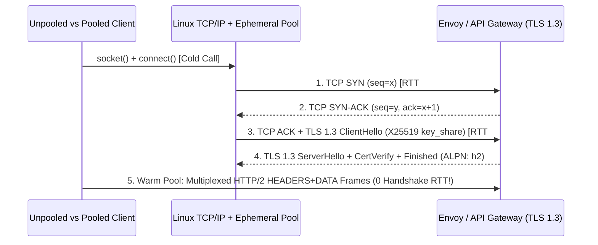

# TCP Handshakes, TLS 1.3 ECDHE & HTTP/2 Connection Pooling

```json pretraining
[
  {
    "term": "Cold Socket Penalty",
    "formula": "T_cold = 1 RTT (TCP) + 1 RTT (TLS 1.3) + T_CPU",
    "meaning": "Every unpooled HTTPS call pays two full network round-trips plus X25519 elliptic-curve math before sending byte zero of JSON."
  },
  {
    "term": "Ephemeral Port Ceiling",
    "formula": "N_TIME_WAIT = RPS * T_MSL_2 (≈ RPS * 60s)",
    "meaning": "Closed client sockets linger in kernel TIME_WAIT for 60s on Linux; exceeding ~28,232 sockets triggers EADDRNOTAVAIL."
  },
  {
    "term": "HTTP/2 Stream Multiplexing",
    "formula": "1 TCP Socket -> M Concurrent Streams (Frame ID 1, 3, 5...)",
    "meaning": "Interleaves binary HEADERS and DATA frames with HPACK header compression over one warm TLS session."
  },
  {
    "term": "TCP-Layer HoL Trap",
    "formula": "1 Dropped TCP Segment -> Stalls All M HTTP/2 Streams",
    "meaning": "The OS kernel enforces strict byte-order delivery across the entire TCP byte stream, motivating QUIC/HTTP/3 over UDP."
  }
]
```

```json poe
{
  "question": "An SDET suite fires 600 unpooled requests.get('https://api.internal/v1/orders') calls per second from a single Linux CI runner (ephemeral port range 32768–60999, 19ms cross-AZ RTT). What fails around second 48?",
  "options": [
    "Server TLS certificates expire due to OCSP stapling rate limits",
    "The CI runner exhausts all ~28,232 ephemeral ports stuck in 60-second TIME_WAIT, crashing with OSError: [Errno 99] Cannot assign requested address while wasting ~38ms per call on TCP+TLS handshakes",
    "HTTP/1.1 automatically upgrades to HTTP/3 QUIC over UDP",
    "DNS cache TTL expires and blocks libc getaddrinfo()"
  ],
  "answerIndex": 1,
  "explanation": "600 sockets/sec * 48 sec = 28,800 sockets in TIME_WAIT, exceeding the Linux default ephemeral port pool (60999 - 32768 = 28,231 ports) while paying 2 * 19ms = 38ms of avoidable TCP + TLS 1.3 handshake overhead on every single request."
}
```

## 1. First-Principles Wire Physics: What Happens Before `POST /orders`

When a junior automation script calls `requests.get("https://api.aerocart.internal/v1/cart")` inside a loop, it treats HTTP like an instantaneous function call. At the Linux kernel and NIC level, an unpooled HTTPS request executes a multi-stage state machine before a single byte of application JSON leaves user space:

1. **DNS Resolution (`UDP/53` or OS Cache)**: `getaddrinfo()` resolves hostname to IPv4/IPv6 (`0.5ms–25ms` if uncached).
2. **TCP 3-Way Handshake (`1 RTT`)**: Client sends `SYN (seq=x)` $\to$ Server replies `SYN-ACK (seq=y, ack=x+1)` $\to$ Client sends `ACK (ack=y+1)`.
3. **TLS 1.3 Cryptographic Handshake (`1 RTT` + CPU)**: Unlike TLS 1.2 (which required `2 RTTs` to agree on a cipher suite before exchanging Diffie-Hellman parameters), **TLS 1.3 (RFC 8446)** optimistically embeds the client's ephemeral `X25519` ECDHE `key_share` extension inside the initial `ClientHello`. The server computes the shared master secret immediately, returning `ServerHello`, `EncryptedExtensions`, `Certificate`, `CertificateVerify`, and `Finished` in a single flight.
4. **Socket Teardown & `TIME_WAIT` (`60s` Kernel Retention)**: Without keep-alive pooling, closing the socket sends `FIN-ACK`. The party initiating the active close (your test client when `Connection: close` is sent) transitions the `(src_ip, src_port, dst_ip, dst_port)` 4-tuple into `TIME_WAIT` for $2 \times \text{MSL}$ (`60 seconds` on Linux) to absorb delayed duplicate packets on the wire.

With a typical cross-region or staging RTT of `19ms`, `1 RTT (TCP) + 1 RTT (TLS 1.3) = 38ms` of pure handshake latency—often **3x slower** than the microservice's actual `11ms` database query!



---

## 2. HTTP/1.1 Keep-Alive vs. HTTP/2 Multiplexing vs. TCP HoL Blocking

Pooling sockets is necessary, but the wire framing protocol determines how many sockets a 32-worker parallel test runner needs:

```json contrast
{
  "title": "Per-Call Ephemeral Sockets vs Warm Pooled HTTP/2 Client",
  "naiveTitle": "requests.get() Inside Test Loops",
  "naiveMetric": "+38ms/req · 28k TIME_WAIT Exhaustion",
  "naivePoints": [
    "Allocates a fresh OS file descriptor, TCP 3-way handshake, and X25519 TLS 1.3 key derivation on every assertion",
    "Saturates Linux ip_local_port_range (32768-60999) at >470 RPS, throwing intermittent EADDRNOTAVAIL",
    "Masks server p99 regressions behind client-side TLS CPU and handshake jitter"
  ],
  "staffTitle": "Session-Scoped Pool + HTTP/2 ALPN",
  "staffMetric": "0ms Handshake · 1 Socket / 100 Streams",
  "staffPoints": [
    "Negotiates TLS 1.3 + ALPN h2 once per worker fixture; amortizes handshake across 10,000+ API calls",
    "HPACK header compression shrinks repetitive 1.8KB Bearer JWT headers down to indexed 2-byte references",
    "Explicit pool limits, keep-alive idle eviction (< server keepalive_timeout), and separate connect/read timeouts"
  ]
}
```

| Protocol & Strategy | Handshake Cost (Warm) | Max Concurrent In-Flight / Socket | Header Overhead | Dominant Bottleneck & Failure Mode |
| :--- | :--- | :--- | :--- | :--- |
| **HTTP/1.1 (`Connection: close`)** | `2 RTT` (`TCP + TLS 1.3`) | `1` request | Verbose ASCII (`~1.5 KB` JWT) | `TIME_WAIT` port exhaustion & `38ms+` cold overhead |
| **HTTP/1.1 Pooled (`Keep-Alive`)** | `0 RTT` | `1` request (Application HoL) | Verbose ASCII (`~1.5 KB` JWT) | Stale pooled socket race (`RemoteDisconnected`) if client idle TTL $\ge$ LB idle TTL |
| **HTTP/2 (`ALPN: h2`)** | `0 RTT` | `100–250` streams (`SETTINGS_MAX_CONCURRENT_STREAMS`) | Binary **HPACK** (`~20 B` delta) | **TCP-Layer Head-of-Line Blocking**: 1 lost packet stalls all 100 streams |
| **HTTP/3 (`QUIC / UDP`)** | `0 RTT` (`0-RTT` resumption) | `100+` independent QUIC streams | Binary **QPACK** | Higher user-space UDP crypto CPU (`sendmsg`/`GSO`) & corporate firewall UDP blocks |

---

## 3. Dual-Language Production Blueprints: Pooled Wire-Telemetry Clients

A Staff-grade API client instruments **cold vs. warm socket reuse** and sets client idle eviction strictly **below** the upstream load balancer's idle timeout (e.g., AWS ALB default `60s` $\to$ client `keepalive_expiry = 45s`) to eliminate half-closed `ConnectionResetError` flakes.

### Python 3 Blueprint: Thread-Safe Pooled Adapter with Handshake & Pool Metrics
```python
from __future__ import annotations
from dataclasses import dataclass
import socket
import time
from typing import Any, Dict
import urllib3
import requests
from requests.adapters import HTTPAdapter


@dataclass(frozen=True)
class WireTimingReport:
    status_code: int
    total_ms: float
    socket_reused: bool
    pool_num_connections: int


class InstrumentedPooledClient:
    """
    Production HTTP connection pool tuned for parallel CI workers:
    - Reuses warm TLS 1.3 sockets across thousands of API assertions.
    - Enables TCP_NODELAY to disable Nagle's 40ms delayed-ACK interaction on small JSON payloads.
    """

    def __init__(self, base_url: str, pool_maxsize: int = 32) -> None:
        self.base_url = base_url.rstrip("/")
        self.session = requests.Session()
        adapter = HTTPAdapter(
            pool_connections=8,
            pool_maxsize=pool_maxsize,
            pool_block=True,  # Backpressure instead of spawning unbounded unpooled sockets!
        )
        adapter.poolmanager.connection_pool_kw["socket_options"] = [
            (socket.IPPROTO_TCP, socket.TCP_NODELAY, 1),
        ]
        self.session.mount("https://", adapter)
        self.session.mount("http://", adapter)
        self._seen_sock_fds: set[int] = set()

    def request_with_telemetry(
        self, method: str, path: str, timeout: tuple[float, float] = (2.0, 5.0), **kwargs: Any
    ) -> WireTimingReport:
        url = f"{self.base_url}/{path.lstrip('/')}"
        t0 = time.perf_counter()
        resp = self.session.request(method, url, timeout=timeout, stream=True, **kwargs)
        try:
            sock_fd = -1
            raw_conn = getattr(resp.raw, "_connection", None)
            if raw_conn and getattr(raw_conn, "sock", None):
                sock_fd = raw_conn.sock.fileno()
            _ = len(resp.content)  # Drain payload so urllib3 returns socket cleanly to pool!
        finally:
            resp.close()

        elapsed_ms = round((time.perf_counter() - t0) * 1000.0, 2)
        reused = sock_fd != -1 and sock_fd in self._seen_sock_fds
        if sock_fd != -1:
            self._seen_sock_fds.add(sock_fd)

        adapter: HTTPAdapter = self.session.get_adapter(url)  # type: ignore[assignment]
        pools: Dict[Any, urllib3.connectionpool.ConnectionPool] = adapter.poolmanager.pools._container  # type: ignore[attr-defined]
        num_conns = sum(getattr(p, "num_connections", 0) for p in pools.values())
        return WireTimingReport(resp.status_code, elapsed_ms, reused, num_conns)

    def close(self) -> None:
        self.session.close()
```

### Java 17 Blueprint: `java.net.http.HttpClient` with TLS 1.3, HTTP/2 & Tuned Keep-Alive
```java
package com.aerocart.api.wire;

import java.io.IOException;
import java.net.URI;
import java.net.http.HttpClient;
import java.net.http.HttpRequest;
import java.net.http.HttpResponse;
import java.time.Duration;
import java.util.concurrent.Executors;
import javax.net.ssl.SSLSession;

public final class PooledHttp2GatewayClient implements AutoCloseable {

    public record WireCallResult(
        int statusCode,
        HttpClient.Version negotiatedProtocol,
        String tlsProtocol,
        String cipherSuite,
        long latencyMicros,
        String body
    ) {}

    private final HttpClient client;
    private final URI baseUri;

    public PooledHttp2GatewayClient(URI baseUri, int maxWorkerThreads) {
        // Set -Djdk.httpclient.keepalive.timeout=45 (< 60s ALB idle timeout)
        this.baseUri = baseUri;
        this.client = HttpClient.newBuilder()
            .version(HttpClient.Version.HTTP_2)
            .connectTimeout(Duration.ofSeconds(2))
            .executor(Executors.newFixedThreadPool(maxWorkerThreads))
            .build();
    }

    public WireCallResult getJson(String relativePath, String bearerToken)
            throws IOException, InterruptedException {
        HttpRequest request = HttpRequest.newBuilder()
            .uri(baseUri.resolve(relativePath))
            .timeout(Duration.ofSeconds(5))
            .header("Accept", "application/json")
            .header("Authorization", "Bearer " + bearerToken)
            .GET()
            .build();

        long startNs = System.nanoTime();
        HttpResponse<String> response = client.send(request, HttpResponse.BodyHandlers.ofString());
        long micros = (System.nanoTime() - startNs) / 1_000L;

        String tlsVer = response.sslSession().map(SSLSession::getProtocol).orElse("PLAINTEXT");
        String cipher = response.sslSession().map(SSLSession::getCipherSuite).orElse("NONE");

        return new WireCallResult(
            response.statusCode(),
            response.version(),
            tlsVer,
            cipher,
            micros,
            response.body()
        );
    }

    @Override
    public void close() {
        client.executor().ifPresent(exec -> {
            if (exec instanceof java.util.concurrent.ExecutorService es) {
                es.shutdown();
            }
        });
    }
}
```

> [!WARNING] **Staff Interview Gotcha — The Stale Keep-Alive Race Condition (`RemoteDisconnected`):** Pooling sockets introduces a classic distributed race condition. If an Nginx ingress or AWS ALB closes idle connections at `keepalive_timeout = 60s`, and your test client's connection pool also sets `keepalive_expiry = 60s`, the server may send a `TCP FIN` at `t = 60.000s` **at the exact millisecond** your client dequeues that socket from its pool and writes `POST /v1/payments`. Because `POST` is non-idempotent, `urllib3` / `HttpClient` **cannot safely auto-retry** after a write failure, surfacing a flaky `RemoteDisconnected` or `ConnectionResetError` in CI. **Invariant:** Always configure client pool idle eviction strictly smaller than the upstream server idle timeout ($T_{\text{client\_idle}} \le 0.75 \times T_{\text{server\_idle}}$, e.g., `45s` vs `60s`), and always consume/close response streams (`stream=True`) so sockets actually return to the pool instead of leaking!

---

## 4. Scenario Retrieval-Practice Mastery Gate

```json quiz
[
  {
    "id": "api-01-q1",
    "question": "Why does TLS 1.3 achieve a 1-RTT cryptographic handshake whereas TLS 1.2 required 2 RTTs on cold connections?",
    "options": [
      "TLS 1.3 skips server X.509 certificate signature verification on internal networks",
      "The client optimistically sends its ephemeral ECDHE key share (e.g., X25519) inside the very first ClientHello packet, allowing the server to derive traffic encryption keys immediately",
      "TLS 1.3 replaces asymmetric cryptography with pre-shared MD5 hashes",
      "TLS 1.3 merges the TCP SYN packet and HTTP payload into a single unacknowledged frame"
    ],
    "answerIndex": 1,
    "explanation": "TLS 1.3 removes legacy RSA key transport and embeds the key_share extension directly in ClientHello, cutting cold cryptographic negotiation from 2 RTTs down to 1 RTT."
  },
  {
    "id": "api-01-q2",
    "question": "Your Pytest suite uses a session-scoped requests.Session() with HTTPAdapter(pool_maxsize=4, pool_block=False) across 32 threads hitting the same host. What silently degrades performance under load?",
    "options": [
      "urllib3 silently creates 28 unpooled overflow connections per burst, and because the pool only holds 4 idle sockets, the excess 28 sockets are closed after every single call—re-introducing TLS handshakes and TIME_WAIT churn",
      "requests.Session automatically serializes all 32 threads onto the Python GIL",
      "HTTPAdapter upgrades excess threads to WebSockets",
      "The DNS resolver blocks all threads after 4 lookups"
    ],
    "answerIndex": 0,
    "explanation": "In urllib3, pool_maxsize controls how many connections are retained in the pool! With pool_block=False (default), overflow threads still open new sockets on demand and immediately discard/close them on completion. Staff frameworks size pool_maxsize >= worker_threads and set pool_block=True."
  },
  {
    "id": "api-01-q3",
    "question": "Every day at sparse CI traffic intervals (~58–60 seconds between test batches), POST /v1/checkout fails with ConnectionResetError / RemoteDisconnected, yet GET /v1/health retries cleanly. What is the root cause and fix?",
    "options": [
      "TLS session tickets only support GET verbs",
      "Stale keep-alive race: the load balancer sends TCP FIN at 60s idle just as the client writes POST bytes to the pooled socket, and RFC-compliant HTTP clients refuse to auto-retry non-idempotent POST writes unless client idle eviction is tuned below 60s (e.g., 45s) or an Idempotency-Key policy is wired",
      "Nagle's algorithm drops POST packets larger than 1460 bytes",
      "HTTP/2 HPACK corrupts Authorization headers after 60 seconds"
    ],
    "answerIndex": 1,
    "explanation": "When a pooled socket is closed by the server while in flight, HTTP clients can safely retry idempotent GET/HEAD/PUT/DELETE methods on a fresh socket, but must abort non-idempotent POST calls to avoid double-charging."
  }
]
```
