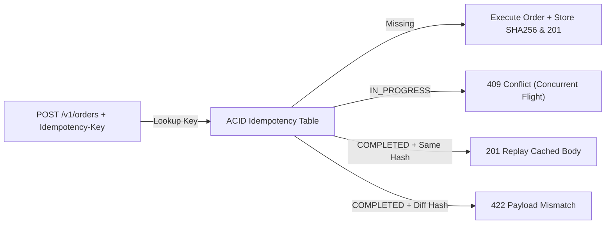

# RESTful HTTP Semantics: Idempotency Keys, ETag Concurrency & Keyset Pagination

```json pretraining
[
  {
    "term": "Idempotency Law",
    "formula": "f(f(S)) = f(S)  (Identical Server State After N>=1 Retries)",
    "meaning": "Idempotency governs server-side state transitions, NOT identical HTTP status codes (e.g., DELETE -> 204 then 404 is still idempotent)."
  },
  {
    "term": "Idempotency-Key Ledger",
    "formula": "(tenant_id, idempotency_key, payload_sha256) -> Cached 201",
    "meaning": "Upgrades non-idempotent POST mutations into safely retryable operations with 422/409 protection against payload tampering."
  },
  {
    "term": "ETag CAS Guard",
    "formula": "PUT + If-Match: \"v7\" -> 200 OK | 412 Precondition Failed",
    "meaning": "Prevents silent lost-update races when two concurrent API clients read-modify-write the same resource."
  },
  {
    "term": "Keyset Cursor Tuple",
    "formula": "WHERE (created_at, id) < (:cursor_ts, :cursor_id)",
    "meaning": "Eliminates O(N) SQL OFFSET scans and concurrent insertion page-drift using a composite tie-breaker index."
  }
]
```

```json poe
{
  "question": "Client A and Client B both GET /v1/inventory/sku-99 (stock=10, ETag: \"rev-4\"). Client A sends PUT stock=8 with If-Match: \"rev-4\" and receives 200 OK (ETag: \"rev-5\"). Client B then sends PUT stock=9 with If-Match: \"rev-4\". Meanwhile, Client C sends the same POST /v1/charges with Idempotency-Key: k-123, first with amount=500 and then on retry with amount=900. What status codes MUST a Staff-grade REST API return to Client B and Client C's second call?",
  "options": [
    "Client B receives 200 OK (last-write-wins); Client C receives 201 Created with amount=900",
    "Client B receives 412 Precondition Failed (preventing lost update); Client C receives 422 Unprocessable Content or 409 Conflict (idempotency key reused with mismatched payload hash)",
    "Both Client B and Client C receive 401 Unauthorized",
    "Client B receives 304 Not Modified; Client C receives 204 No Content"
  ],
  "answerIndex": 1,
  "explanation": "If-Match: \"rev-4\" fails against current ETag \"rev-5\", returning 412 Precondition Failed. Reusing an Idempotency-Key with a mutated request body hash violates the Stripe/IETF Idempotency-Key specification and must be rejected (422/409) rather than silently returning the cached 500-cent receipt."
}
```

## 1. Safe vs. Idempotent Verbs & Status Code Precision (RFC 9110)

Most production API incidents stem from conflating **safe** methods (read-only: `GET`, `HEAD`, `OPTIONS`) with **idempotent** methods (`PUT`, `DELETE`, plus safe methods), or misusing `POST` and `PATCH` without concurrency envelopes.

- **Why `DELETE` Returning `204` Then `404` Is Still Idempotent**: RFC 9110 defines idempotency by the **intended effect on server state**, not byte-for-byte response equivalence. Calling `DELETE /v1/carts/c-42` once removes `c-42` (`204 No Content`); calling it a second time leaves the server in the exact same state (`c-42` absent) even if the HTTP status is `404 Not Found`.
- **Why `PATCH` Is NOT Automatically Idempotent**: A JSON Merge Patch `{"email": "a@b.com"}` happens to be idempotent, whereas a JSON Patch `[ {"op": "add", "path": "/credits/-", "value": 10} ]` appends on every retry!
- **Making `POST` Retry-Safe via `Idempotency-Key`**: When a client times out waiting for `POST /v1/payments`, it cannot know if the server committed the DB transaction before the TCP ACK dropped. Storing `(tenant_id, idempotency_key)` atomically alongside the business write in a single ACID transaction allows retries to replay the exact original response (`Idempotent-Replayed: true`), while returning `409 Conflict` if the first call is still `IN_PROGRESS` or `422 Unprocessable Content` if the retry mutates the request payload.



---

## 2. Optimistic Concurrency (`ETag`) & Offset vs. Keyset Pagination

```json contrast
{
  "title": "Blind Overwrites & OFFSET Scans vs ETag CAS & Keyset Cursors",
  "naiveTitle": "Unconditional PUT + ?offset=10000&limit=50",
  "naiveMetric": "Silent Lost Updates · O(N) Page Drift",
  "naivePoints": [
    "Concurrent PUT overwrites teammate's fields silently (Last-Write-Wins data corruption)",
    "Inserting 1 new row while a client paginates shifts OFFSET boundaries, duplicating row #50 onto page 2",
    "PostgreSQL scans and discards 10,000 index/heap rows on page 200, spiking p99 latency to >450ms"
  ],
  "staffTitle": "If-Match ETag CAS + Composite Keyset Cursor",
  "staffMetric": "Zero Lost Writes · O(log N) 2ms Seek",
  "staffPoints": [
    "Mandatory If-Match header enforces atomic Compare-And-Swap; stale writers fail fast with 412 Precondition Failed",
    "Opaque base64url cursor encodes (created_at, id) tuple so concurrent inserts never duplicate or skip rows",
    "Uses B-Tree index seek WHERE (created_at, id) < (?, ?) for flat ~2ms latency at page 1 or page 100,000"
  ]
}
```

### Precision HTTP Status Code Matrix for Contract Assertions

| Status Code | Exact Semantic Contract | Mandatory Automation Test Case |
| :--- | :--- | :--- |
| **`400 Bad Request`** | Malformed wire syntax (invalid JSON, broken UTF-8, unparseable header) | Send truncated JSON `{"amount": ` and assert `400` with zero stack trace leakage |
| **`401 Unauthorized`** | **Authentication** missing, expired, or invalid signature (`WWW-Authenticate` required) | Send expired `exp` JWT or tampered signature; assert `401`, never `403` |
| **`403 Forbidden`** | **Authorization** denied—caller identity is known, but lacks RBAC/tenant scope | Authenticated Tenant A requests Tenant B's order (`BOLA`); assert `403` (or `404` anti-enumeration) |
| **`409 Conflict`** | Resource state conflict (duplicate unique business key, concurrent in-flight idempotency key) | Fire two simultaneous requests with identical `Idempotency-Key` via `CyclicBarrier` |
| **`412 Precondition Failed`** | Optimistic lock failure (`If-Match` ETag mismatch or `If-Unmodified-Since` expired) | Mutate resource out-of-band between `GET` and `PUT`; assert `412` |
| **`422 Unprocessable Content`** | Syntactically valid JSON that violates domain invariants (`amount: -50`, mismatched key hash) | Send valid JSON schema with negative quantity or reused `Idempotency-Key` + altered body |

---

## 3. Dual-Language Production Blueprints: Idempotency, ETag & Cursor Verifiers

### Python 3 Blueprint: Deterministic Pagination Drift & Idempotency Contract Harness
```python
from __future__ import annotations
import base64
import hashlib
import json
from dataclasses import dataclass
from typing import Callable, Dict, List, Optional, Tuple


def encode_keyset_cursor(created_at_ms: int, record_id: str) -> str:
    payload = json.dumps({"ts": created_at_ms, "id": record_id}, separators=(",", ":")).encode()
    return base64.urlsafe_b64encode(payload).decode().rstrip("=")


def decode_keyset_cursor(cursor: str) -> Tuple[int, str]:
    padding = "=" * (-len(cursor) % 4)
    raw = json.loads(base64.urlsafe_b64decode(cursor + padding).decode())
    return int(raw["ts"]), str(raw["id"])


@dataclass
class CachedIdempotentOutcome:
    request_sha256: str
    status_code: int
    body: Dict[str, object]


class IdempotencyAndConcurrencyVerifier:
    """
    Reference verifier for testing server-side Idempotency-Key state machines,
    ETag If-Match CAS semantics, and cursor-stability under concurrent writes.
    """

    def __init__(self) -> None:
        self._ledger: Dict[Tuple[str, str], CachedIdempotentOutcome] = {}

    @staticmethod
    def canonical_hash(payload: Dict[str, object]) -> str:
        raw = json.dumps(payload, sort_keys=True, separators=(",", ":")).encode("utf-8")
        return hashlib.sha256(raw).hexdigest()

    def simulate_idempotent_post(
        self,
        tenant_id: str,
        idem_key: str,
        payload: Dict[str, object],
        create_fn: Callable[[Dict[str, object]], Dict[str, object]],
    ) -> Tuple[int, Dict[str, object], Dict[str, str]]:
        req_hash = self.canonical_hash(payload)
        composite = (tenant_id, idem_key)
        existing = self._ledger.get(composite)
        if existing is not None:
            if existing.request_sha256 != req_hash:
                return 422, {"error": "IDEMPOTENCY_PAYLOAD_MISMATCH"}, {}
            return existing.status_code, existing.body, {"Idempotent-Replayed": "true"}

        created = create_fn(payload)
        self._ledger[composite] = CachedIdempotentOutcome(req_hash, 201, created)
        return 201, created, {"Idempotent-Replayed": "false"}

    @staticmethod
    def verify_zero_pagination_drift(
        fetch_page: Callable[[Optional[str], int], Tuple[List[str], Optional[str]]],
        inject_concurrent_insert: Callable[[], str],
        expected_existing_ids: List[str],
    ) -> None:
        seen: List[str] = []
        cursor: Optional[str] = None
        page_idx = 0
        while True:
            ids, cursor = fetch_page(cursor, 2)
            seen.extend(ids)
            if page_idx == 0:
                # Insert a brand-new newest record mid-traversal; keyset cursor must NOT shift!
                inject_concurrent_insert()
            page_idx += 1
            if not cursor:
                break
        assert len(seen) == len(set(seen)), f"Duplicate rows leaked across pages: {seen}"
        assert seen == expected_existing_ids, f"Missed or reordered rows: {seen}"
```

### Java 17 Blueprint: Optimistic Concurrency (`ETag` / `If-Match`) & `304` Cache Validator
```java
package com.aerocart.api.semantics;

import java.io.IOException;
import java.net.URI;
import java.net.http.HttpClient;
import java.net.http.HttpRequest;
import java.net.http.HttpResponse;
import java.util.UUID;

public final class OptimisticResourceClient {

    public record VersionedEntity(int statusCode, String etag, String jsonBody) {}

    private final HttpClient http;
    private final URI baseUri;

    public OptimisticResourceClient(HttpClient http, URI baseUri) {
        this.http = http;
        this.baseUri = baseUri;
    }

    public VersionedEntity getWithConditionalCache(String path, String cachedEtag)
            throws IOException, InterruptedException {
        HttpRequest.Builder builder = HttpRequest.newBuilder()
            .uri(baseUri.resolve(path))
            .header("Accept", "application/json")
            .GET();
        if (cachedEtag != null && !cachedEtag.isBlank()) {
            builder.header("If-None-Match", cachedEtag);
        }
        HttpResponse<String> resp = http.send(builder.build(), HttpResponse.BodyHandlers.ofString());
        String etag = resp.headers().firstValue("ETag").orElse(cachedEtag);
        // 304 Not Modified returns empty wire body while preserving cached payload validity
        return new VersionedEntity(resp.statusCode(), etag, resp.body());
    }

    public VersionedEntity casUpdatePut(String path, String expectedEtag, String jsonPayload)
            throws IOException, InterruptedException {
        if (expectedEtag == null || expectedEtag.isBlank()) {
            throw new IllegalArgumentException("Staff invariant: PUT requires non-empty If-Match ETag");
        }
        HttpRequest req = HttpRequest.newBuilder()
            .uri(baseUri.resolve(path))
            .header("Content-Type", "application/json")
            .header("If-Match", expectedEtag)
            .PUT(HttpRequest.BodyPublishers.ofString(jsonPayload))
            .build();
        HttpResponse<String> resp = http.send(req, HttpResponse.BodyHandlers.ofString());
        return new VersionedEntity(
            resp.statusCode(),
            resp.headers().firstValue("ETag").orElse(""),
            resp.body()
        );
    }

    public HttpResponse<String> postIdempotent(String path, UUID idempotencyKey, String jsonPayload)
            throws IOException, InterruptedException {
        HttpRequest req = HttpRequest.newBuilder()
            .uri(baseUri.resolve(path))
            .header("Content-Type", "application/json")
            .header("Idempotency-Key", idempotencyKey.toString())
            .POST(HttpRequest.BodyPublishers.ofString(jsonPayload))
            .build();
        return http.send(req, HttpResponse.BodyHandlers.ofString());
    }
}
```

> [!WARNING] **Staff Interview Gotcha — Single-Column Timestamp Cursors Silently Drop Rows!** A common trap when implementing cursor pagination is encoding *only* `WHERE created_at < :cursor_ts ORDER BY created_at DESC LIMIT 50`. Under bursty CI or production writes, multiple orders share the exact same millisecond/microsecond `created_at` timestamp. If row #50 and row #51 both have `created_at = 1731200000123`, then `WHERE created_at < 1731200000123` on Page 2 **permanently skips row #51**! **Invariant:** Every keyset cursor MUST sort and filter on a **deterministic unique tie-breaker tuple** `(created_at, id)` backed by a matching composite B-Tree index `CREATE INDEX idx_orders_cursor ON orders (tenant_id, created_at DESC, id DESC)`, and your API test suite must explicitly seed $\ge 3$ records with identical timestamps spanning a `limit` boundary to prove zero dropped rows.

---

## 4. Scenario Retrieval-Practice Mastery Gate

```json quiz
[
  {
    "id": "api-02-q1",
    "question": "Why must an API test suite seed multiple records with the EXACT same created_at timestamp across a page-size boundary (e.g., limit=2 with 3 identical-timestamp records) when testing cursor pagination?",
    "options": [
      "To verify that JSON numbers do not overflow IEEE-754 float64",
      "Because a naive single-column cursor (WHERE created_at < :cursor_ts) silently skips remaining tied records on page 2 unless the backend uses a composite tie-breaker tuple (created_at, id)",
      "To force SQLite and PostgreSQL to switch from B-Tree indexes to Hash indexes",
      "To trigger HTTP 304 Not Modified responses on page 2"
    ],
    "answerIndex": 1,
    "explanation": "Without a strictly unique tie-breaker column (id) in both ORDER BY and the tuple inequality predicate, records sharing the boundary timestamp are excluded by strict '<' or endlessly repeated by '<='."
  },
  {
    "id": "api-02-q2",
    "question": "What is the exact behavioural difference between If-None-Match (used with GET) and If-Match (used with PUT/PATCH/DELETE)?",
    "options": [
      "If-None-Match encrypts the ETag whereas If-Match sends it in plaintext",
      "If-None-Match validates read caches (returning 304 Not Modified when the ETag still matches), whereas If-Match enforces optimistic concurrency on writes (returning 412 Precondition Failed if the ETag no longer matches)",
      "If-None-Match is HTTP/1.1 only and If-Match is HTTP/2 only",
      "Both headers return 409 Conflict when stale"
    ],
    "answerIndex": 1,
    "explanation": "GET + If-None-Match saves bandwidth via 304 Not Modified; PUT/DELETE + If-Match implements atomic Compare-And-Swap, aborting stale writes with 412 Precondition Failed."
  },
  {
    "id": "api-02-q3",
    "question": "If Tenant A sends an Idempotency-Key 'order-77' and Tenant B independently sends the exact same string 'order-77' on POST /v1/orders, what happens if the backend indexes idempotency_key globally instead of scoping by (tenant_id, idempotency_key)?",
    "options": [
      "HTTP/2 automatically namespaces headers by TLS SNI",
      "Catastrophic cross-tenant data leak or DoS: Tenant B either receives Tenant A's cached 201 order payload (P0 data breach!) or gets blocked with 422/409 cross-tenant collision",
      "Both tenants receive 204 No Content",
      "The database upgrades the transaction to READ UNCOMMITTED"
    ],
    "answerIndex": 1,
    "explanation": "Idempotency keys are client-generated strings; scoping them globally allows cross-tenant collisions or deliberate key-guessing attacks. Always composite-key on (tenant_id, endpoint, idempotency_key)."
  }
]
```
