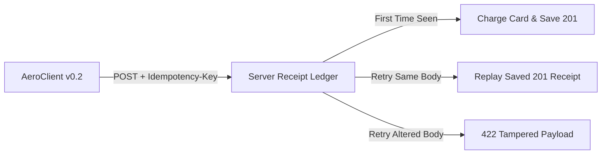

# RESTful HTTP Semantics: Idempotency Keys, ETag Concurrency & Keyset Pagination

```json continuity
{
  "previously": "In Chapter 01, we built AeroClient v0.1 with pooled keep-alive sockets and exponential backoff so a flaky airport Wi-Fi drop automatically retries our HTTP call.",
  "painPoint": "When AeroClient v0.1 automatically retried a timed-out POST /v1/bookings call, the server had already processed the first ticket purchase—charging our passenger's credit card twice! Worse, two gate agents updating seat 12A at the same time silently overwrote each other's changes.",
  "unlock": "We will upgrade to AeroClient v0.2 with unique receipt stamps (Idempotency-Key), version tags that block blind overwrites (ETag + If-Match), and bookmark cursors that never skip or duplicate flights across pages."
}
```

```json walkthrough
[
  {
    "time": "0:00",
    "badge": "1. The Double-Charge Trap",
    "caption": "When a network cable glitches right after the server charges a credit card, the client only sees a timeout. Retrying a plain POST creates a second booking unless we attach a unique receipt number.",
    "code": "POST /v1/bookings\nIdempotency-Key: 9b1deb4d-3b7d-4bad-9bdd"
  },
  {
    "time": "0:22",
    "badge": "2. Safe Retries with Idempotency",
    "caption": "With an Idempotency-Key header, the server checks its ledger first. If it already processed that key with the exact same payload, it simply replays the original 201 receipt without charging twice.",
    "code": "HTTP/1.1 201 Created\nIdempotent-Replayed: true"
  },
  {
    "time": "0:48",
    "badge": "3. Optimistic Locking via ETag",
    "caption": "To stop two gate agents from blindly overwriting seat 12A, every GET returns a version tag called an ETag. An update only succeeds if the client sends back If-Match with that exact version tag.",
    "code": "PUT /v1/seats/12A\nIf-Match: \"v4\"  --> 200 OK or 412 Failed"
  },
  {
    "time": "1:12",
    "badge": "4. Keyset Bookmark Pagination",
    "caption": "Instead of counting row offsets that shift whenever a new flight is booked, AeroClient v0.2 passes a composite bookmark tuple of timestamp and ID so page traversal never duplicates or skips a row.",
    "code": "WHERE (created_at, id) < (1731200000, 'ord-50')"
  }
]
```

```json pretraining
[
  {
    "term": "Idempotency",
    "formula": "Apply(Apply(State)) = Apply(State)",
    "meaning": "An action where performing the exact same request once or ten times leaves the server's stored data in the exact same state, never creating duplicate orders."
  },
  {
    "term": "Idempotency-Key",
    "formula": "(tenant_id, key, body_hash) -> Stored Receipt",
    "meaning": "A unique customer-chosen serial number attached to a POST request so the server can recognize a network retry and hand back the original receipt instead of charging twice."
  },
  {
    "term": "ETag & If-Match",
    "formula": "PUT + If-Match: \"v4\" -> 200 OK | 412 Stale",
    "meaning": "A version stamp on a record: the server only saves your edit if the stamp you send back still matches the version currently stored in the database."
  },
  {
    "term": "Keyset Cursor",
    "formula": "After (timestamp, unique_id)",
    "meaning": "A pagination bookmark that remembers the exact timestamp and ID of the last item on the page, so newly inserted items never push old rows onto the next page."
  }
]
```

## 🌱 Step 1: Plain-English Story — The Elevator Button vs. The Coffee Machine

Imagine standing in a hotel lobby waiting for an elevator. You press the **"UP"** button once, and it lights up. Impatient, you press it five more times. Does the building summon six separate elevators? Of course not—pressing the button once or ten times produces the exact same outcome. In software, we call that **idempotent**.

Now walk over to the lobby's coin-operated espresso machine. If you insert a dollar and press **"Brew Espresso"** twice, you get charged twice and overflow your cup. In HTTP APIs, reading a flight (`GET`), replacing a seat assignment (`PUT`), or canceling a cart (`DELETE`) work like the elevator button. Even if deleting an already-deleted cart returns `204 No Content` the first time and `404 Not Found` the second time, the server's database state is identical: the cart is gone.

Buying a ticket with `POST /v1/bookings`, however, works like the coffee machine. When `AeroClient v0.1` added automatic retries in Chapter 01, a dropped response packet caused our client to press the `POST` button a second time—double-charging the flyer! To turn `POST` into an elevator button, `AeroClient v0.2` attaches a unique serial stamp (`Idempotency-Key`) to every purchase and a version stamp (`If-Match`) to every seat edit:



---

## 🔨 Step 2: First Lines of Code — Upgrading `AeroClient v0.2` with Safe Retries & Version Stamps

Let's evolve `AeroClient v0.1` into `AeroClient v0.2` by adding two small methods: one that attaches an `Idempotency-Key` header before calling `POST`, and one that sends `If-Match` before updating a seat with `PUT`.

```python
import uuid
import requests

class AeroClientV02:
    def __init__(self, base_url: str, session: requests.Session) -> None:
        self.base_url = base_url.rstrip("/")
        self.session = session

    def book_flight_once(self, flight_id: str, idem_key: str | None = None) -> requests.Response:
        key = idem_key or str(uuid.uuid4())
        return self.session.post(
            f"{self.base_url}/v1/bookings",
            json={"flight_id": flight_id},
            headers={"Idempotency-Key": key},
            timeout=(1.0, 3.0),
        )

    def update_seat_safely(self, booking_id: str, seat: str, etag: str) -> requests.Response:
        return self.session.put(
            f"{self.base_url}/v1/bookings/{booking_id}",
            json={"seat": seat},
            headers={"If-Match": etag},
            timeout=(1.0, 3.0),
        )
```

### Java 17 Equivalent

```java
import java.net.URI;
import java.net.http.*;
import java.util.UUID;

public class AeroClientV02 {
    public HttpRequest buildIdempotentBooking(URI url, String flightId, UUID idemKey) {
        return HttpRequest.newBuilder(url)
            .header("Content-Type", "application/json")
            .header("Idempotency-Key", idemKey.toString())
            .POST(HttpRequest.BodyPublishers.ofString("{\"flight_id\":\"" + flightId + "\"}"))
            .build();
    }

    public HttpRequest buildSafeSeatUpdate(URI url, String seat, String currentEtag) {
        return HttpRequest.newBuilder(url)
            .header("Content-Type", "application/json")
            .header("If-Match", currentEtag)
            .PUT(HttpRequest.BodyPublishers.ofString("{\"seat\":\"" + seat + "\"}"))
            .build();
    }
}
```

---

## ⚡ Step 3: Where It Breaks in Real Life — Silent Overwrites, Tampered Retries & Shifting Pages

Our `AeroClient v0.2` headers are in place, but three subtle traps break real-world APIs under concurrent load:

1. **Payload Tampering on Retry (`422`)**: What if a buggy client reuses `Idempotency-Key: k-123` from a \$500 ticket purchase, but changes the body to a \$900 first-class ticket? If the server only checks the key string, it silently returns the cached \$500 receipt! The server must hash the request body and reject mismatches with `422 Unprocessable Content`.
2. **Blind `PUT` Overwrites (`412`)**: If Gate Agent A and Gate Agent B both fetch Booking `#99` (`ETag: "rev-4"`), Agent A saves first (`rev-5`), and Agent B saves second using stale `If-Match: "rev-4"`, the server must block Agent B with `412 Precondition Failed`.
3. **Pagination Drift with `OFFSET`**: When `AeroClient` lists 10,000 bookings using `?offset=50&limit=50`, and a new booking arrives while fetching Page 1, every row shifts down by one—causing Page 2 to return row `#50` a second time!

```json contrast
{
  "title": "Blind Overwrites & OFFSET Scans vs ETag CAS & Keyset Cursors",
  "naiveTitle": "Unconditional PUT + ?offset=10000&limit=50",
  "naiveMetric": "Silent Lost Updates · O(N) Page Drift",
  "naivePoints": [
    "Concurrent PUT overwrites a teammate's seat assignment silently (Last-Write-Wins data corruption)",
    "Inserting 1 new booking while a client paginates shifts OFFSET boundaries, duplicating row #50 onto page 2",
    "Database scans and discards 10,000 rows on page 200, spiking p99 latency above 450ms"
  ],
  "staffTitle": "If-Match ETag CAS + Composite Keyset Cursor",
  "staffMetric": "Zero Lost Writes · O(log N) 2ms Seek",
  "staffPoints": [
    "Mandatory If-Match header enforces atomic Compare-And-Swap; stale writers fail fast with 412 Precondition Failed",
    "Opaque base64url cursor encodes (created_at, id) tuple so concurrent inserts never duplicate or skip rows",
    "Uses B-Tree index seek WHERE (created_at, id) < (?, ?) for flat ~2ms latency at page 1 or page 100,000"
  ]
}
```

```json poe
{
  "question": "Client A and Client B both GET /v1/inventory/sku-99 (stock=10, ETag: \"rev-4\"). Client A sends PUT stock=8 with If-Match: \"rev-4\" and receives 200 OK (ETag: \"rev-5\"). Client B then sends PUT stock=9 with If-Match: \"rev-4\". Meanwhile, Client C sends the same POST /v1/charges with Idempotency-Key: k-123, first with amount=500 and then on retry with amount=900. What status codes MUST a Staff-grade REST API return to Client B and Client C's second call?",
  "options": [
    "Client B receives 200 OK (last-write-wins); Client C receives 201 Created with amount=900",
    "Client B receives 412 Precondition Failed (preventing lost update); Client C receives 422 Unprocessable Content or 409 Conflict (idempotency key reused with mismatched payload hash)",
    "Both Client B and Client C receive 401 Unauthorized",
    "Client B receives 304 Not Modified; Client C receives 204 No Content"
  ],
  "answerIndex": 1,
  "explanation": "If-Match: \"rev-4\" fails against current ETag \"rev-5\", returning 412 Precondition Failed. Reusing an Idempotency-Key with a mutated request body hash violates the Stripe/IETF Idempotency-Key specification and must be rejected (422/409) rather than silently returning the cached 500-cent receipt."
}
```

---

## 🚀 Step 4: Staff Engineer Deep-Dive — Mathematical Invariants, Status Taxonomy & Blueprints

### Formal Idempotency & Keyset Seek Complexity Laws

Under RFC 9110, a method transformation $f: \mathcal{S} \to \mathcal{S}$ on server state space $\mathcal{S}$ is idempotent if and only if repeating the identical request $N \ge 1$ times yields the exact same state transition as a single execution:

$$f^{(N)}(S_0) = f(S_0) \quad \forall N \ge 1$$

For pagination over a table of $N$ records with page size $K$ at page index $P$, traditional `OFFSET` pagination scans and discards $P \cdot K$ index entries, whereas a composite keyset cursor seeks directly to the tuple boundary `(created_at, id)` in logarithmic B+Tree depth $h$:

$$T_{\text{offset}}(P, K) = \mathcal{O}(P \cdot K) \quad \text{vs.} \quad T_{\text{keyset}}(P, K) = \mathcal{O}(\log_B N + K)$$

### Precision HTTP Status Code Matrix for Contract Assertions

| Status Code | Exact Semantic Contract | Mandatory Automation Test Case |
| :--- | :--- | :--- |
| **`400 Bad Request`** | Malformed wire syntax (invalid JSON, broken UTF-8, unparseable header) | Send truncated JSON `{"amount": ` and assert `400` with zero stack trace leakage |
| **`401 Unauthorized`** | **Authentication** missing, expired, or invalid signature (`WWW-Authenticate` required) | Send expired token or tampered signature; assert `401`, never `403` |
| **`403 Forbidden`** | **Authorization** denied—caller identity is known, but lacks tenant/role scope | Authenticated Tenant A requests Tenant B's order (`BOLA`); assert `403` (or `404` anti-enumeration) |
| **`409 Conflict`** | Resource state conflict (duplicate unique business key, concurrent in-flight idempotency key) | Fire two simultaneous requests with identical `Idempotency-Key` via concurrency barrier |
| **`412 Precondition Failed`** | Optimistic lock failure (`If-Match` ETag mismatch or `If-Unmodified-Since` expired) | Mutate resource out-of-band between `GET` and `PUT`; assert `412` |
| **`422 Unprocessable Content`** | Syntactically valid JSON that violates domain invariants (`amount: -50`, mismatched key hash) | Send valid JSON schema with negative quantity or reused `Idempotency-Key` + altered body |

### Python 3 Blueprint: Deterministic Pagination Drift & Idempotency Contract Harness

```python
from __future__ import annotations
import base64
import hashlib
import json
from dataclasses import dataclass
from typing import Callable, Dict, List, Optional, Tuple


def encode_keyset_cursor(created_at_ms: int, record_id: str) -> str:
    payload = json.dumps({"ts": created_at_ms, "id": record_id}, separators=(",", ":")).encode()
    return base64.urlsafe_b64encode(payload).decode().rstrip("=")


def decode_keyset_cursor(cursor: str) -> Tuple[int, str]:
    padding = "=" * (-len(cursor) % 4)
    raw = json.loads(base64.urlsafe_b64decode(cursor + padding).decode())
    return int(raw["ts"]), str(raw["id"])


@dataclass
class CachedIdempotentOutcome:
    request_sha256: str
    status_code: int
    body: Dict[str, object]


class IdempotencyAndConcurrencyVerifier:
    """Reference verifier for Idempotency-Key state machines and cursor stability."""

    def __init__(self) -> None:
        self._ledger: Dict[Tuple[str, str], CachedIdempotentOutcome] = {}

    @staticmethod
    def canonical_hash(payload: Dict[str, object]) -> str:
        raw = json.dumps(payload, sort_keys=True, separators=(",", ":")).encode("utf-8")
        return hashlib.sha256(raw).hexdigest()

    def simulate_idempotent_post(
        self,
        tenant_id: str,
        idem_key: str,
        payload: Dict[str, object],
        create_fn: Callable[[Dict[str, object]], Dict[str, object]],
    ) -> Tuple[int, Dict[str, object], Dict[str, str]]:
        req_hash = self.canonical_hash(payload)
        composite = (tenant_id, idem_key)
        existing = self._ledger.get(composite)
        if existing is not None:
            if existing.request_sha256 != req_hash:
                return 422, {"error": "IDEMPOTENCY_PAYLOAD_MISMATCH"}, {}
            return existing.status_code, existing.body, {"Idempotent-Replayed": "true"}

        created = create_fn(payload)
        self._ledger[composite] = CachedIdempotentOutcome(req_hash, 201, created)
        return 201, created, {"Idempotent-Replayed": "false"}

    @staticmethod
    def verify_zero_pagination_drift(
        fetch_page: Callable[[Optional[str], int], Tuple[List[str], Optional[str]]],
        inject_concurrent_insert: Callable[[], str],
        expected_existing_ids: List[str],
    ) -> None:
        seen: List[str] = []
        cursor: Optional[str] = None
        page_idx = 0
        while True:
            ids, cursor = fetch_page(cursor, 2)
            seen.extend(ids)
            if page_idx == 0:
                inject_concurrent_insert()
            page_idx += 1
            if not cursor:
                break
        assert len(seen) == len(set(seen)), f"Duplicate rows leaked across pages: {seen}"
        assert seen == expected_existing_ids, f"Missed or reordered rows: {seen}"
```

### Java 17 Blueprint: Optimistic Concurrency (`ETag` / `If-Match`) & `304` Cache Validator

```java
package com.aerocart.api.semantics;

import java.io.IOException;
import java.net.URI;
import java.net.http.HttpClient;
import java.net.http.HttpRequest;
import java.net.http.HttpResponse;
import java.util.UUID;

public final class OptimisticResourceClient {

    public record VersionedEntity(int statusCode, String etag, String jsonBody) {}

    private final HttpClient http;
    private final URI baseUri;

    public OptimisticResourceClient(HttpClient http, URI baseUri) {
        this.http = http;
        this.baseUri = baseUri;
    }

    public VersionedEntity getWithConditionalCache(String path, String cachedEtag)
            throws IOException, InterruptedException {
        HttpRequest.Builder builder = HttpRequest.newBuilder()
            .uri(baseUri.resolve(path))
            .header("Accept", "application/json")
            .GET();
        if (cachedEtag != null && !cachedEtag.isBlank()) {
            builder.header("If-None-Match", cachedEtag);
        }
        HttpResponse<String> resp = http.send(builder.build(), HttpResponse.BodyHandlers.ofString());
        String etag = resp.headers().firstValue("ETag").orElse(cachedEtag);
        return new VersionedEntity(resp.statusCode(), etag, resp.body());
    }

    public VersionedEntity casUpdatePut(String path, String expectedEtag, String jsonPayload)
            throws IOException, InterruptedException {
        if (expectedEtag == null || expectedEtag.isBlank()) {
            throw new IllegalArgumentException("Staff invariant: PUT requires non-empty If-Match ETag");
        }
        HttpRequest req = HttpRequest.newBuilder()
            .uri(baseUri.resolve(path))
            .header("Content-Type", "application/json")
            .header("If-Match", expectedEtag)
            .PUT(HttpRequest.BodyPublishers.ofString(jsonPayload))
            .build();
        HttpResponse<String> resp = http.send(req, HttpResponse.BodyHandlers.ofString());
        return new VersionedEntity(
            resp.statusCode(),
            resp.headers().firstValue("ETag").orElse(""),
            resp.body()
        );
    }

    public HttpResponse<String> postIdempotent(String path, UUID idempotencyKey, String jsonPayload)
            throws IOException, InterruptedException {
        HttpRequest req = HttpRequest.newBuilder()
            .uri(baseUri.resolve(path))
            .header("Content-Type", "application/json")
            .header("Idempotency-Key", idempotencyKey.toString())
            .POST(HttpRequest.BodyPublishers.ofString(jsonPayload))
            .build();
        return http.send(req, HttpResponse.BodyHandlers.ofString());
    }
}
```

> [!WARNING] **Staff Interview Gotcha — Single-Column Timestamp Cursors Silently Drop Rows!** A common trap when implementing cursor pagination is encoding *only* `WHERE created_at < :cursor_ts ORDER BY created_at DESC LIMIT 50`. Under bursty CI or production writes, multiple orders share the exact same millisecond `created_at` timestamp. If row `#50` and row `#51` both have `created_at = 1731200000123`, then `WHERE created_at < 1731200000123` on Page 2 **permanently skips row `#51`**! **Invariant:** Every keyset cursor MUST sort and filter on a **deterministic unique tie-breaker tuple** `(created_at, id)` backed by a matching composite B-Tree index `CREATE INDEX idx_orders_cursor ON orders (tenant_id, created_at DESC, id DESC)`, and your API test suite must explicitly seed $\ge 3$ records with identical timestamps spanning a `limit` boundary to prove zero dropped rows.

**Up Next in Chapter 03:** Now that `AeroClient v0.2` can safely retry bookings and paginate without losing rows, how do we prove *who* is calling? In Chapter 03, we upgrade to `AeroClient v0.3` with asymmetric `RS256` JWT validation, OAuth 2.1 `PKCE` S256 handshakes, and mutual TLS (`mTLS`) client certificates.

```json quiz
[
  {
    "id": "api-02-q1",
    "question": "Why must an API test suite seed multiple records with the EXACT same created_at timestamp across a page-size boundary (e.g., limit=2 with 3 identical-timestamp records) when testing cursor pagination?",
    "options": [
      "To verify that JSON numbers do not overflow IEEE-754 float64",
      "Because a naive single-column cursor (WHERE created_at < :cursor_ts) silently skips remaining tied records on page 2 unless the backend uses a composite tie-breaker tuple (created_at, id)",
      "To force SQLite and PostgreSQL to switch from B-Tree indexes to Hash indexes",
      "To trigger HTTP 304 Not Modified responses on page 2"
    ],
    "answerIndex": 1,
    "explanation": "Without a strictly unique tie-breaker column (id) in both ORDER BY and the tuple inequality predicate, records sharing the boundary timestamp are excluded by strict '<' or endlessly repeated by '<='."
  },
  {
    "id": "api-02-q2",
    "question": "What is the exact behavioural difference between If-None-Match (used with GET) and If-Match (used with PUT/PATCH/DELETE)?",
    "options": [
      "If-None-Match encrypts the ETag whereas If-Match sends it in plaintext",
      "If-None-Match validates read caches (returning 304 Not Modified when the ETag still matches), whereas If-Match enforces optimistic concurrency on writes (returning 412 Precondition Failed if the ETag no longer matches)",
      "If-None-Match is HTTP/1.1 only and If-Match is HTTP/2 only",
      "Both headers return 409 Conflict when stale"
    ],
    "answerIndex": 1,
    "explanation": "GET + If-None-Match saves bandwidth via 304 Not Modified; PUT/DELETE + If-Match implements atomic Compare-And-Swap, aborting stale writes with 412 Precondition Failed."
  },
  {
    "id": "api-02-q3",
    "question": "If Tenant A sends an Idempotency-Key 'order-77' and Tenant B independently sends the exact same string 'order-77' on POST /v1/orders, what happens if the backend indexes idempotency_key globally instead of scoping by (tenant_id, idempotency_key)?",
    "options": [
      "HTTP/2 automatically namespaces headers by TLS SNI",
      "Catastrophic cross-tenant data leak or DoS: Tenant B either receives Tenant A's cached 201 order payload (P0 data breach!) or gets blocked with 422/409 cross-tenant collision",
      "Both tenants receive 204 No Content",
      "The database upgrades the transaction to READ UNCOMMITTED"
    ],
    "answerIndex": 1,
    "explanation": "Idempotency keys are client-generated strings; scoping them globally allows cross-tenant collisions or deliberate key-guessing attacks. Always composite-key on (tenant_id, endpoint, idempotency_key)."
  }
]
```
