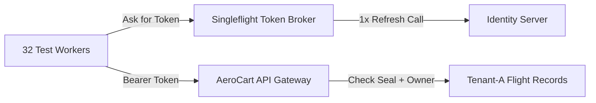

# API Security Internals: JWT JWKS Rotation, OAuth2 PKCE, mTLS & BOLA Matrices

```json continuity
{
  "previously": "In Chapter 02, we upgraded to AeroClient v0.2 with Idempotency-Key receipt stamps, ETag If-Match optimistic locking, and keyset bookmark cursors.",
  "painPoint": "Anyone on the internet could still call our booking endpoints! Worse, when we added basic login tokens and ran 32 parallel test workers, all 32 workers tried to refresh an expired login token at the exact same millisecond—locking out our test account—and our suite never caught that Airline Tenant B could read Airline Tenant A's private passenger manifests.",
  "unlock": "We will build AeroClient v0.3 with tamper-proof digital boarding passes (JWT), one-leader token renewal (Singleflight Refresh), secret handshake codes (PKCE), and an automated cross-tenant security matrix."
}
```

```json walkthrough
[
  {
    "time": "0:00",
    "badge": "1. The Glass Postcard Token",
    "caption": "A JSON Web Token is like a transparent postcard stamped with a wax seal. Anyone can read the text printed on it, so security depends completely on verifying the cryptographic signature seal.",
    "code": "Header . Payload . Signature\nAuthorization: Bearer eyJhbGci..."
  },
  {
    "time": "0:25",
    "badge": "2. PKCE Secret Claim Ticket",
    "caption": "When logging in from a browser or mobile app, AeroClient v0.3 creates a secret random string and sends only its SHA-256 hash upfront. Even if someone steals the redirect link, they cannot trade it for a token without the original secret.",
    "code": "challenge = BASE64URL(SHA256(verifier))"
  },
  {
    "time": "0:50",
    "badge": "3. Singleflight Token Refresh",
    "caption": "When 32 test workers notice the token expires in 30 seconds, one leader thread locks the door and fetches a fresh token while the other 31 threads wait quietly—preventing an identity server stampede.",
    "code": "if now >= exp - 30s:\n    with refresh_lock: fetch_once()"
  },
  {
    "time": "1:15",
    "badge": "4. Cross-Tenant Security Matrix",
    "caption": "Valid login is not enough. AeroClient v0.3 automatically tests every endpoint across four personas—Unauthenticated, Viewer, Admin A, and Rival Tenant B—to prove Tenant B gets 403 or 404 when snooping on Tenant A.",
    "code": "TenantB -> GET /v1/tenants/A/orders --> 403/404"
  }
]
```

```json pretraining
[
  {
    "term": "JSON Web Token (JWT)",
    "formula": "Header . Payload . Signature",
    "meaning": "A digital boarding pass made of three dot-separated text parts: anyone can read the passenger details inside, but only the login server holds the private key to stamp a valid signature."
  },
  {
    "term": "PKCE Handshake",
    "formula": "Challenge = Hash(Secret Verifier)",
    "meaning": "A two-part claim check for login redirects: the app shows a hashed puzzle when starting login, and reveals the secret answer only when picking up the final token."
  },
  {
    "term": "Broken Object Level Auth (BOLA)",
    "formula": "Logged_In(User B) + Reads(User A's Order #42)",
    "meaning": "The number-one API security bug where a server checks that a caller is logged in, but forgets to check whether that caller actually owns the specific record ID they requested."
  },
  {
    "term": "Singleflight Refresh",
    "formula": "32 Workers -> 1 Token Call + 31 Waiters",
    "meaning": "A coordination pattern where only one worker thread requests a new login token when the old one expires, sharing the fresh token with all waiting threads."
  }
]
```

## 🌱 Step 1: Plain-English Story — The Airport Boarding Pass & The Hotel Room Key

Think of walking through airport security with a printed boarding pass. Anyone standing behind you in line can read your name, flight number, and seat `12A` printed right on the paper—it is not encrypted in invisible ink! Why can't a stranger simply print a fake pass at home for First Class seat `1A`? Because the TSA scanner checks the cryptographic barcode seal signed by the airline's private vault key.

A **JSON Web Token (JWT)** works the exact same way. It is a transparent postcard with three parts separated by dots: `Header.Payload.Signature`. Anyone can decode the middle payload to read who you are (`sub`) and which airline tenant you belong to (`tid`), but if an attacker alters a single letter without the login server's private key, the signature check fails with `401 Unauthorized`.

However, passing the TSA checkpoint only proves *who you are* (**Authentication**). Imagine walking into the airport hotel Afterward: your room key opens Room `402`, but if a bug in the hotel lock lets your valid Room `402` key also open Room `403`, that is **Authorization** failure! In `AeroClient v0.3`, we must manage token renewals cleanly across parallel workers and verify that one airline tenant can never open another tenant's door:



---

## 🔨 Step 2: First Lines of Code — Upgrading `AeroClient v0.3` with Singleflight Bearer Auth

Let's evolve `AeroClient v0.2` into `AeroClient v0.3` by adding a thread-safe token manager that refreshes our Bearer token 30 seconds before it expires, ensuring 32 parallel test threads only make a single refresh call.

```python
import threading
import time
from typing import Callable, Tuple

class AeroClientV03:
    def __init__(self, mint_token_fn: Callable[[], Tuple[str, int]]) -> None:
        self._mint_token_fn = mint_token_fn
        self._lock = threading.Lock()
        self._token: str | None = None
        self._expires_at: float = 0.0

    def valid_auth_header(self) -> dict[str, str]:
        if self._token and time.monotonic() < (self._expires_at - 30.0):
            return {"Authorization": f"Bearer {self._token}"}
        with self._lock:
            if not self._token or time.monotonic() >= (self._expires_at - 30.0):
                self._token, ttl = self._mint_token_fn()
                self._expires_at = time.monotonic() + ttl
            return {"Authorization": f"Bearer {self._token}"}
```

### Java 17 Equivalent

```java
import java.time.Instant;
import java.util.concurrent.locks.ReentrantLock;
import java.util.function.Supplier;

public class AeroClientV03 {
    public record Grant(String token, Instant expiresAt) {}
    private final ReentrantLock lock = new ReentrantLock();
    private volatile Grant current;

    public String validAuthHeader(Supplier<Grant> mintTokenFn) {
        if (current != null && current.expiresAt().isAfter(Instant.now().plusSeconds(30))) {
            return "Bearer " + current.token();
        }
        lock.lock();
        try {
            if (current == null || !current.expiresAt().isAfter(Instant.now().plusSeconds(30))) {
                current = mintTokenFn.get();
            }
            return "Bearer " + current.token();
        } finally {
            lock.unlock();
        }
    }
}
```

---

## ⚡ Step 3: Where It Breaks in Real Life — Algorithm Confusion, Token Stampedes & Cross-Tenant Snooping

When teams only test `AeroClient` with a single "happy-path" admin token, three catastrophic security bugs slip into production:

1. **The Algorithm Confusion Trick (`RS256` $\to$ `HS256`)**: Asymmetric tokens (`RS256`) sign with a **private** key and verify with a **public** key. Symmetric tokens (`HS256`) use the *exact same* string to both sign and verify. If a server blindly trusts the `alg` header inside an incoming token, an attacker changes `"alg": "RS256"` to `"alg": "HS256"` and signs a fake admin token using the server's publicly downloadable RSA key file as the password!
2. **Refresh Token Stampede Lockouts**: Modern login servers rotate refresh tokens on every use. If a shared token expires mid-test and 32 parallel workers all send the same refresh token at once, the login server detects reuse, assumes a hacker stole the token, and revokes the entire session!
3. **Cross-Tenant Snooping (`BOLA`)**: If our test suite only runs as `SuperAdmin`, we never notice that `GET /v1/bookings/ord-99` runs `SELECT * FROM bookings WHERE id = 'ord-99'` without checking `AND tenant_id = caller.tenant_id`.

```json contrast
{
  "title": "Happy-Path Shared Admin Token vs Adversarial BOLA Matrix + Singleflight Auth",
  "naiveTitle": "Single Superadmin Token + Unlocked Refresh",
  "naiveMetric": "0% BOLA Detection · 429 Login Lockouts",
  "naivePoints": [
    "Runs entire API regression suite with one god-mode ADMIN token, completely blind to Cross-Tenant BOLA (OWASP #1)",
    "When access token expires mid-run, all 32 workers fire /oauth/token simultaneously, revoking rotating refresh tokens",
    "Never tests audience (aud) confusion, clock-skew expiry, or read-only viewer privilege escalation"
  ],
  "staffTitle": "Declarative Actor×Tenant Matrix + Singleflight",
  "staffMetric": "100% OWASP API1/API5 Gate · 1 RPC Refresh",
  "staffPoints": [
    "Parametrizes every endpoint across {Unauthenticated, Viewer_TenantA, Admin_TenantA, Admin_TenantB} automatically",
    "Double-checked lock (Singleflight) refreshes 30s BEFORE exp so zero in-flight tests hit 401 or rate limits",
    "Tests tampered signatures, alg:none, wrong aud, and unknown key-ID DoS resilience deterministically"
  ]
}
```

```json poe
{
  "question": "An API gateway verifies incoming JWTs using a public RSA key fetched from /.well-known/jwks.json, but passes the unverified JWT header's 'alg' field directly into jwt.decode(token, key=public_pem). An attacker changes the header to {\"alg\": \"HS256\"} and signs a forged admin payload using the server's PUBLIC RSA PEM bytes as an HMAC shared secret. What happens?",
  "options": [
    "OpenSSL rejects HMAC signatures shorter than 2048 bits",
    "Classic Algorithm-Confusion Privilege Escalation: the verifier treats the public PEM string as the symmetric HS256 secret, validates the attacker's HMAC signature as authentic, and grants admin access",
    "TLS 1.3 strips non-RS256 Authorization headers at the socket layer",
    "The base64url decoder throws a padding exception"
  ],
  "answerIndex": 1,
  "explanation": "Never let an untrusted JWT header dictate the verification algorithm family! Verifiers must hardcode an explicit allowlist (e.g., algorithms=['RS256', 'ES256']) bound to the asymmetric key type."
}
```

---

## 🚀 Step 4: Staff Engineer Deep-Dive — Cryptographic Equations, mTLS & Security Blueprints

### Formal PKCE (`S256`), Asymmetric Verification & BOLA Invariants

In OAuth 2.1 Authorization Code with Proof Key for Code Exchange (**PKCE**, RFC 7636), the client generates a high-entropy cryptographic random `code_verifier` $v \in \{43..128\text{ ASCII chars}\}$ and transmits only its one-way transformation on the front channel:

$$\text{code\_challenge} = \text{ BASE64URL\_NOPAD }\!\left(\text{SHA-256}(\text{ASCII}(v))\right)$$

When the resource server validates an incoming request for object $r$ by subject $u$ carrying signed JWT claims $C = (\text{iss}, \text{sub}, \text{aud}, \text{tid}, \text{scp}, \text{exp})$ at wall-clock time $t$ with clock-skew tolerance $\delta \le 30\text{s}$, access is granted if and only if both cryptographic authentication and object-level tenant ownership hold:

$$\text{Allow}(u, r, t) \iff \text{Verify}_{\text{PK}_{\text{kid}}}(C) \;\land\; (t < C.\text{exp} + \delta) \;\land\; (C.\text{aud} = \text{svc}) \;\land\; (\text{Owner}(r) = C.\text{tid})$$

| Auth Mechanism | Primary Threat Mitigated | Stateless Verification? | Revocation Latency | Mandatory Negative Security Test |
| :--- | :--- | :--- | :--- | :--- |
| **Short-Lived `RS256`/`ES256` JWT** | Central DB bottleneck on every API call | Yes (cached `JWKS` public key) | Bounded by TTL (`5–15 min`) | Forge `alg:none`, `HS256` confusion, wrong `aud`, & 1-bit flipped signature |
| **OAuth 2.1 + `PKCE` (`S256`)** | Auth-code interception on mobile/SPA redirects | Back-channel `/token` stateful | Immediate on code reuse | Replay `/token` exchange twice OR supply mismatched `code_verifier` |
| **Rotating Refresh Tokens** | Long-lived credential theft | Stateful family tracking in IdP | Immediate family kill on replay | Assert replaying generation $N$ after $N+1$ revokes the **entire** token family |
| **mTLS + Cert-Bound JWT (`cnf`)** | Bearer token exfiltration from logs/proxies | Cryptographic X.509 thumbprint | CRL / short-lived SPIFFE SVID | Replay valid JWT over a TLS socket signed by a *different* client certificate |

### Python 3 Blueprint: PKCE `S256` Generator, Singleflight Token Manager & BOLA Matrix Runner

```python
from __future__ import annotations
import base64
import hashlib
import secrets
import threading
import time
from dataclasses import dataclass
from typing import Callable, Dict, List, Tuple


def generate_pkce_pair() -> Tuple[str, str]:
    """RFC 7636 PKCE S256 verifier + challenge pair."""
    verifier = secrets.token_urlsafe(48)  # 64 ASCII chars within [43, 128]
    digest = hashlib.sha256(verifier.encode("ascii")).digest()
    challenge = base64.urlsafe_b64encode(digest).decode("ascii").rstrip("=")
    return verifier, challenge


@dataclass(frozen=True)
class OAuthTokenLease:
    access_token: str
    expires_at_epoch: float


class SingleflightTokenProvider:
    """Thread-safe OAuth2 token cache for 32+ worker API suites."""

    def __init__(
        self,
        fetch_token_fn: Callable[[], Tuple[str, int]],
        refresh_skew_sec: float = 30.0,
        clock: Callable[[], float] = time.monotonic,
    ) -> None:
        self._fetch_token_fn = fetch_token_fn
        self._skew = refresh_skew_sec
        self._clock = clock
        self._lock = threading.Lock()
        self._lease: OAuthTokenLease | None = None
        self.refresh_count: int = 0

    def get_bearer_token(self) -> str:
        now = self._clock()
        if self._lease and now < (self._lease.expires_at_epoch - self._skew):
            return self._lease.access_token

        with self._lock:
            now = self._clock()
            if self._lease and now < (self._lease.expires_at_epoch - self._skew):
                return self._lease.access_token
            token, ttl_sec = self._fetch_token_fn()
            self.refresh_count += 1
            self._lease = OAuthTokenLease(token, now + float(ttl_sec))
            return self._lease.access_token


@dataclass(frozen=True)
class BolaCase:
    actor_name: str
    bearer_token: str | None
    expected_statuses: Tuple[int, ...]


def assert_bola_authorization_matrix(
    send_fn: Callable[[str, str, Dict[str, str]], int],
    method: str,
    tenant_a_resource_path: str,
    matrix: List[BolaCase],
) -> None:
    """Executes cross-tenant BOLA & RBAC assertions against a Tenant-A owned resource."""
    failures: List[str] = []
    for case in matrix:
        headers = {"Authorization": f"Bearer {case.bearer_token}"} if case.bearer_token else {}
        actual = send_fn(method, tenant_a_resource_path, headers)
        if actual not in case.expected_statuses:
            failures.append(
                f"[{case.actor_name}] {method} {tenant_a_resource_path} -> got {actual}, "
                f"expected one of {case.expected_statuses}"
            )
    if failures:
        raise AssertionError("BOLA / RBAC Matrix Violation:\n" + "\n".join(failures))
```

### Java 17 Blueprint: Singleflight Auth + Mutual TLS (`mTLS`) `SSLContext` Client

```java
package com.aerocart.api.security;

import java.io.InputStream;
import java.net.http.HttpClient;
import java.nio.charset.StandardCharsets;
import java.nio.file.Files;
import java.nio.file.Path;
import java.security.KeyStore;
import java.security.MessageDigest;
import java.security.SecureRandom;
import java.time.Instant;
import java.util.Base64;
import java.util.concurrent.locks.ReentrantLock;
import java.util.function.Supplier;
import javax.net.ssl.KeyManagerFactory;
import javax.net.ssl.SSLContext;
import javax.net.ssl.TrustManagerFactory;

public final class MtlsAndSingleflightAuth {

    public record TokenGrant(String accessToken, Instant expiresAt) {}
    public record PkcePair(String verifier, String s256Challenge) {}

    private final Supplier<TokenGrant> tokenIssuer;
    private final ReentrantLock refreshLock = new ReentrantLock();
    private volatile TokenGrant activeGrant;

    public MtlsAndSingleflightAuth(Supplier<TokenGrant> tokenIssuer) {
        this.tokenIssuer = tokenIssuer;
    }

    public String currentBearerToken() {
        TokenGrant snapshot = activeGrant;
        Instant cutoff = Instant.now().plusSeconds(30);
        if (snapshot != null && snapshot.expiresAt().isAfter(cutoff)) {
            return snapshot.accessToken();
        }
        refreshLock.lock();
        try {
            if (activeGrant != null && activeGrant.expiresAt().isAfter(Instant.now().plusSeconds(30))) {
                return activeGrant.accessToken();
            }
            activeGrant = tokenIssuer.get();
            return activeGrant.accessToken();
        } finally {
            refreshLock.unlock();
        }
    }

    public static PkcePair generatePkceS256() throws Exception {
        byte[] entropy = new byte[32];
        new SecureRandom().nextBytes(entropy);
        String verifier = Base64.getUrlEncoder().withoutPadding().encodeToString(entropy);
        byte[] sha256 = MessageDigest.getInstance("SHA-256")
            .digest(verifier.getBytes(StandardCharsets.US_ASCII));
        String challenge = Base64.getUrlEncoder().withoutPadding().encodeToString(sha256);
        return new PkcePair(verifier, challenge);
    }

    public static HttpClient buildMtlsHttpClient(
            Path clientP12Path, char[] keyPass, Path trustStorePath, char[] trustPass) throws Exception {
        KeyStore keyStore = KeyStore.getInstance("PKCS12");
        try (InputStream in = Files.newInputStream(clientP12Path)) {
            keyStore.load(in, keyPass);
        }
        KeyManagerFactory kmf = KeyManagerFactory.getInstance(KeyManagerFactory.getDefaultAlgorithm());
        kmf.init(keyStore, keyPass);

        KeyStore trustStore = KeyStore.getInstance("PKCS12");
        try (InputStream in = Files.newInputStream(trustStorePath)) {
            trustStore.load(in, trustPass);
        }
        TrustManagerFactory tmf = TrustManagerFactory.getInstance(TrustManagerFactory.getDefaultAlgorithm());
        tmf.init(trustStore);

        SSLContext sslCtx = SSLContext.getInstance("TLSv1.3");
        sslCtx.init(kmf.getKeyManagers(), tmf.getTrustManagers(), new SecureRandom());
        return HttpClient.newBuilder().sslContext(sslCtx).build();
    }
}
```

> [!WARNING] **Staff Interview Gotcha — Rotating Refresh Token Reuse Detection Kills Parallel Suites:** Under OAuth 2.1 Refresh Token Rotation, every call to `POST /oauth/token` invalidates `refresh_token_v1` and issues `refresh_token_v2`. If an attacker (or **two unsynchronized Pytest/JUnit worker processes**!) submits `refresh_token_v1` a second time, the Identity Provider assumes `refresh_token_v1` was stolen and **immediately revokes the entire session family (`v2` included!)**, causing all 32 CI workers to cascade into `401 invalid_grant` failures mid-run. **Invariant:** Either mint isolated per-worker service principals (`worker-01..worker-32`) at suite bootstrap OR funnel token acquisition through a single process-safe Singleflight broker with a `30s` pre-expiry buffer.

**Up Next in Chapter 04:** Now that `AeroClient v0.3` authenticates securely and enforces cross-tenant authorization, what happens when a flash sale sends 50,000 requests per second? In Chapter 04, we upgrade to `AeroClient v0.4` to test Token Bucket vs. Sliding Window rate limiters (`429 Retry-After`), circuit breakers, and webhook HMAC replay protection.

```json quiz
[
  {
    "id": "api-03-q1",
    "question": "A microservice cleanly verifies RS256 signatures, iss, and exp on incoming JWTs, yet an attacker with a valid free-tier account on 'Notifications-Service' replays that exact JWT to read payroll endpoints on 'HR-Service' (both signed by the same corporate IdP). Which JWT claim check was omitted?",
    "options": [
      "jti (JWT ID) entropy validation",
      "Strict aud (Audience) claim validation ensuring the token was explicitly minted for 'hr-service'",
      "iat (Issued At) nanosecond precision",
      "typ header case sensitivity"
    ],
    "answerIndex": 1,
    "explanation": "When multiple microservices trust the same IdP JWKS, omitting strict aud (Audience) verification allows horizontal token confusion across services."
  },
  {
    "id": "api-03-q2",
    "question": "Why does an API returning 404 Not Found (instead of 403 Forbidden) when Tenant B requests GET /v1/tenants/T-A/invoices/inv-9991 often represent an intentional Staff security pattern?",
    "options": [
      "404 responses compress better under HTTP/2 HPACK",
      "Anti-enumeration: returning 403 on existing IDs and 404 on non-existent IDs leaks an existence oracle allowing Tenant B to enumerate valid invoice IDs belonging to Tenant A; scoping SQL by WHERE id = ? AND tenant_id = jwt.tid naturally yields 404",
      "RFC 9110 forbids returning 403 on GET requests",
      "API gateways cache 403 responses globally across all tenants"
    ],
    "answerIndex": 1,
    "explanation": "RFC 9110 §15.5.4 explicitly permits returning 404 Not Found instead of 403 Forbidden when the server does not wish to reveal whether a cross-tenant resource exists. A BOLA matrix allows (403, 404) as valid rejection codes while failing on 200/500."
  },
  {
    "id": "api-03-q3",
    "question": "What specific attack happens if a JWT middleware fetches /.well-known/jwks.json synchronously over the network every time it encounters an unrecognized 'kid' (Key ID) in a request header?",
    "options": [
      "Padding oracle decryption of RS256 private keys",
      "JWKS Cache-Miss Amplification DoS: an unauthenticated attacker sends 5,000 RPS with random UUID 'kid' headers, forcing the service to DDoS its own Identity Provider and exhaust outbound connection pools",
      "Automatic downgrade to TLS 1.0",
      "SQL injection inside the base64url decoder"
    ],
    "answerIndex": 1,
    "explanation": "Production JWKS verifiers must coalesce concurrent refreshes (Singleflight) and enforce a minimum cooldown interval (e.g., max 1 JWKS network fetch per 30–60s) when unknown kid values arrive."
  }
]
```
