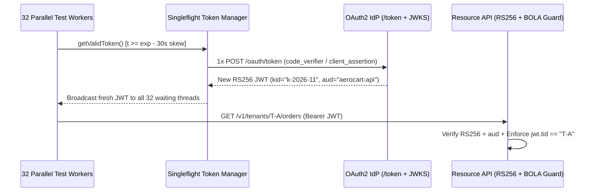

# API Security Internals: JWT JWKS Rotation, OAuth2 PKCE, mTLS & BOLA Matrices

```json pretraining
[
  {
    "term": "JWT Wire Structure",
    "formula": "base64url(Header) . base64url(Payload) . base64url(Sig)",
    "meaning": "Signed (JWS), NOT encrypted (JWE)—anyone can base64url-decode claims; integrity relies strictly on server-enforced asymmetric verification."
  },
  {
    "term": "OAuth2 PKCE S256",
    "formula": "code_challenge = BASE64URL(SHA256(code_verifier))",
    "meaning": "Binds the front-channel authorization code to the exact client instance that initiated login, neutralizing intercepted redirect URIs."
  },
  {
    "term": "BOLA / IDOR Invariant",
    "formula": "AuthN(caller_sub) ∧ Owner(resource_id) == caller_tenant",
    "meaning": "OWASP API1 #1 vulnerability: valid JWT authentication succeeds, but the handler queries WHERE id = ? without WHERE tenant_id = jwt.tid."
  },
  {
    "term": "Singleflight Auth Refresh",
    "formula": "32 Expired Worker Calls -> 1 OAuth /token RPC + 31 Waiters",
    "meaning": "Prevents parallel CI workers from stampeding the IdP or triggering refresh-token reuse revocation when a shared token nears expiry."
  }
]
```

```json poe
{
  "question": "An API gateway verifies incoming JWTs using a public RSA key fetched from /.well-known/jwks.json, but passes the unverified JWT header's 'alg' field directly into jwt.decode(token, key=public_pem). An attacker changes the header to {\"alg\": \"HS256\"} and signs a forged admin payload using the server's PUBLIC RSA PEM bytes as an HMAC shared secret. What happens?",
  "options": [
    "OpenSSL rejects HMAC signatures shorter than 2048 bits",
    "Classic Algorithm-Confusion RCE/Privilege Escalation: the verifier treats the public PEM string as the symmetric HS256 secret, validates the attacker's HMAC signature as authentic, and grants admin access",
    "TLS 1.3 strips non-RS256 Authorization headers at the socket layer",
    "The base64url decoder throws a padding exception"
  ],
  "answerIndex": 1,
  "explanation": "Never let an untrusted JWT header dictate the verification algorithm family! Verifiers must hardcode an explicit allowlist (e.g., algorithms=['RS256', 'ES256']) bound to the asymmetric key type."
}
```

## 1. JWT Cryptographic Verification, `JWKS` Rotation & Classic Exploits

A JSON Web Token (`JWS`, RFC 7515) is three dot-separated `base64url` segments: `Header.Payload.Signature`. In Staff-level API security testing, validating happy-path `200 OK` bearer tokens covers less than 10% of real production vulnerabilities:

1. **Algorithm Confusion (`RS256` $\to$ `HS256`) & `alg: "none"`**: Every JWT library call in production must pin `algorithms=["RS256"]` (or `["ES256"]`) from server config—**never** reading `header["alg"]` dynamically—and must validate `iss` (issuer), `aud` (audience—preventing a valid Billing-service token from being replayed against Payroll-service!), `exp`, and `nbf` with bounded clock-skew leeway ($\le 30\text{s}$).
2. **`JWKS` Key Rotation (`kid`) Cache Poisoning & DoS**: Identity providers publish rotating public keys at `/.well-known/jwks.json` indexed by `kid`. If a microservice re-fetches `jwks.json` synchronously on **every** unknown `kid`, an attacker sending random `kid: "uuid-..."` headers turns your auth middleware into an amplification DoS cannon against your own IdP! Production verifiers enforce a **rate-limited JWKS refresh cooldown** (e.g., at most 1 network refresh per 60s).
3. **OAuth 2.1 Authorization Code + `PKCE` (`S256`)**: Implicit grant (`response_type=token`) is deprecated because tokens leak in browser history and Referer headers. Modern clients generate a high-entropy `code_verifier` (`43–128` chars), send `code_challenge = BASE64URL(SHA256(code_verifier))` during `/authorize`, and prove possession of `code_verifier` on the back-channel `/token` exchange.
4. **Mutual TLS (`mTLS` / SPIFFE X.509 SANs)**: For east-west service-to-service traffic or high-assurance banking APIs (RFC 8705 certificate-bound tokens), both client and server present X.509 certificates during the TLS 1.3 handshake (`CertificateRequest`), binding the bearer token's `cnf.x5t#S256` thumbprint to the caller's TLS client certificate so stolen JWTs are useless without the hardware/workload private key.



---

## 2. Authorization Matrix Testing (`BOLA` / `BFLA`) & Token Refresh Stampedes

```json contrast
{
  "title": "Happy-Path Shared Admin Token vs Adversarial BOLA Matrix + Singleflight Auth",
  "naiveTitle": "Single Superadmin Token + Unlocked Refresh",
  "naiveMetric": "0% BOLA Detection · 429 IdP Lockouts",
  "naivePoints": [
    "Runs entire API regression suite with one god-mode ADMIN JWT, completely blind to Cross-Tenant BOLA (OWASP #1)",
    "When access token expires mid-run, all 32 workers fire /oauth/token simultaneously, revoking rotating refresh tokens",
    "Never tests audience (aud) confusion, clock-skew expiry, or read-only viewer privilege escalation"
  ],
  "staffTitle": "Declarative Actor×Tenant Matrix + Singleflight",
  "staffMetric": "100% OWASP API1/API5 Gate · 1 RPC Refresh",
  "staffPoints": [
    "Parametrizes every endpoint across {Unauthenticated, Viewer_TenantA, Admin_TenantA, Admin_TenantB} automatically",
    "Double-checked lock (Singleflight) refreshes 30s BEFORE exp so zero in-flight tests hit 401 or IdP rate limits",
    "Tests tampered signatures, alg:none, wrong aud, and unknown kid DoS resilience deterministically using local RSA keys"
  ]
}
```

| Auth Mechanism | Primary Threat Mitigated | Stateless Verification? | Revocation Latency | Mandatory Negative Security Test |
| :--- | :--- | :--- | :--- | :--- |
| **Short-Lived `RS256`/`ES256` JWT** | Central DB bottleneck on every API call | Yes (cached `JWKS` public key) | Bounded by TTL (`5–15 min`) | Forge `alg:none`, `HS256` confusion, wrong `aud`, & 1-bit flipped signature |
| **OAuth 2.1 + `PKCE` (`S256`)** | Auth-code interception on mobile/SPA redirects | Back-channel `/token` stateful | Immediate on code reuse | Replay `/token` exchange twice OR supply mismatched `code_verifier` |
| **Rotating Refresh Tokens** | Long-lived credential theft | Stateful family tracking in IdP | Immediate family kill on replay | Assert replaying generation $N$ after $N+1$ revokes the **entire** token family |
| **mTLS + Cert-Bound JWT (`cnf`)** | Bearer token exfiltration from logs/proxies | Cryptographic X.509 thumbprint | CRL / short-lived SPIFFE SVID | Replay valid JWT over a TLS socket signed by a *different* client certificate |

---

## 3. Dual-Language Production Blueprints: PKCE, Singleflight Refresh & BOLA Harness

### Python 3 Blueprint: PKCE `S256` Generator, Singleflight Token Manager & BOLA Matrix Runner
```python
from __future__ import annotations
import base64
import hashlib
import secrets
import threading
import time
from dataclasses import dataclass
from typing import Callable, Dict, List, Tuple


def generate_pkce_pair() -> Tuple[str, str]:
    """RFC 7636 PKCE S256 verifier + challenge pair."""
    verifier = secrets.token_urlsafe(48)  # 64 ASCII chars within [43, 128]
    digest = hashlib.sha256(verifier.encode("ascii")).digest()
    challenge = base64.urlsafe_b64encode(digest).decode("ascii").rstrip("=")
    return verifier, challenge


@dataclass(frozen=True)
class OAuthTokenLease:
    access_token: str
    expires_at_epoch: float


class SingleflightTokenProvider:
    """
    Thread-safe OAuth2 token cache for 32+ worker API suites.
    Proactively refreshes 30s prior to expiry using double-checked locking
    so parallel workers never stampede /oauth/token or trip rotating-refresh revocation.
    """

    def __init__(
        self,
        fetch_token_fn: Callable[[], Tuple[str, int]],
        refresh_skew_sec: float = 30.0,
        clock: Callable[[], float] = time.monotonic,
    ) -> None:
        self._fetch_token_fn = fetch_token_fn
        self._skew = refresh_skew_sec
        self._clock = clock
        self._lock = threading.Lock()
        self._lease: OAuthTokenLease | None = None
        self.refresh_count: int = 0

    def get_bearer_token(self) -> str:
        now = self._clock()
        if self._lease and now < (self._lease.expires_at_epoch - self._skew):
            return self._lease.access_token

        with self._lock:
            now = self._clock()
            if self._lease and now < (self._lease.expires_at_epoch - self._skew):
                return self._lease.access_token
            token, ttl_sec = self._fetch_token_fn()
            self.refresh_count += 1
            self._lease = OAuthTokenLease(token, now + float(ttl_sec))
            return self._lease.access_token


@dataclass(frozen=True)
class BolaCase:
    actor_name: str
    bearer_token: str | None
    expected_statuses: Tuple[int, ...]


def assert_bola_authorization_matrix(
    send_fn: Callable[[str, str, Dict[str, str]], int],
    method: str,
    tenant_a_resource_path: str,
    matrix: List[BolaCase],
) -> None:
    """Executes cross-tenant BOLA & RBAC assertions against a Tenant-A owned resource."""
    failures: List[str] = []
    for case in matrix:
        headers = {"Authorization": f"Bearer {case.bearer_token}"} if case.bearer_token else {}
        actual = send_fn(method, tenant_a_resource_path, headers)
        if actual not in case.expected_statuses:
            failures.append(
                f"[{case.actor_name}] {method} {tenant_a_resource_path} -> got {actual}, "
                f"expected one of {case.expected_statuses}"
            )
    if failures:
        raise AssertionError("BOLA / RBAC Matrix Violation:\n" + "\n".join(failures))
```

### Java 17 Blueprint: `CompletableFuture` Singleflight Auth + mTLS `SSLContext` Client
```java
package com.aerocart.api.security;

import java.io.InputStream;
import java.net.http.HttpClient;
import java.nio.charset.StandardCharsets;
import java.nio.file.Files;
import java.nio.file.Path;
import java.security.KeyStore;
import java.security.MessageDigest;
import java.security.SecureRandom;
import java.time.Instant;
import java.util.Base64;
import java.util.concurrent.locks.ReentrantLock;
import java.util.function.Supplier;
import javax.net.ssl.KeyManagerFactory;
import javax.net.ssl.SSLContext;
import javax.net.ssl.TrustManagerFactory;

public final class MtlsAndSingleflightAuth {

    public record TokenGrant(String accessToken, Instant expiresAt) {}
    public record PkcePair(String verifier, String s256Challenge) {}

    private final Supplier<TokenGrant> tokenIssuer;
    private final ReentrantLock refreshLock = new ReentrantLock();
    private volatile TokenGrant activeGrant;

    public MtlsAndSingleflightAuth(Supplier<TokenGrant> tokenIssuer) {
        this.tokenIssuer = tokenIssuer;
    }

    public String currentBearerToken() {
        TokenGrant snapshot = activeGrant;
        Instant cutoff = Instant.now().plusSeconds(30);
        if (snapshot != null && snapshot.expiresAt().isAfter(cutoff)) {
            return snapshot.accessToken();
        }
        refreshLock.lock();
        try {
            if (activeGrant != null && activeGrant.expiresAt().isAfter(Instant.now().plusSeconds(30))) {
                return activeGrant.accessToken();
            }
            activeGrant = tokenIssuer.get();
            return activeGrant.accessToken();
        } finally {
            refreshLock.unlock();
        }
    }

    public static PkcePair generatePkceS256() throws Exception {
        byte[] entropy = new byte[32];
        new SecureRandom().nextBytes(entropy);
        String verifier = Base64.getUrlEncoder().withoutPadding().encodeToString(entropy);
        byte[] sha256 = MessageDigest.getInstance("SHA-256")
            .digest(verifier.getBytes(StandardCharsets.US_ASCII));
        String challenge = Base64.getUrlEncoder().withoutPadding().encodeToString(sha256);
        return new PkcePair(verifier, challenge);
    }

    public static HttpClient buildMtlsHttpClient(
            Path clientP12Path, char[] keyPass, Path trustStorePath, char[] trustPass) throws Exception {
        KeyStore keyStore = KeyStore.getInstance("PKCS12");
        try (InputStream in = Files.newInputStream(clientP12Path)) {
            keyStore.load(in, keyPass);
        }
        KeyManagerFactory kmf = KeyManagerFactory.getInstance(KeyManagerFactory.getDefaultAlgorithm());
        kmf.init(keyStore, keyPass);

        KeyStore trustStore = KeyStore.getInstance("PKCS12");
        try (InputStream in = Files.newInputStream(trustStorePath)) {
            trustStore.load(in, trustPass);
        }
        TrustManagerFactory tmf = TrustManagerFactory.getInstance(TrustManagerFactory.getDefaultAlgorithm());
        tmf.init(trustStore);

        SSLContext sslCtx = SSLContext.getInstance("TLSv1.3");
        sslCtx.init(kmf.getKeyManagers(), tmf.getTrustManagers(), new SecureRandom());
        return HttpClient.newBuilder().sslContext(sslCtx).build();
    }
}
```

> [!WARNING] **Staff Interview Gotcha — Rotating Refresh Token Reuse Detection Kills Parallel Suites:** Under OAuth 2.1 Refresh Token Rotation, every call to `POST /oauth/token` invalidates `refresh_token_v1` and issues `refresh_token_v2`. If an attacker (or **two unsynchronized Pytest/JUnit worker processes**!) submits `refresh_token_v1` a second time, the Identity Provider assumes `refresh_token_v1` was stolen and **immediately revokes the entire session family (`v2` included!)**, causing all 32 CI workers to cascade into `401 invalid_grant` failures mid-run. **Invariant:** Either mint isolated per-worker service principals (`worker-01..worker-32`) at suite bootstrap OR funnel token acquisition through a single process-safe Singleflight broker with a `30s` pre-expiry buffer.

---

## 4. Scenario Retrieval-Practice Mastery Gate

```json quiz
[
  {
    "id": "api-03-q1",
    "question": "A microservice cleanly verifies RS256 signatures, iss, and exp on incoming JWTs, yet an attacker with a valid free-tier account on 'Notifications-Service' replays that exact JWT to read payroll endpoints on 'HR-Service' (both signed by the same corporate IdP). Which JWT claim check was omitted?",
    "options": [
      "jti (JWT ID) entropy validation",
      "Strict aud (Audience) claim validation ensuring the token was explicitly minted for 'hr-service'",
      "iat (Issued At) nanosecond precision",
      "typ header case sensitivity"
    ],
    "answerIndex": 1,
    "explanation": "When multiple microservices trust the same IdP JWKS, omitting strict aud (Audience) verification allows horizontal token confusion across services."
  },
  {
    "id": "api-03-q2",
    "question": "Why does an API returning 404 Not Found (instead of 403 Forbidden) when Tenant B requests GET /v1/tenants/T-A/invoices/inv-9991 often represent an intentional Staff security pattern?",
    "options": [
      "404 responses compress better under HTTP/2 HPACK",
      "Anti-enumeration: returning 403 on existing IDs and 404 on non-existent IDs leaks an existence oracle allowing Tenant B to enumerate valid invoice IDs belonging to Tenant A; scoping SQL by WHERE id = ? AND tenant_id = jwt.tid naturally yields 404",
      "RFC 9110 forbids returning 403 on GET requests",
      "API gateways cache 403 responses globally across all tenants"
    ],
    "answerIndex": 1,
    "explanation": "RFC 9110 §15.5.4 explicitly permits returning 404 Not Found instead of 403 Forbidden when the server does not wish to reveal whether a cross-tenant resource exists. A BOLA matrix allows (403, 404) as valid rejection codes while failing on 200/500."
  },
  {
    "id": "api-03-q3",
    "question": "What specific attack happens if a JWT middleware fetches /.well-known/jwks.json synchronously over the network every time it encounters an unrecognized 'kid' (Key ID) in a request header?",
    "options": [
      "Padding oracle decryption of RS256 private keys",
      "JWKS Cache-Miss Amplification DoS: an unauthenticated attacker sends 5,000 RPS with random UUID 'kid' headers, forcing the service to DDoS its own Identity Provider and exhaust outbound connection pools",
      "Automatic downgrade to TLS 1.0",
      "SQL injection inside the base64url decoder"
    ],
    "answerIndex": 1,
    "explanation": "Production JWKS verifiers must coalesce concurrent refreshes (Singleflight) and enforce a minimum cooldown interval (e.g., max 1 JWKS network fetch per 30–60s) when unknown kid values arrive."
  }
]
```
