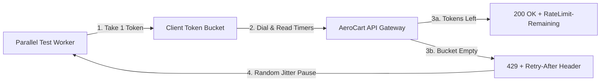

# Rate Limiting, Token Buckets, Granular Timeouts & Full-Jitter Backoff

```json continuity
{
  "previously": "In Chapter 04, we built AeroClient v0.4 with strict Pydantic v2 and Java 17 record schemas, dual-mode result envelopes, and secret-redacted cURL failure logs.",
  "painPoint": "When we ran our 400 clean AeroClient v0.4 tests across 32 parallel CI workers, the suite fired 500 requests in a single second. The staging gateway slammed us with HTTP 429 Too Many Requests, and a single dropped network packet hung worker #7 for two full hours because our timeout was not split between connecting and reading.",
  "unlock": "We will upgrade to AeroClient v0.5 with a self-pacing Token Bucket rate limiter, explicit connect and read timeout budgets, and randomized Full-Jitter retries that honor server Retry-After headers."
}
```

```json walkthrough
[
  {
    "slide": 1,
    "title": "The Arcade Token Bucket & Revolving Door",
    "time": "0:00 - 0:22",
    "badge": "PLAIN STORY",
    "caption": "Imagine an arcade machine that holds a bucket of 10 brass tokens and drops 2 new tokens into the bucket every second. As long as tokens are in the bucket, players walk right in. When the bucket is empty, the machine flashes 429 Too Many Requests and tells you how many seconds to wait.",
    "focusSelector": "#step-1-story",
    "code": "# Bucket capacity = 10 tokens, refill = 2 tokens/sec\n# Burst 10 calls instantly -> 11th call waits 0.5s"
  },
  {
    "slide": 2,
    "title": "AeroClient v0.5: Twin Timeouts & Retry-After",
    "time": "0:22 - 0:45",
    "badge": "FIRST CODE",
    "caption": "We upgrade AeroClient v0.5 with a two-part timeout—1.5 seconds to dial the server, 4.0 seconds to read the answer—and teach it to pause when the server sends a 429 Retry-After header.",
    "focusSelector": "#step-2-code",
    "code": "resp = session.get(url, timeout=(1.5, 4.0))\nif resp.status_code == 429:\n    time.sleep(float(resp.headers.get('Retry-After', 1)))"
  },
  {
    "slide": 3,
    "title": "Boundary Bursts & Synchronized Stampedes",
    "time": "0:45 - 1:10",
    "badge": "FAILURE MODE",
    "caption": "If all 32 workers get a 429 and sleep for an exact 1.000 second, they all wake up at the exact same millisecond and crash the server again! Worse, naive minute counters allow a 2x traffic spike right across the 12:00:59 to 12:01:00 clock tick.",
    "focusSelector": "#step-3-breaks",
    "code": "# 100 calls at 12:00:59.9 + 100 calls at 12:01:00.1\n# = 200 calls in 200ms (2x quota breach!)"
  },
  {
    "slide": 4,
    "title": "Staff Blueprint: Token Bucket + Full Jitter",
    "time": "1:10 - 1:35",
    "badge": "STAFF BLUEPRINT",
    "caption": "Our production AeroClient v0.5 combines a thread-safe Token Bucket to pace outgoing calls with AWS Full-Jitter backoff, spreading retries smoothly across time and only retrying safe or idempotent requests.",
    "focusSelector": "#step-4-staff",
    "code": "bucket.acquire(1.0)\nsleep_s = server_floor + random.uniform(0.05, 0.35)"
  }
]
```

```json pretraining
[
  {
    "term": "Token Bucket",
    "formula": "Bucket holds max B tokens, refills r tokens/sec",
    "meaning": "A traffic-pacing bowl that holds up to B tokens and drips new tokens in at a steady speed, allowing short bursts of fast requests while capping long-term speed."
  },
  {
    "term": "Fixed-Window Boundary Spike",
    "formula": "Burst at 00:59.9 + Burst at 01:00.1 = 2x Quota",
    "meaning": "A flaw in simple per-minute counters where a user fires a full minute's worth of requests just before the clock ticks to a new minute and another full batch right after, doubling the allowed load."
  },
  {
    "term": "Connect vs Read Timeout",
    "formula": "timeout = (connect_seconds, read_seconds)",
    "meaning": "Setting two separate stopwatches: a short timer (like 1.5s) just to establish a network connection, and a slightly longer timer (like 4s) for the server to finish computing and send back data."
  },
  {
    "term": "Full-Jitter Backoff",
    "formula": "Wait = Retry-After + Random Spread",
    "meaning": "Adding a small random delay when retrying a failed call so 32 parallel test workers do not wake up at the exact same instant and slam the server in a synchronized wave."
  }
]
```

## 🌱 Step 1: Plain-English Story — The Arcade Token Bucket & The Revolving Door

Picture a popular pizza shop with a single brick oven. If one hungry customer orders 3 pizzas at once, the chef can handle that brief rush. But if 32 tour buses pull up at the exact same second and 500 people shout orders simultaneously, the kitchen catches fire.

To protect the kitchen without turning away normal bursts of customers, the shop puts a **Token Bucket** bowl by the front door. The bowl holds at most **10 brass tokens**, and a mechanical dispenser drops **2 new tokens per second** into the bowl (any extra tokens overflow onto the floor if the bowl is already full at 10). Every time you place an order, you must drop 1 token into a slot:
- If 10 friends arrive together, they grab all 10 tokens and order immediately.
- Friend #11 finds an empty bowl. The sign flashes **`HTTP 429 Too Many Requests`** along with **`Retry-After: 1`**, telling them to wait half a second for the next token to drop.

In **`AeroClient v0.5`**, we put a small Token Bucket inside our test client so our 32 parallel workers pace themselves politely, AND we add a two-stage stopwatch (**Connect Timeout** vs **Read Timeout**) plus a randomized retry pause:



---

## 🔨 Step 2: First Lines of Code — Adding Twin Timeouts & `Retry-After` to `AeroClient v0.5`

Let's write a minimal `AeroClientV05` method that sets separate `(connect, read)` timeouts so a dead network never hangs CI, and respects the server's `Retry-After` header whenever an `HTTP 429` occurs.

```python
import random, time
import requests

class AeroClientV05:
    def __init__(self, session: requests.Session, base_url: str) -> None:
        self.session, self.base_url = session, base_url.rstrip("/")

    def get_inventory(self, sku: str) -> dict:
        for attempt in range(3):
            # (1.5s max to connect socket, 4.0s max to wait for response bytes)
            resp = self.session.get(f"{self.base_url}/v1/inventory/{sku}", timeout=(1.5, 4.0))
            if resp.status_code != 429 or attempt == 2:
                return resp.json()
            wait_s = float(resp.headers.get("Retry-After", "1")) + random.uniform(0.05, 0.30)
            time.sleep(wait_s)
        raise RuntimeError("Rate limit retries exhausted")
```

### Java 17 Equivalent

```java
package com.aerocart.client;

import java.net.URI;
import java.net.http.*;
import java.time.Duration;
import java.util.concurrent.ThreadLocalRandom;

public class AeroClientV05 {
    private final HttpClient client = HttpClient.newBuilder()
        .connectTimeout(Duration.ofMillis(1500)).build();

    public HttpResponse<String> getInventory(String baseUrl, String sku) throws Exception {
        HttpRequest req = HttpRequest.newBuilder(URI.create(baseUrl + "/v1/inventory/" + sku))
            .timeout(Duration.ofSeconds(4)).GET().build();
        for (int attempt = 0; attempt < 3; attempt++) {
            HttpResponse<String> resp = client.send(req, HttpResponse.BodyHandlers.ofString());
            if (resp.statusCode() != 429 || attempt == 2) return resp;
            long waitMs = resp.headers().firstValueAsLong("Retry-After").orElse(1L) * 1000L;
            Thread.sleep(waitMs + ThreadLocalRandom.current().nextLong(50, 300));
        }
        throw new IllegalStateException("Exhausted retries");
    }
}
```

Notice how adding `random.uniform(0.05, 0.30)` ensures that if 10 workers get throttled together, they stagger their retries instead of colliding again!

---

## ⚡ Step 3: Where It Breaks in Real Life — Boundary Bursts, Synchronized Stampedes & Unsafe Retries

When scaling rate limiters and test clients to production traffic, three classic traps cause outages:

1. **The Fixed-Window Seam Bug**: Suppose a server limits users to 100 requests per clock minute (`12:00:00–12:00:59`). If a client fires 100 requests at `12:00:59.500` and another 100 requests 600 milliseconds later at `12:01:00.100`, the server allows **200 requests in 0.6 seconds**—doubling the permitted load!
2. **Synchronized Retry Stampedes**: If 32 workers hit `429` or `503` and all sleep an exact `1.000` second (`time.sleep(2 ** attempt)` without randomness), all 32 wake up in lockstep at `t = 1.000s`, causing a repeating thundering herd.
3. **Blindly Retrying Non-Idempotent `POST` Calls**: If a `POST /v1/refunds` times out at 4.0 seconds *after* the database already sent the money, retrying without an `Idempotency-Key` header refunds the customer twice!

```json contrast
{
  "title": "Naive Sleep & Fixed Windows vs Staff Token Bucket & Full-Jitter AeroClient v0.5",
  "naiveTitle": "timeout=None + Fixed sleep(1)",
  "naiveMetric": "2-Hour Hung Builds · 2x Seam Bursts",
  "naivePoints": [
    "Omitting timeout in Python requests defaults to None, hanging CI workers for hours on dropped packets",
    "Fixed-window minute counters allow 2x traffic bursts across the :59.9 to :00.1 clock boundary",
    "Retrying every 429/503 with fixed sleep(1) synchronizes workers into thundering-herd waves"
  ],
  "staffTitle": "Token Bucket + 3-Tier Timeouts + Full Jitter",
  "staffMetric": "Zero Hung Threads · Smooth Pacing",
  "staffPoints": [
    "Client-side Token Bucket with injected fake clock tests rate-limit math in <5ms without real sleep(60)",
    "Enforces separate (connect=1.5s, read=4.0s) timeouts and parses both numeric and HTTP-date Retry-After headers",
    "Uses AWS Full-Jitter backoff and retries ONLY idempotent verbs or requests carrying an Idempotency-Key"
  ]
}
```

```json poe
{
  "question": "An API enforces a naive Fixed-Window rate limit of 100 requests per minute keyed on the UTC minute (12:00:00–12:00:59, 12:01:00–12:01:59). How can an SDET deterministically prove in <10ms that this limiter allows a 2x burst, and what server algorithm fixes it?",
  "options": [
    "Send 100 requests spread evenly over 60 seconds; fix with round-robin DNS",
    "Advance an injected test clock to 12:00:59.500, fire 100 requests, advance 600ms to 12:01:00.100, and fire 100 more—proving 200 requests pass inside 600ms; fix with a Token Bucket or Sliding Window Counter",
    "Send malformed Content-Length headers to bypass Redis",
    "Open 100 idle sockets without sending HTTP headers"
  ],
  "answerIndex": 1,
  "explanation": "Fixed-window counters reset completely at the minute mark, allowing 2x quota spikes straddling the boundary. Injecting a controllable clock lets tests verify boundary behavior in milliseconds without calling sleep(60)."
}
```

---

## 🚀 Step 4: Staff Engineer Deep-Dive — Token Bucket & Sliding Window Math + Production Blueprints

### 1. Token Bucket & Sliding Window Counter Mathematics

A **Token Bucket** with maximum capacity $B$ and refill rate $r$ tokens/second updates available tokens at timestamp $t$ (given previous access time $t_0$) as:

$$\text{tokens}(t) = \min\Big(B,\; \text{tokens}(t_0) + r \cdot (t - t_0)\Big)$$

When $\text{tokens}(t) < 1$, the gateway rejects the request with `HTTP 429` and computes the exact cooldown header:

$$\text{Retry-After} = \left\lceil \frac{1 - \text{tokens}(t)}{r} \right\rceil$$

Alternatively, a **Sliding Window Counter** eliminates the Fixed-Window seam bug in $\mathcal{O}(1)$ memory using only the previous window count ($N_{\text{prev}}$) and current window count ($N_{\text{curr}}$) across window width $W$:

$$\hat{N}(t) = N_{\text{curr}} + \left\lfloor N_{\text{prev}} \times \left(1 - \frac{t \bmod W}{W}\right) \right\rfloor$$

On the client side, **AWS Full-Jitter** desynchronizes $k$-th attempt retries while honoring `Retry-After` ($T_{\text{ra}}$):

$$T_{\text{sleep}}(k) = \max\Big(T_{\text{ra}} + \mathcal{U}(0.05, 0.35),\; \mathcal{U}\big(0,\; \min(T_{\text{cap}},\, T_{\text{base}} \cdot 2^k)\big)\Big)$$

| Rate Limiter / Mechanism | State per Tenant Key | Boundary Burst Protection | Production Concurrency Requirement |
| :--- | :--- | :--- | :--- |
| **Fixed Window Counter** | `1` integer + TTL | Vulnerable to `2x` seam burst | Atomic `INCR` + `EXPIRE` |
| **Sliding Window Counter** | `2` integers (`curr`, `prev`) | Smooth weighted rolling cap | Atomic read of adjacent windows |
| **Token Bucket (Server)** | `2` floats (`tokens`, `last_ts`) | Controlled burst $\le B$, steady rate $r$ | Must execute inside a single atomic Redis Lua script (`EVALSHA`) |
| **Token Bucket (Client)** | Local `Lock` or `AtomicReference` | Self-paces CI workers below 429 threshold | Accepts injected `clock` & `sleeper` for instant unit testing |

### Python 3 Production Blueprint: `AeroClient v0.5` Token Bucket & Idempotency-Gated Full-Jitter Executor

```python
from __future__ import annotations
import email.utils, math, random, threading, time
from typing import Callable, Mapping, Set
import requests

SAFE_RETRY_METHODS: Set[str] = {"GET", "HEAD", "OPTIONS", "PUT", "DELETE"}
RETRYABLE_STATUSES: Set[int] = {429, 502, 503, 504}

class ThreadSafeTokenBucket:
    """Self-paces parallel test workers; injectable clock/sleeper enable 0ms unit tests."""
    def __init__(
        self,
        capacity: float,
        refill_per_sec: float,
        clock: Callable[[], float] = time.monotonic,
        sleeper: Callable[[float], None] = time.sleep,
    ) -> None:
        self._capacity, self._rate = float(capacity), float(refill_per_sec)
        self._tokens = float(capacity)
        self._clock, self._sleeper = clock, sleeper
        self._last_ts = self._clock()
        self._lock = threading.Lock()

    def acquire(self, cost: float = 1.0) -> float:
        waited = 0.0
        while True:
            with self._lock:
                now = self._clock()
                self._tokens = min(self._capacity, self._tokens + max(0.0, now - self._last_ts) * self._rate)
                self._last_ts = now
                if self._tokens >= cost:
                    self._tokens -= cost
                    return waited
                wait_s = (cost - self._tokens) / self._rate
            self._sleeper(wait_s)
            waited += wait_s

def parse_retry_after_seconds(headers: Mapping[str, str], now_epoch: float | None = None) -> float:
    raw = (headers.get("Retry-After") or "").strip()
    if not raw:
        return 0.0
    if raw.isdigit():
        return max(0.0, float(raw))
    try:
        dt = email.utils.parsedate_to_datetime(raw)
        return max(0.0, dt.timestamp() - (time.time() if now_epoch is None else now_epoch))
    except Exception:
        return 0.0

def compute_backoff_seconds(attempt: int, headers: Mapping[str, str], base: float = 0.25, cap: float = 8.0) -> float:
    floor_s = parse_retry_after_seconds(headers)
    if floor_s > 0.0:
        return min(cap * 2.0, floor_s + random.uniform(0.05, 0.35))
    return random.uniform(0.0, min(cap, base * math.pow(2, attempt)))

def send_with_resilience(
    session: requests.Session,
    bucket: ThreadSafeTokenBucket,
    method: str,
    url: str,
    headers: dict[str, str] | None = None,
    max_attempts: int = 4,
    timeout: tuple[float, float] = (1.5, 4.0),
) -> requests.Response:
    hdrs = dict(headers or {})
    verb = method.upper()
    can_retry = verb in SAFE_RETRY_METHODS or "Idempotency-Key" in hdrs

    for attempt in range(max_attempts):
        bucket.acquire(1.0)
        try:
            resp = session.request(verb, url, headers=hdrs, timeout=timeout)
        except (requests.ConnectTimeout, requests.ConnectionError):
            if not can_retry or attempt == max_attempts - 1:
                raise
            time.sleep(compute_backoff_seconds(attempt, {}))
            continue

        if resp.status_code not in RETRYABLE_STATUSES or not can_retry or attempt == max_attempts - 1:
            return resp
        resp.close()
        time.sleep(compute_backoff_seconds(attempt, resp.headers))
    raise RuntimeError("Exhausted retry budget")
```

### Java 17 Production Blueprint: Lock-Free CAS Token Bucket & Resilient Executor

```java
package com.aerocart.api.resilience;

import java.io.IOException;
import java.net.http.HttpClient;
import java.net.http.HttpRequest;
import java.net.http.HttpResponse;
import java.time.Duration;
import java.util.Set;
import java.util.concurrent.ThreadLocalRandom;
import java.util.concurrent.atomic.AtomicReference;

public final class ResilientRateLimitedExecutor {
    private static final Set<String> IDEMPOTENT_VERBS = Set.of("GET", "HEAD", "OPTIONS", "PUT", "DELETE");
    private static final Set<Integer> RETRYABLE_CODES = Set.of(429, 502, 503, 504);

    private record BucketState(double tokens, long lastNanoTime) {}

    private final double capacity;
    private final double refillPerNano;
    private final AtomicReference<BucketState> state;
    private final HttpClient httpClient;

    public ResilientRateLimitedExecutor(HttpClient httpClient, double capacity, double refillPerSec) {
        this.httpClient = httpClient;
        this.capacity = capacity;
        this.refillPerNano = refillPerSec / 1_000_000_000.0;
        this.state = new AtomicReference<>(new BucketState(capacity, System.nanoTime()));
    }

    public void acquireToken() throws InterruptedException {
        while (true) {
            BucketState prev = state.get();
            long now = System.nanoTime();
            double refilled = Math.min(capacity, prev.tokens() + Math.max(0L, now - prev.lastNanoTime()) * refillPerNano);
            if (refilled >= 1.0) {
                if (state.compareAndSet(prev, new BucketState(refilled - 1.0, now))) return;
            } else {
                long waitMs = Math.max(1L, (long) Math.ceil(((1.0 - refilled) / refillPerNano) / 1_000_000.0));
                Thread.sleep(waitMs);
            }
        }
    }

    public HttpResponse<String> execute(HttpRequest baseReq, int maxAttempts, Duration readTimeout)
            throws IOException, InterruptedException {
        boolean hasIdemKey = baseReq.headers().firstValue("Idempotency-Key").isPresent();
        boolean retrySafe = IDEMPOTENT_VERBS.contains(baseReq.method().toUpperCase()) || hasIdemKey;
        HttpRequest timedReq = HttpRequest.newBuilder(baseReq, (k, v) -> true).timeout(readTimeout).build();

        for (int attempt = 0; attempt < maxAttempts; attempt++) {
            acquireToken();
            HttpResponse<String> resp = httpClient.send(timedReq, HttpResponse.BodyHandlers.ofString());
            if (!RETRYABLE_CODES.contains(resp.statusCode()) || !retrySafe || attempt == maxAttempts - 1) {
                return resp;
            }
            long retryAfterMs = resp.headers().firstValue("Retry-After")
                .filter(v -> v.chars().allMatch(Character::isDigit))
                .map(v -> Long.parseLong(v) * 1000L).orElse(0L);
            double expCapMs = Math.min(8_000.0, 250.0 * Math.pow(2, attempt));
            long sleepMs = retryAfterMs > 0
                ? retryAfterMs + ThreadLocalRandom.current().nextLong(50, 350)
                : (long) ThreadLocalRandom.current().nextDouble(0.0, expCapMs);
            Thread.sleep(sleepMs);
        }
        throw new IllegalStateException("Exhausted retry budget");
    }
}
```

> [!WARNING] **Staff Interview Gotcha — Python `requests` Default `timeout=None` & Dual-Format `Retry-After`:** In Python's `requests`, omitting `timeout=...` defaults to `None` (wait forever until OS TCP keepalive expires—over 2 hours on Linux!), freezing your entire CI runner on a single dropped packet. Furthermore, **RFC 9110 §10.2.3** allows `Retry-After` to be **either** integer seconds (`Retry-After: 120`) **or** an HTTP-date string (`Retry-After: Tue, 10 Nov 2026 08:45:00 GMT`). Calling `int(resp.headers["Retry-After"])` crashes with `ValueError` the first time a CDN returns an HTTP-date!

**Up Next in Chapter 06:** Now that `AeroClient v0.5` is rate-limit-aware and resilient over REST, what happens when the mobile checkout team migrates their catalog aggregator to **GraphQL** and internal inventory billing to **gRPC / Protobuf**? In Chapter 06, we will evolve to **`AeroClient v0.6`** to catch HTTP 200 masked GraphQL errors, block $O(b^d)$ depth-bomb queries, and test gRPC deadlines and status codes.

```json quiz
[
  {
    "id": "api-05-q1",
    "question": "A microservice implements a Redis Token Bucket by running GET tokens in application code, subtracting 1 in Python/Java, and calling SET tokens back to Redis. Under a 32-thread parallel burst with capacity=10, 27 requests return 200 OK instead of 10. Why, and what fixes it?",
    "options": [
      "Redis uses eventual consistency on single-node deployments",
      "Classic Read-Modify-Write TOCTOU race: concurrent workers read the same stale token balance before SET completes; moving the refill + decrement check inside a single atomic Redis EVALSHA Lua script serializes execution atomically on Redis's single command thread",
      "TCP Nagle buffering merges 27 HTTP requests into 1 Redis command",
      "Floating-point precision loss in IEEE-754"
    ],
    "answerIndex": 1,
    "explanation": "Distributed rate limiters must execute refill math and token deduction atomically inside a single Redis Lua script so no two callers observe the same token count."
  },
  {
    "id": "api-05-q2",
    "question": "Why must an HTTP client differentiate Connect Timeout (e.g., 1.5s) from Read Timeout (e.g., 8.0s) instead of passing a single 10s scalar timeout?",
    "options": [
      "TLS 1.3 requires connect timeouts under 2 seconds by RFC",
      "A TCP SYN to a dead/blackholed IP should fail fast in ~1.5s rather than stalling 10s, whereas an already-connected analytics query legitimately needs 8s; also, Python requests' read timeout measures inter-byte silence, NOT total wall-clock transfer time",
      "HTTP/2 ignores scalar timeouts",
      "Connect timeouts only apply to DNS UDP packets"
    ],
    "answerIndex": 1,
    "explanation": "Separating connect vs read timeouts lets dead hosts fail fast while giving legitimate heavy queries enough time to respond."
  },
  {
    "id": "api-05-q3",
    "question": "When 500 API clients simultaneously receive 429 Too Many Requests with Retry-After: 5, why should clients sleep 5.0 + Uniform(0.05, 0.35)s rather than sleeping 5.000s sharp?",
    "options": [
      "Because monotonic clocks drift by 500ms over 5 seconds",
      "Sleeping an exact synchronized 5.000s aligns all 500 clients into a synchronized micro-burst at t=5.000s, immediately re-exhausting the server's token bucket and causing secondary 429 cascades",
      "To allow TLS session tickets to expire",
      "RFC 9110 forbids sleeping whole integers"
    ],
    "answerIndex": 1,
    "explanation": "Adding positive jitter on top of the Retry-After floor respects the server's cooldown contract while smearing retry arrivals evenly across time."
  }
]
```
