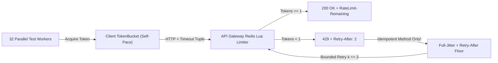

# Rate Limiting, Token Buckets, Granular Timeouts & Full-Jitter Backoff

```json pretraining
[
  {
    "term": "Token Bucket Refill",
    "formula": "tokens(t) = min(B, tokens(t_0) + r * (t - t_0))",
    "meaning": "Permits controlled micro-bursts up to bucket capacity B while bounding sustained throughput to refill rate r tokens/sec."
  },
  {
    "term": "Fixed-Window Boundary Bug",
    "formula": "Burst @ 00:59.9 + Burst @ 01:00.1 = 2B in 200ms",
    "meaning": "Naive minute-bucket counters allow 2x quota spikes straddling window resets; Sliding Window Counters blend weighted adjacent windows."
  },
  {
    "term": "3-Tier Timeout Tuple",
    "formula": "T_budget = (T_connect, T_read, T_pool_acquire)",
    "meaning": "A single scalar timeout conflates SYN packet drops (~2s), slow DB queries (~5s), and local worker pool starvation (~1s)."
  },
  {
    "term": "AWS Full-Jitter Sleep",
    "formula": "sleep = max(Retry-After, Uniform(0, min(T_cap, T_base * 2^k)))",
    "meaning": "Desynchronizes retrying workers to crush thundering-herd retry storms while strictly honoring server Retry-After floors."
  }
]
```

```json poe
{
  "question": "An API enforces a naive Fixed-Window rate limit of 100 requests per minute keyed on UTC minute (12:00:00–12:00:59, 12:01:00–12:01:59). How should an SDET write a deterministic boundary test to prove this limiter can fail to protect downstream databases, and what server algorithm fixes it?",
  "options": [
    "Send 100 requests spread evenly at 1.66 RPS; replace with round-robin DNS",
    "Advance fake/injected clock to 12:00:59.500, fire 100 requests (all 200 OK), advance 600ms to 12:01:00.100, and fire another 100 requests—proving 200 requests slip through inside a 600ms window (2x quota breach); fix with Token Bucket or Sliding Window Counter",
    "Send malformed Content-Length headers to bypass Redis INCR",
    "Open 100 idle TLS sockets without sending HTTP headers"
  ],
  "answerIndex": 1,
  "explanation": "Fixed-window counters reset completely on window boundaries, permitting 2x burst amplification across the seam. Injecting a deterministic Clock into the limiter lets tests prove the straddle bug in <5ms without sleeping 60 real seconds."
}
```

## 1. Server-Side Rate Limiter Algorithms & How to Test Them Without `sleep(60)`

Testing `429 Too Many Requests` in CI by calling `time.sleep(60)` makes test suites unmaintainable. Staff engineers verify rate limiters along two dimensions: **server-side contract tests** (using an injected monotonic clock / Redis Lua virtual timestamp to test quota math in milliseconds) and **client-side self-throttling resilience** (ensuring 32 CI workers pace themselves via client-side Token Buckets and honor `Retry-After` headers).

- **Token Bucket (`capacity = B, refill_rate = r/sec`)**: Stored atomically in Redis via a single Lua script (`HMGET tokens last_ts` $\to$ compute `min(B, tokens + (now - last_ts) * r)` $\to$ decrement if $\ge 1$). Emits standard IETF headers: `RateLimit-Limit`, `RateLimit-Remaining`, `RateLimit-Reset`, and on `429`, `Retry-After: <seconds>` (computed as $\lceil (1 - \text{tokens}) / r \rceil$).
- **Sliding Window Counter**: Approximates a true sliding window in $O(1)$ memory using just two counters (`prev_window_count` and `curr_window_count`):
  $$\text{weight} = 1 - \frac{t \bmod W}{W}, \qquad \hat{N} = \text{curr\_count} + \lfloor \text{prev\_count} \times \text{weight} \rfloor$$



---

## 2. Granular Timeout Budgets & Retry-Storm Prevention

```json contrast
{
  "title": "Infinite Timeouts & Synchronized Retries vs 3-Tier Budgets & Full-Jitter",
  "naiveTitle": "requests.get(url) + Fixed 1s Retry",
  "naiveMetric": "Hung CI Runners · 4x Retry Amplification",
  "naivePoints": [
    "Python requests default timeout=None hangs worker threads forever if a blackholed firewall drops TCP packets silently",
    "Retrying every 500/429 after a fixed sleep(1.0) synchronizes all 32 workers into harmonic thundering-herd waves",
    "Blindly retries POST /v1/refunds without an Idempotency-Key when a read timeout fires after DB commit"
  ],
  "staffTitle": "Separate (Connect, Read, Pool) + Full Jitter",
  "staffMetric": "Bounded Fail-Fast · Zero Duplicate Mutations",
  "staffPoints": [
    "Enforces explicit (connect=1.5s, read=4.0s, pool=1.0s) timeouts so blackholed hosts fail in 1.5s instead of hanging",
    "Honors server Retry-After as a strict floor plus Uniform(0, min(cap, base * 2^attempt)) full jitter",
    "Gates automatic retries strictly on RFC-idempotent verbs OR requests carrying a verified Idempotency-Key header"
  ]
}
```

| Algorithm / Mechanism | Memory per Tenant Key | Burst Behavior | Failure Mode if Misconfigured |
| :--- | :--- | :--- | :--- |
| **Fixed Window Counter** | `1` integer + TTL | Allows `2x` quota spike at window seam | Downstream DB CPU spike every `:00` minute mark |
| **Sliding Window Log** | $O(B)$ sorted timestamps (`ZSET`) | Exact rolling cap, zero seam burst | High Redis RAM footprint at `10,000+` RPM quotas |
| **Sliding Window Counter** | `2` integers (`curr`, `prev`) | Smooth weighted rolling cap | Slight approximation (<1.5% drift) under extreme skew |
| **Token Bucket (Redis Lua)** | `2` floats (`tokens`, `last_ts`) | Controlled burst up to `B`, steady rate `r` | Race conditions (`INCR` over-admission) if read-compute-write is NOT inside an atomic Lua script! |

---

## 3. Dual-Language Production Blueprints: Thread-Safe Token Bucket & Resilient Executor

### Python 3 Blueprint: Thread-Safe Client Token Bucket + `Retry-After` Full-Jitter Policy
```python
from __future__ import annotations
import email.utils
import math
import random
import threading
import time
from typing import Callable, Mapping, Set
import requests

SAFE_RETRY_METHODS: Set[str] = {"GET", "HEAD", "OPTIONS", "PUT", "DELETE"}
RETRYABLE_STATUSES: Set[int] = {429, 502, 503, 504}


class ThreadSafeTokenBucket:
    """Client-side rate limiter shared across worker threads to prevent self-inflicted 429s."""

    def __init__(
        self,
        capacity: float,
        refill_per_sec: float,
        clock: Callable[[], float] = time.monotonic,
        sleeper: Callable[[float], None] = time.sleep,
    ) -> None:
        self._capacity = float(capacity)
        self._rate = float(refill_per_sec)
        self._tokens = float(capacity)
        self._clock = clock
        self._sleeper = sleeper
        self._last_ts = self._clock()
        self._lock = threading.Lock()

    def acquire(self, cost: float = 1.0) -> float:
        total_waited = 0.0
        while True:
            with self._lock:
                now = self._clock()
                elapsed = max(0.0, now - self._last_ts)
                self._tokens = min(self._capacity, self._tokens + elapsed * self._rate)
                self._last_ts = now
                if self._tokens >= cost:
                    self._tokens -= cost
                    return total_waited
                deficit = cost - self._tokens
                wait_sec = deficit / self._rate
            self._sleeper(wait_sec)
            total_waited += wait_sec


def parse_retry_after_seconds(headers: Mapping[str, str], now_epoch: float | None = None) -> float:
    raw = headers.get("Retry-After")
    if not raw:
        return 0.0
    raw = raw.strip()
    if raw.isdigit():
        return max(0.0, float(raw))
    try:
        dt = email.utils.parsedate_to_datetime(raw)
        ref = time.time() if now_epoch is None else now_epoch
        return max(0.0, dt.timestamp() - ref)
    except Exception:
        return 0.0


def compute_backoff_seconds(
    attempt: int, headers: Mapping[str, str], base: float = 0.25, cap: float = 8.0
) -> float:
    exp_ceiling = min(cap, base * math.pow(2, attempt))
    jittered = random.uniform(0.0, exp_ceiling)
    server_floor = parse_retry_after_seconds(headers)
    # When Retry-After is present, honor it + add small desynchronization jitter
    if server_floor > 0.0:
        return min(cap * 2.0, server_floor + random.uniform(0.05, 0.35))
    return jittered


def send_with_resilience(
    session: requests.Session,
    bucket: ThreadSafeTokenBucket,
    method: str,
    url: str,
    headers: dict[str, str] | None = None,
    max_attempts: int = 4,
    timeout: tuple[float, float] = (1.5, 4.0),
) -> requests.Response:
    hdrs = dict(headers or {})
    upper_method = method.upper()
    can_retry = upper_method in SAFE_RETRY_METHODS or "Idempotency-Key" in hdrs

    for attempt in range(max_attempts):
        bucket.acquire(1.0)
        try:
            resp = session.request(upper_method, url, headers=hdrs, timeout=timeout)
        except (requests.ConnectTimeout, requests.ConnectionError):
            if not can_retry or attempt == max_attempts - 1:
                raise
            time.sleep(compute_backoff_seconds(attempt, {}))
            continue

        if resp.status_code not in RETRYABLE_STATUSES or not can_retry or attempt == max_attempts - 1:
            return resp
        resp.close()
        time.sleep(compute_backoff_seconds(attempt, resp.headers))
    raise RuntimeError("Unreachable retry loop exit")
```

### Java 17 Blueprint: Lock-Free CAS Token Bucket & Idempotency-Gated Full-Jitter Executor
```java
package com.aerocart.api.resilience;

import java.io.IOException;
import java.net.URI;
import java.net.http.HttpClient;
import java.net.http.HttpRequest;
import java.net.http.HttpResponse;
import java.time.Duration;
import java.util.Set;
import java.util.concurrent.ThreadLocalRandom;
import java.util.concurrent.atomic.AtomicReference;

public final class ResilientRateLimitedExecutor {

    private static final Set<String> IDEMPOTENT_VERBS = Set.of("GET", "HEAD", "OPTIONS", "PUT", "DELETE");
    private static final Set<Integer> RETRYABLE_CODES = Set.of(429, 502, 503, 504);

    private record BucketState(double tokens, long lastNanoTime) {}

    private final double capacity;
    private final double refillPerNano;
    private final AtomicReference<BucketState> state;
    private final HttpClient httpClient;

    public ResilientRateLimitedExecutor(HttpClient httpClient, double capacity, double refillPerSec) {
        this.httpClient = httpClient;
        this.capacity = capacity;
        this.refillPerNano = refillPerSec / 1_000_000_000.0;
        this.state = new AtomicReference<>(new BucketState(capacity, System.nanoTime()));
    }

    public void acquireToken() throws InterruptedException {
        while (true) {
            BucketState prev = state.get();
            long now = System.nanoTime();
            double refilled = Math.min(capacity, prev.tokens() + Math.max(0L, now - prev.lastNanoTime()) * refillPerNano);
            if (refilled >= 1.0) {
                if (state.compareAndSet(prev, new BucketState(refilled - 1.0, now))) {
                    return;
                }
            } else {
                long waitMillis = Math.max(1L, (long) Math.ceil(((1.0 - refilled) / refillPerNano) / 1_000_000.0));
                Thread.sleep(waitMillis);
            }
        }
    }

    public HttpResponse<String> execute(HttpRequest baseReq, int maxAttempts, Duration perAttemptTimeout)
            throws IOException, InterruptedException {
        boolean hasIdemKey = baseReq.headers().firstValue("Idempotency-Key").isPresent();
        boolean retrySafe = IDEMPOTENT_VERBS.contains(baseReq.method().toUpperCase()) || hasIdemKey;

        HttpRequest timedReq = HttpRequest.newBuilder(baseReq, (k, v) -> true)
            .timeout(perAttemptTimeout)
            .build();

        for (int attempt = 0; attempt < maxAttempts; attempt++) {
            acquireToken();
            HttpResponse<String> resp = httpClient.send(timedReq, HttpResponse.BodyHandlers.ofString());
            if (!RETRYABLE_CODES.contains(resp.statusCode()) || !retrySafe || attempt == maxAttempts - 1) {
                return resp;
            }
            long retryAfterMs = resp.headers().firstValue("Retry-After")
                .filter(v -> v.chars().allMatch(Character::isDigit))
                .map(v -> Long.parseLong(v) * 1000L)
                .orElse(0L);
            double expCapMs = Math.min(8_000.0, 250.0 * Math.pow(2, attempt));
            long sleepMs = retryAfterMs > 0
                ? retryAfterMs + ThreadLocalRandom.current().nextLong(50, 300)
                : (long) ThreadLocalRandom.current().nextDouble(0.0, expCapMs);
            Thread.sleep(sleepMs);
        }
        throw new IllegalStateException("Exhausted retry budget");
    }
}
```

> [!WARNING] **Staff Interview Gotcha — Python `requests` Default `timeout=None` & Dual-Format `Retry-After`:** In Python's `requests` library, omitting `timeout=...` defaults to **`None` (wait forever until OS TCP keepalive expires—over 2 hours on default Linux!)**, freezing an entire CI shard on a single dropped packet. Furthermore, **RFC 9110 §10.2.3** specifies that `Retry-After` can be **either** delta-seconds (`Retry-After: 120`) **or** an HTTP-date (`Retry-After: Tue, 10 Nov 2026 08:45:00 GMT`). Calling `int(resp.headers["Retry-After"])` crashes with `ValueError` the first time a CDN/Cloudflare edge returns an HTTP-date string! Always parse both formats defensively.

---

## 4. Scenario Retrieval-Practice Mastery Gate

```json quiz
[
  {
    "id": "api-05-q1",
    "question": "A microservice implements a Redis Token Bucket by running GET tokens in application code, subtracting 1 in Python/Java, and calling SET tokens back to Redis. Under a 32-thread parallel burst with capacity=10, 27 requests return 200 OK instead of 10. Why, and what fixes it?",
    "options": [
      "Redis uses eventual consistency on single-node deployments",
      "Classic Read-Modify-Write TOCTOU race: concurrent workers read the same stale token balance before SET completes; moving the refill + decrement check inside a single atomic Redis EVALsha Lua script serializes execution atomically on Redis's single command thread",
      "TCP Nagle buffering merges 27 HTTP requests into 1 Redis command",
      "Floating-point precision loss in IEEE-754"
    ],
    "answerIndex": 1,
    "explanation": "Distributed rate limiters must execute refill math and token deduction atomically inside a single Redis Lua script (or Redis Cell module) so no two callers observe the same token count."
  },
  {
    "id": "api-05-q2",
    "question": "Why must an HTTP client differentiate Connect Timeout (e.g., 1.5s) from Read Timeout (e.g., 8.0s) instead of passing a single 10s scalar timeout?",
    "options": [
      "TLS 1.3 requires connect timeouts under 2 seconds by RFC",
      "A TCP SYN to a dead/blackholed IP should fail fast in ~1.5s rather than stalling 10s, whereas an already-connected analytics query legitimately needs 8s; also, Python requests' read timeout measures inter-byte silence, NOT total wall-clock transfer time",
      "HTTP/2 ignores scalar timeouts",
      "Connect timeouts only apply to DNS UDP packets"
    ],
    "answerIndex": 1,
    "explanation": "Separating connect vs read (and bounding total wall-clock deadline for trickling slowloris streams) lets dead hosts fail fast while accommodating legitimate heavy queries."
  },
  {
    "id": "api-05-q3",
    "question": "When 500 API clients simultaneously receive 429 Too Many Requests with Retry-After: 5, why should clients sleep 5.0 + Uniform(0.05, 0.50)s rather than sleeping 5.000s sharp?",
    "options": [
      "Because monotonic clocks drift by 500ms over 5 seconds",
      "Sleeping an exact synchronized 5.000s aligns all 500 clients into a synchronized micro-burst at t=5.000s, immediately re-exhausting the server's token bucket and causing secondary 429 cascades",
      "To allow TLS session tickets to expire",
      "RFC 9110 forbids sleeping whole integers"
    ],
    "answerIndex": 1,
    "explanation": "Adding positive jitter on top of the Retry-After floor respects the server's cooldown contract while smearing retry arrivals evenly across time."
  }
]
```
