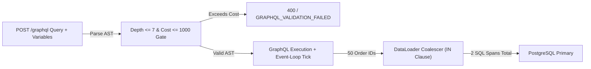

# GraphQL AST Security, Partial-Error Envelopes & OTel DataLoader N+1 Gates

```json pretraining
[
  {
    "term": "200 OK Error Trap",
    "formula": "HTTP 200 + {\"data\": {\"cart\": ...}, \"errors\": [{...}]}",
    "meaning": "GraphQL decouples transport status from execution errors; asserting resp.status_code == 200 passes broken resolvers silently."
  },
  {
    "term": "Non-Null Bubbling (!)",
    "formula": "Field Price! Fails -> Parent Item = null (Propagates to Nullable Ancestor)",
    "meaning": "A single null returned for a schema-non-nullable (!) leaf wipes out the entire parent object—or the root data object itself!"
  },
  {
    "term": "AST Alias/Depth DoS",
    "formula": "Cost(AST) = sum(FieldWeight * ListMultiplier^depth * Aliases)",
    "meaning": "Without pre-execution AST depth and cost gates, 1 cyclic query user { orders { user { orders } } } triggers exponential DB joins."
  },
  {
    "term": "DataLoader O(1) Batch",
    "formula": "N Parent Rows -> 2 SQL Spans (WHERE id IN (...)), NOT N+1",
    "meaning": "Coalesces per-tick field resolver lookups into one batched query; verified in CI by asserting OTel db span count stays O(1)."
  }
]
```

```json poe
{
  "question": "A REST-trained engineer ports health checks and E2E API assertions to a GraphQL Federation gateway using assert response.status_code == 200 and assert response.json()['data']['viewer']['id'] == 'u-1'. Downstream 'InventorySubgraph' crashes with a database timeout, returning null for viewer.cart.availableStock and appending an entry to response.json()['errors']. What does the CI pipeline report?",
  "options": [
    "The gateway automatically converts any subgraph error into HTTP 503 Service Unavailable",
    "100% GREEN FALSE POSITIVE: GraphQL returns HTTP 200 OK with partial data (viewer.id is still populated while errors[] holds the subgraph crash), shipping an outage straight to production",
    "GraphQL drops the TCP connection when errors[] is non-empty",
    "JSON parsing fails because data and errors cannot coexist in the same envelope"
  ],
  "answerIndex": 1,
  "explanation": "Per the GraphQL over HTTP specification, once query parsing/validation succeeds and execution begins, partial resolver failures still return HTTP 200 OK alongside an errors[] array. Every GraphQL client MUST inspect errors[] explicitly."
}
```

## 1. The `HTTP 200` Partial-Success Envelope & Null-Bubbling Physics

In REST, transport status codes (`200`, `403`, `500`) map 1-to-1 to resource execution outcomes. In **GraphQL**, a single `POST /graphql` query can fan out across four federated subgraphs (`Users`, `Orders`, `Inventory`, `Recommendations`). If three succeed and `Recommendations` throws a timeout:

1. **Transport Remains `HTTP 200 OK`**: Unless the request itself was unparseable JSON (`400`) or rejected before execution (`401`/`429`), the gateway returns `200 OK` with `{"data": {...}, "errors": [{"message": "...", "path": ["viewer", "recommendations"], "extensions": {"code": "DOWNSTREAM_SERVICE_ERROR"}}]}`.
2. **Non-Null (`!`) Blast-Radius Bubbling**: Suppose the schema declares `type Order { id: ID!, totalCents: Int!, invoicePdfUrl: String! }`. Because `invoicePdfUrl!` is marked strictly non-nullable (`!`), if the PDF microservice glitches and returns `null`, GraphQL **cannot** violate its type contract by emitting `"invoicePdfUrl": null`. Instead, GraphQL **destroys the entire `Order` object** (`"order": null`)—and if `[Order!]!` is also non-null, it bubbles all the way up to `"data": null`! Staff engineers intentionally mark volatile federated subgraph fields **nullable** (`String` without `!`) to contain subgraph blast radius.



---

## 2. Adversarial AST Amplification & OpenTelemetry `DataLoader` Verification

```json contrast
{
  "title": "Naive status==200 GraphQL Tests vs Strict Envelope + AST Cost + OTel Span Gates",
  "naiveTitle": "Status-Only Check & String Concatenation",
  "naiveMetric": "Missed Outages · O(N+1) SQL Storms",
  "naivePoints": [
    "Asserts resp.status_code == 200 without asserting not body.get('errors'), missing partial subgraph crashes",
    "Interpolates f-strings into GraphQL query text instead of parameterized $variables, breaking APQ query caching & risking injection",
    "Tests with 1 seeded row in CI, completely missing N+1 resolver loops that fire 101 SQL queries at limit=100"
  ],
  "staffTitle": "Typed GraphQL Envelope + Span Count Invariant",
  "staffMetric": "Zero Silent Errors · O(1) SQL Verified",
  "staffPoints": [
    "Fails immediately on unexpected errors[] unless test explicitly asserts extensions.code & exact error path",
    "Adversarial security tests assert cyclic depth (>7), 200x alias batching, and disabled production __schema introspection",
    "Seeds N=25 child items and asserts OpenTelemetry SQL span count stays constant (<= 3 queries) proving DataLoader works"
  ]
}
```

| GraphQL Attack / Failure Vector | Wire Payload Signature | Production Defense | Deterministic Automation Assertion |
| :--- | :--- | :--- | :--- |
| **Silent Partial Failure** | `HTTP 200` + `"errors": [{"extensions": {"code": "INTERNAL"}}]` | Client envelope validator | Fail test if `errors` is present (unless explicitly asserted via `expect_gql_error`) |
| **Nested Cyclic Depth DoS** | `user { friends { friends { friends { id } } } }` (depth 18) | Static AST `DepthLimitRule(max_depth=7)` | Send 12-level nested AST; assert `GRAPHQL_VALIDATION_FAILED` in `<5ms` with `0` DB spans |
| **Alias Batching Amplification** | `{ a1: login(...) a2: login(...) ... a500: login(...) }` | Weighted AST Query Complexity + Alias Cap | Send 100 aliased expensive fields; assert rejection before resolver execution |
| **Resolver `N+1` Regression** | Fetching `25` orders triggers `1 + 25 = 26` SQL queries | Request-scoped `DataLoader` (`WHERE order_id = ANY($1)`) | Seed `5` vs `25` orders; assert `X-Debug-Sql-Count` / OTel DB spans stay identical (`2`) |

---

## 3. Dual-Language Production Blueprints: AST Cost Analyzer & Strict GraphQL Client

### Python 3 Blueprint: Strict GraphQL Envelope Client + AST Depth/Alias Gate + $N+1$ Verifier
```python
from __future__ import annotations
from dataclasses import dataclass
import re
from typing import Any, Callable, Dict, List, Optional, Sequence
import requests


@dataclass(frozen=True)
class GraphQLErrorItem:
    message: str
    path: List[Any]
    code: str


@dataclass(frozen=True)
class GraphQLEnvelope:
    http_status: int
    data: Optional[Dict[str, Any]]
    errors: List[GraphQLErrorItem]
    db_span_count: int

    def require_clean_data(self) -> Dict[str, Any]:
        if self.http_status != 200:
            raise AssertionError(f"Expected HTTP 200, got {self.http_status}")
        if self.errors:
            formatted = ", ".join(f"{e.code}@{e.path}: {e.message}" for e in self.errors)
            raise AssertionError(f"GraphQL returned HTTP 200 with partial/execution errors: {formatted}")
        if self.data is None:
            raise AssertionError("GraphQL returned null root data without errors")
        return self.data

    def require_error_code(self, expected_code: str, expected_path: Sequence[Any] | None = None) -> GraphQLErrorItem:
        for err in self.errors:
            if err.code == expected_code and (expected_path is None or err.path == list(expected_path)):
                return err
        raise AssertionError(f"Expected GraphQL error {expected_code} at {expected_path}, got: {self.errors}")


def estimate_graphql_ast_risk(query: str) -> Dict[str, int]:
    """Lightweight pre-flight AST structural analyzer for depth and alias amplification tests."""
    stripped = re.sub(r'"[^"]*"', '""', re.sub(r"#[^\n]*", "", query))
    max_depth = cur = 0
    for ch in stripped:
        if ch == "{":
            cur += 1
            max_depth = max(max_depth, cur)
        elif ch == "}":
            cur = max(0, cur - 1)
    # Count GraphQL field aliases (`aliasName: fieldName`) outside variable declarations (`$var: Type`)
    no_vars = re.sub(r"\([^)]*\)", "", stripped)
    alias_count = len(re.findall(r"\b[A-Za-z_][A-Za-z0-9_]*\s*:\s*[A-Za-z_]", no_vars))
    return {"max_depth": max_depth, "alias_count": alias_count}


class StrictGraphQLClient:
    def __init__(self, session: requests.Session, endpoint: str) -> None:
        self._session = session
        self._endpoint = endpoint

    def execute(
        self,
        query: str,
        variables: Optional[Dict[str, Any]] = None,
        operation_name: Optional[str] = None,
        headers: Optional[Dict[str, str]] = None,
    ) -> GraphQLEnvelope:
        payload: Dict[str, Any] = {"query": query, "variables": variables or {}}
        if operation_name:
            payload["operationName"] = operation_name
        resp = self._session.post(self._endpoint, json=payload, headers=headers, timeout=(2.0, 6.0))
        body = resp.json()
        raw_errs = body.get("errors") or []
        parsed_errs = [
            GraphQLErrorItem(
                message=str(e.get("message", "")),
                path=list(e.get("path") or []),
                code=str((e.get("extensions") or {}).get("code", "UNCLASSIFIED")),
            )
            for e in raw_errs
        ]
        sql_spans = int(resp.headers.get("X-OTel-Db-Span-Count", "0"))
        return GraphQLEnvelope(resp.status_code, body.get("data"), parsed_errs, sql_spans)

    @staticmethod
    def assert_dataloader_constant_queries(
        run_for_n_items: Callable[[int], GraphQLEnvelope],
    ) -> None:
        """Proves O(1) batched SQL queries instead of O(N+1) as child cardinality scales 5 -> 25."""
        env_small = run_for_n_items(5)
        env_large = run_for_n_items(25)
        env_small.require_clean_data()
        env_large.require_clean_data()
        if env_large.db_span_count > env_small.db_span_count:
            raise AssertionError(
                f"N+1 Resolver Regression Detected! 5 items -> {env_small.db_span_count} SQL spans, "
                f"25 items -> {env_large.db_span_count} SQL spans (missing DataLoader batching)."
            )
```

### Java 17 Blueprint: Parameterized GraphQL Executor + Partial-Error & $N+1$ Span Gate
```java
package com.aerocart.api.graphql;

import com.fasterxml.jackson.databind.JsonNode;
import com.fasterxml.jackson.databind.ObjectMapper;
import java.io.IOException;
import java.net.URI;
import java.net.http.HttpClient;
import java.net.http.HttpRequest;
import java.net.http.HttpResponse;
import java.time.Duration;
import java.util.ArrayList;
import java.util.List;
import java.util.Map;

public final class StrictGraphQlTestClient {

    public record GqlError(String message, String code, List<String> path) {}

    public record GqlResponse(int httpStatus, JsonNode data, List<GqlError> errors, int dbSpanCount) {
        public JsonNode assertZeroErrors() {
            if (httpStatus != 200) {
                throw new AssertionError("Expected HTTP 200, got " + httpStatus);
            }
            if (!errors.isEmpty()) {
                throw new AssertionError("GraphQL 200 OK masked resolver errors: " + errors);
            }
            if (data == null || data.isNull()) {
                throw new AssertionError("GraphQL root data is null");
            }
            return data;
        }
    }

    private final HttpClient http;
    private final URI graphqlUri;
    private final ObjectMapper mapper = new ObjectMapper();

    public StrictGraphQlTestClient(HttpClient http, URI graphqlUri) {
        this.http = http;
        this.graphqlUri = graphqlUri;
    }

    public GqlResponse execute(String operationName, String query, Map<String, Object> variables, String token)
            throws IOException, InterruptedException {
        String requestJson = mapper.writeValueAsString(Map.of(
            "operationName", operationName,
            "query", query,
            "variables", variables == null ? Map.of() : variables
        ));
        HttpRequest req = HttpRequest.newBuilder()
            .uri(graphqlUri)
            .timeout(Duration.ofSeconds(6))
            .header("Content-Type", "application/json")
            .header("Authorization", "Bearer " + token)
            .POST(HttpRequest.BodyPublishers.ofString(requestJson))
            .build();

        HttpResponse<String> resp = http.send(req, HttpResponse.BodyHandlers.ofString());
        JsonNode root = mapper.readTree(resp.body());
        List<GqlError> parsedErrors = new ArrayList<>();
        JsonNode errArray = root.get("errors");
        if (errArray != null && errArray.isArray()) {
            for (JsonNode err : errArray) {
                String code = err.path("extensions").path("code").asText("UNCLASSIFIED");
                List<String> path = new ArrayList<>();
                err.path("path").forEach(p -> path.add(p.asText()));
                parsedErrors.add(new GqlError(err.path("message").asText(), code, path));
            }
        }
        int spans = resp.headers().firstValue("X-OTel-Db-Span-Count").map(Integer::parseInt).orElse(0);
        return new GqlResponse(resp.statusCode(), root.get("data"), parsedErrors, spans);
    }
}
```

> [!WARNING] **Staff Interview Gotcha — Request-Scoped vs. Singleton `DataLoader` Cross-Tenant Cache Leaks!** `DataLoader` works by memoizing `(key -> Promise)` inside an in-memory `Map` in addition to batching keys per event-loop tick. If a backend developer accidentally registers `DataLoader` as a **process-wide singleton** instead of instantiating a **fresh `DataLoader` per HTTP request context**, Tenant B's query in request #2 will hit Tenant A's memoized `Order` object from request #1—bypassing database row-level security completely! Always write an automated cross-tenant sequential GraphQL test (`Tenant A queries id=1` $\to$ `Tenant B queries id=1` on the same keep-alive pod) to verify `DataLoader` caches are strictly request-scoped.

---

## 4. Scenario Retrieval-Practice Mastery Gate

```json quiz
[
  {
    "id": "api-06-q1",
    "question": "In a GraphQL schema where user.recommendedProducts is typed as [Product!]! (non-null list of non-null Products), what happens if the ML Recommendation microservice times out for 1 out of 10 products while Core Orders & Profile succeed?",
    "options": [
      "GraphQL omits the 1 failed product and returns the remaining 9 products cleanly",
      "Null-bubbling catastrophe: because Product! cannot be null, the list fails; because [Product!]! cannot be null, null bubbles up to destroy the parent User object (or root data: null), turning a minor ML glitch into a total page crash",
      "HTTP status switches to 206 Partial Content",
      "The client automatically retries only the 10th list index"
    ],
    "answerIndex": 1,
    "explanation": "Strict non-null (!) modifiers on volatile federated subgraphs cause cascading null-bubbling that wipes out healthy sibling fields on the parent object."
  },
  {
    "id": "api-06-q2",
    "question": "Why does Depth Limiting alone (e.g., max_depth = 5) FAIL to stop GraphQL Denial-of-Service & brute-force attacks?",
    "options": [
      "GraphQL queries do not form an Abstract Syntax Tree",
      "An attacker can craft a flat depth-2 query containing 1,000 field aliases ({ a1: verifyOtp(code:\"0001\"), a2: verifyOtp(code:\"0002\"), ... }), bypassing per-HTTP-request rate limiters and executing 1,000 mutations in a single HTTP packet unless weighted AST Query Cost + Alias Limits are enforced",
      "Depth limits only apply to subscriptions over WebSockets",
      "Introspection queries bypass depth rules"
    ],
    "answerIndex": 1,
    "explanation": "Alias batching multiplies resolver invocations horizontally at depth 1–2, completely bypassing naive HTTP request-per-minute rate limiters and simple AST depth caps."
  },
  {
    "id": "api-06-q3",
    "question": "What is the most deterministic, zero-flakiness way to catch a GraphQL N+1 SQL regression in CI when wall-clock latency on small test databases is noisy (<3ms)?",
    "options": [
      "Assert wall-clock response time is strictly < 15ms",
      "Instrument OpenTelemetry SQL span counting (exposed in test mode via trace collector or X-OTel-Db-Span-Count) and assert that querying N=5 vs N=25 parent rows executes the exact same constant number of SQL statements",
      "Sleep 50ms inside PostgreSQL triggers",
      "Parse PostgreSQL WAL binary segments manually"
    ],
    "answerIndex": 1,
    "explanation": "Wall-clock assertions on tiny CI datasets miss O(N+1) regressions; asserting constant SQL span cardinality across N=5 vs N=25 catches broken DataLoaders with 100% determinism."
  }
]
```
