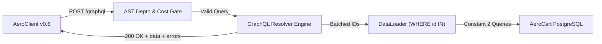

# GraphQL AST Security, Partial-Error Envelopes & OTel DataLoader N+1 Gates

```json continuity
{
  "previously": "In Chapter 05, we upgraded AeroClient v0.5 with strict Pydantic/Jackson schema validators and BOLA/IDOR authorization matrix assertions across REST endpoints.",
  "painPoint": "AeroCart's mobile team just launched a unified GraphQL gateway (/graphql) so the iOS app can fetch a flyer's profile, cart, and seat upgrades in a single trip. Last night, the Seat Inventory database crashed—yet every AeroClient check passed 100% green because GraphQL still returned HTTP 200 OK with an errors[] array hidden inside the JSON body!",
  "unlock": "We will upgrade AeroClient to v0.6 with a strict GraphQL Envelope Validator that fails on partial errors[], tests null-bubbling blast radius, blocks malicious nested queries, and catches N+1 SQL database storms using OpenTelemetry span counters."
}
```

```json walkthrough
[
  {
    "time": "0:00",
    "badge": "1. The 200 OK Lie",
    "caption": "In REST, a server crash returns HTTP 500. In GraphQL, one query calls four microservices at once. If three succeed and one crashes, GraphQL returns HTTP 200 OK with both data and errors[]!",
    "code": "HTTP/1.1 200 OK\n{\"data\": {\"cart\": null}, \"errors\": [{\"message\": \"DB Timeout\"}]}"
  },
  {
    "time": "0:22",
    "badge": "2. First GraphQL Guard",
    "caption": "In AeroClient v0.6, we never stop at checking status_code == 200. Our first 12 lines of code assert that errors[] is empty and always pass user inputs via parameterized $variables.",
    "code": "body = resp.json()\nassert resp.status_code == 200 and not body.get(\"errors\")"
  },
  {
    "time": "0:48",
    "badge": "3. Null-Bubbling & N+1",
    "caption": "When a field is marked non-null (!) in the GraphQL schema and its microservice fails, that null bubbles up and wipes out the entire parent object—while unbatched child resolvers fire N+1 SQL queries.",
    "code": "type Order { id: ID!, pdfInvoice: String! } # Null pdf wipes whole Order!"
  },
  {
    "time": "1:12",
    "badge": "4. AST Cost & OTel Spans",
    "caption": "At Staff scale, AeroClient v0.6 verifies static AST depth/alias limits before resolvers run and asserts that fetching 25 orders executes the exact same number of SQL queries as fetching 5 orders.",
    "code": "assert env_25_orders.db_span_count == env_5_orders.db_span_count  # O(1) DataLoader"
  }
]
```

```json pretraining
[
  {
    "term": "200 OK Error Trap",
    "formula": "HTTP 200 + {\"data\": {...}, \"errors\": [{...}]}",
    "meaning": "Because a single GraphQL request can ask for ten different things at once, the server still sends back an HTTP 200 status code even when half of your request failed—hiding the failures inside an 'errors' list in the JSON body."
  },
  {
    "term": "Non-Null Bubbling (!)",
    "formula": "Child Field! = null -> Parent Object Destroyed",
    "meaning": "When a GraphQL schema puts an exclamation mark (!) on a field to promise it will never be empty, if that field's service crashes and returns null, GraphQL erases the entire parent object so it never breaks its promise."
  },
  {
    "term": "AST Query Complexity",
    "formula": "Cost = sum(FieldWeight * Multiplier^Depth * Aliases)",
    "meaning": "Before running any database queries, the GraphQL server reads the tree structure of the incoming request and calculates a difficulty score so hackers cannot crash the server with deeply nested loops."
  },
  {
    "term": "DataLoader Batching",
    "formula": "25 Orders -> 1 Batched SQL Query (WHERE id IN (...))",
    "meaning": "Instead of running a separate database query for each item in a list (the N+1 problem), DataLoader waits one tiny tick, collects all requested IDs into a single list, and fetches them all in one database trip."
  }
]
```

## 🌱 Step 1: Plain-English Story — The Bento Box Delivery & The `200 OK` Illusion

Imagine ordering a single pizza from a traditional restaurant (`REST API`). If the kitchen oven is broken, the driver never shows up and the restaurant calls to cancel your order (`HTTP 500 Internal Server Error`). It is completely obvious that something went wrong.

Now imagine ordering a four-compartment **Bento Box** (`GraphQL API`), where each compartment comes from a different kitchen station:
1. **Profile Station**: Your frequent-flyer name (`"Alice"`).
2. **Cart Station**: Your selected flight (`"SFO -> NRT"`).
3. **Seat Station**: Your window seat (`"14A"`).
4. **Invoice PDF Station**: Your printable tax receipt.

What happens if the first three stations fill their compartments cleanly, but the **Invoice PDF printer jams**? The delivery driver still brings the Bento Box to your front door and smiles (`HTTP 200 OK`), handing you three full compartments, one empty compartment, and a tiny sticky note tucked under the lid (`"errors": [{"message": "PDF Printer Offline"}]`).

If our test suite **`AeroClient`** only checks that the delivery driver arrived at the door (`assert response.status_code == 200`), our tests will pass `100% GREEN` while flyers cannot download their receipts! Worse yet, if the Bento Box menu promised that a box is **never** allowed to leave the kitchen without a receipt (`invoicePdfUrl: String!` with an exclamation mark), the kitchen manager throws your **entire Bento Box into the trash** (`"order": null`) just because one tiny receipt failed!



---

## 🔨 Step 2: First Lines of Code — `AeroClient v0.6` Strict GraphQL Guard

Let's evolve **`AeroClient`** from `v0.5` to `v0.6`. Whenever we send a GraphQL query, we follow two non-negotiable habits right from line one:
1. Pass dynamic arguments inside a separate `variables` dictionary (`$orderId`)—never concatenate strings into the query text.
2. Assert **both** `HTTP 200` **and** that the `"errors"` list is completely empty before reading `"data"`.

```python
import requests

def fetch_order_graphql(url: str, order_id: str, token: str) -> dict:
    """AeroClient v0.6 starter: parameterized $variables + strict errors[] check."""
    query = """
    query GetOrder($orderId: ID!) {
      order(id: $orderId) { id totalCents seatNumber }
    }
    """
    resp = requests.post(
        url,
        json={"query": query, "variables": {"orderId": order_id}},
        headers={"Authorization": f"Bearer {token}"},
        timeout=5.0,
    )
    assert resp.status_code == 200, f"Transport failed: {resp.status_code}"
    body = resp.json()
    assert not body.get("errors"), f"GraphQL partial errors: {body['errors']}"
    return body["data"]["order"]
```

### Java 17 Equivalent

```java
import java.net.URI;
import java.net.http.*;

public class AeroGraphQlStarter {
    public static String fetchOrderGraphQl(HttpClient client, URI url, String orderId) throws Exception {
        String payload = """
            {"query":"query GetOrder($id:ID!){order(id:$id){id totalCents}}","variables":{"id":"%s"}}
            """.formatted(orderId).trim();
        HttpRequest req = HttpRequest.newBuilder(url)
            .header("Content-Type", "application/json")
            .POST(HttpRequest.BodyPublishers.ofString(payload)).build();
        HttpResponse<String> resp = client.send(req, HttpResponse.BodyHandlers.ofString());
        if (resp.statusCode() != 200 || resp.body().contains("\"errors\"")) {
            throw new AssertionError("GraphQL error envelope detected: " + resp.body());
        }
        return resp.body();
    }
}
```

---

## ⚡ Step 3: Where It Breaks in Real Life — Null-Bubbling, AST Bombs & $N+1$ Storms

Checking `not body.get("errors")` catches broken happy-path queries, but as soon as **AeroCart** scales to production traffic, three GraphQL-specific traps emerge:

1. **Non-Null (`!`) Blast-Radius Bubbling**: Suppose `type Order { id: ID!, totalCents: Int!, loyaltyBadge: String! }` marks `loyaltyBadge!` as strictly non-nullable (`!`). When the minor Loyalty microservice times out and returns `null`, GraphQL cannot violate the `!` contract by returning `"loyaltyBadge": null`. Instead, GraphQL **destroys the entire parent `Order` object** (`"order": null`)! Marking non-essential federated fields nullable (`String` without `!`) isolates the blast radius so flyers can still see their flight even if their badge is missing.
2. **Cyclic Depth & Alias Amplification Bombs**: Because clients choose which fields to nest, an attacker can send a cyclic query (`user { orders { user { orders { id } } } }`) or 500 field aliases in a single HTTP request (`{ a1: checkPromo(code:"001") a2: checkPromo(code:"002") ... }`), bypassing traditional HTTP rate limiters.
3. **Silent $N+1$ Database Storms**: In CI, if a test seeds only `1` order, a broken child resolver executes `1 + 1 = 2` SQL queries in `2ms`. In production, a frequent flyer with `50` orders triggers `1 + 50 = 51` sequential SQL round-trips unless `DataLoader` batches them into `WHERE order_id IN (...)`.

```json contrast
{
  "title": "Naive status==200 GraphQL Tests vs AeroClient v0.6 Envelope + AST Cost + OTel Span Gates",
  "naiveTitle": "Status-Only Check & Single-Row Seeding",
  "naiveMetric": "Missed Outages · O(N+1) SQL Storms",
  "naivePoints": [
    "Asserts resp.status_code == 200 without inspecting body.get('errors'), shipping partial subgraph crashes to prod",
    "Interpolates f-strings into GraphQL query text instead of parameterized $variables, breaking query caching",
    "Tests with 1 seeded row in CI, completely missing N+1 resolver loops that fire 101 SQL queries at limit=100"
  ],
  "staffTitle": "AeroClient v0.6 Envelope + Span Count Invariant",
  "staffMetric": "Zero Silent Errors · O(1) SQL Verified",
  "staffPoints": [
    "Fails immediately on unexpected errors[] unless the test explicitly asserts extensions.code & exact error path",
    "Adversarial security tests assert cyclic depth (>7), alias batching caps, and disabled production introspection",
    "Seeds N=5 vs N=25 child items and asserts OpenTelemetry SQL span count stays constant (2 queries) proving DataLoader works"
  ]
}
```

```json poe
{
  "question": "A REST-trained engineer ports health checks and E2E API assertions to a GraphQL Federation gateway using assert response.status_code == 200 and assert response.json()['data']['viewer']['id'] == 'u-1'. Downstream 'InventorySubgraph' crashes with a database timeout, returning null for viewer.cart.availableStock and appending an entry to response.json()['errors']. What does the CI pipeline report?",
  "options": [
    "The gateway automatically converts any subgraph error into HTTP 503 Service Unavailable",
    "100% GREEN FALSE POSITIVE: GraphQL returns HTTP 200 OK with partial data (viewer.id is still populated while errors[] holds the subgraph crash), shipping an outage straight to production",
    "GraphQL drops the TCP connection when errors[] is non-empty",
    "JSON parsing fails because data and errors cannot coexist in the same envelope"
  ],
  "answerIndex": 1,
  "explanation": "Per the GraphQL over HTTP specification, once query parsing/validation succeeds and execution begins, partial resolver failures still return HTTP 200 OK alongside an errors[] array. Every GraphQL client MUST inspect errors[] explicitly."
}
```

---

## 🚀 Step 4: Staff Engineer Deep-Dive — AST Complexity Math, OTel Span Budgets & Production Blueprints

### 1. Formal AST Query Cost & $N+1$ Amplification Equations

Before executing any resolver, a hardened GraphQL gateway parses the incoming query into an **Abstract Syntax Tree (AST)** and computes its static worst-case execution cost across all nodes $v \in \text{AST}$:

$$\text{Cost}(\text{AST}) = \sum_{v \in \text{AST}} \left( w(v) \cdot \alpha(v) \cdot \prod_{a \in \text{Ancestors}(v)} m(a) \right) \le C_{\max}$$

Where:
- $w(v)$ is the intrinsic resolver weight ($w = 0$ for scalar properties in memory, $w = 10$ for external RPC/SQL lookups).
- $\alpha(v)$ is the horizontal **alias multiplicity** at node $v$ (blocking `{ a1: expensiveField, a2: expensiveField, ... }`).
- $m(a)$ is the pagination list multiplier (`first: 50`) along every ancestor list $a$.

Similarly, for a query of depth $D$ with branching factor $B$, unbatched resolvers trigger exponential SQL queries, whereas request-scoped **`DataLoader`** coalesces each depth level into a single `WHERE parent_id IN (...)` query:

$$Q_{\text{naive}}(B, D) = \sum_{d=0}^{D} B^d = \frac{B^{D+1} - 1}{B - 1} \quad \xrightarrow{\text{DataLoader Batching}} \quad Q_{\text{batched}}(B, D) = D + 1 = \mathcal{O}(D)$$

### 2. GraphQL Failure & Attack Matrix

| GraphQL Attack / Failure Vector | Wire Payload Signature | Production Defense | Deterministic `AeroClient v0.6` Assertion |
| :--- | :--- | :--- | :--- |
| **Silent Partial Failure** | `HTTP 200` + `"errors": [{"extensions": {"code": "INTERNAL"}}]` | Strict client envelope validator | Fail test if `errors` is non-empty unless explicitly asserted via `require_error_code()` |
| **Nested Cyclic Depth DoS** | `user { friends { friends { friends { id } } } }` (depth 18) | Static AST `DepthLimitRule(max_depth=7)` | Send 12-level nested AST; assert `GRAPHQL_VALIDATION_FAILED` in `<5ms` with `0` DB spans |
| **Alias Batching Amplification** | `{ a1: login(...) a2: login(...) ... a500: login(...) }` | Weighted AST Query Complexity + Alias Cap | Send 100 aliased expensive fields; assert rejection before resolver execution |
| **Resolver `N+1` Regression** | Fetching `25` orders triggers `1 + 25 = 26` SQL queries | Request-scoped `DataLoader` (`WHERE order_id = ANY($1)`) | Seed `5` vs `25` orders; assert `X-OTel-Db-Span-Count` stays identical (`2`) |

### 3. Dual-Language Production Blueprints: `AeroClient v0.6` AST & Envelope Gate

#### Python 3 Blueprint: Strict GraphQL Envelope Client + AST Depth/Alias Gate + $N+1$ Verifier

```python
from __future__ import annotations
from dataclasses import dataclass
import re
from typing import Any, Callable, Dict, List, Optional, Sequence
import requests


@dataclass(frozen=True)
class GraphQLErrorItem:
    message: str
    path: List[Any]
    code: str


@dataclass(frozen=True)
class GraphQLEnvelope:
    http_status: int
    data: Optional[Dict[str, Any]]
    errors: List[GraphQLErrorItem]
    db_span_count: int

    def require_clean_data(self) -> Dict[str, Any]:
        if self.http_status != 200:
            raise AssertionError(f"Expected HTTP 200, got {self.http_status}")
        if self.errors:
            formatted = ", ".join(f"{e.code}@{e.path}: {e.message}" for e in self.errors)
            raise AssertionError(f"GraphQL returned HTTP 200 with partial/execution errors: {formatted}")
        if self.data is None:
            raise AssertionError("GraphQL returned null root data without errors")
        return self.data

    def require_error_code(self, expected_code: str, expected_path: Sequence[Any] | None = None) -> GraphQLErrorItem:
        for err in self.errors:
            if err.code == expected_code and (expected_path is None or err.path == list(expected_path)):
                return err
        raise AssertionError(f"Expected GraphQL error {expected_code} at {expected_path}, got: {self.errors}")


def estimate_graphql_ast_risk(query: str) -> Dict[str, int]:
    """Lightweight pre-flight AST structural analyzer for depth and alias amplification tests."""
    stripped = re.sub(r'"[^"]*"', '""', re.sub(r"#[^\n]*", "", query))
    max_depth = cur = 0
    for ch in stripped:
        if ch == "{":
            cur += 1
            max_depth = max(max_depth, cur)
        elif ch == "}":
            cur = max(0, cur - 1)
    no_vars = re.sub(r"\([^)]*\)", "", stripped)
    alias_count = len(re.findall(r"\b[A-Za-z_][A-Za-z0-9_]*\s*:\s*[A-Za-z_]", no_vars))
    return {"max_depth": max_depth, "alias_count": alias_count}


class StrictGraphQLClient:
    def __init__(self, session: requests.Session, endpoint: str) -> None:
        self._session = session
        self._endpoint = endpoint

    def execute(
        self,
        query: str,
        variables: Optional[Dict[str, Any]] = None,
        operation_name: Optional[str] = None,
        headers: Optional[Dict[str, str]] = None,
    ) -> GraphQLEnvelope:
        payload: Dict[str, Any] = {"query": query, "variables": variables or {}}
        if operation_name:
            payload["operationName"] = operation_name
        resp = self._session.post(self._endpoint, json=payload, headers=headers, timeout=(2.0, 6.0))
        body = resp.json()
        raw_errs = body.get("errors") or []
        parsed_errs = [
            GraphQLErrorItem(
                message=str(e.get("message", "")),
                path=list(e.get("path") or []),
                code=str((e.get("extensions") or {}).get("code", "UNCLASSIFIED")),
            )
            for e in raw_errs
        ]
        sql_spans = int(resp.headers.get("X-OTel-Db-Span-Count", "0"))
        return GraphQLEnvelope(resp.status_code, body.get("data"), parsed_errs, sql_spans)

    @staticmethod
    def assert_dataloader_constant_queries(
        run_for_n_items: Callable[[int], GraphQLEnvelope],
    ) -> None:
        """Proves O(1) batched SQL queries instead of O(N+1) as child cardinality scales 5 -> 25."""
        env_small = run_for_n_items(5)
        env_large = run_for_n_items(25)
        env_small.require_clean_data()
        env_large.require_clean_data()
        if env_large.db_span_count > env_small.db_span_count:
            raise AssertionError(
                f"N+1 Resolver Regression Detected! 5 items -> {env_small.db_span_count} SQL spans, "
                f"25 items -> {env_large.db_span_count} SQL spans (missing DataLoader batching)."
            )
```

#### Java 17 Blueprint: Parameterized GraphQL Executor + Partial-Error & $N+1$ Span Gate

```java
package com.aerocart.api.graphql;

import com.fasterxml.jackson.databind.JsonNode;
import com.fasterxml.jackson.databind.ObjectMapper;
import java.io.IOException;
import java.net.URI;
import java.net.http.HttpClient;
import java.net.http.HttpRequest;
import java.net.http.HttpResponse;
import java.time.Duration;
import java.util.ArrayList;
import java.util.List;
import java.util.Map;

public final class StrictGraphQlTestClient {

    public record GqlError(String message, String code, List<String> path) {}

    public record GqlResponse(int httpStatus, JsonNode data, List<GqlError> errors, int dbSpanCount) {
        public JsonNode assertZeroErrors() {
            if (httpStatus != 200) {
                throw new AssertionError("Expected HTTP 200, got " + httpStatus);
            }
            if (!errors.isEmpty()) {
                throw new AssertionError("GraphQL 200 OK masked resolver errors: " + errors);
            }
            if (data == null || data.isNull()) {
                throw new AssertionError("GraphQL root data is null");
            }
            return data;
        }
    }

    private final HttpClient http;
    private final URI graphqlUri;
    private final ObjectMapper mapper = new ObjectMapper();

    public StrictGraphQlTestClient(HttpClient http, URI graphqlUri) {
        this.http = http;
        this.graphqlUri = graphqlUri;
    }

    public GqlResponse execute(String operationName, String query, Map<String, Object> variables, String token)
            throws IOException, InterruptedException {
        String requestJson = mapper.writeValueAsString(Map.of(
            "operationName", operationName,
            "query", query,
            "variables", variables == null ? Map.of() : variables
        ));
        HttpRequest req = HttpRequest.newBuilder()
            .uri(graphqlUri)
            .timeout(Duration.ofSeconds(6))
            .header("Content-Type", "application/json")
            .header("Authorization", "Bearer " + token)
            .POST(HttpRequest.BodyPublishers.ofString(requestJson))
            .build();

        HttpResponse<String> resp = http.send(req, HttpResponse.BodyHandlers.ofString());
        JsonNode root = mapper.readTree(resp.body());
        List<GqlError> parsedErrors = new ArrayList<>();
        JsonNode errArray = root.get("errors");
        if (errArray != null && errArray.isArray()) {
            for (JsonNode err : errArray) {
                String code = err.path("extensions").path("code").asText("UNCLASSIFIED");
                List<String> path = new ArrayList<>();
                err.path("path").forEach(p -> path.add(p.asText()));
                parsedErrors.add(new GqlError(err.path("message").asText(), code, path));
            }
        }
        int spans = resp.headers().firstValue("X-OTel-Db-Span-Count").map(Integer::parseInt).orElse(0);
        return new GqlResponse(resp.statusCode(), root.get("data"), parsedErrors, spans);
    }
}
```

> [!WARNING] **Staff Interview Gotcha — Request-Scoped vs. Singleton `DataLoader` Cross-Tenant Cache Leaks!** `DataLoader` works by memoizing `(key -> Promise)` inside an in-memory `Map` in addition to batching keys per event-loop tick. If a backend developer accidentally registers `DataLoader` as a **process-wide singleton** instead of instantiating a **fresh `DataLoader` per HTTP request context**, Tenant B's query in request #2 will hit Tenant A's memoized `Order` object from request #1—bypassing database row-level security completely! Always write an automated cross-tenant sequential GraphQL test (`Tenant A queries id=1` $\to$ `Tenant B queries id=1` on the same keep-alive pod) to verify `DataLoader` caches are strictly request-scoped.

---

### Up Next in Chapter 07: gRPC Binary Protobuf Framing & Deadlines

`AeroClient v0.6` now protects our public-facing GraphQL gateway against silent partial errors and $N+1$ storms. But behind that gateway, AeroCart's internal microservices (`PricingService`, `InventoryService`, `PaymentLedger`) talk to each other over high-speed binary **gRPC (`HTTP/2` + Protobuf)**. In **Chapter 07**, we will upgrade `AeroClient` to `v0.7` to decode binary Protobuf wire tags, verify schema backward compatibility, and enforce distributed `grpc-timeout` deadline propagation!

```json quiz
[
  {
    "id": "api-06-q1",
    "question": "In a GraphQL schema where user.recommendedProducts is typed as [Product!]! (non-null list of non-null Products), what happens if the ML Recommendation microservice times out for 1 out of 10 products while Core Orders & Profile succeed?",
    "options": [
      "GraphQL omits the 1 failed product and returns the remaining 9 products cleanly",
      "Null-bubbling catastrophe: because Product! cannot be null, the list fails; because [Product!]! cannot be null, null bubbles up to destroy the parent User object (or root data: null), turning a minor ML glitch into a total page crash",
      "HTTP status switches to 206 Partial Content",
      "The client automatically retries only the 10th list index"
    ],
    "answerIndex": 1,
    "explanation": "Strict non-null (!) modifiers on volatile federated subgraphs cause cascading null-bubbling that wipes out healthy sibling fields on the parent object."
  },
  {
    "id": "api-06-q2",
    "question": "Why does Depth Limiting alone (e.g., max_depth = 5) FAIL to stop GraphQL Denial-of-Service & brute-force attacks?",
    "options": [
      "GraphQL queries do not form an Abstract Syntax Tree",
      "An attacker can craft a flat depth-2 query containing 1,000 field aliases ({ a1: verifyOtp(code:\"0001\"), a2: verifyOtp(code:\"0002\"), ... }), bypassing per-HTTP-request rate limiters and executing 1,000 mutations in a single HTTP packet unless weighted AST Query Cost + Alias Limits are enforced",
      "Depth limits only apply to subscriptions over WebSockets",
      "Introspection queries bypass depth rules"
    ],
    "answerIndex": 1,
    "explanation": "Alias batching multiplies resolver invocations horizontally at depth 1–2, completely bypassing naive HTTP request-per-minute rate limiters and simple AST depth caps."
  },
  {
    "id": "api-06-q3",
    "question": "What is the most deterministic, zero-flakiness way to catch a GraphQL N+1 SQL regression in CI when wall-clock latency on small test databases is noisy (<3ms)?",
    "options": [
      "Assert wall-clock response time is strictly < 15ms",
      "Instrument OpenTelemetry SQL span counting (exposed in test mode via trace collector or X-OTel-Db-Span-Count) and assert that querying N=5 vs N=25 parent rows executes the exact same constant number of SQL statements",
      "Sleep 50ms inside PostgreSQL triggers",
      "Parse PostgreSQL WAL binary segments manually"
    ],
    "answerIndex": 1,
    "explanation": "Wall-clock assertions on tiny CI datasets miss O(N+1) regressions; asserting constant SQL span cardinality across N=5 vs N=25 catches broken DataLoaders with 100% determinism."
  }
]
```
