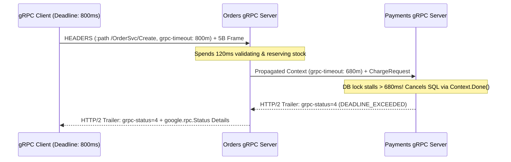

# gRPC Internals: Protobuf Wire Framing, Schema Evolution & Deadline Propagation

```json pretraining
[
  {
    "term": "Protobuf Wire Tag",
    "formula": "tag_byte = (field_number << 3) | wire_type",
    "meaning": "Field names NEVER cross the wire—only integer field numbers! Changing a field's number or wire type silently corrupts live binary payloads."
  },
  {
    "term": "gRPC 5-Byte Prefix",
    "formula": "[1B CompressedFlag] + [4B Big-Endian MessageLength] + Bytes",
    "meaning": "Frames discrete Protobuf messages inside continuous HTTP/2 DATA streams, terminated by HTTP/2 HEADERS trailers carrying grpc-status."
  },
  {
    "term": "Reserved Field Law",
    "formula": "reserved 4, 15; reserved \"legacy_ssn\";",
    "meaning": "Blocks engineers from reusing deleted Protobuf field numbers, preventing old clients from decoding new fields as legacy types."
  },
  {
    "term": "Deadline Propagation",
    "formula": "grpc-timeout: 1850m -> Child Budget = Remaining - HopLatency",
    "meaning": "Propagates remaining wall-clock budget across microservice hops so doomed downstream work cancels immediately via DEADLINE_EXCEEDED."
  }
]
```

```json poe
{
  "question": "A microservice runs behind a Legacy Layer-7 HTTP/1.1 Reverse Proxy that downgrades HTTP/2 to HTTP/1.1 and strips HTTP Trailers. Unary gRPC calls appear to transmit request bytes, yet every gRPC client crashes with INTERNAL: HTTP status code 200 missing grpc-status. Why?",
  "options": [
    "Protobuf varints cannot traverse IPv4 NAT gateways",
    "gRPC sends HTTP 200 headers immediately when the stream opens and delivers the actual RPC outcome (grpc-status: 0 OK or 14 UNAVAILABLE) exclusively inside HTTP/2 Trailing HEADERS at the end of the stream—stripping trailers breaks the gRPC protocol contract",
    "gRPC requires TLS 1.2 RSA cipher suites",
    "HTTP/1.1 proxies uppercase binary Protobuf payload bytes"
  ],
  "answerIndex": 1,
  "explanation": "Because gRPC supports streaming responses, the server does not know if the RPC will succeed until the final message is generated; therefore grpc-status and grpc-message live in HTTP/2 Trailers."
}
```

## 1. Protocol Buffers Wire Physics & Backward-Compatible Evolution

East-west microservice meshes replace verbose UTF-8 JSON with **gRPC over HTTP/2 + Protocol Buffers (`proto3`)** to cut serialization CPU by `5–8x` and payload size by `60–80%`. Understanding the exact binary framing unlocks deterministic wire-compatibility testing:

1. **Tag-Wire `Varint` Encoding**: On the wire, a Protobuf field `int64 total_cents = 1;` with value `150` does **not** send `"total_cents":150` (`17 bytes`). It encodes `tag = (1 << 3) | 0 = 0x08` (`wire_type = 0` varint) followed by base-128 varint `0x96 0x01`—just **`3 bytes` total**! Note that negative integers in standard `int32`/`int64` expand to `10 bytes` because of sign-extension; negative-heavy coordinates/deltas must use **`sint32`/`sint64` (ZigZag encoding)** so `-1` maps to `1` (`1 byte`).
2. **Field Number Immutability (`reserved`)**: Field numbers `1..15` take `1 tag byte` (save these for hot fields!); `16..2047` take `2 tag bytes`. Renaming a field (`user_id` $\to$ `account_id`) is `100%` wire-compatible in binary Protobuf (only JSON `ProtoJson` transcoding cares about names), whereas **reusing a deleted field number** (`4`) causes an older consumer to decode a new `string email = 4` (`wire_type 2`) or `int64` (`wire_type 0`) into the wrong memory slot! Always enforce `buf breaking` and `reserved` declarations in CI.
3. **5-Byte Length-Prefixed Framing & Trailers**: Every gRPC message inside an HTTP/2 `DATA` frame starts with `1 byte` compression flag (`0x00` raw, `0x01` gzip/zstd) + `4-byte uint32` big-endian payload length. An HTTP `200 OK` header only means the proxy routed the stream; true success requires `grpc-status: 0` (`OK`) in the closing HTTP/2 `HEADERS (END_STREAM)` trailer frame!



---

## 2. The 4 gRPC Streaming Modes, Status Codes & Deadline Propagation

```json contrast
{
  "title": "Unbounded Unary Stubs & Naive Load Balancing vs Deadlines, Retries & L7 Balancing",
  "naiveTitle": "Stub Without Deadline + K8s L4 VIP",
  "naiveMetric": "Thread Starvation · 1 Hot Pod @ 100% CPU",
  "naivePoints": [
    "Calls stub.createOrder(req) without withDeadlineAfter(), allowing hung downstream RPCs to pin caller threads forever",
    "Uses default Kubernetes ClusterIP (L4 TCP load balancing): 1 persistent HTTP/2 socket pins ALL 10,000 RPS onto a single pod!",
    "Retries non-idempotent ABORTED or DEADLINE_EXCEEDED mutations blindly, duplicating financial ledger entries"
  ],
  "staffTitle": "Mandatory Deadlines + Round-Robin Subchannels",
  "staffMetric": "Fast Context Cancel · Even Pod Spread",
  "staffPoints": [
    "Client interceptor rejects any outbound RPC lacking an explicit Deadline and propagates remaining budget downstream",
    "Configures headless DNS / xDS client-side 'round_robin' load balancing across HTTP/2 subchannels so scaling pods works",
    "Uses gRPC ServiceConfig retryPolicy strictly on StatusCode.UNAVAILABLE (14) where server guarantees zero execution"
  ]
}
```

| `grpc-status` Code | Wire Meaning & Retry Safety | Equivalent HTTP | Mandatory gRPC Automation Test |
| :--- | :--- | :--- | :--- |
| **`0 OK`** | RPC completed cleanly | `200 OK` | Assert response Protobuf invariants + unknown-field preservation |
| **`3 INVALID_ARGUMENT`** | Deterministic domain/validation error (`google.rpc.BadRequest` detail) | `400 / 422` | Unpack `google.rpc.Status` rich `ErrorInfo`/`BadRequest` field violations |
| **`4 DEADLINE_EXCEEDED`** | Budget expired; server *may* or *may not* have committed state! | `504 Gateway Timeout` | Set `withDeadlineAfter(50ms)` against `150ms` stub; assert server cancels context |
| **`8 RESOURCE_EXCEEDED`** | Rate limit quota exhausted OR `maxInboundMessageSize` (>4MB default) breached | `429 / 413` | Send `5MB` payload to default `4MB` server; assert clean `8` rejection, zero OOM |
| **`14 UNAVAILABLE`** | Transient transport/pod shutdown before processing (safe to retry idempotent calls) | `503 Service Unavailable` | Inject `GOAWAY` frame during rolling deploy; verify seamless subchannel failover |

---

## 3. Dual-Language Production Blueprints: Protobuf Wire Codec & Deadline Interceptors

### Python 3 Blueprint: Zero-Dependency Protobuf Varint/Frame Inspector + Deadline Guard
```python
from __future__ import annotations
from dataclasses import dataclass
import struct
import time
from typing import Dict, List, Tuple


def encode_varint(value: int) -> bytes:
    if value < 0:
        raise ValueError("Use encode_zigzag_varint for negative sint64 values")
    out = bytearray()
    while value > 0x7F:
        out.append((value & 0x7F) | 0x80)
        value >>= 7
    out.append(value & 0x7F)
    return bytes(out)


def encode_zigzag_varint(signed_val: int) -> bytes:
    zigzag = (signed_val << 1) ^ (signed_val >> 63)
    return encode_varint(zigzag)


def pack_grpc_data_frame(protobuf_bytes: bytes, compressed: bool = False) -> bytes:
    """Wraps serialized Protobuf bytes in the 5-byte gRPC HTTP/2 DATA length-prefix envelope."""
    flag = 1 if compressed else 0
    return struct.pack(">BI", flag, len(protobuf_bytes)) + protobuf_bytes


def unpack_grpc_data_frame(frame: bytes) -> Tuple[bool, bytes]:
    if len(frame) < 5:
        raise ValueError("Truncated gRPC frame (< 5-byte header)")
    compressed_flag, msg_len = struct.unpack(">BI", frame[:5])
    if len(frame) - 5 != msg_len:
        raise ValueError(f"Frame length mismatch: header={msg_len}, actual={len(frame) - 5}")
    return bool(compressed_flag), frame[5:]


@dataclass(frozen=True)
class PropagatedDeadlineContext:
    deadline_monotonic: float
    trace_id: str

    def remaining_ms(self, now: float | None = None) -> int:
        ref = time.monotonic() if now is None else now
        rem = int((self.deadline_monotonic - ref) * 1000.0)
        if rem <= 0:
            raise TimeoutError("grpc.StatusCode.DEADLINE_EXCEEDED (code=4): budget exhausted before hop")
        return rem

    def to_grpc_metadata(self, safety_margin_ms: int = 5, now: float | None = None) -> Dict[str, str]:
        budget_ms = self.remaining_ms(now) - safety_margin_ms
        if budget_ms <= 0:
            raise TimeoutError("grpc.StatusCode.DEADLINE_EXCEEDED (code=4): insufficient hop margin")
        return {"grpc-timeout": f"{budget_ms}m", "x-trace-id": self.trace_id}


def verify_proto_wire_compatibility(
    v1_fields: Dict[int, str], v2_fields: Dict[int, str], v2_reserved_numbers: set[int]
) -> List[str]:
    """Static CI gate enforcing Protobuf binary wire-compatibility invariants between v1 and v2."""
    violations: List[str] = []
    for num, v1_type in v1_fields.items():
        if num not in v2_fields:
            if num not in v2_reserved_numbers:
                violations.append(f"Deleted field #{num} ({v1_type}) MUST be added to 'reserved {num};'")
        elif v2_fields[num] != v1_type:
            violations.append(f"Wire-breaking type mutation on field #{num}: {v1_type} -> {v2_fields[num]}")
    return violations
```

### Java 17 Blueprint: Mandatory gRPC `ClientInterceptor` Enforcing Deadlines & Metadata
```java
package com.aerocart.api.grpc;

import io.grpc.CallOptions;
import io.grpc.Channel;
import io.grpc.ClientCall;
import io.grpc.ClientInterceptor;
import io.grpc.Deadline;
import io.grpc.ForwardingClientCall;
import io.grpc.ManagedChannel;
import io.grpc.ManagedChannelBuilder;
import io.grpc.Metadata;
import io.grpc.MethodDescriptor;
import java.util.concurrent.TimeUnit;

public final class StaffGrpcChannelFactory {

    private static final Metadata.Key<String> AUTHORIZATION_KEY =
        Metadata.Key.of("authorization", Metadata.ASCII_STRING_MARSHALLER);
    private static final Metadata.Key<String> IDEMPOTENCY_KEY =
        Metadata.Key.of("x-idempotency-key", Metadata.ASCII_STRING_MARSHALLER);

    /**
     * Enforces mandatory per-RPC deadlines (preventing hung CI workers & production thread leaks)
     * and injects Bearer auth + idempotency metadata uniformly across unary and streaming stubs.
     */
    public static final class MandatoryDeadlineAndAuthInterceptor implements ClientInterceptor {
        private final long defaultTimeoutMillis;
        private final java.util.function.Supplier<String> bearerSupplier;

        public MandatoryDeadlineAndAuthInterceptor(
                long defaultTimeoutMillis, java.util.function.Supplier<String> bearerSupplier) {
            this.defaultTimeoutMillis = defaultTimeoutMillis;
            this.bearerSupplier = bearerSupplier;
        }

        @Override
        public <ReqT, RespT> ClientCall<ReqT, RespT> interceptCall(
                MethodDescriptor<ReqT, RespT> method, CallOptions callOptions, Channel next) {
            CallOptions effectiveOptions = callOptions.getDeadline() != null
                ? callOptions
                : callOptions.withDeadline(Deadline.after(defaultTimeoutMillis, TimeUnit.MILLISECONDS));

            ClientCall<ReqT, RespT> delegate = next.newCall(method, effectiveOptions);
            return new ForwardingClientCall.SimpleForwardingClientCall<>(delegate) {
                @Override
                public void start(Listener<RespT> responseListener, Metadata headers) {
                    headers.put(AUTHORIZATION_KEY, "Bearer " + bearerSupplier.get());
                    if (!headers.containsKey(IDEMPOTENCY_KEY) && method.getType().clientSendsOneMessage()) {
                        headers.put(IDEMPOTENCY_KEY, java.util.UUID.randomUUID().toString());
                    }
                    super.start(responseListener, headers);
                }
            };
        }
    }

    public static ManagedChannel createRoundRobinChannel(
            String headlessTarget, long defaultDeadlineMs, java.util.function.Supplier<String> tokenFn) {
        return ManagedChannelBuilder.forTarget(headlessTarget) // e.g., "dns:///orders-headless.prod:9090"
            .defaultLoadBalancingPolicy("round_robin")          // Avoid L4 single-TCP-connection hot-spotting!
            .maxInboundMessageSize(4 * 1024 * 1024)             // Explicit 4 MiB cap
            .intercept(new MandatoryDeadlineAndAuthInterceptor(defaultDeadlineMs, tokenFn))
            .build();
    }
}
```

> [!WARNING] **Staff Interview Gotcha — Kubernetes L4 `ClusterIP` Breaks gRPC Load Balancing & `proto3` Default Zero-Value Ambiguity:** Two classic Staff traps in gRPC systems:
> 1. **L4 Sticky Socket Trap**: Because gRPC multiplexes all RPCs over a single persistent HTTP/2 TCP connection, pointing a gRPC `ManagedChannel` at a standard Kubernetes `ClusterIP` VIP routes **100% of RPCs to whichever single pod won the initial TCP handshake**, leaving newly autoscaled pods at `0%` CPU! Fix via **Headless Service (`clusterIP: None`) + `round_robin` client policy** or an L7 Envoy/Istio/xDS mesh.
> 2. **`proto3` Scalar Zero vs. Unset**: In `proto3`, an unadorned `int32 discount_pct = 3;` serializes `0` as **zero bytes on the wire**—meaning the server cannot distinguish `"client explicitly set discount_pct = 0"` from `"client omitted discount_pct"`! Always use the **`optional` keyword** (`optional int32 discount_pct = 3;`, restored in `proto3.15+` with explicit `hasDiscountPct()` field presence) whenever `0`, `""`, or `false` carries distinct business meaning from unset!

---

## 4. Scenario Retrieval-Practice Mastery Gate

```json quiz
[
  {
    "id": "api-07-q1",
    "question": "A developer deletes 'int64 legacy_loyalty_points = 5;' from Order.proto and in the next sprint adds 'bool is_gift_order = 5;' reusing field number 5 (since bool and int64 both use Protobuf wire_type 0 varint!). What happens during a rolling deployment?",
    "options": [
      "Protobuf rejects the message because the field name string does not match",
      "Silent data corruption: field names are absent on the binary wire, so un-upgraded v1 consumers decode 'is_gift_order = true' (varint 1) as 'legacy_loyalty_points = 1', and upgraded v2 consumers decode old loyalty points > 0 as 'is_gift_order = true'!",
      "gRPC returns UNIMPLEMENTED (code 12)",
      "HTTP/2 resets the stream with PROTOCOL_ERROR"
    ],
    "answerIndex": 1,
    "explanation": "Because int64 and bool share Wire Type 0 (Varint), reusing field tag #5 parses without any framing error while silently corrupting domain semantics across rolling versions. Deleted tags must ALWAYS be marked 'reserved 5;'."
  },
  {
    "id": "api-07-q2",
    "question": "In Java gRPC, an engineer builds ONE Deadline at application startup (CallOptions.DEFAULT.withDeadlineAfter(2, SECONDS)) and stores that CallOptions constant in a static final field reused across all RPCs. What breaks 2.001 seconds after the JVM boots?",
    "options": [
      "TLS certificates expire after 2 seconds",
      "Deadline.after(2, SECONDS) captures an ABSOLUTE wall-clock timestamp at construction time! Every single RPC invoked >2 seconds after JVM startup fails instantaneously on the client with DEADLINE_EXCEEDED without sending a packet—deadlines must be minted fresh per-call inside an interceptor or stub.withDeadlineAfter()",
      "ManagedChannel switches from HTTP/2 to HTTP/1.1",
      "Protobuf varints overflow 32 bits"
    ],
    "answerIndex": 1,
    "explanation": "io.grpc.Deadline represents a fixed point in monotonic time, not a relative duration template; caching a Deadline or pre-built stub.withDeadlineAfter() across time immediately expires all future RPCs."
  },
  {
    "id": "api-07-q3",
    "question": "Why does gRPC's built-in RetryPolicy (configured via ServiceConfig JSON) strongly recommend retrying StatusCode.UNAVAILABLE (14) while avoiding blind retries on StatusCode.DEADLINE_EXCEEDED (4) for state-mutating RPCs?",
    "options": [
      "DEADLINE_EXCEEDED closes the entire ManagedChannel",
      "UNAVAILABLE typically signals transport refusal or HTTP/2 GOAWAY before the server handler executed, whereas DEADLINE_EXCEEDED means the request WAS dispatched and the server may still commit the write milliseconds after the client gave up",
      "UNAVAILABLE uses UDP whereas DEADLINE_EXCEEDED uses TCP",
      "ServiceConfig JSON cannot parse code 4"
    ],
    "answerIndex": 1,
    "explanation": "DEADLINE_EXCEEDED is an ambiguous outcome on mutations unless paired with an explicit idempotency key and server-side context cancellation."
  }
]
```
